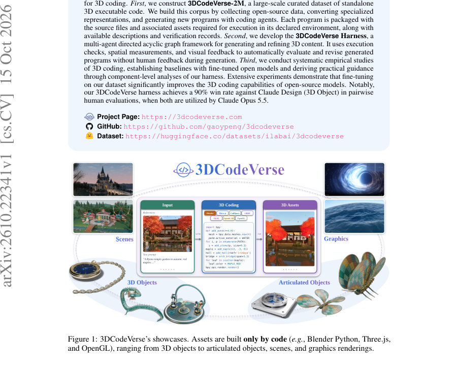
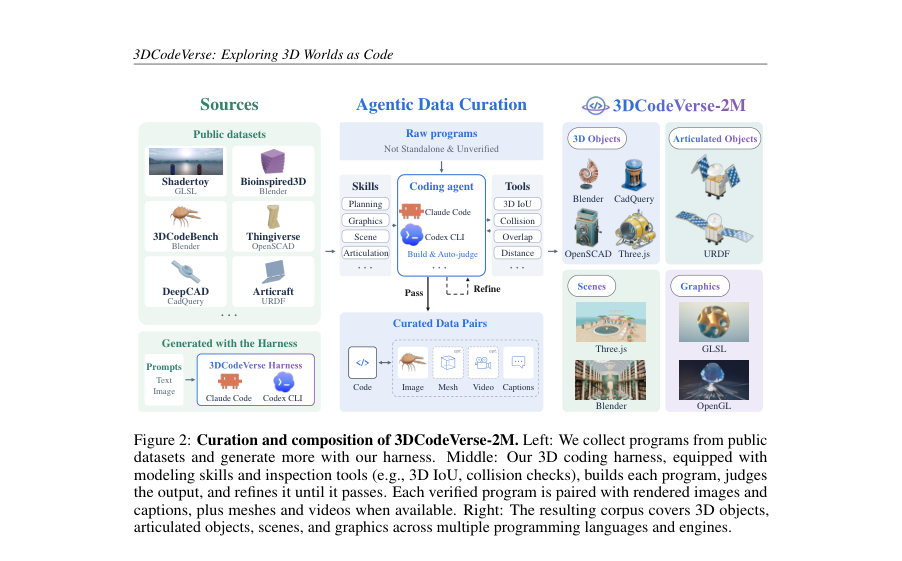
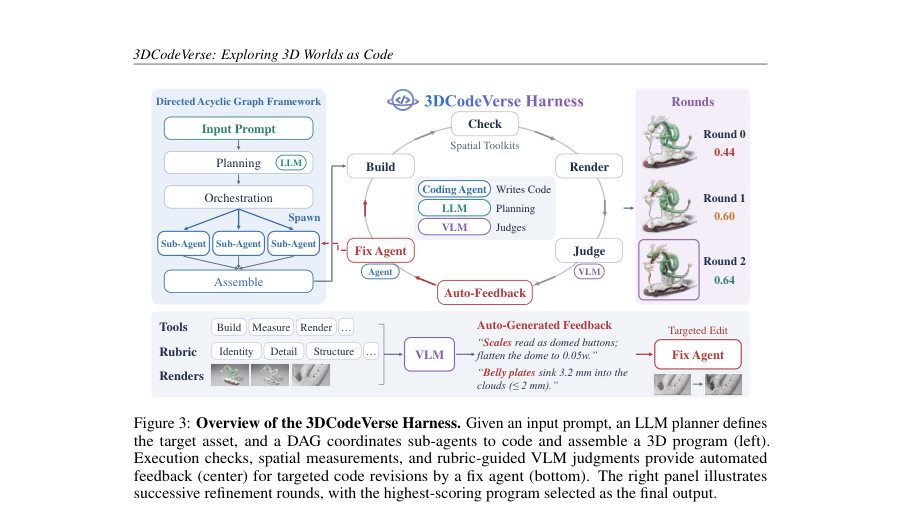

# 3DCodeVerse: Exploring 3D Worlds as Code

- **게시일:** 2026-10-17
- **arXiv:** [2610.22341v1](http://arxiv.org/abs/2610.22341v1) · [PDF](https://arxiv.org/pdf/2610.22341v1)
- **저자:** Yipeng Gao, Ziyao Zeng, Jinfa Huang, Yijiang Li, Haolin Xiong, Wang Qin, Xinlei Yu, Youheng Yao, Jie Zhang, Kun-Yu Lin, Rong Liu, Yinyuan Zhao, Yajie Zhao, Meiqi Guo, Jiebo Luo, Lei Shu, Yunhao Ge, Xinyu Hu, Laurent Itti
- **분야:** cs.CV, cs.AI
- **선정 점수:** 4.96
- **선정 이유:** 최근성 0.8, 인용 영향 0.0 (인용 0회), 저자 영향 0.0 (최고 h-index 0), AI 주제 적합성 2.8, 개발자 관심 0.9, 학술 신호 0.5, 오픈 웨이트·주요 연구조직 신호 0.0

[← 2026-10-17 목록으로 돌아가기](../daily/2026-10-17.html)

<!-- paper-visuals:start -->
## 주요 Figure

> 원문 PDF에서 실제 Figure 캡션과 그림 영역이 함께 확인된 자료만 자동 추출했다.

*Figure · 원문 PDF 1쪽 · Figure 1: 3DCodeVerse’s showcases. Assets are built only by code (e.g., Blender Python, Three.js,*

*Figure · 원문 PDF 4쪽 · Figure 2: Curation and composition of 3DCodeVerse-2M. Left: We collect programs from public*

*Figure · 원문 PDF 5쪽 · Figure 3: Overview of the 3DCodeVerse Harness. Given an input prompt, an LLM planner defines*

<!-- paper-visuals:end -->

## 한 문장 요약

대규모 실행 가능한 3D 코드 코퍼스(3DCodeVerse-2M)와 멀티에이전트 DAG 기반의 자동 검증·수정 허니스를 결합해 텍스트/이미지로부터 편집 가능한 실행 가능한 3D 콘텐츠를 생성·검증·확장하는 연구 생태계를 제안한다.

## 해결하려는 문제

기존 3D 생성 자원은 데이터셋과 런타임(Blender, CadQuery, GLSL, Three.js 등), 검증·수정 허니스가 파편화되어 있어 3D 코드를 대규모로 수집·검증·학습시키고, 실행 기반의 반복적 수정(compile–debug) 루프를 자동화하는 인프라가 부족하다. 또한 다양한 표현을 실행 가능한 독립 프로그램(standalone)으로 통합하고, 실행·기하학적 검사·시각적 평가를 결합한 자동화된 피드백을 통해 인간 개입 없이 고품질 3D 코드를 생성·정제하는 방법이 제한적이다.

## 핵심 기여

- 3DCodeVerse-2M: Blender, CadQuery, OpenSCAD, Three.js, GLSL, URDF 등 여러 방언(dialect)을 아우르는 실행 가능한 3D 코드의 대규모 통합 코퍼스(논문에서 2.03M 쌍으로 보고). 각 프로그램은 실행에 필요한 소스 및 자산, 렌더, 검증 기록을 포함한다.
- 3DCodeVerse Harness: LLM 플래너가 생성한 계획을 DAG(작업 노드/종속)로 변환하고, 다수의 서브 에이전트가 파일 단위로 병렬 작성·통합·실행하며 실행 피드백, 기하학 검사(3D IoU, 충돌, 간섭, 배치 등), VLM 기반 루브릭 판정으로 국지적 수리 목표를 만들어 반복적으로 코드 수리하는 멀티-에이전트 파이프라인을 제시.
- 에이전틱 데이터 큐레이션 파이프라인: DeepCAD→CadQuery 변환, Articraft 기하 인라인화, 기존 공개 소스 수집과 허니스를 통한 자동 생성·검증을 결합해 단일 실행 환경에서 재현 가능한 standalone 프로그램을 생성·보관.
- 모델 학습·정책 향상 실험: 공개 모델(Qwen3.5-9B, Qwen3.8-27B)을 LoRA로 미세조정하고, 실행·기하·종료 신호를 이용한 DPO(Direct Preference Optimization)를 적용하여 실행률 및 기하 충실도를 크게 향상시킴.
- 종합 평가와 사례 응용: 허니스가 여러 백본에서 기존 네이티브 허니스보다 우수함을 보이고(사람 선호/루브릭 점수), 로보틱스 시뮬레이션 및 비디오 생성과 연동 가능한 실용적 파이프라인을 제시.

## 접근 방법

* 데이터 구축: 공개 데이터셋(Shadertoy, Bioinspired3D, Thingiverse, DeepCAD 등)을 수집·변환하고, 3DCodeVerse Harness를 이용해 텍스트·이미지 프롬프트로 추가 프로그램을 생성·실행·검증하여 3DCodeVerse-2M을 구성한다.
* 변환 예: DeepCAD의 시퀀스를 CadQuery 프로그램으로 변환하고 Articraft 기하 루틴을 인라인화하며 URDF 관절 사양을 보존한다.허니스 구조: (1) LLM 플래너 Aplan(c; e)가 목표 구성요소·치수·자재·공간관계·수용기준 P를 산출; (2) P를 DAG G=(V,E)로 변환하여 파일 단위 소스작성(서브에이전트)과 조립 작업을 병렬·순차 조정; (3) 생성된 초기 프로그램 f(0)을 실행(Ee)하고 렌더(R)하여 평가한다.반복 정제 루프: 각 라운드 t에서 (a(t), ℓ(t))=Ee(f(t)), o(t)=(ℓ(t), Me(a(t)), Re(a(t))).
* 피드백은 세 가지: 실행 피드백(빌드/런타임 로그), 측정 피드백(Me: 치수·충돌·접촉·프레임·관절 샘플링 검사 등), 시각 피드백(VLM 판정: 증거·결함·점수·수리 제안).
* 판정 j(t)을 수치 점수 s(t)로 통합하고 우선순위화된 수리 과제 Δ(t)을 생성해 Fix Agent가 f(t+1)=Acode(...)로 수정한다.판정(심사) 신뢰성 개선: 개발 중 판단자(θJ)와 허니스(θH)를 번갈아 적대적(대립) 루프에서 조정하여 판정 일관성(LJ)과 허니스 성능(UH)을 최적화.학습·추론 보조법: 미세조정은 LoRA를 사용하고, DPO는 실행 성공·기하 충실도(F@0.05)·종료 신호를 기준으로 선호쌍을 구성해 성능을 추가 개선.평가 설정: 동일한 요청과 다이얼렉트 고정 런타임에서 모델들을 디코딩(T=0.7, 기본은 1 seed)하고 모든 출력을 해당 런타임에서 실행/컴파일하여 실행률·기하 충실도(F@0.05)·DINOv2 유사도·VLM 루브릭 점수 등으로 측정.

## 주요 결과

- 코퍼스 규모: 논문 전반에서 3DCodeVerse-2M을 2.03M 쌍(표 1)에 걸쳐 수집·구성했다고 보고함.
- 허니스 vs 네이티브 허니스(휴먼·VLM 평가): 3D 객체 생성에서 3DCodeVerse Harness의 인간 선호(Human Preference)는 백본별로 69%–89% 범위로 보고되며 루브릭 점수는 11–25점 개선. Claude Opus 5.5를 사용한 동일 백본 비교에서 3DCodeVerse Harness는 Claude Design(3D Object)에 대해 인간 선호 90%를 기록하고 Judge Score는 88 vs 37(논문 본문 수치).
- 미세조정(표 2) 실행률 개선: Qwen3.5-9B(무푼팅)에서 3DCodeBench: 0.0% → +SFT 84.9% (Δ +84.9pt). Blender: 1.9% → 90.3% (Δ +88.4pt). CadQuery: 10.5% → 98.5% (Δ +88.0pt). GLSL: 33.0% → 56.0% (Δ +23.0pt). Three.js: 72.5% → 74.5% (Δ +2.0pt). Qwen3.8-27B는 3DCodeBench 51.9%→92.9% (+41.0), Blender 74.8%→93.2% (+18.4), CadQuery 65.5%→98.5% (+33.0).
- 기하 충실도 개선(표 3): Qwen3.5-9B F@0.05(3DCodeBench) 0.000 → +SFT 0.317; DINO 유사도도 상승(.000→.261 → .329 등). Qwen3.8-27B 3DCodeBench F@0.05 0.214 → +SFT+DPO 0.374.
- DPO·샘플링 개선: 실행 피드백 기반 DPO는 패스@4(pass@4)를 큰 폭으로 향상: 예시로 9B(5.2K base)에서 pass@4가 91.0% → 99.1%로 상승(표 13). Geometry-DPO는 조건부 F@0.05 향상. 종료(termination) DPO는 비종료 롤아웃을 제거하여 OpenSCAD 및 GLSL 실행률을 대폭 상승시킴(예: OpenSCAD greedy 실행 8.0%→86.0%).

## 한계

- 저자 명시 한계: 허니스의 자동 피드백 신뢰성은 판정자 구성(프롬프트·루브릭·증거 프레젠테이션)에 의존하며, 이를 개선하기 위해 개발 단계에서 판정자(θJ)와 허니스(θH)를 번갈아 조정하는 '대립적 개발 루프'가 필요하다고 명시함.
- 데이터·커버리지 제약(본문에서 확인되는 제약): 수집·변환된 소스별로 커버리지와 변환 충실도가 다름(예: DeepCAD 변환은 voxel IoU, Articraft 변환은 Chamfer distance로 충실도 측정). 즉, 소스에 따라 품질·검증 가능성이 상이함.
- 구조적 다양성·탑롤로지 분산: 동일 프롬프트의 독립 실행들이 유효하지만 서로 다른 토폴로지(예: 단일 메쉬 대 다중 파트 조립)를 생성할 수 있어(A/A 연구에서 표준편차 및 평균 차 등 보고), 단일 롤아웃만으로는 최적 구조를 보장하지 않음.
- 비용·토큰 의존성: 닫힌 루프 검증은 프롬프트 토큰 소비와 호출 비용을 수반함(예: Gemini Flash + 3DCodeVerse 평균 객체당 비용 $3.31 보고). 프롬프트 캐시로 대부분(93.9%)의 입력 토큰을 절감했으나, 실환경 배포시 비용 고려 필요. (이 수치는 본문 Table 8의 평가 계산 방식에 기반함.)

## 개발자 관점

- 데이터 구축: 이종 표현을 실행 가능한 standalone 프로그램으로 변환해 보관하라(예: DeepCAD→CadQuery, Articraft 기하 인라인화 및 URDF 보존). 변환 충실도를 voxel IoU/Chamfer로 측정해 소스별 품질을 추적하라.
- 허니스 설계: 복잡 프로젝트는 플래너→DAG 변환으로 파일-단위 분할하고 서브에이전트로 병렬화하라. 실행(Ee), 측정(Me), 렌더·판정(Re, VLM) 세 가지 피드백을 우선순위(실행 오류→측정 위반→시각 결함)로 변환해 국지적 수리 과제로 만들고 Fix Agent가 수정하게 하라.
- 검증·안정성: 판정자와 허니스를 번갈아 개발(대립적 루프)하여 VLM 판정의 일관성과 측정(geometry)과의 모순을 해소하라. 판정자는 관찰을 먼저 보고 점수를 내리게 구성하라(증거 분리 원칙).
- 훈련·미세조정: LoRA 미세조정과 실행·기하·종료 신호 기반 DPO를 결합하면 실행률과 기하 충실도를 크게 개선한다. 다이얼렉트 혼합비를 조절(타깃 업샘플링)하면 특정 런타임 성능을 높일 수 있다.
- 운영 효율화·비용: 파일-불일치 서브트리 분해로 세션 토큰 폭발을 억제하고, 판정·전송(verdict/transport)을 분리하고 진단 페이로드를 제한해 불필요한 재시도와 토큰/비용을 크게 줄여라. 또한 플랜 리샘플링(문맥 리셋)으로 잘못된 계획 실패를 대폭 감소시킬 수 있다.

**근거 범위:** 이 분석은 제공된 논문 PDF 본문(본문과 부록의 주요 표·수치 포함)에 기반함. 본문에서 직접 확인 가능한 수치(예: 데이터 규모, 실행률, F@0.05, 사람 선호 비율, 비용·토큰 통계 등)만을 사용했고, 저자가 부록이나 코드 저장소에서 추가로 제공했을 가능성이 있는 세부 구현·하이퍼파라미터는 본문에 명시된 범위 내에서만 기술함. 부록의 일부 상세 평가·미세설정(모든 mixture 사양, 전체 로그 등)은 본문에 요약되어 있으나, 완전한 재현을 위해서는 원저자의 공개 코드·데이터·훈련 레시피(논문에서 공개 예정이라고 명시)를 참조해야 한다.
