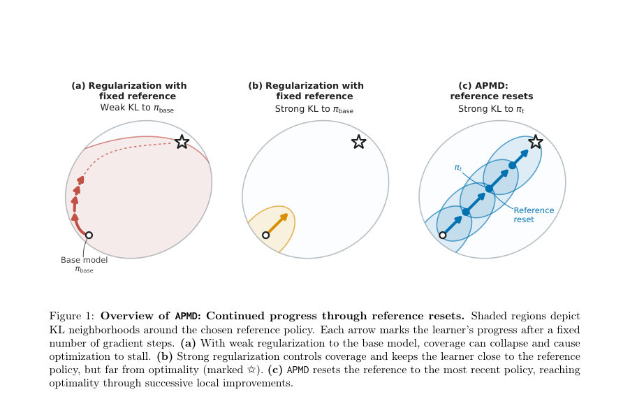
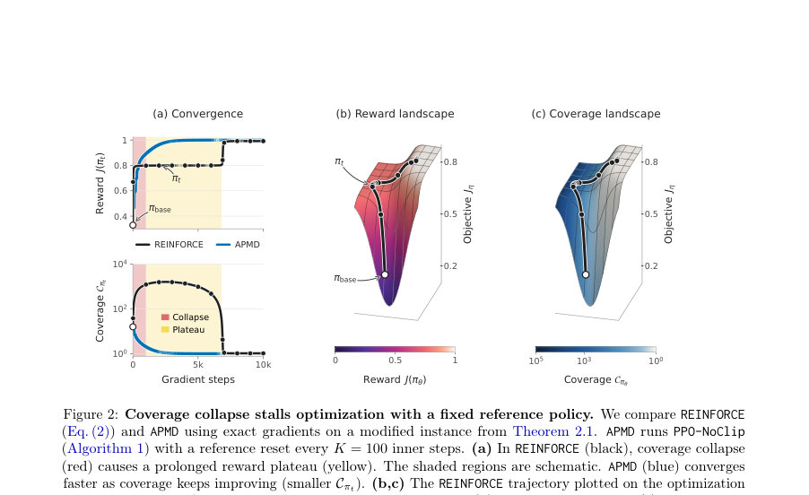
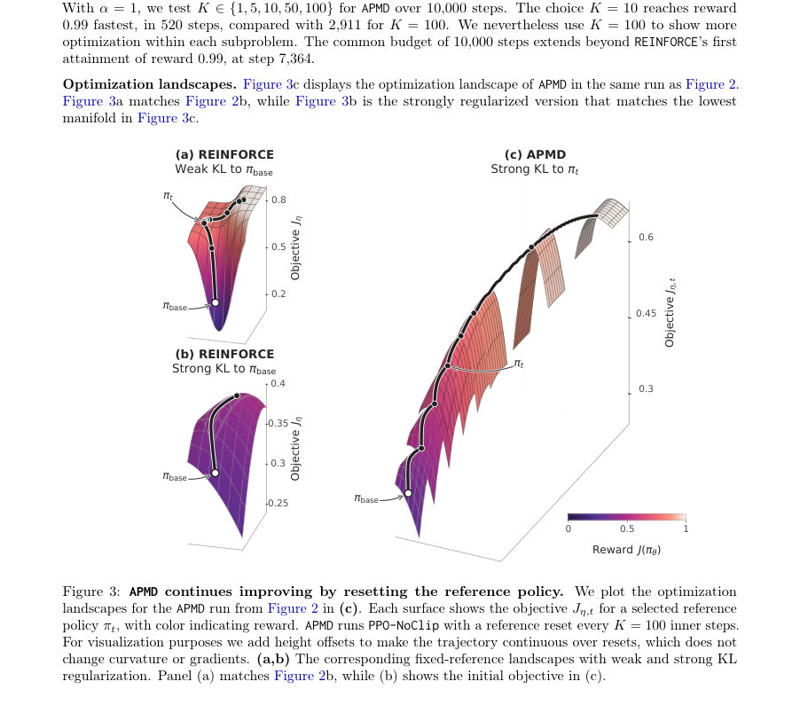

# A Theory of Policy Optimization in Post-Training: Coverage Collapse and Reference Resets

- **게시일:** 2026-11-12
- **arXiv:** [2611.14467v1](http://arxiv.org/abs/2611.14467v1) · [PDF](https://arxiv.org/pdf/2611.14467v1)
- **저자:** Audrey Huang, Nan Jiang, Sham M. Kakade, Sadhika Malladi, Akshay Krishnamurthy, Dylan J. Foster
- **분야:** cs.LG, stat.ML
- **선정 점수:** 4.83
- **선정 이유:** 최근성 0.7, 인용 영향 0.0 (인용 0회), 저자 영향 0.0 (최고 h-index 0), AI 주제 적합성 1.4, 개발자 관심 0.0, 학술 신호 0.3, 오픈 웨이트·주요 연구조직 신호 2.4

[← 2026-11-12 목록으로 돌아가기](../daily/2026-11-12.html)

<!-- paper-visuals:start -->
## 주요 Figure

> 원문 PDF에서 실제 Figure 캡션과 그림 영역이 함께 확인된 자료만 자동 추출했다.

*Figure · 원문 PDF 3쪽 · Figure 1: Overview of APMD: Continued progress through reference resets. Shaded regions depict*

*Figure · 원문 PDF 6쪽 · Figure 2: Coverage collapse stalls optimization with a fixed reference policy. We compare REINFORCE*

*Figure · 원문 PDF 46쪽 · Figure 3: APMD continues improving by resetting the reference policy. We plot the optimization*

<!-- paper-visuals:end -->

## 한 문장 요약

사전학습된 베이스 모델의 응답 '커버리지'를 보존하면서 효율적으로 보상을 최적화하는 이론적 방법(Approximate Policy Mirror Descent, APMD)과, 이를 통해 REINFORCE 계열의 '커버리지 붕괴' 문제를 규명하고 '참조 리셋(reference resets)'으로 해결하는 알고리즘적·복잡도 보장을 제시한다.

## 해결하려는 문제

기존 정책 최적화(예: REINFORCE/PPO/GRPO)는 사전학습된 베이스 모델에서 이미 샘플링으로 확보 가능한 최적 응답(좋은 응답)을 활용하려는 포스트-트레이닝(post-training) 환경에서, 학습 중 학습기(learner)가 베이스 모델의 응답 커버리지를 잃어버려(coverage collapse) 수렴이 매우 느려지는 문제가 발생한다. 이로 인해 베이스 모델의 초기 품질(Cbase)이 있음에도 불구하고 실제 샘플·그레이디언트 스텝 비용이 베이스 품질과 무관하게 폭등할 수 있다. 본문은 어떤 정책 최적화 알고리즘이 '베이스 모델의 커버리지에 의해 통제되는' 샘플·스텝 복잡도로 수렴하는지를 묻는다(coverage-preserving).

## 핵심 기여

- 커버리지 붕괴(coverage collapse) 현상의 이론적 하한 제시: REINFORCE(정확한 그래디언트 포함, KL 정규화 적용하더라도) 초기 좋은 커버리지에서도 최적 응답 확률이 지수적으로 감소하여 수렴에 지수적 단계가 필요할 수 있음을 보였다(Thm 2.1).
- 참조 리셋(reference resets) 개입과 APMD 제안: 매 외부 반복에서 기준(reference) 정책을 최신 정책으로 리셋하고, 그에 대한 KL-정규화 서브문제를 근사적으로 푸는 메타알고리즘(Apmroximate Policy Mirror Descent, APMD)을 제시하여 커버리지 보존 및 전역 수렴을 보장했다(Thm 3.1).
- 현실적 알고리즘군에 대한 보장: softmax 선형 정책(사전학습된 피처를 고정한 설정) 하에서 APMD 프레임워크로 정형화한 PPO/GRPO 계열(참조 리셋 포함, 클리핑 유무 변형)과 제곱손실 기반 방법(Kimi 스타일 알고리즘, Rebel-OnPolicy 등)이 coverage-preserving임을 보이고 구체적 복잡도 상한을 제공했다(Cor. 3.1, 3.2, L.1 등).
- 설계·실무적 시사점 제시: 강한 KL 정규화(참조에 대해 η=Θ(1))와 주기적 참조 리셋이 커버리지를 유지하고 각 내부 서브문제를 쉽게 만들어 전체 학습 효율을 개선함을 이론적으로 설명하고, 클리핑은 최적화 자체보다는 중요도 가중치의 통계적 비용을 제어함을 분리하여 해석했다(Cor. 3.2).

## 접근 방법

* 논문은 다음 구성으로 접근한다.
* (1) 문제형식: Contextual bandit(= one-shot RL)으로 포스트-트레이닝을 모델링하고, 응답 커버리지 Cπ := Ex[1/π(Y⋆x\|x)]로 베이스 모델 품질을 측정한다(Def.1.1).
* (2) 실패 사례 분석: REINFORCE(고전 policy gradient) 업데이트에 대해 정확한 그래디언트와 KL 정규화 Jη(π)=J(π)−(1/η)DKL(π‖πbase)를 허용한 채로 동적 경로를 분석해 커버리지 붕괴 발생과 지수적 수렴 하한(Thm 2.1)을 구성한다.
* (3) APMD 메타알고리즘: 각 외부 반복 t에서 참조를 현재 정책 πt로 리셋하고 π⋆η,t ∝ πt e^{η r}로 정의된 KL-정규화 서브문제의 해를 목표로 하여 내부 루프에서 근사적으로 해결한다.
* 이론적 핵심은 내부 루프가 KL-오차 DKL(πt+1‖π⋆η,t) ≤ ε_in을 만족하면 거시적으로 mirror-descent 속도로 전역 수렴하고(Thm 3.1), 각 반복에서 커버리지가 보존된다는 점이다.
* (4) 알고리즘화: APMD 틀을 구체화하여 (i) PPO-NoClip: 참조 리셋 + 강한 KL 정규화 + 중요도 가중치 기반 내부 풀배치 그래디언트 상승(Alg.1), (ii) PPO-Lite: 위에 클리핑을 추가한 변형(Alg.2), (iii) 제곱손실 계열: 로그 정책비를 보상에 대해 회귀하도록 설계한 Kimi 스타일(평균 보상/정규화 기준) 및 Rebel-OnPolicy(쌍응답을 사용하여 베이스라인 제거) 등을 분석한다.
* (5) 복잡도·수렴 분석: softmax 선형 정책(Assump.2.1) 및 보상 선형성(리워드가 피처의 선형 형태)을 가정해 내부 루프의 샘플·스텝 수를 추정하고 전체 복잡도를 Cbase, 문제 파라미터(B, D⋆ 등), ε에 대한 eO(·) 표기법으로 제시한다.
* 핵심 매개변수로는 참조 정규화 강도 η와 내부 루프 정확도(내부 KL 허용오차 ε_in)가 있다.

## 주요 결과

- 커버리지 붕괴(lower bound): Thm 2.1 — 단일-프롬프트 탭룰러 소프트맥스 정책에서, 어떤 구성에 대해 REINFORCE(임의의 η∈(0,∞], 고정 학습률 α≤1/5, 정확한 그래디언트) 는 정책이 ε-최적이 되려면 어떤 중간 반복 t에서 전체 반복 횟수 T가 Ω(C_{πt}/(α√ε))이며 해당 시점의 커버리지 C_{πt}는 exp(Θ(1/√ε)) 수준까지 증가될 수 있음을 보인다. 즉, 초기 C_base가 상수여도 지수적 수렴 지연이 가능함을 이론적으로 제시했다.
- APMD 보장(Thm 3.1): 내부 루프가 모든 t에 대해 DKL(π_{t+1}‖π⋆η,t) ≤ ε_in := 1/(64 Cbase T^2 log(eT))를 만족하면 최종 정책의 전역 서브옵티멀리티는 J⋆−J(π_T) ≤ log(2 Cbase)/(η T)이고, 대부분의 프롬프트에 대해 모든 반복에서 π_t(Y⋆_x|x) ≥ (1/2) π_base(Y⋆_x|x) 로 커버리지가 보존된다.
- PPO-NoClip (Cor.3.1): Assump.2.1 하에서 η = 1/B 설정 시, 적절한 α,N,K 선택으로 PPO-NoClip은 확률 ≥1−δ로 ε-최적 정책을 출력한다. 복잡도: N_step(ε,δ)=eO(Cbase B^3 / ε^3) (전체 그레이디언트 스텝), N_sample(ε,δ)=eO(Cbase B^3 (d + log(1/δ)) / ε^3) (전체 응답 샘플). (본문 및 부록 증명 제공).
- PPO-Lite (Cor.3.2, 비공식/요약): 유한한 정책집합 또는 일반 파라미터화에서, η=1/R_max 및 클리핑 임계값을 π⋆η,t가 잘려나가지 않도록 설정하면(논문에서 제시된 대칭/비대칭 임계값), 내부 루프가 일정 최적화 허용오차 ε_opt을 만족할 때 전체 샘플 수는 N_sample = N T = eO(Cbase R_max^3 (log|ΠΘ| + log(1/δ)) / ε^3) 수준으로 coverage-preserving함을 보였다. 클리핑은 중요도 가중치의 통계적 비용을 제어하는 역할임을 이론적으로 분리해 설명함.
- Squared-loss 계열 및 Rebel-OnPolicy (Cor.4.2 및 부록 L): Kimi 스타일(보상 중심화/정규화)과 Rebel-OnPolicy(온-폴리시 쌍응답 제곱손실)는 APMD 틀 아래 coverage-preserving 보장을 얻는다. 최종적으로 Rebel-OnPolicy(Assump.2.1 치환 후) 복잡도는 N_step = eO(Cbase B^3 / ε^3), N_sample = eO(Cbase B^3 / ε^3 · log(d/δ)) 등급의 상한을 얻는다(부록 L.4에서 치환된 형태로 제시).

## 한계

- 저자가 명시한 제한사항: 주요 전역 수렴·복잡도 보장은 softmax 선형 정책과 보상이 동일한 선형 피처 집합에 표현된다는 Assumption 2.1에 의존한다(즉, '사전학습된 피처를 고정'한 환경). PPO-Lite 문장상 일부 결과는 유한한 정책집합 또는 π⋆η,t ∈ ΠΘ 같은 추가 가정을 요구한다(Cor.3.2). 또한 APMD 보장은 각 내부 서브문제를 충분히 정확히(작은 KL 오차) 풀 수 있다는 가정에 의존한다(Thm 3.1의 ε_in 조건).
- 본문·실험 범위에서 합리적으로 확인되는 제약(분리 서술): (i) 이론적 복잡도는 eO(·) 표기로 표현되며 상수·로그 인자·문제별 파라미터(B, D⋆ 등)에 민감하다 — 실제 대형 LLM 환경에서의 실용적 비용은 추가 분석/실험이 필요하다. (ii) REINFORCE 하한(Thm 2.1)은 구성된(인위적) 밴딧 인스턴스로 증명되므로 실제 대형 모델에서의 빈도는 불확실하지만 현상(coverage collapse)은 이질적 환경에서도 발생할 수 있음을 주장한다. (iii) 일부 보장은 내부 루프의 완전한 또는 충분한 최적화(또는 정밀한 KL/제곱손실 최소화)를 가정하므로, 확률적 추정·미니배치·비선형 거대 네트워크의 실제 최적화 잡음이 추가되면 보장과 실제 성능 간 괴리가 생길 가능성이 있다.

## 개발자 관점

- 참조 리셋을 도입하라: KL 정규화의 기준을 고정 베이스(π_base)에 두지 말고 주기적으로 최신 정책 π_t로 리셋하면 커버리지 보존과 전역 개선이 가능하다(APMD).
- 강한(국지적) 정규화 활용: 내부 서브문제를 '쉽게' 풀려면 η를 문제 스케일(B 또는 R_max의 역수 등)에 맞춰 Θ(1) 수준으로 강하게 설정하라(예: PPO-NoClip에서 η=1/B). 이는 내부 반복에서 중요도 비율과 부드러움 조건을 제어한다(식 (14)).
- 클리핑은 통계적 비용을 제어: 클리핑(PPO-Lite)은 중요도 가중치로 인한 표본복잡도 폭발을 방지하는 통계적 수단이며, 최적화 관점의 직접적 이득과는 다르다. 따라서 복잡한(비선형) 파라미터화에서는 클리핑과 정규화를 병행하라.
- 내부 루프 정확도와 모니터링: APMD가 보장하려면 각 외부 반복의 내부 최적화가 정해진 KL·MSE 허용오차(ε_in 또는 εSq_in)를 만족해야 한다. 실무에서는 내부 루프 수렴 지표(예: DKL 추정치, empirical surrogate loss)를 모니터링하고 기준 미만이면 외부 반복을 진행하지 말라.
- 복잡도·샘플 예측: softmax 선형 가정 하에서 핵심 복잡도는 N_step, N_sample = eO(C_base · B^3 / ε^3) 형태로 제시되어 있으며(예: PPO-NoClip), 이는 베이스 커버리지(C_base)에 선형(또는 다항)으로 의존하므로 좋은 베이스 모델을 활용하는 포스트-트레이닝에서 유리하다. 실무자는 C_base 추정(예: 베이스 모델로 Best-of-N 성능으로 유추)을 통해 필요한 샘플·스텝 예산을 가늠할 수 있다. (수식은 본문/부록 근거).

**근거 범위:** 이 분석은 제공된 논문 PDF 본문(메인 텍스트 및 부록 발췌)을 근거로 작성되었다. 본문에 명시된 정리·보조정리·부록의 수식·복잡도 표기(eO(·))와 알고리즘(Alg.1–5), 그리고 각 코롤러리의 수식적 결과를 직접 인용·요약했다. 다만 PDF 일부는 장·절·부록으로 길게 연결되어 있어 본 응답은 제공된 텍스트 범위 내에서 확인 가능한 명시적 진술들만을 근거로 작성했으며, 실무적 적용 시 요구되는 상수·상세 하이퍼파라미터(예: 정확한 배치 크기 N, 내부 스텝 K의 최소값 등)는 본문·부록의 구체식(예: Cor. G.1, K.1, L.1 등)을 참조해야 한다.
