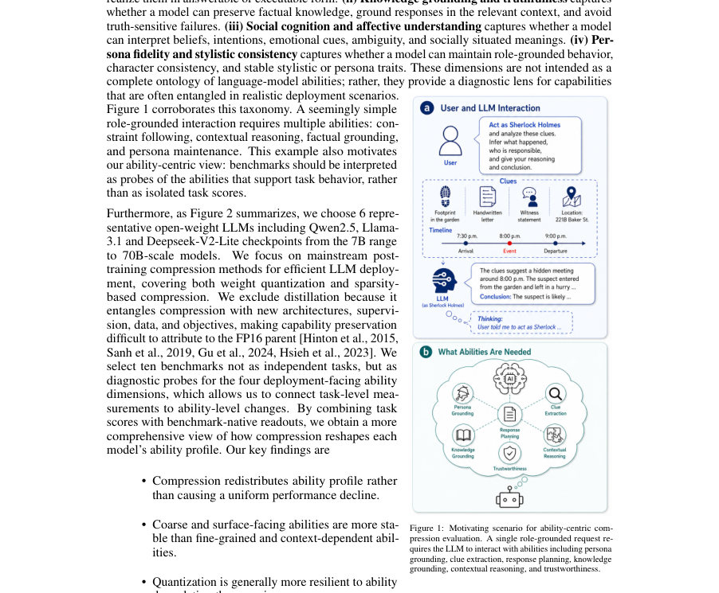
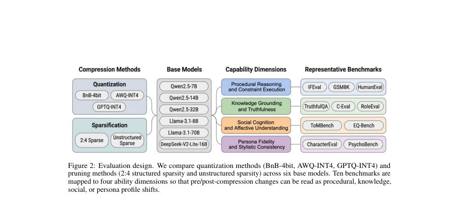
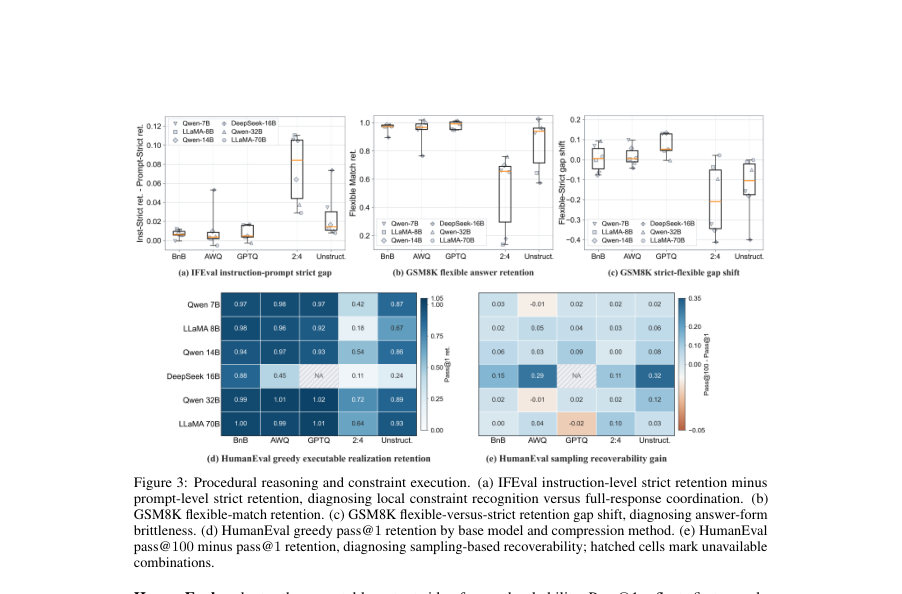

# ACE-Compression: An Ability-Centric Evaluation of Compressed Large Language Models

- **게시일:** 2026-10-21
- **arXiv:** [2610.27913v1](http://arxiv.org/abs/2610.27913v1) · [PDF](https://arxiv.org/pdf/2610.27913v1)
- **저자:** Jiahui Ning, Liang Chen, Yuchen Liang, Yi Zhang, Fenglei Fan
- **분야:** cs.AI, cs.CL
- **선정 점수:** 6.18
- **선정 이유:** 최근성 1.1, 인용 영향 0.0 (인용 0회), 저자 영향 0.0 (최고 h-index 0), AI 주제 적합성 2.1, 개발자 관심 0.3, 학술 신호 0.5, 오픈 웨이트·주요 연구조직 신호 2.2

[← 2026-10-21 목록으로 돌아가기](../daily/2026-10-21.html)

<!-- paper-visuals:start -->
## 주요 Figure

> 원문 PDF에서 실제 Figure 캡션과 그림 영역이 함께 확인된 자료만 자동 추출했다.

*Figure · 원문 PDF 2쪽 · Figure 1: Motivating scenario for ability-centric com-*

*Figure · 원문 PDF 3쪽 · Figure 2: Evaluation design. We compare quantization methods (BnB-4bit, AWQ-INT4, GPTQ-INT4) and*

*Figure · 원문 PDF 6쪽 · Figure 3: Procedural reasoning and constraint execution. (a) IFEval instruction-level strict retention minus*

<!-- paper-visuals:end -->

## 한 문장 요약

압축된 대형언어모델(LLM)이 단순한 작업 점수 보존을 넘어서 어떤 핵심 능력(절차적 추론, 지식 기반, 사회인지, 페르소나 일관성)을 유지하거나 손상하는지를 능력 중심으로 진단하는 평가 프레임워크(ACE-Compression)와 이를 적용한 실험 결과를 제시한다.

## 해결하려는 문제

현재의 압축 평가 관행은 보통 벤치마크 성능(작업 점수) 보존 여부만 측정하는데, 이는 압축이 수십억 가중치에 분포된 지식과 능력을 교란한다는 사실을 반영하지 못한다. 이로 인해 어떤 근본적 능력이 유지되는지 또는 은밀하게 붕괴하는지를 식별할 수 없고, 따라서 배포·알고리즘 개선 관점에서 유용한 진단 신호를 제공하지 못한다.

## 핵심 기여

- 능력 중심(ability-centric)으로 압축 전후 LLM 변화를 진단하는 ACE-Compression 프로토콜을 네 가지 배포지향적 차원(절차적 추론·제약 이행, 지식 기반·진실성, 사회인지·정서 이해, 페르소나 충실도·문체 일관성)으로 제시함.
- BitsAndBytes 4-bit, AWQ-INT4, GPTQ-INT4(양자화) 및 2:4 구조적 희소성·비구조적 희소성(프루닝)을 포함하는 주된 후처리 압축 기법들을 대상으로 6개 공개 가중치 모델에서 35개 이상 압축 체크포인트를 능력 차원으로 평가함.
- 10개 진단 벤치마크(IFEval, GSM8K, HumanEval, TruthfulQA, C-Eval, RoleEval, ToMBench, EQ-Bench, CharacterEval, PsychoBench)를 능력 차원에 맵핑하고, 벤치마크 고유의 판독값을 보존해 압축에 따른 능력 프로필 변화를 해석함.
- 실험(약 25,000개 문항, 1,785 다중턴 대화, 13 심리척도)을 통해 압축이 능력 분포를 재분배함을 보이고(거친·표면 신호는 상대적으로 보존, 미세·롱테일·문맥 의존 능력은 취약), 양자화가 일반적으로 프루닝보다 능력 보존에서 우수함을 보고함.

## 접근 방법

* 평가 패널: Qwen2.5-{7B,14B,32B}, Llama-3.1-{8B,70B}, DeepSeek-V2-Lite-16B 등 6개 챗·튜닝된 FP16 기반 모델을 대상으로 실험을 수행함.
* 압축 기법: (1) 양자화 — BitsAndBytes(온더플라이 BnB-4bit), AWQ-INT4 및 GPTQ-INT4(커뮤니티 릴리스된 정수화 체크포인트) (2) 프루닝 — SparseGPT를 이용한 원샷 행렬 재구성 기반 프루닝(주요 어텐션·MLP 투영 행렬에 대해 50% 희소화), 구조적 2:4와 비구조적 희소성 패턴을 사용함.
* 보정 데이터: yahma/alpaca-cleaned에서 추출한 캘리브레이션 활성화로 SparseGPT를 실행함.
* 서빙·평가 환경: 통일된 vLLM 백엔드와 NVIDIA RTX PRO 6000 Blackwell GPU를 이용해 FP16, 양자화, 희소성 상태를 동일한 스택에서 평가.
* 능력 매핑: 각 벤치마크의 '벤치마크-네이티브' 판독값(예: IFEval의 prompt-/instruction-level strict/loose, GSM8K의 strict/flexible, TruthfulQA의 MC1/MC2와 generation-side BLEURT, ToMBench의 서브어빌리티 등)을 보존하여 FP16 대비 보존율 R = S_comp / S_fp16 으로 정량화함.
* 재현성 보조: 익명화된 보조 코드·처리된 결과 파일과 설정 요약을 부록으로 제공(단 가중치·데이터는 배포하지 않음).

## 주요 결과

- 평가 규모: 10개 벤치마크에 대해 총 25,000개 이상 문항(세부: 541 지침 프롬프트, 1,319 GSM8K 문제, 164 HumanEval 문제, 817 TruthfulQA 문항, 13,948 객관식 C‑Eval 문제, 6,000 RoleEval 문항, 2,860 ToMBench 샘플, 60 감정 문항), 1,785 다중턴 역할놀이 대화, 13 심리척도 보고.
- 핵심 관찰 1 — 능력 재분배: 압축은 단순한 균일한 성능 저하를 초래하지 않고 능력 프로필을 재분배함. 예컨대 지역적·표면적 신호(단일 지침 준수, 광범위 지식)는 비교적 잘 보존되나, 전체 응답 조정·장기적·문맥 의존 능력(다중단계 추론, 롱테일 역할지식, 내적 정신 상태 추론, 페르소나 정체성)은 더 취약함.
- 핵심 관찰 2 — 양자화 vs 프루닝: 전반적으로 양자화(특히 GPTQ-INT4 계열)가 프루닝(2:4 구조적 및 비구조적 희소성)에 비해 능력 보존률이 높게 관찰됨. 다만 보존 격차의 실용적 의미는 응용에서 요구하는 특정 능력에 따라 달라짐.
- 핵심 관찰 3 — 절차적·실행적 능력: IFEval 결과에서 지침 수준(local) 준수는 전체 응답 수준(글로벌 제약 조정)보다 오래 보존되는 경향을 보였고, HumanEval에서는 양자화가 첫 샘플(pass@1) 성공률을 상대적으로 잘 보존하는 반면 프루닝이 더 큰 감소를 보였음(샘플링 시 일부 유효 프로그램 공간은 여전히 접근 가능).
- 핵심 관찰 4 — 지식·진실성: C‑Eval(일반 지식)은 RoleEval(롱테일 역할 지식)보다 압축 후 보존이 더 양호했고, TruthfulQA에서 generation-side BLEURT 보존은 비교적 높게 유지되나 제약된 선택(MC1) 보존은 희소성에서 더 크게 약해져 'generation–selection' 간 괴리가 증가함(즉 BLEURT 친화적 생성으로의 이동이지 진정한 진실성 개선 아님). 예: EQ‑Bench의 parseability(출력 파싱 가능성) 감소 사례로 DeepSeek‑16B의 언파서블 출력 수가 FP16 기준 169.7에서 108.2로 하락함이 보고됨(비교: 특정 희소 설정).

## 한계

- 저자 명시 한계: ACE-Compression은 행동적(behavioral) 변화의 진단을 제공하지만 내부 인과기제(예: 어떤 가중치·활성화가 왜 민감한지)는 설명하지 않음. 모델 패널은 가족·스케일·압축법 효과를 완전히 분리하지 못함(설계상 후처리 양자화와 희소성만 포함; 증류·재학습 기반 방법은 제외됨). 실험 범위는 후처리 양자화와 희소성에 한정되며, 양자화-인지 학습(QAT), 증류, 재학습 기반 방법은 후속 연구로 남음.
- 추론 가능한(본문 기반) 제약: 프루닝은 SparseGPT 원샷·50% 희소로 한정되어 있어 다른 프루닝 비율·점진적 방법의 결과가 다를 수 있음. 일부 모델/설정(예: DeepSeek‑16B의 GPTQ‑INT4 부재)으로 인해 기법-모델 조합이 완전하지 않음. 벤치마크 해석은 벤치마크-네이티브 판독값에 의존하므로, 벤치 특성에 따른 해석 편향이 존재할 수 있음. 또한 재현을 위한 전체 가중치·데이터는 공개되지 않음(보조 패키지는 설정·처리 결과만 제공).

## 개발자 관점

- 배포자는 평균 보존률(리더보드 평균)만 보지 말고 애플리케이션에 필요한 '능력 프로필'을 기준으로 압축 방법을 선택하라(예: 코드생성 서비스는 HumanEval 보존이 중요, 대화형 페르소나 에이전트는 페르소나 충실도·사회인지 보존이 중요).
- 양자화 우선 고려: 대체로 GPTQ-INT4/AWQ/BnB-4bit 계열이 절차적 추론·지식 기반 보존에서 프루닝보다 더 낫게 관찰되므로 메모리·성능·능력 보존 간 균형에서는 양자화를 우선 검토하라. 다만 특정 능력(예: 페르소나 일관성)은 양자화에서도 축소될 수 있으므로 벤치마크 대응이 필요함.
- 프루닝 적용 시 주의: SparseGPT 기반 50% 희소화는 미세·문맥적 능력(다중단계 제약 이행, 사회인지, 페르소나 안정성)에 큰 영향을 줄 수 있으니, 프루닝 비율·대상(어텐션·MLP)을 조정하거나 민감한 축을 보존하는 보정 절차가 필요함.
- 배포 검증 프로세스: 압축 모델을 도입할 때는 단일 작업 점수 대신 ACE-Compression과 유사한 능력별 진단(벤치마크-네이티브 판독값)을 함께 보고하여 특정 능력 임계값을 만족하는지 검증하라. 예: EQ‑Bench의 parseability나 PsychoBench의 심리 프로파일(예: DTDD 증가) 같은 안전·윤리적 위험 신호를 모니터링할 것.
- 압축 개선 방향 제시: 알고리즘 설계자는 취약 능력을 보존하기 위해 보정 데이터, 정규화·보존 목적함수, 부분적 재학습 또는 압축 후 수리(post‑compression repair)를 도입해 보라(예: ToMBench의 belief–action link 관련 활성 보존 타깃).

**근거 범위:** 이 분석은 제출된 논문 PDF 본문(주요 본문 및 부록 페이지)을 기반으로 작성되었으며, 본문에 명시된 실험 설정·벤치마크 목록·데이터 규모(예: >35 체크포인트, 6개 모델, 10개 벤치마크, 항목별 문항 수)와 주요 관찰을 직접 인용하였다. 본문에 구체적으로 제시되지 않았거나 재현 관련으로 보조 패키지에만 언급된 세부 구현(예: 전체 가중치 파일, 일부 보조 설정의 세부 수치)은 임의로 생성하지 않았다. PDF 추출 과정에서 반복 인쇄된 페이지 일부가 있었으나(중복 페이지), 분석 내용은 명시적으로 본문·부록에 기록된 정보에 근거한다.
