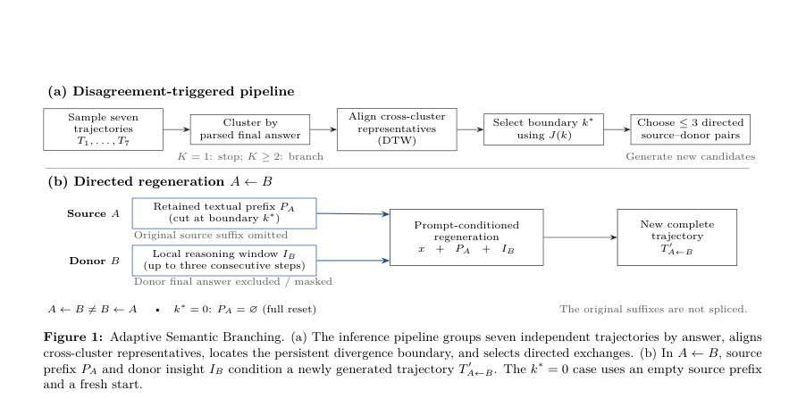

# Adaptive Semantic Branching: Disagreement-Localized Cross-Trajectory Regeneration for Reasoning Candidate Expansion

- **게시일:** 2026-11-06
- **arXiv:** [2611.07918v1](http://arxiv.org/abs/2611.07918v1) · [PDF](https://arxiv.org/pdf/2611.07918v1)
- **저자:** Jeong-Yoon Kim, Tae-Yoon Lee
- **분야:** cs.AI
- **선정 점수:** 4.87
- **선정 이유:** 최근성 1.1, 인용 영향 0.0 (인용 0회), 저자 영향 0.0 (최고 h-index 0), AI 주제 적합성 3.0, 개발자 관심 0.2, 학술 신호 0.5, 오픈 웨이트·주요 연구조직 신호 0.0

[← 2026-11-06 목록으로 돌아가기](../daily/2026-11-06.html)

<!-- paper-visuals:start -->
## 주요 Figure

> 원문 PDF에서 실제 Figure 캡션과 그림 영역이 함께 확인된 자료만 자동 추출했다.

*Figure · 원문 PDF 3쪽 · Figure 1: Adaptive Semantic Branching. (a) The inference pipeline groups seven independent trajectories by answer, aligns*

<!-- paper-visuals:end -->

## 한 문장 요약

여러 독립 샘플링으로 얻은 서로 다른 추론 궤적 간의 불일치를 정량적으로 정렬·분석하고, 불일치가 지속적으로 발생하는 지점을 경계로 삼아 한 궤적의 앞부분과 다른 궤적의 국소적 대안(reasoning window)을 결합해 추가 후보해 를 생성하는 학습비전용(인퍼런스 시) 방법인 Adaptive Semantic Branching(ASB)을 제안한다.

## 해결하려는 문제

대형언어모델의 체인-오브-생각(chain-of-thought) 추론에서 여러 독립 샘플이 서로 다른 최종답을 도출하는 경우가 빈번하며, 기존의 단순 다중샘플링(Self-consistency)이나 트리·그래프 탐색 기법은 이미 생성된 완전한 해답들 간의 구조적 관계(공통된 초반 추론 이후에 갈라지는 지점)를 활용해 표적화된 추가 후보를 생성하는 절차가 부족하다. 연구 질문은 완료된 추론 궤적들 간의 단계별 유사성을 이용해 '지속적인 발산(persistent divergence)' 경계를 식별하고, 그 경계를 기준으로 방향성 있는(비대칭적인) 정보 교환을 통해 효율적으로 올바른 후보를 회복해 후보 커버리지를 늘릴 수 있는가이다.

## 핵심 기여

- 지속적 발산(localized divergence)을 찾는 단조(모노토닉) 단계 정렬(DTW)과 균형화된 변화점 목적함수(J(k))로 불일치 경계를 소스별로 결정하는 '발산-국소화 분기' 절차를 제시했다.
- 방향성 있는 교환(Directed cross-trajectory regeneration)을 정의하여 소스(prefix)와 도너(donor)로부터 각각 텍스트 접두와 최대 3단계의 국소적 인사이트를 결합하는 비대칭적 분기 연산자를 만들고, 부모-공여(선행궤적) 계보를 기록하도록 했다.
- 정답 클러스터 구조에 따라 0/2/3개의 추가 생성 예산을 적응적으로 배분하는 정책을 제안하고, 점수화(q(A←B)=Jmax * sqrt(cA cB))와 다양성 우선순위를 통해 분기 대상을 선택하도록 했다.
- 학습이 아닌 인퍼런스 단계에서 동작하는 경량화된 파이프라인을 구체적으로 규격화(단계 분할 규칙, 해싱 기반 단계 임베딩(d=512), DTW 정렬, 분기 프롬프트 템플릿, 시드 유도 방식 등)하고, 재현가능한 실험 구성과 로그·계보 산출물을 제시했다.

## 접근 방법

* (요약) ASB는 학습 없이 인퍼런스 단계에서 동작한다.
* 1) 초기 생성: 동일 문제에 대해 Qwen2.5-7B-Instruct를 사용해 온도 0.7, top-p=1.0, 최대 2,048토큰으로 '독립적' 시드로 7개 완전 추론(complete trajectories)을 샘플한다.
* 2) 클러스터링: 각 궤적에서 파싱한 최종 답을 클러스터 키로 사용해 답 클러스터 G1..GK를 형성한다(본문 구현에서는 파싱된 답 문자열).
* K=1이면 종료.
* 3) 대표선택: 각 클러스터에서 길이정규화 토큰 로그확률 평균이 가장 큰 궤적을 대표로 선택(로그확률이 없으면 관찰된 첫번째).
* 4) 단계 추출: 대표 궤적 텍스트를 단계들(a1..am)로 분절(번호·불릿 우선, 그다음 줄바꿈·문장부호; 최종 정답 전용 조각은 제외; 5토큰 미만은 이전 단계와 병합).
* 각 단계의 문자 오프셋 저장.
* 5) 단계 표현: 각 단계 문장을 소문자·공백 정렬 후 단어와 4-문자 문자서브스트링을 특징 집합으로 수집, SHA-256 해시의 처음 4바이트로 차원(512) 좌표를 선택하고 5번째 바이트의 최하위비트로 부호를 정해 가산한 뒤 L2 정규화해 결정론적 임베딩(e(a)) 생성(영벡터는 코사인 유사도 0 처리).
* 6) 단조 정렬(DTW): 소스(A)와 도너(B) 단계 간 코스트 c(i,j)=1-cos(e(ai),e(bj))로 DTW 실행, 소스 단계별로 정렬된 도너 단계 중 최대 코사인 값을 si로 집계해 유사도 시퀀스 s1..sm 획득.
* 7) 지속적 발산 경계 선택: 모든 내부 경계 k에 대해 J(k)=sqrt(k(m-k)/m) * (avg_{i≤k} si - avg_{i>k} si)를 계산, 양수 최대값을 주는 가장 이른 k*를 선택(최대가 ≤0이면 k*=0으로 전체 리셋 분기 허용).
* k*>0이면 소스 텍스트의 원시 문자 오프셋 dA(k*)까지를 보존된 접두 PA로 재구성; k*=0이면 PA는 빈 문자열.
* 8) 도너 인사이트 추출: 정렬 π에서 k*에 정렬된 도너 단계부터 최대 연속 3단계(도너의 최종답 문자열은 마스킹)까지를 IB로 구성.
* 9) 분기 생성: 프롬프트에 원문 문제, 보존된 소스 접두(PA), 도너 인사이트(IB)를 포함해 모델에 재생성하도록 요청하여 새로운 전체 추론 T'_{A←B} 생성(방향 반대는 다른 연산).
* 10) 쌍 점수화 및 배정: 각 방향 쌍의 Jmax(=max_k J(k))과 소스·도너의 접두·윈도우에 대한 평균 토큰 로그확률로 얻은 확신인자 cA,cB를 사용해 q 점수 산정; K=2이면 두 방향 모두 생성, K≥3이면 점수와 다양성 기준으로 최대 3개까지 선택해 생성(참고 구현은 추가 생성 호출 수를 제한하여 총 후보를 7,9 또는 최대 10으로 함).
* 프롬프트 템플릿, 시드 유도키(key=BASE_SEED\|sample_id\|stage\|agent_or_branch_id)와 SHA-256 기반 시드 생성 등 재현에 필요한 구성 요소를 논문 본문에 구체 명시한다.

## 주요 결과

- 평가 데이터셋: 고정된 MATH-500 문제집(500문제). 모델: Qwen2.5-7B-Instruct. 초기 7개 샘플에서의 오라클 후보 커버리지: 445/500 (89.0%). ASB 적용 후 확장된 컬렉션의 커버리지: 455/500 (91.0%), 절대 증가 +2.0 백분포 포인트(10문제 회복). 초기에 정답이 포함되지 않았던 55문제 중 10문제(18.18%)에서 정답 후보를 회복. 초기 모델 생성 호출 수: 3,500; 추가 분기 호출 수: 576; 총 생성 호출 수: 4,076. 문제당 평균 호출 수: 8.152(초기 7 호출 대비 +16.46%). 분기 배정 분포: 0/2/3 브랜치가 배정된 문제 수는 284 / 72 / 144.
- limitations':['저자가 직접 언급한 한계: 논문 본문(섹션 7)은 ASB가 참조 구현과 단일 저장(run seed=100) 설정에서 평가되었음을 명시하며, 매치드-콜(matched-call) 독립 샘플링과의 비교, 무작위 경계 선택·접두만·도너만 생성 등의 대조 실험, 대체 단계 인코더나 정답 등가성 기반 클러스터링 실험 등을 자연스러운 확장으로 제안해 현재 결과가 이러한 민감도 실험을 포함하지 않음을 인정한다. 또한 평가가 후보 발견(oracle candidate coverage)에 초점을 맞추고 있어 후속의 후보 선택(answer selection) 성능으로 확장되지 않았음을 언급한다.','본문에서 합리적으로 확인되는 제약: 결과 이득은 절대적으로 작음(커버리지 +2.0pp); 단일 모델(Qwen2.5-7B-Instruct)과 단일 저장 실행(seed-100)에 대한 보고로 일반화성이 제한될 수 있음; 단계 임베딩은 간단한 해싱 기반 결정자 표현을 사용해 어휘·형식 차이에 민감할 가능성이 있으며, 클러스터링이 파싱된 답 문자열에 의존해 포맷 차이에 따라 클러스터 수 K가 달라질 수 있음; 추가 생성 호출로 계산비용이 증가함(보고된 추가 호출 576, 전체 생성호출 +16.46%); 논문은 다운스트림 선택 절차와 결합한 전체 파이프라인 비용·성능 분석을 제공하지 않음.'],
- developer_takeaways':['재현성: 저자는 실행 구성 파일(run_config.json), 결과 파일(results.jsonl, summary.json, gold_recovery_cases.jsonl)과 각 생성에 대한 프롬프트·시드·계보 등 상세 아티팩트를 저장하도록 해 재현 가능성을 높였음. 시드 유도 방식(key = "BASE_SEED|sample_id|stage|agent_or_branch_id")과 SHA-256 기반 시드 파생 절차가 본문에 구체적으로 명시되어 있어 동일한 시드 체계로 재실행 가능하다.
- 구현 세부사항: 단계 분할(번호/불릿 우선, 줄바꿈·문장부호), 해싱 기반 임베딩(단어 + 4-문자 문자그램, SHA-256 첫 4바이트로 좌표, 5번째 바이트 최하위비트로 부호, d=512, L2 정규화), DTW 정렬, J(k) 목적식, k*=0 처리(전체 리셋 분기), 도너 윈도우 최대 길이 3단계, 분기 프롬프트 템플릿(소스 접두 보존/마스킹 규칙 포함) 등은 그대로 구현하면 논문과 동일한 행동을 재현할 수 있다.
- 배포·비용: 실사용/서버화 시 단일 문제당 평균 생성 호출이 7→8.152로 증가(약 +16.46%)하므로 RPS·비용 예측에 이 추가 비용을 반영해야 함. 분기 정책은 클러스터 수에 따라 동적으로 0/2/3을 부여하므로 워크로드 변동성이 존재한다(전체 추가 호출은 데이터셋·모델·시드에 의존). 모델 호출이 가장 비용이 큰 부분이다(본문도 로깅은 분기 호출만 추가 비용으로 계상).','안전성·정책: 도너 인사이트에 포함된 도너의 최종 답 문자열은 분기 프롬프트 구성 시 마스킹하며, 프롬프트는 모델에 '대안으로만 고려하고 복사하지 말라'고 명시적으로 지시함. 그러나 도너 인사이트는 본질적으로 잘못된 로컬 추론일 수 있어 생성된 후보의 품질·허위정보 가능성에 대한 검증 단계(예: 검증자/verifier 또는 수학적 엄밀성 검사)를 추가하는 것이 권장된다.','확장 및 연구용: 단계 임베딩·정렬·분기 정책을 교체해 민감도 실험을 수행하기 쉽도록 설계되었으므로 연구·제품 단계에서 다양한 인코더나 클러스터링 전략을 시험하는 것이 실용적이다.'],

## 한계

- 저자가 직접 언급한 한계: 본문 섹션 7에서 ASB는 참조 구현과 단일 저장(run seed=100) 실행에 대해 보고되었으며, 매치드-콜 독립 샘플링 대비 가치 측정, 무작위 경계 선택·접두만 생성·도너만 생성 등의 대조 실험, 다른 단계 인코더·클러스터링 전략에 대한 민감도 실험, 그리고 후보 발견에서 후보 선택까지의 downstream 통합 평가는 향후 작업으로 제안되어 현재 결과에 이러한 비교·확인이 포함되지 않았음을 저자 스스로 지적한다.
- 본문에서 합리적으로 확인되는 제약: 제안된 절차가 후보 커버리지를 89.0%→91.0%로만 소폭 향상시키며(절대 +2.0pp), 실험은 하나의 모델(Qwen2.5-7B-Instruct)·단일 시드 설정에 기반해 일반화 가능성이 제한된다. 단계 임베딩은 해싱 기반의 단순 표현이므로 형식·어휘 차이에 민감할 수 있고, 클러스터링이 파싱된 답 문자열에 의존해 포맷 차이로 인해 K 결정이 불안정할 수 있다. 추가 분기는 생성 호출 수를 증가시켜 계산 비용(보고된 추가 호출 576, 전체 호출 +16.46%)과 지연을 유발한다. 또한 논문은 분기 후보의 선택(selection) 단계와 결합했을 때 최종 정확도·비용 트레이드오프에 대한 분석을 제공하지 않는다.

## 개발자 관점

- 재현성 확보를 위해 논문이 제공하는 구성요소(프롬프트 템플릿, 시드 파생법, 단계 분할 규칙, 해싱 임베딩·차원, DTW 정렬, J(k) 정의, 분기 정책)를 그대로 구현하라.
- 실서비스 배포 시 비용산정: 문제당 평균 생성 호출 수가 7→8.152로 증가하므로 예상 요청량에 생성 호출 비용을 반영해야 하고, 클러스터 구조에 따른 변동성(문제마다 0/2/3 분기)도 고려해야 한다.
- 검증 단계 필요: 도너 인사이트는 잘못된 정보를 포함할 수 있으므로 생성된 후보에 대해 수학적 검증기·정형 검사 또는 별도의 평가기(verifier)를 도입해 허위정답 위험을 줄여야 한다.
- 모듈성 활용: 단계 인코더·정렬 알고리즘·클러스터링 키·분기 점수화 및 정책은 교체·실험이 쉬운 모듈로 구현해 민감도 실험과 비용-성능 최적화를 수행하라.
- 운영 팁: 로그와 계보(run_config.json, results.jsonl, gold_recovery_cases.jsonl 등)를 체계적으로 보관해 어떤 소스-도너 조합·경계(k*)가 회복에 기여했는지 분석하면 향후 휴리스틱 개선에 유용하다.

**근거 범위:** 논문 PDF 본문(제공된 전체 텍스트)을 바탕으로 분석을 작성했다. 결과 수치(커버리지, 생성 호출 수, 분기 배정 등), 알고리즘·프롬프트·시드 세부사항은 본문에서 직접 인용하였다. 프로그램 코드·추가 실행 결과나 저자가 공개한 외부 아티팩트는 PDF 본문에 포함된 기술서술에 기반해 해석했으며, 본문에 명시되지 않은 추가 실험 결과나 외부 구현세부(예: 실제 API 응답 지연, 전산 자원 사용량의 세부 측정 등)는 포함하지 않았다.
