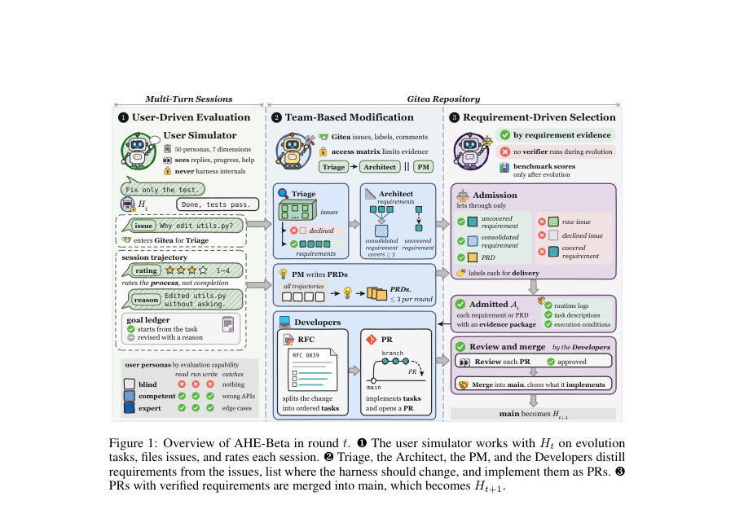
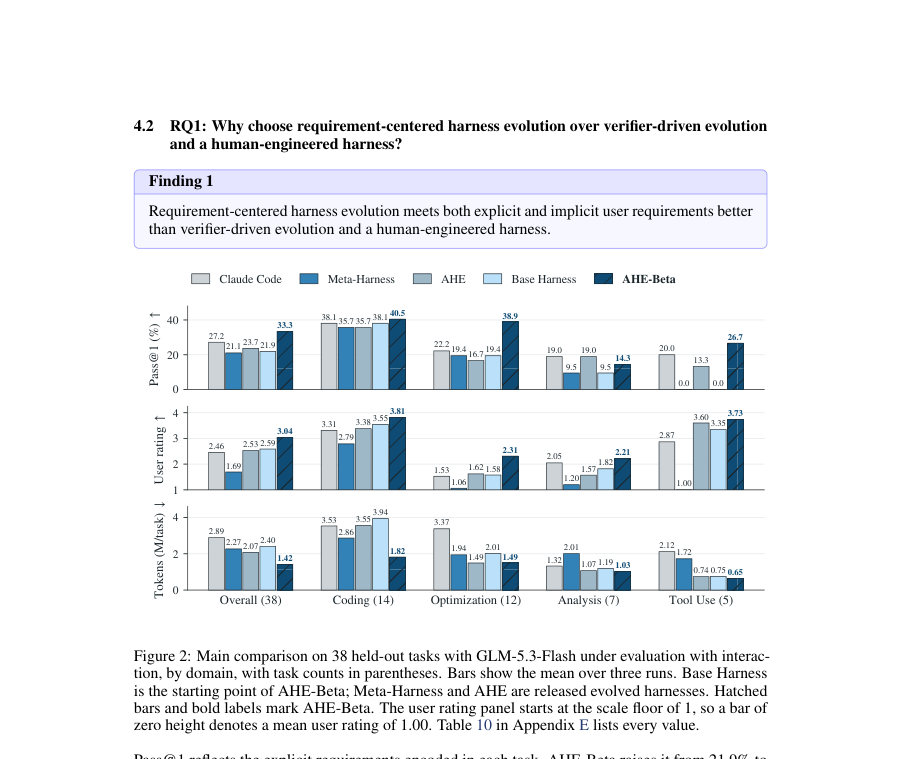
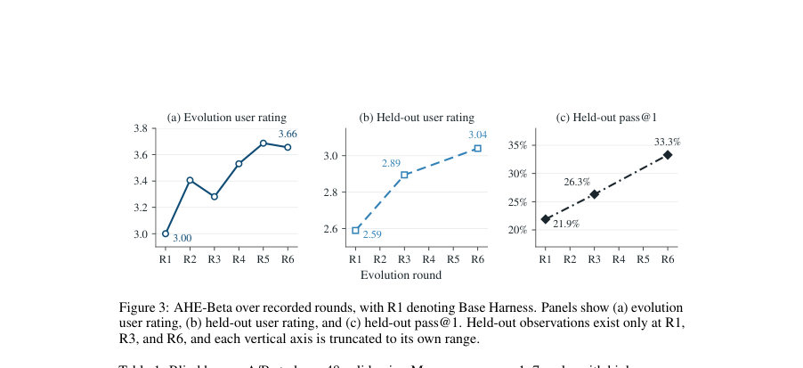

# Agentic Harness Engineering Beta: Requirement-Centered Evolution of Agent Harnesses

- **게시일:** 2026-11-19
- **arXiv:** [2611.24924v1](http://arxiv.org/abs/2611.24924v1) · [PDF](https://arxiv.org/pdf/2611.24924v1)
- **저자:** Jiahang Lin, Jiahao Chen, Yiding Wang, Shichun Liu, Chengjun Pan, Shihan Dou, Honglin Guo, Yuyang Hu, Changhao Jiang, Zhenhua Han, Hang Yan, Qi Zhang, Tao Gui, Xuanjing Huang
- **분야:** cs.SE, cs.AI
- **선정 점수:** 7.28
- **선정 이유:** 최근성 1.3, 인용 영향 0.0 (인용 0회), 저자 영향 0.0 (최고 h-index 0), AI 주제 적합성 2.2, 개발자 관심 0.5, 학술 신호 0.8, 오픈 웨이트·주요 연구조직 신호 2.5

[← 2026-11-19 목록으로 돌아가기](../daily/2026-11-19.html)

<!-- paper-visuals:start -->
## 주요 Figure

> 원문 PDF에서 실제 Figure 캡션과 그림 영역이 함께 확인된 자료만 자동 추출했다.

*Figure · 원문 PDF 2쪽 · Figure 1: Overview of AHE-Beta in round t. ❶The user simulator works with Ht on evolution*

*Figure · 원문 PDF 7쪽 · Figure 2: Main comparison on 38 held-out tasks with GLM-5.3-Flash under evaluation with interac-*

*Figure · 원문 PDF 8쪽 · Figure 3: AHE-Beta over recorded rounds, with R1 denoting Base Harness. Panels show (a) evolution*

<!-- paper-visuals:end -->

## 한 문장 요약

사용자 요구(명시적·암시적)를 중심으로 한 에이전트 기반 하니스 진화 루프(AHE-Beta)를 제안하여 다중 턴 사용자 시뮬레이션으로 요구를 수집하고, 팀 역할(RFC/PRD/아키텍트 등)로 일반화 가능한 변경을 구현·검증해 벤치마크 과적합을 줄이며 실제 사용자 경험과 pass@1을 개선한다.

## 해결하려는 문제

기존 하니스(프롬프트·툴·미들웨어) 자동 진화 방법은 주로 테스크 검증기와 벤치마크 점수에 의존해 변화 선택을 수행한다. 이로 인해(1) 사용자가 명시하지 않는 암시적 요구·상호작용 필요를 놓치고, (2) 단일 진화 에이전트가 실패를 즉각 수정하는 방식이 과제 특화 패치(로컬 옵티마)에 머무르며 일반화에 실패한다. 따라서 하니스 변화가 실제 사용자 요구를 해결하는지 판단하고, 평가-수정-선택 전반에서 사용자 관점을 반영하는 체계가 필요하다.

## 핵심 기여

- 요구(requirement)-중심 하니스 진화 프레임워크 AHE-Beta 제안: 사용자 주도 평가, 팀 기반 수정, 요구 기반 선택의 세 단계 루프를 정의함.
- 다중 턴 사용자 시뮬레이터(50개 페르소나, 의도-행동-목표 장부(goal ledger) 포함)를 도입해 암시적 요구·중간 교정 등을 이끌어내는 평가 설계 제시.
- Gitea 기반의 다중 역할 워크플로우(트리아지, 아키텍트, PM, 개발자) 및 RFC/PRD/증거 패키지·승인·리뷰 게이트로 변경을 일반화·추적 가능하게 구현함.
- 검증 없이 벤치마크 점수로 병합하지 않고, 세션 증거로 요구를 확인한 PR만 병합하는 '요구 기반 선택'을 제시해 과적합 위험을 낮춤.
- 38개 Harbor-index 보류(held-out) 과제와 인간 A/B 테스트를 통한 실험으로, 요구 중심 진화가 성능·사용자 경험·토큰 효율에서 개선을 보임을 실증함.

## 접근 방법

* 전체 방법은 베이스 모델 M을 고정한 채 하니스 H만 진화시키는 라운드 기반 루프이다(Algorithm 1).
* 각 라운드는 세 단계로 구성된다.
* 1) 사용자 주도 평가: 사용자 시뮬레이터(50개 페르소나; 각 페르소나는 수용 기준·자율성 기대·평가 능력 등 7개 차원으로 정의)를 현재 하니스 H_t와 함께 다중 턴 세션으로 실행한다.
* 시뮬레이터는 사용자 인터페이스를 통해서만 응답·진행 상태를 보고, 세션 중 이슈를 제기하고 최종 사용자 평점을 남긴다.
* 세션은 사용자가 우선 의도(다음 단계)를 기술한 뒤 행동 메뉴에서 선택하도록 설계되어 중간 교정과 암시적 요구를 기록하는 goal ledger를 유지한다.
* 2) 팀 기반 수정: Gitea 저장소에서 Triage가 원치 않거나 과제 전용인 이슈를 걸러내고, 아키텍트가 공통 원인을 공유하는 요구들을 통합(consolidated requirements)한다.
* PM은 세션 전반에서 드러난 반복적·명시되지 않은 요구를 PRD로 작성(라운드당 최대 3개).
* 개발자 팀은 승인된 요구·PRD에 대해 RFC를 작성하고, 설계로 분할한 후 코드·테스트·PR로 구현한다.
* 구현은 파일 분리·수용 기준·테스트 명시 등으로 일반화 가능하게 설계된다.
* 3) 요구 기반 선택: admission 단계에서 세션 증거(런타임 로그·공개 과제 텍스트·실행 조건 등)를 첨부한 요구·PRD만 개발자에게 전달한다.
* PR은 설계 리뷰와 코드 리뷰(수용 기준, 전체 테스트 통과)를 통과해야만 main으로 머지되며, 모든 변경은 커밋으로 남아 쉽게 되돌릴 수 있다.
* 진화 과정에서는 검증기(숨겨진 테스트)나 벤치마크 점수를 병합 게이트로 사용하지 않으며, 벤치마크는 진화가 끝난 뒤 평가에 사용된다.
* 평가·진화 실험 환경: 진화·평가에는 GLM-5.3-Flash(실행 모델)를 주로 사용했으며, 하니스 공학팀은 GLM-5.3로 동작했다.
* 진화는 최대 32 시드(페어링된 진화 과제+페르소나)와 6라운드 스케줄로 진행되었다.

## 주요 결과

- 평가 데이터셋·설정: Harbor-index에서 선별한 38개 held-out 과제(도메인: Coding 14, Optimization 12, Analysis 7, Tool Use 5)로 평가. 평가 주요 지표는 pass@1(한 번의 시도에서 합격한 비율), 사용자 평점(1–4 시뮬레이터 평점, 평가는 상호작용 포함일 때만 수집), 실행 토큰(태스크당 평균, 모델 호출 토큰, 사용자 시뮬레이션 제외).
- 주요 정량 결과: AHE-Beta(최종 AHE-Beta, N=32)는 Base Harness 대비 held-out pass@1을 21.9%에서 33.3%로 개선했고(절대 +11.4pp), held-out 사용자 평점은 2.59→3.04로 상승했으며 실행 토큰은 40.8% 절감(예: Base 2.40M/task → AHE-Beta 1.42M/task, Table 4).
- 비교 대상 대비 성능: AHE-Beta는 같은 평가(상호작용 포함)에서 Claude Code(27.2% pass@1), AHE(23.7%), Meta-Harness(21.1%)보다 높은 pass@1(33.3%)을 기록함(Figure 2).
- 상호작용의 기여: 동일한 진화 시드(N=8)에서 상호작용을 켠 진화(AHE-Beta N=8)는 상호작용 없는 진화보다 held-out pass@1이 28.9% vs 23.7%로 높았고, 토큰 사용은 1.71M vs 3.15M으로 크게 절감되어(약 45.7% 적음) 상호작용이 암시적 요구·중간 교정을 노출시켜 성능과 효율에 기여함(Table 2).
- 사람 사용자 검증: 블라인드 인간 A/B 테스트(48 valid pairs)에서 실제 사용자는 48개 유효 페어 중 31건에서 AHE-Beta를 선호했고(31/48), 5개 평가 차원(전반, 이해도, 유용성, 제어, 사용자 부담, 사용 용이성) 모두에서 AHE-Beta가 평균 점수 우위를 보였음(예: Overall 5.39→6.01, Process understandability 4.13→5.33 등, Table 1). 이 결과는 시뮬레이터 방향성과 일치함.」「전달성(transfer): Flash에서 진화된 하니스를 추가 진화 없이 GLM-5.3 및 DeepSeek-V4.1-Flash에서 그대로 적용했을 때 pass@1가 각각 Base 대비 +15.8pp(23.7→39.5)와 +5.3pp(36.8→42.1) 개선되어 진화 변경이 실행 모델을 초월해 일반화되는 증거를 보였음(Table 4).

## 한계

- 저자 명시 한계: 시간·계산 자원 제약으로 최대 32 시나리오·6라운드·하나의 시뮬레이터 모델과 선택된 페르소나 집합으로 실험을 진행했으며(따라서 더 넓은 시나리오·시뮬레이터·페르소나 구성이 추가 요구됨), 인간 A/B 연구 표본도 제한적임(본문 Limitations).
- 저자 명시 위험·윤리적 한계: 페르소나 편향이 특정 사용자 집단을 유리하게 만들 수 있고, 요구가 불명확할 때 과도하게 자율적인 하니스가 사용자의 허용 범위를 넘는 행동을 할 위험이 있음(본문).
- 본문 실험 제약(확인 가능한 제약): 평가는 38개 held-out 과제와 특정 실행 모델들에 국한되어 있어 도메인·과제 규모 확대 시 결과 재현성·효율 영향은 추가 검증 필요. 또한 진화 중에는 숨겨진 검증기(테스트)를 사용하지 않기 때문에 진화 과정에서의 자동화된 검증 능력은 제한적이며, 일부 변경은 인간-가시성(예: 중간 진행 라인, 수신 영수증)과 상호작용 가능한 환경에서만 의미 있는 이득을 보임(본문에서 평가와 인간 A/B 조건 차이로 설명됨).

## 개발자 관점

- 실행 설계: 하니스 코드는 Gitea 저장소로 관리하고 모든 변경을 RFC→PR→리뷰→머지 절차로 처리하면 변경 근거(요구·세션 증거)를 명확히 추적하고 되돌리기 쉬움.
- 평가 설계: 단발 검증기·벤치마크 점수만으로는 사용자 요구 충족을 보장하지 못하므로 다중 턴 사용자 시뮬레이션(입력 의도 명세+행동 선택+goal ledger)을 도입해 암시적 요구·중간 교정을 수집해야 함.
- 팀·역할 분리: Triage(이슈 필터), Architect(루트 원인 통합), PM(PRD 추출), Developers(RFC/테스트/분할 구현) 같은 역할을 모사하거나 할당하면 과제 특화 패치 대신 일반화 가능한 변경을 만들기 유리함.
- 병합 정책: ‘요구가 세션 증거로 검증될 때만 admission→리뷰→머지’하는 파이프라인은 벤치마크 과적합을 줄이고 다른 모델·과제로의 전달성을 확보하는 데 효과적임. 변경 병합 시 숨겨진 테스트·대외적 검증은 진화 후 평가로 남겨 두는 것이 설계 원칙임.
- 운영·비용: 상호작용 중심 진화는 평가 시 토큰 사용을 줄일 수 있으나 라운드별 증거 수집·리뷰·RFC 작성 등으로 인적(또는 추가 모델 호출) 비용이 들 수 있다. 따라서 자동화 수준과 인간 개입 사이의 설계·비용 트레이드오프를 고려해 스케일링 전략을 세워야 함.

**근거 범위:** 이 분석은 제공된 논문 PDF 본문(주요 본문, 도표, 표, 사례 연구 및 Limitations 섹션)에 근거함. 부록(Appendix)과 일부 표(Table 수치)는 본문에 인용된 값을 사용했으며, PDF 추출 과정에서 부록의 전체 내용이 포함되지 않았거나 표의 세부 항목이 본문에서 요약된 경우가 있으므로 매우 세부적인 구현·하이퍼파라미터(예: 라운드별 정확한 시드 매핑 등)는 본문에 명시된 내용만 반영했음을 밝힘.
