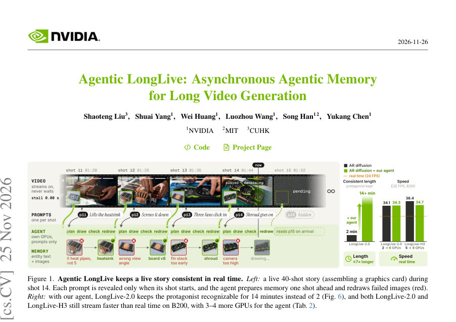
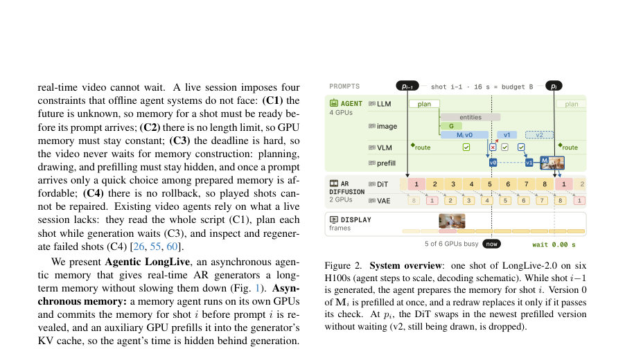
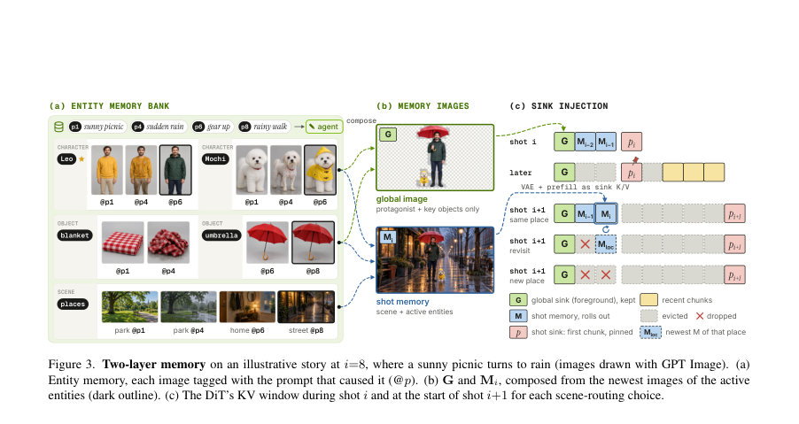

# Agentic LongLive: Asynchronous Agentic Memory for Long Video Generation

- **게시일:** 2026-11-27
- **arXiv:** [2611.34907v1](http://arxiv.org/abs/2611.34907v1) · [PDF](https://arxiv.org/pdf/2611.34907v1)
- **저자:** Shaoteng Liu, Shuai Yang, Wei Huang, Luozhou Wang, Song Han, Yukang Chen
- **분야:** cs.CV
- **선정 점수:** 4.32
- **선정 이유:** 최근성 0.7, 인용 영향 0.0 (인용 0회), 저자 영향 0.0 (최고 h-index 0), AI 주제 적합성 2.6, 개발자 관심 0.5, 학술 신호 0.6, 오픈 웨이트·주요 연구조직 신호 0.0

[← 2026-11-27 목록으로 돌아가기](../daily/2026-11-27.html)

<!-- paper-visuals:start -->
## 주요 Figure

> 원문 PDF에서 실제 Figure 캡션과 그림 영역이 함께 확인된 자료만 자동 추출했다.

*Figure · 원문 PDF 1쪽 · Figure 1. Agentic LongLive keeps a live story consistent in real time. Left: a live 40-shot story (assembling a graphics card) during*

*Figure · 원문 PDF 2쪽 · Figure 2. System overview: one shot of LongLive-2.0 on six*

*Figure · 원문 PDF 4쪽 · Figure 3. Two-layer memory on an illustrative story at i=8, where a sunny picnic turns to rain (images drawn with GPT Image). (a)*

<!-- paper-visuals:end -->

## 한 문장 요약

실시간 autoregressive 비디오 생성기에 대해 별도 GPU에서 동작하는 비동기 LLM 에이전트 기반의 '엔티티(텍스트+이미지) 메모리'를 도입해 장시간 스트리밍 비디오에서 인물·객체·장소의 일관성을 유지하고, 메모리를 생성기의 attention sink로 미리 프리필(prefill)하여 생성 지연 없이 동작하도록 한 시스템을 제안한다.

## 해결하려는 문제

실시간 스트리밍 방식의 autoregressive(AR) 비디오 생성기는 장시간 이야기(streamed interactive story)를 처리할 때 인물·객체·장소 등의 지속적 상태를 유지하지 못하고 KV 캐시의 제한(짧은 윈도우, 모델이 생성한 오래된 잘못된 출력의 복사) 때문에 정체성(identity)·장소 일관성·지속 상태가 깨지는 문제가 있다. 기존의 오프라인 에이전트 기반 멀티샷 생성기들은 전체 스크립트를 미리 읽고(미래를 알음), 각 샷을 계획하고 실패 샷을 재생성하는데, 이는 실시간 스트리밍 환경의 제약(C1: 미래 불확실성, C2: 무한 길이에서 일정한 GPU 메모리, C3: 하드 데드라인―비디오가 에이전트를 기다릴 수 없음, C4: 롤백 불가)과 맞지 않는다. 연구 질문은 이러한 실시간 제약 속에서 에이전트를 어떻게 설계하고 학습시켜 장시간(수분~십 수 분) 동안 일관성을 크게 개선할 수 있는가이다.

## 핵심 기여

- 비동기(agentic) 메모리 시스템: 에이전트가 별도 GPU에서 이전에 공개된 프롬프트만 읽고(생성 비디오를 읽지 않음) 엔티티(사람/객체/장소)별 텍스트 상태와 발전하는 이미지를 유지하여, 다음 샷 시작 전에 메모리를 커밋하고 보조 GPU가 이를 generator의 attention sink로 프리필하도록 하여 비디오가 메모리를 기다리지 않게 만든 설계.
- 열린 루프(open-loop)·두 계층 메모리 설계: (1) 엔티티 메모리(텍스트 상태 + 이미지를 유지)와 (2) 전역 이미지 G 및 샷별 메모리 이미지 M을 합성해 frozen AR generator의 sink K/V로 주입하는 두 계층 구조를 도입하고, 프롬프트에 등장하는 엔티티에 대해 사전에 작성된 'entity card'를 프롬프트에 붙여 텍스트 기반 정보도 제공.
- 무엇을 기억할지 학습하는 RL 레시피: 작은 LLM(Qwen3-8B + LoRA)을 GRPO로 fine-tune하여 각 샷에서 어떤 엔티티를 그려 저장할지 결정하도록 학습하고, 보상은 숨겨진 미래 어노테이션을 이용한 힌드시드(hindsight) 보상으로 구성(텍스트·이미지·정밀도·retention·패널티 가중치 포함)하며 이미지항(r_img)은 downstream 비디오 결과에 맞춰 캘리브레이션함.
- 실험 벤치마크 LongStory-Online 공개 및 평가: 프롬프트가 샷 단위로 순차 공개되고 각 샷을 한 번만 생성하는 프로토콜의 25개 스토리(857 샷, 약 150분)로 실시간 제약 하에서 비교 평가를 수행하여 메모리의 효과를 입증.
- 실시간 성능 유지: H100 기준 약 1%의 추가 생성 시간 비용으로 LongLive-2.0 기반에서 지속 상태(state)·정체성(identity)·재방문 장소 일관성 개선을 달성하고, 8×B200 노드(BF16)에서 디코딩 포함 약 34.3 FPS로 재생속도(24 FPS 기준)보다 빠르게 스트리밍 가능함을 보임.

## 접근 방법

* 시스템 구성 및 동작 절차는 다음과 같다.
* 에이전트는 별도의 GPU 랭크들(agent ranks)에서 비전-언어 모델로 계획(plan)·검사(check)하고 이미지 모델로 엔티티 이미지를 생성·편집한다.
* 보조 프리필(prefill) 워커는 frozen VAE를 사용해 에이전트가 만든 전역 이미지 G와 샷 메모리 M을 인코딩하여 generator(DiT)의 attention sink용 K/V를 미리 계산한다.
* 데이터 흐름은 에이전트 → 프리필 워커 → DiT → 디코더(표시)로 단방향이다.
* 메모리는 두 계층으로 구성된다: 엔티티 메모리(bank)는 각 사람·객체·장소에 대해 텍스트 상태와 여러 뷰 이미지를 유지하고, 이로부터 (i) 전역 이미지 G(주인공+핵심 객체, 스튜디오 배경으로 정적)와 (ii) 샷별 메모리 Mi(해당 샷의 장면과 활동 엔티티)를 합성한다.
* G와 Mi는 VAE로 인코딩되어 sink K/V로 프리필되며, DiT는 샷 시작 시 최신 완전 프리필 버전을 전체 교체(swap)해 사용한다(부분 혼합 없음).
* 에이전트는 프롬프트가 등장하기 전에 해당 샷의 메모리 버전 v0을 커밋(commit)하고, 시간이 남으면 재그림(redraw)을 시도하되 교체는 체크를 통과한 경우에만 이루어진다.
* 샷이 시작될 때 프롬프트 내에 등장하는 엔티티 이름(문자열 일치)에는 미리 작성한 entity card(이름/설명/지속 상태)를 추가하여 텍스트도 주입한다.
* 샷 간 장면 전환(scene routing)은 에이전트 LLM이 알려진 장소들 중 하나 또는 new를 선택하도록 constrained decoding으로 결정하며, 선택 결과에 따라 적절한 M 블록(기존 장소의 최신 M 또는 none)을 주입한다.
* 무엇을 메모리 슬롯에 그릴지 결정하는 정책은 작은 LLM(Qwen3-8B + LoRA)을 사용하고 학습은 다음과 같이 수행된다: 교사(teacher)가 온라인으로 56개 학습 스토리를 재생해 초기화한 뒤 rejection-sampling으로 warm-start하고 GRPO로 최적화한다.
* 보상은 r = 0.35 r_text + 0.3 r_img + 0.15 r_prec + 0.05 r_ret − r_pen으로 구성되며, r_img는 G와 M으로 렌더링한 결과를 VLM이 판단한 후 downstream 비디오 영향에 맞춰 회귀로 캘리브레이션한 값이다.
* 시스템은 'open-loop'로 설계되어 에이전트가 생성 비디오를 읽지 않아(video not written back) 생성 오류를 메모리에 반영하지 않는다.
* 구현상 LongLive-2.0 기반 전체 실험은 DiT(생성)·auxiliary(프리필·디코더)·agent 랭크를 포함해 총 6개의 H100로 구성되며(세부 매핑: DiT 1, auxiliary 2, agent 3), full system에서는 RL planner(Qwen3-8B LoRA)가 에이전트를 대체 가능하다.

## 주요 결과

- 데이터셋 및 프로토콜: LongStory-Online(25 stories, 857 shots, 약 150분). 프롬프트는 샷 단위로 차례로 공개되며 각 샷은 한 번만 생성되고 재생성/베스트오브-Nは禁止됨.
- 동일 백본 비교( Wan2.2 기반 LongLive-2.0): built-in memory 대비 본 시스템(Full system, RL planner + LLM routing + entity cards)에서 State(지속 속성) 38.2 → 64.5 (+26.3 포인트), Identity(주인공 식별) 44.1 → 89.0 (+44.9 포인트), Revisit(재방문 장소 일관성) 15.0% → 55.4% (+40.4 포인트), Location(장면 변경 시 위치 일치) 68.8 → 98.0, Same protagonist(같은 주인공 연속성) 18.1 → 46.8. (Table 1)
- 속도 및 오버헤드: H100 환경에서 생성 시간은 약 +0.9% (예: LongLive-2.0 15.8 s/shot → Ours 16.0 s/shot)로 매우 작고, 8×B200 노드(BF16, 최적화된 커널)에서는 디코딩 포함으로 34.3 FPS(=1.43× 재생속도 기준, Tab. 2)를 달성해 실시간 스트리밍이 가능함을 보고함.
- 다른 백본( MiniMax-H3 계열)에서의 효과: RAVEN에서 Identity 61.0 → 98.0, LongLive-H3에서 Identity 58.2 → 96.8로 큰 개선을 보였음. 단, 독립 샷(independent shots)에서의 per-shot 화질은 기반 생성기 품질에 따름(Table 1).
- 메모리 설계 기여 분해(Ablation): 이미지 메모리(G+M)를 추가하면 built-in 대비 State +8.8, Identity +18.6 포인트 증가. G만 또는 정적 identity 이미지만으로는 큰 개선이 없고, 최신 M을 포함하는 것이 주요 개선 원인임(Table 3). 엔티티 카드(text)만으로는 위치·재방문 개선이 크지 않고, 카드+이미지 조합이 상보적으로 작용함. 씬 라우팅(LLM)은 장소 일치에 중요하며 '항상 마지막 M 유지'는 위치 성능을 크게 떨어뜨림(Table 3). 카드를 모든 주입 멤버에 대해 붙이면 프롬프트가 길어져 프레이밍을 해침(긴 텍스트가 카메라 관련 워드를 희석). 카드 작성은 '프롬프트에 이름이 등장하는 엔티티'에만 적용하는 것이 효율적임(Table 3). (본문 전수치 참조).

## 한계

- 저자가 명시한 한계: (1) 에이전트와 프리필 워커를 위한 추가 GPU 자원이 필요하여 하드웨어 비용이 늘어난다(예: H100 기준 실험은 6 H100 사용, 8×B200에서는 1/2/3 매핑). (2) 메모리는 샷 시작 이전에 커밋되므로 현재 프롬프트에서 처음으로 명시되는 지속적 변화(예: 첫 회에 면도한 얼굴 변화)는 해당 샷의 메모리 이미지에 반영되지 못하고 다음 샷부터 반영된다(본문의 C1/C3 설계적 제약). (3) LongLive-H3에서 본 시스템은 per-shot 비주얼 품질을 기반 모델 수준보다 개선하지 못하며, 일부 생성기에서는 메모리 이미지가 장면 전이를 이전 장소 쪽으로 끌어당기는 현상이 관찰된다(본문의 저자 한계 섹션·H절).
- 본문에서 합리적으로 확인되는 한계: (4) 메모리 이미지와 카드가 프롬프트 길이와 cross-attention 흐름에 영향을 주므로, 텍스트-선행(text-first) 아키텍처(MiniMax-H3 계열)에서는 메모리 인코딩이 크리티컬 패스에 남아 실시간 제약을 더 엄격하게 만들 수 있음(본문 Sec. 2.3, 3.3). (5) 오픈-루프 설계(생성 비디오를 에이전트가 읽지 않음)는 생성 오류를 메모리에 '덮어쓰기'하지 않아 오류 축적을 일부 방지하지만, 반대로 생성된 실제 장면 상태와 에이전트의 믿음(belief)이 불일치할 경우 불일치로 인한 문제를 후속 처리가 어렵게 만듦(설계상 트레이드오프로 본문에서 논의됨). (6) 프레이밍(카메라 샷 규모) 일치성은 메모리 이미지가 미리 그려진 중간/와이드 뷰를 선호하기 때문에 근접 샷(close-up) 계획의 정확도를 떨어뜨릴 수 있음(H절).

## 개발자 관점

- 비동기 구조 권장: 에이전트(plan/draw/check)는 별도 GPU에서 '다음 샷이 시작되기 전' 기간(이전 샷 생성 시간)을 사용해 메모리를 준비하고, 프리필 워커가 VAE로 인코딩한 sink K/V를 미리 생성기 측으로 전송하여 생성기가 메모리를 기다리지 않도록 하라(비디오가 에이전트를 기다리지 않도록 설계).
- 두 계층 메모리(G + M) 사용: 전역 정체성/상태는 G에, 현재 샷의 장소·활성 엔티티는 샷별 M에 두어 장소 정보와 정체성 정보를 분리하면 재방문·장소 일관성 향상에 유리하다. G의 배경은 foreground만 sink로 넣어 기반 모델이 스튜디오 배경을 복사하는 것을 막아야 한다(MiniMax-H3 관련).
- 엔티티 카드 최적화: 모든 주입 멤버에 카드 작성은 프롬프트 길이를 늘려 프레이밍을 해치므로, 카드 작성은 '프롬프트에 이름이 등장하는' 엔티티에 한정하라. 카드와 이미지 메모리는 상보적이라 둘 다 활용하면 최적의 성능을 얻는다.
- 학습/보상 설계: 무엇을 메모리 슬롯에 그릴지 결정하는 작은 LLM은 rejection-sampling으로 warm-start한 뒤 GRPO로 힌드시드 보상(텍스트·이미지·정밀도·retention 가중치 포함)을 사용해 학습하라. 이미지 보상 항(r_img)은 생성된 비디오 성능(하위 지표)에 맞춰 캘리브레이션해야 효과적이다(본문의 실험 결과와 ablation).
- 실시간 제약을 염두에 둔 구현: (1) 프리필 워커는 generator와 동일한 가중치를 보유하고 VAE 인코딩 및 sink K/V 계산을 별도 GPU에서 수행해야 한다. (2) 샷 경계에서 '가장 최근에 완전히 프리필된' 버전만 swap하여 부분 혼합을 피하고, 버전0은 즉시 커밋하되 재그림은 체크를 통과한 경우에만 교체하도록 구현하면 지연을 예방한다. (3) 만약 미리 준비한 메모리가 준비되지 않으면 이전 커밋을 재사용하는 'lag k' 메커니즘을 두어 데드라인을 보장하라(페일세이프). (4) RL planner를 잘 학습하면 대형(35B) planner 대신 8B급 LLM+LoRA로 대체해 비용을 줄일 수 있음(본문 실험).

**근거 범위:** 이 분석은 제공된 논문 PDF 본문(본문 및 표, 그림, 부록 참조 문단)을 기반으로 작성되었으며, 주요 수치와 설계·실험적 근거는 본문에 직접 기재된 값을 사용했습니다. 다만 부속 세부 구현 파라미터(예: 세부 하이퍼파라미터, LoRA rank/학습률, 이미지 모델 내부 설계)나 부록의 아주 상세한 수치 일부는 본문에 요약·참조되어 있으므로 본문에서 명시적으로 제공된 항목 위주로 정리했음을 밝힙니다.
