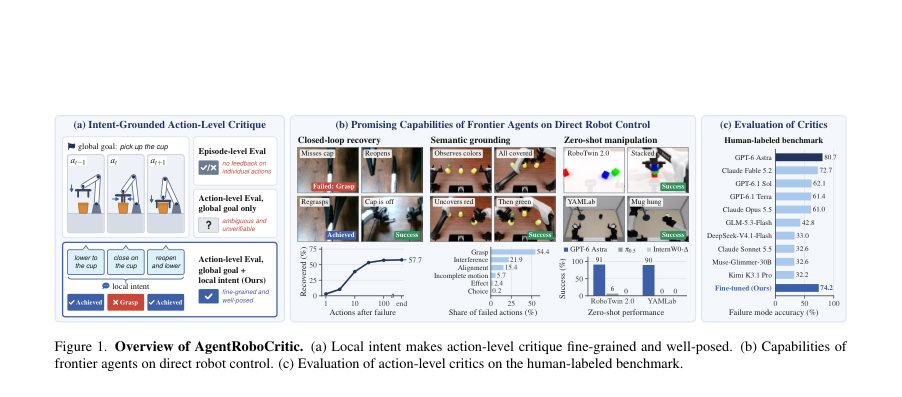
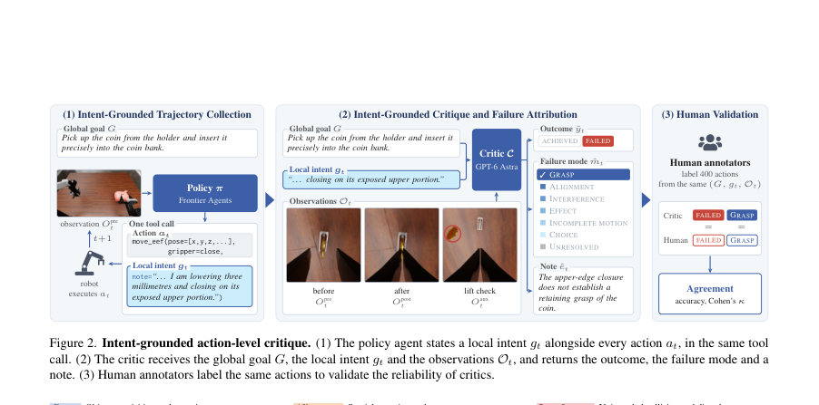
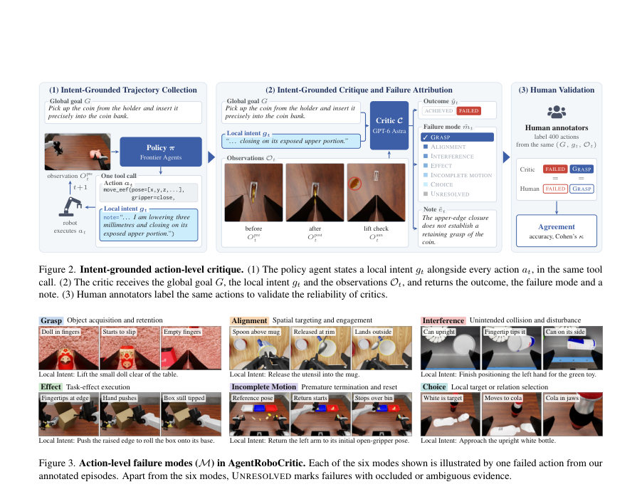

# AgentRoboCritic: Understanding the Capability of Frontier Agents on Direct Robot Control

- **게시일:** 2026-11-22
- **arXiv:** [2611.26613v1](http://arxiv.org/abs/2611.26613v1) · [PDF](https://arxiv.org/pdf/2611.26613v1)
- **저자:** Yiyang Du, Yuxuan Kuang, Qitao Zhao, Yixuan Wang, Zhanqiu Guo, Yi Xu, Xin Li, Wenbin He, Liu Ren, Chenyan Xiong
- **분야:** cs.RO, cs.CL, cs.CV
- **선정 점수:** 4.88
- **선정 이유:** 최근성 0.5, 인용 영향 0.0 (인용 0회), 저자 영향 0.0 (최고 h-index 0), AI 주제 적합성 3.0, 개발자 관심 0.7, 학술 신호 0.8, 오픈 웨이트·주요 연구조직 신호 0.0

[← 2026-11-22 목록으로 돌아가기](../daily/2026-11-22.html)

<!-- paper-visuals:start -->
## 주요 Figure

> 원문 PDF에서 실제 Figure 캡션과 그림 영역이 함께 확인된 자료만 자동 추출했다.

*Figure · 원문 PDF 2쪽 · Figure 1. Overview of AgentRoboCritic. (a) Local intent makes action-level critique fine-grained and well-posed. (b) Capabilities of*

*Figure · 원문 PDF 4쪽 · Figure 2. Intent-grounded action-level critique. (1) The policy agent states a local intent gt alongside every action at, in the same tool*

*Figure · 원문 PDF 4쪽 · Figure 3. Action-level failure modes (M) in AgentRoboCritic. Each of the six modes shown is illustrated by one failed action from our*

<!-- paper-visuals:end -->

## 한 문장 요약

프런티어 멀티모달 언어 에이전트를 직접 로봇 제어 정책으로 평가하기 위해, 정책이 각 액션과 함께 명시한 '로컬 의도'에 기반해 액션 단위 결과와 실패 원인을 자동으로 판정하는 의도-기반 액션 레벨 크리틱 프레임워크(AgentRoboCritic)를 제안하고, 12개 조작 벤치마크에서 액션 수준 분석과 오픈소스 비평기(Muse-Glimmer-30B) 미세튜닝을 통해 능력·한계를 규명하고 데이터셋을 공개한다.

## 해결하려는 문제

기존 평가는 에피소드 수준의 이진 성공률이나 집계 점수에 의존해 프런티어 언어 에이전트가 왜/어떻게 성공하거나 실패하는지 밝히지 못한다. 로봇 조작에서는 동일한 관찰에 대해 여러 유효한 국지적 궤적이 가능하므로 단순한 액션 성공 판정이 애매하며, 액션의 실제 목적(로컬 의도)을 고려하지 않으면 실패 원인 귀속이 불명확해진다. 또한 액션-단위 실패 원인 분류가 자동화될 수 있는지, 그 신뢰성·비용·지연 트레이드오프는 어떠한지도 미정이다.

## 핵심 기여

- 의도-기반 액션 레벨 크리틱 프레임워크(AgentRoboCritic): 정책이 각 액션과 함께 자연어 로컬 의도(gt)를 출력하도록 하고, 전역 과제 목표(G)와 다중 뷰 관찰(Ot)을 조건으로 액션 결과(성취/실패/부분/판별불가)와 실패 모드(7개 범주) 및 간단한 근거를 반환하는 자동화된 크리틱 설계.
- 프런티어 에이전트의 액션-레벨 분석: GPT-6 Astra를 정책·크리틱으로 사용해 12개 조작 벤치마크에서 12,844개의 액션 주석을 수집·분석하여 폐루프 복구, 의미적 그라운딩, 제로-샷 조작 성능 등 능력과 GRASP·ALIGNMENT 같은 물리적 병목을 규명.
- 인간 검증된 400-액션 테스트셋: 자동 크리틱의 신뢰성을 검증하기 위한 400개 인간 주석 액션 벤치마크 구축 및 분석.
- 오픈소스 크리틱 공개 및 미세튜닝: 12,844개 주석으로 Muse-Glimmer-30B를 LoRA로 파인튜닝해 실패모드 정확도를 32.58%에서 74.24%로 개선하고, 낮은 추론 비용으로 액션-레벨 분석 가능케 함.
- 액션-단위 코드북·주석 규약 공개: 실패 모드(7종)와 GRASP 하위 분류(S1..S14), 접촉 인지용 시간 창(포스트-그립 리프트 프레임 포함) 등 재현 가능한 주석 규약을 제시.

## 접근 방법

* 프런티어 멀티모달 언어 에이전트가 전역 과제(G)·사전 관찰(Opre_t)·히스토리(ht)로부터 저수준 수치 제어(at)와 함께 자연어 로컬 의도(gt)를 동시 출력하도록 확장했다(Equation (2)).
* 각 실행된 액션에 대해 바운디드 관찰 창 Ot (사전/사후 프레임 및 필요한 보조 리프트 프레임 Oaux_t)을 제공하고, 크리틱 C(G, gt, Ot)를 통해 액션 결과(achieved/failed/partial/unverifiable/not_applicable), 실패 모드(M1..M7: GRASP, ALIGNMENT, INTERFERENCE, EFFECT, INCOMPLETE MOTION, CHOICE, UNRESOLVED) 및 간단 진단 문구를 산출한다.
* 크리틱 설계 원칙은 (1) 접촉 인지에 적합한 시간 창 사용, (2) 로컬 의도 기준으로 국지적 유효성 분리(에피소드 성공과 분리), (3) 관찰에 기반한 증거-제한 실패 귀속이다.
* 실행 데이터는 12개 벤치마크에서 GPT-6 Astra 정책으로 수집하거나 공개 트레이스에서 의도 노트를 짝지어 수집했다.
* 자동 크리틱으로 GPT-6 Astra 등을 비교 평가하고, 공개형 Muse-Glimmer-30B를 LoRA로 미세튜닝(하이퍼파라미터: LoRA rank=32, peak LR=5e-5, epoch=2, batch=32, 최대 컨텍스트 크게 설정)해 저비용 대안으로 제공했다.

## 주요 결과

- 데이터셋: 12개 벤치마크에서 총 12,844개의 주석된 액션을 공개(학습/검증/테스트 분할, 인간 주석 400개 포함). (Table 9)
- 액션-레벨 복구: 모든 성공 에피소드의 49.8%가 최소 하나의 로컬 실패를 포함(즉, 절반의 성공은 복구를 통해 달성). 에피소드 내 실패 수에 따른 성공률은 실패-무(75.1%) vs 1–2회 실패(40.3%) vs 3+ 실패(13.3%). (Figure 5(a),(b), Table 5)
- 실패 복구 동역학: 분석된 12,163개의 실패 액션 중 38.9%는 이후 10액션 이내에 검증된 복구를 보였고, 57.7%는 에피소드 종료 시점까지 복구됨. 벤치마크별 복구율과 공식 성공률은 Pearson r=0.81로 강한 양의 상관을 보임. (Figure 5(c),(d), Table 4)
- 실패 모드 분포: 전반적으로 실패는 저수준 물리 상호작용으로 집중되며(특히 GRASP), CHOICE(의도와 다른 객체/순서 선택)는 전체 실패의 약 0.2%로 희소함—즉 의미적 선택 오류는 드묾. (Figure 4)
- GRASP 세부: GRASP 실패의 약 세 분의 일(논문: 'Three in five')가 그리퍼 '폐쇄(closure)' 시점에 발생해(포획 전에 실패), 이는 깊이·횡방향 오프셋 등 3D 위치 정밀도의 한계가 주 병목임을 시사. 손실은 주로 첫 리프트나 운반 중 발생. (Section 4.3, Figure 7(b))

## 한계

- 저자가 언급한 한계: 프런티어 에이전트는 강점이 있으나 물리적 실행 병목(특히 오브젝트 획득·유지: GRASP, 민감한 정렬: ALIGNMENT)과 실패 모드별 불균등한 복구 능력을 보이며, 정밀-허용오차가 작은 조립/삽입 과제에서는 ALIGNMENT가 주요 장애물이라고 저자들이 명시함.
- 본문에서 합리적으로 확인되는 제약: (1) 사용된 자동 크리틱 대부분(특히 GPT-6 Astra)은 결정 지연과 추론비용이 크며(테스트셋 비용: GPT-6 Astra $26.06, Muse-Glimmer-30B fine-tuned $0.79), 실시간 제어 루프에 바로 투입하기엔 지연이 크다(예: GPT-6 Astra 중앙값 의사결정 시간 ~31.9s vs π0.5 ~0.11s). (2) 크리틱 신뢰도는 로컬 의도 존재에 의존하며, 로컬 의도가 없을 경우 실패·원인 판정이 크게 붕괴함(로컬 의도 제거 실험에서 정확도 급락). (3) 연구는 주로 GPT-6 Astra 기반 데이터와 공개 벤치마크(시뮬·현실 혼합)에 의존하므로, 다른 정책 아키텍처나 센서셋(예: 고주파 촉각 센서 등)에 대한 일반화는 본문에서 충분히 평가되지 않음.

## 개발자 관점

- 정책 도구 호출 인터페이스에 각 액션의 자연어 '로컬 의도' 필드를 강제하라: 액션-단위 평가와 실패 귀속을 잘-정의된 문제로 만들고 후속 자동 분석·디버깅에 필수적이다.
- 접촉 판단을 위해 포스트-그립 리프트 등 짧은 보조 프레임(Oaux_t)을 로그하라: 단순 사전/사후 프레임만으로는 그립의 안정적 확보 여부를 판단하기 어렵다.
- 자동 크리틱을 현장에 적용할 때는 비용·지연·정확도 트레이드오프 고려: 최상위 상용 모델(GPT-6 Astra)은 정확하지만 비용과 지연이 크므로, 대량 로그 분석이나 오프라인 코퍼스 주석은 미세튜닝된 오픈소스 비평기(Muse-Glimmer-30B)를 사용해 비용을 30× 이상 절감할 수 있다(논문 수치).
- 실시간 피드백 루프 구현 시에는 크리틱 출력을 정책 재시도 입력으로 제공하면 정책 개선에 유의미한 효과: 논문에서 크리틱 피드백을 포함한 재시도는 동일 초기상태에서 성공으로 전환된 사례를 보였다(Section H.1).
- 실행·디버깅 관점에서 유용한 최소 산출물: (1) 로컬 의도 텍스트, (2) 사전/사후/보조 프레임 멀티뷰, (3) 실행상태 메타데이터(명령 거부 여부 등). 이들만 있으면 액션-레벨 자동 진단 및 원인 귀속이 가능하다.

**근거 범위:** 이 분석은 제공된 논문 PDF 본문(본문과 부록 포함)에 기반해 작성되었음. 그래픽에서만 제시되고 본문에 수치로 반복 기재되지 않은 일부 수치는 본문 서술을 우선시했고(예: 일부 그림 바 상의 작은 숫자 미기재), 본문에 명시된 표와 텍스트의 수치를 우선 사용하였다. 구현·하이퍼파라미터(LoRA 설정 등)는 본문 및 부록 표를 근거로 기재했다.
