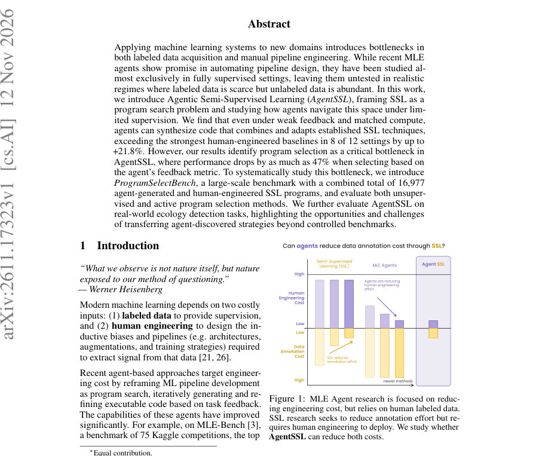
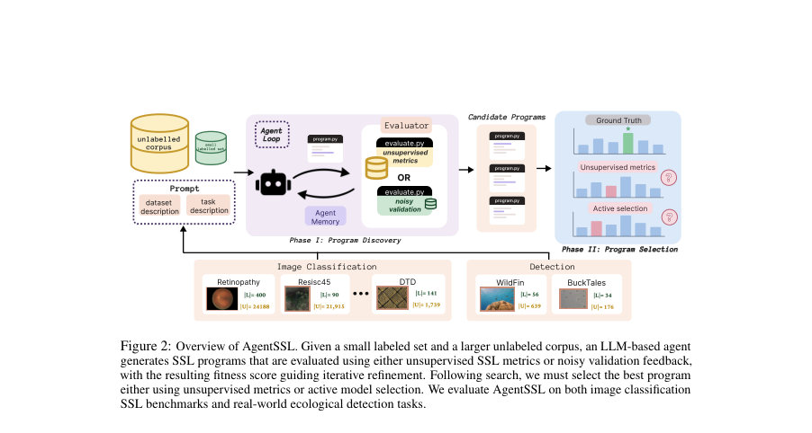
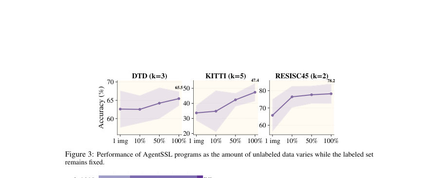

# AgentSSL: Can MLE Agents Leverage Unlabeled Data?

- **게시일:** 2026-11-15
- **arXiv:** [2611.17323v1](http://arxiv.org/abs/2611.17323v1) · [PDF](https://arxiv.org/pdf/2611.17323v1)
- **저자:** Ethan Lin, Akanksha Sarkar, Ziang Liu, Kristin Branson, Jennifer J. Sun
- **분야:** cs.AI, cs.LG
- **선정 점수:** 4.13
- **선정 이유:** 최근성 0.5, 인용 영향 0.0 (인용 0회), 저자 영향 0.0 (최고 h-index 0), AI 주제 적합성 2.6, 개발자 관심 0.5, 학술 신호 0.6, 오픈 웨이트·주요 연구조직 신호 0.0

[← 2026-11-15 목록으로 돌아가기](../daily/2026-11-15.html)

<!-- paper-visuals:start -->
## 주요 Figure

> 원문 PDF에서 실제 Figure 캡션과 그림 영역이 함께 확인된 자료만 자동 추출했다.

*Figure · 원문 PDF 1쪽 · Figure 1: MLE Agent research is focused on reduc-*

*Figure · 원문 PDF 4쪽 · Figure 2: Overview of AgentSSL. Given a small labeled set and a larger unlabeled corpus, an LLM-based agent*

*Figure · 원문 PDF 8쪽 · Figure 3: Performance of AgentSSL programs as the amount of unlabeled data varies while the labeled set*

<!-- paper-visuals:end -->

## 한 문장 요약

AgentSSL은 반지도학습(SSL)을 프로그램 탐색 문제로 재구성해 MLE 에이전트가 소량의 레이블과 풍부한 비표식 데이터(Labeled/Unlabelled)를 입력으로 받아 SSL 파이프라인 코드를 자동 생성·수정하도록 하고, 발견(Program discovery)과 선택(Program selection) 두 축에서 성능과 한계를 체계적으로 평가한 연구이다.

## 해결하려는 문제

기존 MLE(ML 엔지니어링) 에이전트 연구는 대부분 충분한 레이블이 있는 완전지도 환경에서 평가되어 실제로 레이블이 희소하고 비표식 데이터가 풍부한 현실적 조건에서 에이전트가 비표식 데이터를 활용해 성능을 향상시킬 수 있는지 불명확하다. 또한 SSL 방법들은 데이터-특이적 튜닝에 민감하고, 레이블이 적은 상황에서 발견된 여러 후보 프로그램 중 우수한 하나를 신뢰성 있게 선택하는 문제(모델/프로그램 선택)가 실무에서 큰 병목이다. 본문은 이 두 문제(프로그램 발견과 프로그램 선택)를 에이전트 기반 프로그램 탐색 관점으로 정의하고 실험적으로 검증한다.

## 핵심 기여

- Agentic Semi-Supervised Learning(AgentSSL) 제안: SSL을 (L,U)→h를 출력하는 실행 가능한 프로그램의 탐색 문제로 정식화하고 에이전트 검색 요소들을 명시적으로 분해함.
- MLE 에이전트가 제한된 감독(노이즈 검증·무라벨 지표) 하에서도 다양한 SSL 기법을 조합·응용하는 실행 가능한 코드(program)를 합성하여 12개 설정 중 8개에서 인간 설계된 강력한 SSL 베이스라인을 능가함(oracle 기준).
- 프로그램 선택 문제를 주요 병목으로 규정하고 ProgramSelectBench 공개: 에이전트 생성 및 인간 설계 프로그램 총 16,977개를 포함하는 대규모 벤치마크와 다양한 비지도·능동 선택 기법 평가 제공.
- 실세계 생태계(생물 탐지) 태스크에 대한 사례 연구를 수행해 에이전트가 레이블·엔지니어링 비용을 줄일 잠재력과 실제 전이 시의 불안정성을 분석함.

## 접근 방법

* 요약된 접근(본문 기준):
* 문제정의: 프로그램 A:(L,U)→h(예측기) 형태로 SSL 전략을 일반화.
* 에이전트 탐색은 노드가 프로그램인 유향 그래프 Gt로 모델링되며, 연산자(초안·디버그·개선·분석)를 통해 기존 프로그램을 변형하여 신규 프로그램을 생성·평가하고 그래프에 추가함.
* 에이전트 사양은 (F, πsel, O, πop, M)으로 정의됨.
* 피트니스(F): 검색 중 반환되는 피드백으로 두 종류를 사용—(1) noisy validation: 소규모 레이블을 검증에 사용한 감독 신호(분산 큼), (2) unsupervised metrics: 레이블 없이 예측/표현에 대한 통계(AMI, ARI, silhouette 등).
* (메트릭 계산 상세는 부록 참조)
* 탐색 정책(πsel): 그리디, MCTS, 진화적(evolutionary) 등 비교.
* 주 실험은 그리디 사용.
* 연산자 집합은 고정(초안·디버그·개선·분석).
* 언어모델(M): GPT-5.4와 Gemini-3.1 등을 비교하여 프로그램 생성 능력과 탐색 다양성에 미치는 영향을 분석.
* 구현 세부: AIRA-Dojo 실행 환경 사용, 후보 프로그램은 Apptainer(격리)에서 실행.
* 실험에서 에이전트는 CLIP ViT-B-16과 DINOv2-B 백본만 사용하도록 탐색공간을 제약하고 PEFT(LoRA/Adaptformer) 라이브러리 사용.
* 초기화는 단순한 supervised warm-start 프로그램으로 시작.
* 예산·데이터: VTAB 계열 6개 이미지 분류 데이터셋(DTD, SUN397, RESISC45, Retinopathy, CLEVR-Count, KITTI) 각종 샷 설정(클래스당 레이블 수)과 3개 랜덤 스플릿.
* 작은 데이터셋은 RTX 6000 Ada에서 8시간, 큰 데이터셋은 H100 또는 Blackwell RTX 6000에서 15시간 검색 예산.
* AgentSL 변형(비표식 데이터 미사용)도 비교.
* 평가 지표: (i) 발견(oracle) 성능 = 발견 풀에서의 최고 프로그램 Q(A*), (ii) 선택 후 성능 손실(selection regret) Rsel = Q(A*) − Q(As).
* 프로그램 선택은 무라벨(비지도) 지표선택 혹은 능동 모델 선택(제한된 라벨 예산으로 후보를 평가)으로 수행.
* 추가 자원: ProgramSelectBench(16,977개 프로그램, >10,000 GPU시간에 해당하는 사전계산 결과) 공개.

## 주요 결과

- Oracle 발견 성능: 에이전트가 생성한 최상 프로그램(Abest)은 인간 설계된 최강 SSL 베이스라인(Hbest)에 대해 12개 설정 중 8개에서 우수했고 최대 개선폭은 +21.81%까지 관찰됨(테이블 1, Abest−Hbest).
- 프로그램 선택 병목: 피트니스(검색 중 사용한 피드백)를 그대로 선택 기준으로 삼으면 성능이 크게 저하될 수 있음(선택 기반 성능 하락이 최대 47%까지 관찰됨—본문 요약). Table 2의 무라벨 선택 후 회귀(regret)에서 큰 손실을 보고함.
- 무라벨 지표의 한계 및 능동 선택 효과: 무라벨 지표가 테스트 성능과 잘 정렬될 때는 잘 작동하나 실패할 경우 제한된 라벨 예산으로 후보를 평가하는 능동 모델 선택(예: ActiveTesting, VMA, CODA, ModelSelector 등)에 라벨을 일부 할당하면 동일한 예산을 전부 학습에 쓰는 것보다 더 나은 최종 선택을 만들 수 있음(Table 3; Retinopathy 등에서 +25% 근처의 이득 사례 존재). 다만 능동 방법들은 방법별로 분산·안정성에 차이가 있음(예: CODA·ModelSelector는 적은 라벨로 수렴하나 레이블이 누적될수록 불안정할 수 있음).
- 에이전트 탐색의 다양성: LLM-as-judge 파이프라인을 통해 에이전트 생성 프로그램을 분류한 결과, 에이전트는 다양한 SSL 패러다임을 발견·혼합함(예: 의사라벨링 70.5%, 일관성 규제 48.9%, 자기학습/재학습 39.5% 등; Figure 4).
- 비표식 데이터 활용 증거: 특정 상위 프로그램의 평가에서 비표식 데이터 U의 크기를 늘리면 성능이 상승하여(그리드 실험, Figure 3) 탐색된 프로그램들이 실제로 비표식 데이터를 활용함을 시사함. 예: RESISC45·DTD·KITTI 등에서 무라벨 증가에 따른 정확도 개선 관찰.  자연·특수·구조적 데이터셋에서 에이전트가 도메인 특화 설계(예: Retinopathy에서 prototype + kNN + ordinal bias)로 큰 개선(약 +19%)을 달성함(섹션 6.3).

## 한계

- (저자 명시) SSL이 항상 지도학습보다 낫지 않음: 일부 현실 태스크(예: ecology 사례)에서는 단순한 지도적 설계가 동일하거나 더 효과적일 수 있음(에이전트 변형인 AgentSL이 AgentSSL과 동등한 성능을 보인 사례 존재).
- (저자 명시) 통제된 AIRA-Dojo 프레임워크와 사용한 LLM·검색정책·연산자 집합에 의존함. 더 강력한 LLM이나 다른 하니스가 더 나은 결과를 낼 수 있어 본 논문 결과는 초기(초기값) 기준이라는 점.
- (저자 명시) 약한 피드백에 의존하는 탐색을 사용했으며, 피드백이 강해질 때 탐색 효율과 최종 정확도가 어떻게 변하는지는 미해결 문제.
- (관찰로부터 확인된 제약) 프로그램 선택이 핵심 병목임: 무라벨(비지도) 지표는 모델이 동일한 표현(frozen representation)을 재사용하는 경우 후보를 구분하지 못해 성능 선택에 실패할 수 있음. 선택 성능 저하는 최대 수십 퍼센트까지 관찰됨(Table 2). 또한 능동 선택 방법은 방법별로 분산·안정성 트레이드오프가 큼(Table 3, 부록 분석).  」「(실험 범위 제약, 본문으로 확인) 실험은 이미지 분류(VTAB 계열)와 두 생태계 탐지 태스크(WildFin, BuckTales)에 국한되고, 사용 가능한 백본(Clip/DINOv2)·PEFT 옵션·연산자 집합·검색 예산으로 탐색공간을 제약함. 따라서 다른 도메인·아키텍처·더 넓은 연산자 집합에서의 일반화는 추가 검증 필요.

## 개발자 관점

- 프로그램 검색 파이프라인 구성: AIRA-Dojo 같은 격리 실행(harness)과 컨테이너(Apptainer)를 사용해 에이전트가 생성한 코드를 안전하게 실행·검증하라. 본문은 이 방식을 사용함.
- 탐색공간 설계: 비교 가능성을 위해 백본·PEFT·기본 인프라를 고정하면 에이전트가 SSL 전략 탐색에 집중하게 할 수 있음(논문은 CLIP ViT-B-16·DINOv2-B만 허용).
- 피드백(피트니스) 설계의 중요성: 무라벨 지표는 전제(예: 표현 품질, 군집 구조)가 맞을 때는 효율적이지만, 그렇지 않으면 후보 선택 실패를 야기하므로 실제 배포에서는 (a) 여러 무라벨 지표를 조합하거나 (b) 일부 라벨을 능동적 선택에 할당하는 정책을 고려하라. 논문에서는 동일 예산 내에서 레이블을 선택용으로 일부 배분하면 성능이 향상되는 사례를 보고함.
- LLM·검색정책 선택: LLM(예: GPT-5.4 vs Gemini-3.1)은 최종 정확도보다는 발견된 솔루션의 다양성에 큰 영향을 미침. 진화적 검색은 다양성(다양한 SSL 패러다임 탐색)을 증진하므로 탐색 예산이 큰 경우 유용할 수 있음. 개발자는 다양성-성능 트레이드오프를 고려해 LLM과 검색정책을 선택해야 함.
- 재현·비용 고려: ProgramSelectBench 데이터(16,977 프로그램, 저자 언급으로 >10,000 GPU시간 규모)가 공개되어 있으나, 실제 에이전트 검색은 데이터셋 크기별로 GPU 수·시간을 다르게 배정(작은 데이터셋: 8시간/RTX6000, 큰 데이터셋: 15시간/H100 등)하고 초기화(슈퍼바이즈드 warm-start)를 사용했음을 염두에 둘 것. 대규모 탐색은 상당한 비용이 소요됨.」「안전·검증: 에이전트가 생성한 프로그램은 데이터·도메인 특화 설계(예: 비모수적 k-NN+prototype) 등 비표준적 접근을 포함할 수 있으므로, 배포 전 도메인 전문가의 검토·소규모 라벨 기반 검증을 반드시 수행하라.

**근거 범위:** 이 분석은 제공된 논문 PDF 본문(주요 본문과 도표·표)을 기반으로 작성되었다. 부록(세부 구현·메트릭 계산)은 본문에서 여러 번 참조되지만 PDF에서 일부 부록 내용이 축약되어 인용되었으므로, 매우 세부적인 구현 매개변수나 추가 수치(예: 부록 내 전체 하이퍼파라미터 그리드, 모든 실험별 표준편차)는 본문에서 직접 확인되지 않은 경우가 있다. 본문에 명시된 표·그림(테이블 1–3, Figure 3–6 등)과 저자가 본문에서 직접 기재한 한계·기여는 본문 텍스트에 근거하여 보고하였다.
