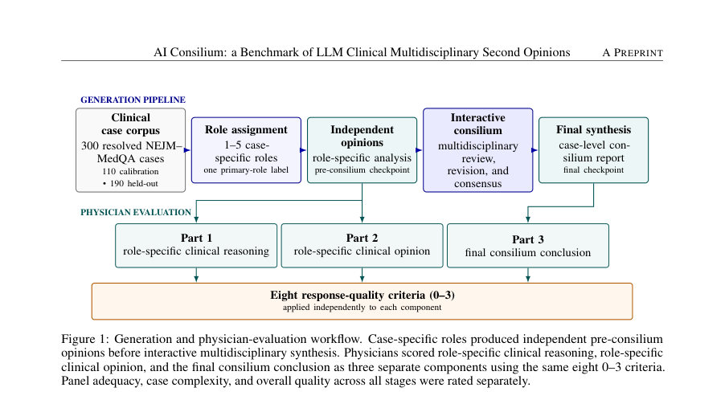
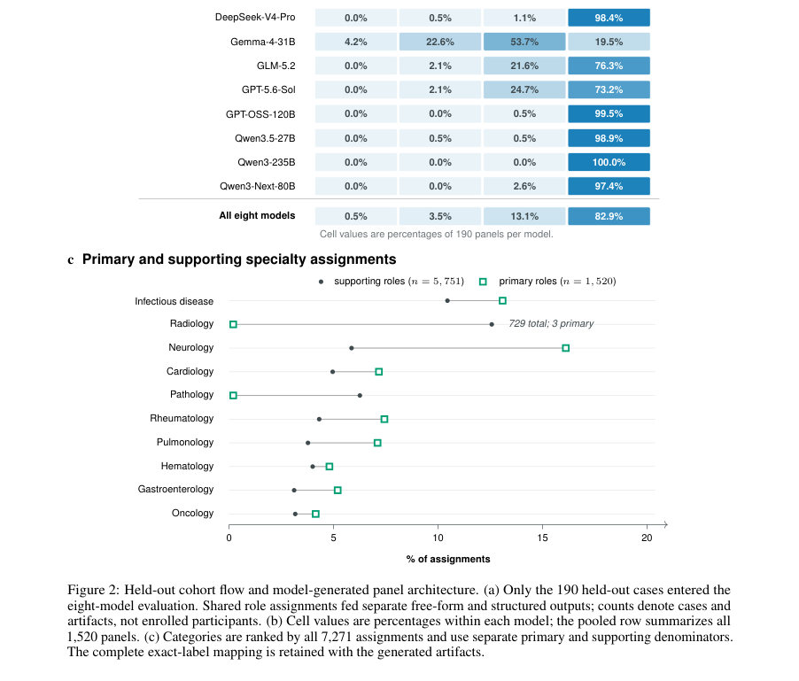
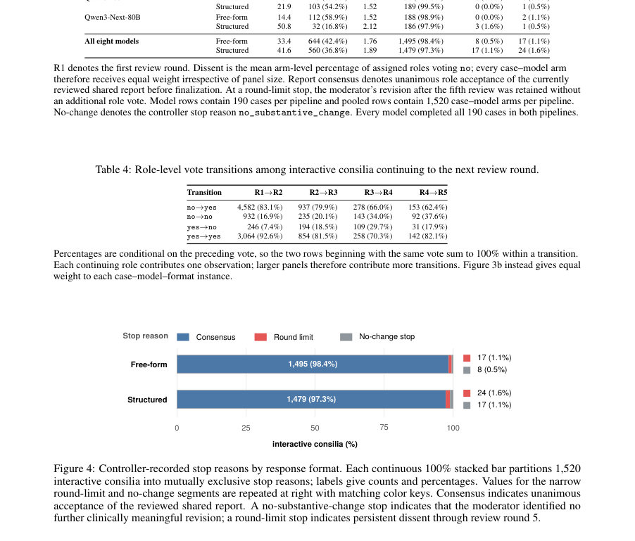

# AI Consilium: a Benchmark of LLM Clinical Multidisciplinary Second Opinions

- **게시일:** 2026-10-18
- **arXiv:** [2610.22298v1](http://arxiv.org/abs/2610.22298v1) · [PDF](https://arxiv.org/pdf/2610.22298v1)
- **저자:** Alexey A. Bokov, Ivan I. Panin, Nikolay B. Nechaev, Mikhail Yu. Valkov, Valeria Yu. Chernina, Natalia Gombolevskaya, Ayyaz Hussain, Vladimir M. Agafonov, Victor A. Gombolevskiy, Aleksandr V. Nesterov, Iaroslav R. Bespalov, Ivan V. Oseledets, Dmitry V. Dylov
- **분야:** cs.CL, cs.AI
- **선정 점수:** 4.49
- **선정 이유:** 최근성 0.5, 인용 영향 0.0 (인용 0회), 저자 영향 0.0 (최고 h-index 0), AI 주제 적합성 3.0, 개발자 관심 0.2, 학술 신호 0.8, 오픈 웨이트·주요 연구조직 신호 0.0

[← 2026-10-18 목록으로 돌아가기](../daily/2026-10-18.html)

<!-- paper-visuals:start -->
## 주요 Figure

> 원문 PDF에서 실제 Figure 캡션과 그림 영역이 함께 확인된 자료만 자동 추출했다.

*Figure · 원문 PDF 6쪽 · Figure 1: Generation and physician-evaluation workflow. Case-specific roles produced independent pre-consilium*

*Figure · 원문 PDF 13쪽 · Figure 2: Held-out cohort flow and model-generated panel architecture. (a) Only the 190 held-out cases entered the*

*Figure · 원문 PDF 16쪽 · Figure 4: Controller-recorded stop reasons by response format. Each continuous 100% stacked bar partitions 1,520*

<!-- paper-visuals:end -->

## 한 문장 요약

NEJM 케이스 300건(110개 캘리브레이션, 190개 평가)을 사용해 역할별 독립의견과 대화형 다학제 합의를 생성·비교하는 벤치마크(AI Consilium)를 제안하고, 구조화된 응답·합의 과정·모델 정체성의 효과를 의사-교정 LLM Judge로 다차원 평가하여 모델 간 성능 차이와 합성의 기여를 분해·정량화했다.

## 해결하려는 문제

기존 연구는 LLM의 진단 정확도를 보고하지만, 임상적 '세컨드 오피니언'으로서 요구되는 사실 근거성(factual grounding), 임상적 논리 일관성, 실행 가능성(관리 계획), 불확실성 명시 및 안전성 등 다차원적 품질을 충분히 평가하지 못하며, 구조화된 추론·다중 에이전트(다학제) 합의·반복적 심사(심의)의 개별 효과를 분리하고 계산 자원(confounding)을 통제한 비교가 부족하다.

## 핵심 기여

- 동일 케이스에서 역할별(1–5개 역할) 독립 의견(pre-consilium)과 대화형 다학제 합의(consilium)를 별도 산출물로 평가하는 벤치마크 설계
- 사실 근거성, 문제 우선순위, 데이터 사용, 추론 일관성, 감별진단, 최종결론, 관리계획, 안전성 등 8개 항목의 의사 개발 다차원 평가 프레임워크
- 응답 형식(자유형 vs 구조화), 추론 위상(단일 vs N+1), 역할 구성, 모델 정체성 등을 분리하여 통제 비교 가능하게 구성한 실험 파이프라인
- 의사 평가로 캘리브레이션된 LLM Judge(GPT-OSS-120B)를 이용한 대규모 자동 평가(3,040개 최종 리포트 및 대응하는 구조화된 주역할 출력 평가)와 Judge의 기준별 교정 절차
- 구조화 응답과 다학제 합성이 어떤 평가 기준(특히 관리[management], 문제 우선순위, 사실 근거성, 추론 일관성)에 기여하는지 정량적으로 분석

## 접근 방법

* 데이터는 NEJM–MedQA의 진단이 확정된 300개 NEJM Case Records(2015–2023)를 사용하고 DOI 기반으로 고정 분할(110개: 의사 주석 및 Judge 교정, 190개: 히든 평가)을 적용.
* 파이프라인은 세 단계로 구성: (1) 케이스별 역할 할당(1–5개, 하나는 primary로 표기), (2) 각 역할의 독립적 사전 의견(pre-consilium) 생성(자유형 또는 구조화된 스키마), (3) 모든 역할의 고정된 사전 의견을 입력으로 하는 대화형 consilium(최대 5라운드)으로 최종 합성.
* 구조화 조건은 필수 필드(주관·객관 정보, 임상 증후·기전, 감별진단 근거, 진단·치료 전술, 최종 의견)를 요구함.
* 대화형 프로토콜: 각 라운드에서 역할별로 찬반(yes/no) 투표 및 비동의시 임상적 비평과 수정안 제출, 조정자(moderator)는 이견을 고려해 보고서를 수정하거나 변경 불필요로 기록.
* 중단 기준: 전원 찬성, 조정자의 변경 불필요 기록, 이전 상태 반복, 5라운드 종료.
* 캘리브레이션 코퍼스에는 OpenRouter에서 선별한 모델(예: GLM-5.2를 종합자 및 consilium 수행자, MiniMax M3·DeepSeek-V4-Pro·Kimi K2.6을 워커로 사용)의 3+1 워커 구성 사용.
* 히든 190건 평가는 각 모델이 단일 모델 파이프라인(역할 할당·사전 생성·리뷰·최종화 모두 동일 모델 수행)로 실행된 8개 후보 모델(DeepSeek-V4-Pro, Gemma-4-31B, GLM-5.2, GPT-5.6-Sol, GPT-OSS-120B, Qwen3.5-27B, Qwen3-235B, Qwen3-Next-80B).
* 생성 파라미터는 temperature=0, top-p=1, seed=42, 최대 5라운드, 모델별 토큰 한도(역할할당: 1,024/2,048/4,096; pre-consilium: 16,000/16,384; consilium:16,000/32,768) 등 고정.
* 평가: 의사가 개발한 8개 0–3 척도 기준과 패널 적절성·사례 복잡성·전반 품질을 사용.
* 의사 평가는 단일 블라인드(모델·조건 미공개), 6명의 의사 패널(각 사례에 대해 3개 전문분야 관점에서 평가).
* LLM Judge는 GPT-OSS-120B로 의사 평가지에 따라 교정되어 각 컴포넌트별로 판단을 수행(프롬프트에 기준 정의·4개 점수 앵커 포함).
* 사실 조작(fabricated facts)에 대한 엄격 규칙을 점수화에 적용.

## 주요 결과

- 데이터: 300개 NEJM 케이스(110 캘리브레이션, 190 히든). LLM Judge가 총 3,040개의 최종 리포트와 대응하는 구조화된 주역할(pre-consilium primary-role) 출력을 평가(저자 보고)
- 구조화된 최종 리포트는 8개 모델 파이프라인 중 7개에서 평균 점수가 더 높았음(저자 보고). 관리(Justification and specificity of management) 항목에서 구조화된 최종 리포트의 평균 점수가 2.740 vs 자유형 2.436으로 가장 뚜렷한 이득을 보임(저자 보고)
- 구조화된 사전(주역할) 의견과 비교할 때, 완전한 구조화 합성(structured synthesis)은 공통 기준(논문에서 '공유 기준'으로 언급된 5개 기준)에 대해 합산 점수가 증가했으며, 가장 큰 증가가 문제 우선순위(Identification and prioritization), 사실 근거(Factual grounding), 추론 일관성(Coherence of clinical reasoning)에서 관찰됨(저자 보고)
- 모델별 성과: GPT-5.6-Sol이 모든 평가 구성요소에서 선두를 차지했고 합의(consensus)에 도달하는 라운드 수가 가장 적었음(저자 보고)
- 평가 파이프라인·Judge 활용으로 모델 정체성이 응답 형식보다 리포트 품질 분산을 더 크게 설명한다는 결론을 제시(저자 요약)

## 한계

- 저자 명시: NEJM Case Records는 드문·복잡한 증례를 포함하므로 결과를 일상 임상 실무 성능으로 일반화해서는 안 됨
- 저자 명시: 역할 라벨은 검증된 전문성의 증거가 아니며, 역할 지정만으로 객관적 성능 향상이 보장되지 않음(페르소나·역할 프롬프트의 한계)
- 저자 명시: 다중 에이전트(다학제) 접근은 토큰 사용량·모델 호출 수 등 계산 비용과 혼동될 수 있으며, 합의 자체가 품질 보증 수단이 아니라는 점(합의 압력으로 인한 오류 억압 위험 포함)
- 추정 한계(논문 본문으로 합리적으로 확인 가능한 제약): LLM Judge는 의사 교정을 거쳤으나 모든 평가 기준·상황에서 인간 평가자와 완전 동등하다고 보장할 수 없고(저자도 LLM-as-judge 한계 논의), 논문에 제시된 일부 정량적 비교(예: 모델 간 통계적 유의성, 분산 분석 세부값)는 본문 발췌에 포함되지 않아 상세 재현을 위해 추가 데이터 필요함

## 개발자 관점

- 재현성: 모델 식별, 프롬프트, 생성 파라미터(temperature=0, top-p=1, seed=42), 토큰 한도, 라운드 제한(최대 5라운드) 등 실행 세부사항을 기록·고정하여 재현 가능성을 높임 — 구현 시 모든 런 매니페스트를 보관할 것
- 평가 자동화: 의사 주석으로 LLM Judge를 캘리브레이션하면 대규모 평가가 가능하나, Judge-인간 불일치 가능성 때문에 기준별(criterion-wise) 검증과 의사 샘플링이 필요함
- 응답 구조화의 가치: 구조화된 응답 스키마는 특히 관리 계획 항목에서 개선을 가져왔으므로 임상용 리포트 설계 시 필수 필드를 명시해 라벨링·검토를 용이하게 할 것
- 합의 워크플로우 설계: 대화형 consilium은 역할별 찬반 투표·비평·조정자 수정 루프를 적용해 불일치와 미해결 이슈를 명시적으로 보존하므로, 실제 서비스 배포에서는 합의 불일치 기록·비동의 처리 로직과 사용자(임상의)에게 노출되는 불확실성 표기 정책을 설계할 것
- 비용·안전성: 다학제·반복 심사는 토큰·호출 수 증가로 비용과 대기시간이 상승하므로 동등 계산 예산(equal-compute) 대비 이득을 확인해야 하며, 생성된 응답의 '제조된 사실(fabrication)' 규칙을 평가 파이프라인에 통합해 중대한 허위 정보가 관리 계획에 영향을 미치지 않도록 할 것

**근거 범위:** 이 분석은 제공된 논문 PDF 본문 텍스트(초록, 서론, 관련연구, 방법, 평가 지침 및 예시, 알고리즘·파라미터 설명 등 발췌)를 기반으로 작성되었음. 주요 수치와 방법적 세부(데이터 분할, 모델 목록, 생성 파라미터, 평가 기준, consilium 프로토콜)는 본문에서 직접 확인 가능함. 다만 전체 논문에 포함될 수 있는 추가 표·세부 통계(예: 모델별 분산 분석 표, 추가 정량 결과 수치(신뢰구간·p값) 등)는 제공된 발췌에 포함되지 않아 상세 수치 일부는 본문 전체를 참조해야 완전 확인 가능함.
