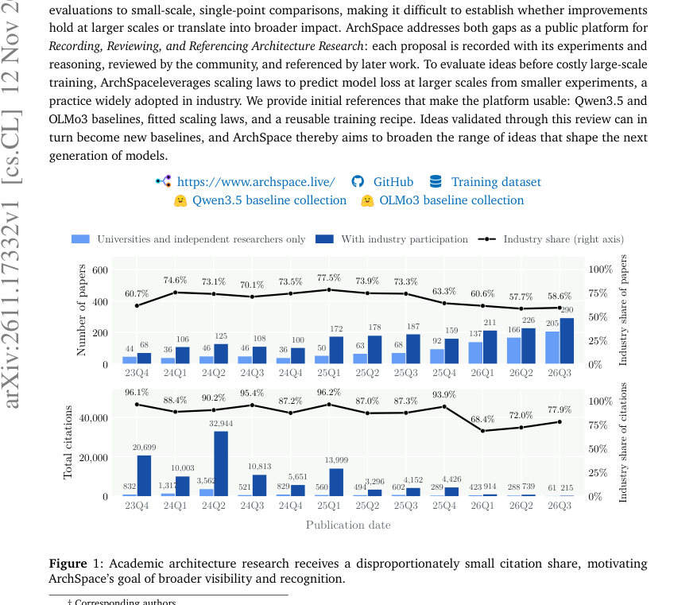
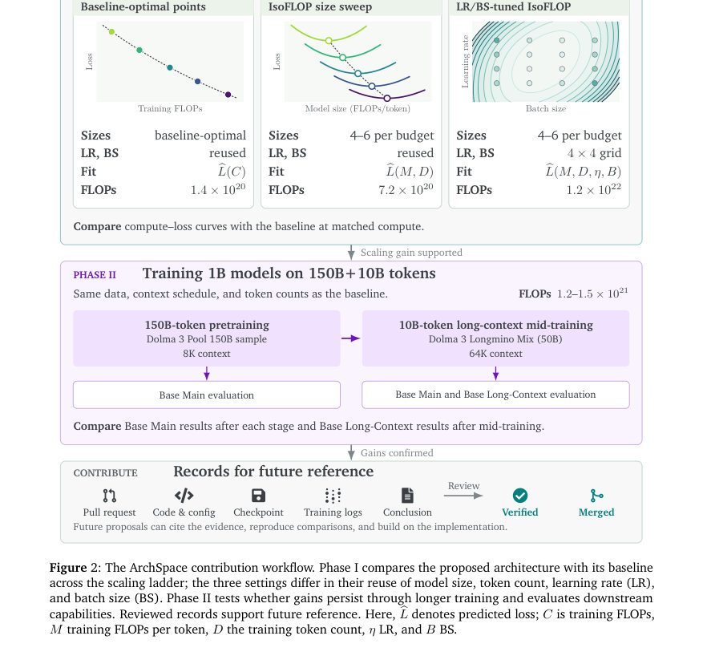
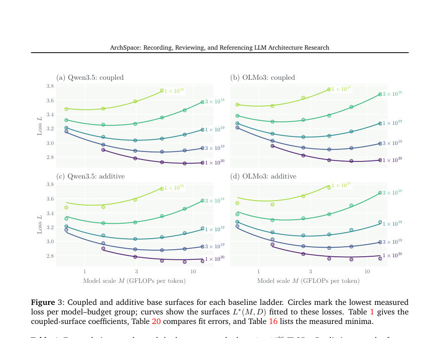

# ArchSpace: Recording, Reviewing, and Referencing LLM Architecture Research

- **게시일:** 2026-11-14
- **arXiv:** [2611.17332v1](http://arxiv.org/abs/2611.17332v1) · [PDF](https://arxiv.org/pdf/2611.17332v1)
- **저자:** Jie Wang, Tong Zhu, JiaHao Kuang, Zhe Xu, Yunkai Chai, Dehong Zheng, Yu Cheng, Tao Ji, ZhouHan Lin, Qi Zhang, Bowen Zhou
- **분야:** cs.CL, cs.LG
- **선정 점수:** 6.80
- **선정 이유:** 최근성 0.7, 인용 영향 0.0 (인용 0회), 저자 영향 0.0 (최고 h-index 0), AI 주제 적합성 3.0, 개발자 관심 0.2, 학술 신호 0.3, 오픈 웨이트·주요 연구조직 신호 2.5

[← 2026-11-14 목록으로 돌아가기](../daily/2026-11-14.html)

<!-- paper-visuals:start -->
## 주요 Figure

> 원문 PDF에서 실제 Figure 캡션과 그림 영역이 함께 확인된 자료만 자동 추출했다.

*Figure · 원문 PDF 1쪽 · Figure 1: Academic architecture research receives a disproportionately small citation share, motivating*

*Figure · 원문 PDF 3쪽 · Figure 2: The ArchSpace contribution workflow. Phase I compares the proposed architecture with its baseline*

*Figure · 원문 PDF 8쪽 · Figure 3: Coupled and additive base surfaces for each baseline ladder. Circles mark the lowest measured*

<!-- paper-visuals:end -->

## 한 문장 요약

ArchSpace라는 공개 플랫폼과 표준화된 검증 프레임워크를 제안하여 LLM 아키텍처 변경을 기록·검토·참조하고, 소규모 실험과 적합한 스케일링 법칙을 이용해 대규모 학습에서의 성능을 예측·검증할 수 있게 한다.

## 해결하려는 문제

(1) 산업계에서 많은 아키텍처 혁신이 공개되지만 성공·중단·설계 결정의 상세 실험 기록이 부족해 이후 연구가 재현·확장하기 어렵다. (2) 학계는 계산 자원과 일관된 기준의 제약으로 소규모 단일-포인트 비교에 머무르며, 제안된 아키텍처의 대규모로의 일반화와 실제적 영향이 불확실하다. (3) 아키텍처 비교에 필요한 비용·하이퍼파라미터 탐색과 스케일링 특성의 차이를 체계적으로 통제하는 표준화된 방법이 부족하다.

## 핵심 기여

- ArchSpace: 아키텍처 제안(issue)→구현·실험·로그·체크포인트·결과를 PR로 제출하고 커뮤니티가 검토·검증하여 참조 가능한 레코드를 남기는 공개 플랫폼과 워크플로를 제시.
- 검증 프레임워크: Phase I(스케일링 사다리의 5개 예산에서 스케일링 법칙을 적합해 계산–손실 곡선을 비교)와 Phase II(1B 모델을 150B 토큰 + 10B 장문 중간학습으로 학습해 장기학습·장문 성능을 직접 평가)를 표준으로 제안.
- 기초 기준 제공: Qwen3.5와 OLMo3에 대한 baseline ladder(다양한 모델 규모·예산·LR·BS 스윕), 이들에 대한 적합된 스케일링 법칙 및 LR/BS 법칙을 공개하여 후속 검증에서 재사용 가능하게 함.
- 스케일링 법칙 설계·검증: 모델·데이터 항(term)을 결합하는 coupled base surface(Equation 3)를 채택하고 LR–BS 의존성은 cosh 기반 항(Equation 5)으로 모델링하여 swept runs와 외삽(extrapolation)에서 낮은 예측 오차를 달성함(예: 전체 스윕에 대한 MAPE 약 0.25–0.27%).
- 재현 가능한 훈련 레시피와 비용·검색 전략 제시: Phase II용 1B 모델 레시피(예: Qwen3.5 선택 레시피 peak LR 3e-3/BS 4M, mid-train LR 1e-3/BS 4M)와 탐색 설정(Setting1–3) 및 계산 비용 비교를 제공(예: 전체 검색 약 1.6×10^22 FLOPs, 재사용 레시피로 양 모델 각 1.47×10^21·1.24×10^21 FLOPs).

## 접근 방법

* 플랫폼·워크플로: 사용자는 Architecture Proposal 이슈에서 변경 내용·기준·검증계획을 제시하고, 구현·로그·체크포인트를 포함한 PR로 제출하면 커뮤니티가 구현 일치성·재현성·실험 근거를 검토해 병합한다.
* 검증 프레임워크는 두 단계로 구성됨.
* Phase I: 동일 데이터·토크나이저를 쓰고 5개 훈련 FLOPs 예산(1×10^18, 3×10^18, 1×10^19, 3×10^19, 1×10^20 FLOPs)에서 모델 규모(M: FLOPs/토큰)와 토큰 수 D를 조정하는 IsoFLOP 또는 baseline-optimal 실험을 수행해 각 아키텍처별 최소 달성 손실 𝐿*(M,D)를 적합함(Equation 3, coupled form).
* LR·BS 의존성은 ∆L 항으로 분리해 cosh 기반 모델(Equation 5)을 사용하고, 두 단계(먼저 𝐿*를 그룹 최소값에 적합하고 ∆L을 고정 𝐿*에 맞춰 적합)로 피팅함.
* 세 가지 설정: Setting1(기본 레시피 재사용, 1 run/예산), Setting2(IsoFLOP 사이즈 스윕, LR·BS 재사용), Setting3(LR·BS 그리드 튜닝 포함).
* Phase II: Phase I의 예측을 바탕으로 1B 모델을 150B 토큰으로 8K 컨텍스트에서 사전학습하고, 10B 토큰을 64K 장문 중간학습으로 확장해 Base Main과 Base Long-Context(주요 지표: OLMES, RULER, HELMET)를 평가함.
* 실험 설정: Dolma 3 Pool 150B 샘플과 Dolma 3 Longmino Mix(50B), 동일 토크나이저, Muon+AdamW, WSD 스케줄 및 탐색 그리드 등 논문 본문과 부록에 명시된 레시피·그리드를 따름.

## 주요 결과

- 스케일링 법칙 적합 품질: coupled base surface와 전체 법칙(∆L 포함)은 swept runs에서 Best-point MAPE 0.13% (Qwen3.5)·0.11% (OLMo3)와 All-point MAPE 0.25% (Qwen3.5)·0.27% (OLMo3)를 기록(Table 3, Table 20).
- 외삽 검증: 피팅 계수를 고정한 상태로 더 큰 예산에서 훈련한 extrapolation runs에 대해 예측 오차 MAPE 0.32% (Table 4).
- LR·BS 최적치 예측 한계: 고정-기울기(fixed-slope) 법칙에서 예측한 최적 LR은 실제 최적 LR과 차이가 크며 MAPE가 Qwen3.5에서 약 35.1%, OLMo3에서 23.1%로 보고되어 예측치로 초기화한 뒤 지역적 튜닝이 필요함(Section 4.3).
- Phase II(1B) 기준선 성능: Qwen3.5와 OLMo3 1B 모델을 pretraining(≈150B 토큰) 후 long-context mid-training(10B 토큰, 64K)까지 학습한 결과 Base Main 및 장문 성능이 크게 향상됨. 예: Qwen3.5 Base Main score가 pretrained 27.9 → mid-trained 46.3로 상승, OLMo3는 26.2 → 40.5로 상승(Table 10).
- 장문 평가(RULER/HELMET): Qwen3.5 64K RULER는 pretrained 17.5 → mid-trained 57.0, HELMET는 23.3 → 39.1 등 큰 개선을 보임(Table 11, Table 9). OLMo3도 유사하게 개선됨(예: RULER 2.7 → 36.1).

## 한계

- 저자가 명시한 한계: (1) LR와 BS의 최적값 예측 정확도는 낮아(예: LR MAPE 23–35%) Setting 3에서 예측치로 초기화한 뒤 측정된 손실로 최종 레시피를 선택해야 함(Section 4.3). (2) Phase II의 장기 전이와 장문 중간학습은 1B 모델 규모와 특정 토큰 수(약 150B+10B)에 한정되어 있으며, 더 큰 규모·다른 데이터 믹스에 대한 일반화는 추가 검증이 필요함(Section 3.2, 5). (3) scaling-law 기반 예측은 LR·BS·warmup 등 스케줄 차이에 민감하여(예: pretraining 스윕에서는 고정된 계수가 약 1% 수준으로 과대 예측함) 실험적 튜닝이 여전히 요구됨(Section 5.1,E.2).
- 본문·실험에서 확인되는 추가 제약(저자 구분): (4) 스케일링 법칙 피팅·검증은 동일한 데이터셋(Dolma 3 Pool/Longmino Mix)·토크나이저·훈련 구현을 전제로 하며, 다른 데이터·토크나이저 또는 optimizer/라이브러리 차이에 대한 민감도는 본문에서 다루지 않음. (5) 플랫폼은 PR 기반 기록·검토를 권장하지만 실제 커뮤니티 확산·중복 작업 관리·외부 기여자의 신뢰성 보장 등 운영적 한계는 본문에서 상세히 다루지 않음.

## 개발자 관점

- 재현성: ArchSpace PR은 코드·설정·체크포인트·학습 로그·실패 사례까지 함께 제출하도록 요구하므로 제안 아키텍처를 실험적으로 재현·검증하는 데 필요한 자료가 구조화되어 있음(Section 2, Figure 2).
- 검증 비용 설계: 세 가지 Setting(1: baseline-optimal 재사용, 2: IsoFLOP 사이즈 스윕, 3: LR/BS 튜닝 포함)은 아키텍처 변화의 규모와 사용 가능한 FLOPs 예산에 따라 선택하여 비용을 절감할 수 있음(Section 3.1).
- 스케일링 법칙의 실무적 사용: 소규모/중간 규모 실험으로 compute–loss 트렌드를 적합해 대규모에서의 손실을 예측하면 값비싼 대규모 학습을 시작하기 전에 유망성을 평가할 수 있으나, LR·BS는 예측치로 초기화 후 반드시 현장 튜닝이 필요함(Section 4.3, D.4).
- 레시피 재사용과 비용절감: 검증된 레시피를 재사용하면 검색 비용 대비 실제 배포 비용이 훨씬 낮음(예: Qwen3.5 전체 탐색 약 1.6×10^22 FLOPs, 재사용된 단일 레시피로는 약 1.47×10^21 FLOPs) — 따라서 초기 탐색을 체계적으로 기록하고 우수 레시피를 baseline으로 고정해 재사용하라(Section 5.2,E.2).
- 평가 지표 권장: Phase II에서는 손실(prediction loss)뿐 아니라 Base Main, RULER, HELMET 같은 downstream 및 장문 지표를 함께 고려해 레시피를 선택해야 함(Section 5.1–5.3, Table 8–11).

**근거 범위:** 이 분석은 제공된 논문 PDF 본문(본문, 도표, 표, 부록 항목들을 포함한 페이지 내용)을 기준으로 작성되었음. 모든 정량 수치(예: 스케일링 법칙 적합 계수·MAPE·Phase II 결과·FLOPs 비용 등)는 본문·표에서 직접 확인 가능한 값만 포함함. 본문 외부(예: 코드 저장소의 세부 구현, 일부 부록의 전체 표·코드 샘플 등)에서 추가 세부항목이 있을 수 있으며, 본문에서 명확히 기술되지 않은 구현 세부사항과 외부 운영(커뮤니티 확산·거버넌스) 관련 내용은 추정 없이 제외함.
