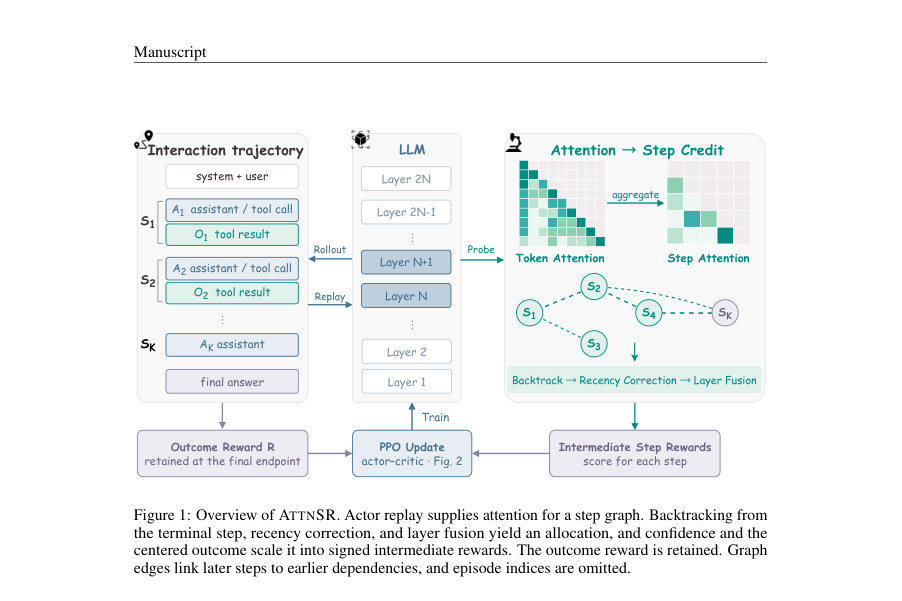
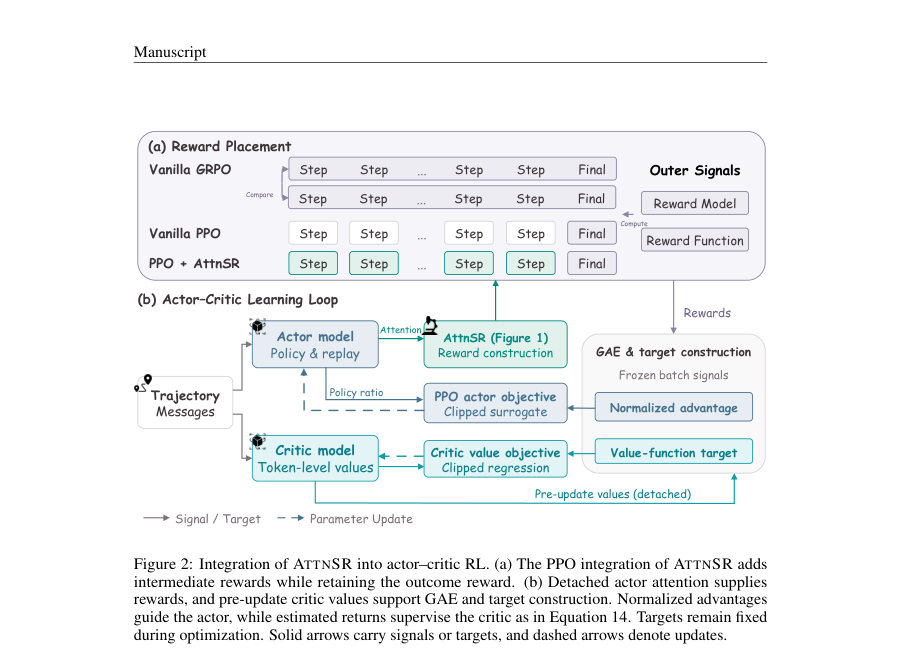
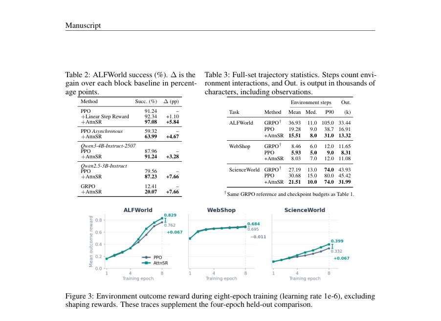

# AttnSR: Attention Step Reward for Long-Horizon Agentic RL

- **게시일:** 2026-11-06
- **arXiv:** [2611.07932v1](http://arxiv.org/abs/2611.07932v1) · [PDF](https://arxiv.org/pdf/2611.07932v1)
- **저자:** Mengsong Wu, Tianchen Zhou, Zhaochen Su, Zhenhua Liu, Zhe Cui, Aimin Zhou
- **분야:** cs.LG, cs.AI
- **선정 점수:** 5.92
- **선정 이유:** 최근성 1.1, 인용 영향 0.0 (인용 0회), 저자 영향 0.0 (최고 h-index 0), AI 주제 적합성 2.3, 개발자 관심 0.2, 학술 신호 1.1, 오픈 웨이트·주요 연구조직 신호 1.2

[← 2026-11-06 목록으로 돌아가기](../daily/2026-11-06.html)

<!-- paper-visuals:start -->
## 주요 Figure

> 원문 PDF에서 실제 Figure 캡션과 그림 영역이 함께 확인된 자료만 자동 추출했다.

*Figure · 원문 PDF 3쪽 · Figure 1: Overview of ATTNSR. Actor replay supplies attention for a step graph. Backtracking from*

*Figure · 원문 PDF 6쪽 · Figure 2: Integration of ATTNSR into actor–critic RL. (a) The PPO integration of ATTNSR adds*

*Figure · 원문 PDF 8쪽 · Figure 3: Environment outcome reward during eight-epoch training (learning rate 1e-6), excluding*

<!-- paper-visuals:end -->

## 한 문장 요약

정책 모델의 어텐션을 역추적해 최종 보상으로부터 단계별(reward-at-endpoint) 보상 할당을 생성하고 이를 PPO에 주입하여 장기(긴-호라이즌) 에이전트의 시간적 신용배분을 개선하는 ATTNSR을 제안한다.

## 해결하려는 문제

LLM 기반 에이전트는 다단계 의사결정을 수행하나 기존의 결과(terminal) 보상만을 사용하는 강화학습은 개별 중간 단계들이 최종 성과에 어떻게 기여했는지에 대한 직접적 감독을 제공하지 못해 긴-호라이즌 환경에서 신용배분(credit assignment)이 어렵다. 기존 대응 방법들은 단계 주석, 추가 롤아웃, 또는 별도 학습된 평가기(리워드 모델)를 필요로 하며 이로 인해 환경 상호작용 비용과 학습 복잡성이 증가한다.

## 핵심 기여

- 정책(policy) 어텐션을 단계간 관련성의 사전(prior)으로 가정하고, 학습된 actor의 어텐션을 재생(replay) 중에 추출해 단계별 보상 할당을 구성하는 ATTNSR 방법을 제안함(별도 리워드 모델·추가 롤아웃 불필요).
- 어텐션 기반 할당(backtracking), 레시언스(recency) 보정·레이어 퓨전(geometric mean), 신뢰(confidence) 게이팅, 그리고 결과 중심화(centered outcome budget)를 결합한 단계별 보상 생성 파이프라인을 설계·구현하여 토큰-레벨 PPO 통합을 제시함.
- 세 가지 벤치마크(ALFWORLD, WEBSHOP, SCIENCEWORLD)와 여러 대조 실험(선형 시점 보상 제어, GRPO 변형, TARL/AgentPRM/FlowTracer 비교)을 통해 ATTNSR의 성능 이득(특히 ALFWorld에서의 유의미한 성공률 향상)과 상호작용 비용 절감 효과를 보고함.

## 접근 방법

* ATTNSR은 actor의 포워드 패스 중에 정책의 Q/K(로테리 포지셔널 임베딩 이후, fused attention 이전)를 캡처해 토큰 어텐션을 단계(step) 단위로 집계하여 단계 의존성 그래프 G(l) 을 구성한다(각 레이어에 대해 assistant→assistant와 assistant→observation 어텐션을 0.5/0.5로 혼합).
* 터미널 단계에서 역방향으로 관련성 a(l)_{i,k}을 전파(backtrack)하되 홉당 감쇠 ρ=0.85를 적용해 직접·간접 의존성을 누적한다(식(3)).
* 시의성 편향을 완화하기 위해 거리 특성 di,k = exp(−(∆−1)/κ)와 로그 관련성을 표준화한 뒤 소프트맥스(T=1)로 per-layer 할당 p(l)_{i,k}을 계산하고, 레이어 간 일관성을 중시하는 기하평균(qi,k→pi,k)으로 레이어 융합한다.
* 신뢰(Ci)는 터미널 커버드 mass m(l) (식(6)), 할당 엔트로피 H(l) (식(7)) 및 레이어 간 총변이(TV)로 구성된 세 요소로 계산되어 최종 게이트로 작용한다(식(8)–(11)).
* 결과의 부호는 배치 단위 EMA 기반 베이스라인 ¯R_t(초기 M1, EMA 계수 0.99) 대비 Ri−¯R_t로 정하고, 예산 규모는 Bi = β Ci (Ri−¯R_t) (β=0.25)로 설정한다(식(12),(13)).
* 중간 단계 보상 si,k = Bi pi,k을 각 assistant 단계의 마지막 학습 가능한 토큰(ei,k)에 배치하고 최종 보상 Ri(결과)는 유지한다(식(2)).
* PPO 통합에서는 보상 생성이 GAE 및 이득(advantage) 계산 전에 수행되며(보상·타깃 고정), 어텐션은 reward 구성 시 detached되고 critic 아키텍처와 손실은 변경하지 않는다.
* 구현상 블록 단위(쿼리 블록 128토큰) 집계를 사용해 토큰 행렬 전체 저장을 피하지만 쿼리·키 계산은 이차적 비용을 유지한다.
* 선택한 레이어는 {8,10,12,14,16,18}이며 기타 하이퍼파라미터(ρ, η=−0.25, κ=4, β=0.25 등)는 본문에 명시됨.

## 주요 결과

- ALFWorld(274 held-out): PPO 기준 성공률 91.24% → PPO+ATTNSR 97.08% (266/274), 실패수 24→8; 페어드 McNemar p=0.002; 95% 부트스트랩 차이 구간 +2.55 to +9.49 percentage points(논문 표와 부록 수치 근거).
- ALFWorld 상세: seen 92.86%→96.43%, unseen 89.55%→97.76%(카테고리별로 Clean/Heat/Cool/Pick2에서 6.9–10.9pp 향상 보고).
- ScienceWorld: 공식 점수 44.53%→46.35%, 성공률 28.59%→30.90%; 평균 환경 스텝은 30.68→21.51로 −29.88% 감소(동시에 성공률 증가).
- WebShop: 성공률은 40.20%→41.00%로 소폭 상승하나 공식 점수는 70.74%→69.71%로 감소해 유의미한 향상은 검출되지 않음(부트스트랩 구간이 0을 포함).
- 대조실험: 시간적(선형) 단계 보상 제어(Linear Step Reward)는 ALFWorld에서 92.34% 도달으로 ATTNSR의 97.08%에 비해 이득이 작음(ATTNSR이 단순 위치 기반 누적보다 더 큰 개선을 보임).

## 한계

- 저자가 명시한 한계: 어텐션은 '관련성의 사전(prior)'일 뿐 인과적 기여를 증명하지 않으며(본문에서 명시), ATTNSR은 결과 보상(Ri)을 보존하지 않고 중간 보상을 더하므로(return-preserving 보정 불가) 정책 불변성을 보장하지 않음(본문에서 명시된 훈련 휴리스틱).
- 저자가 명시한 실험적/방법론적 제약: 벽시계 시간 및 피크 메모리 오버헤드가 측정되지 않았음(본문 명시). 평가는 Qwen2.5-7B-Instruct LoRA 단일 학습 실행들을 주로 사용하였고(여러 체크포인트 보고 있으나 각 방법 대부분이 단일 시드 실행), 일부 비교(예: GRPO 참조)는 최적화 예산이 달라 직접적인 동등 비교가 아님을 저자가 밝힘.
- 본문과 실험에서 확인되는 제약: WebShop에서 유의미한 이득이 없고, 향상은 복잡·장기 과제에서 더 뚜렷해 짧은 궤적(짧은 horizon) 문제에는 한계가 있을 수 있음(본문에서 가설로 제시). 또한 대부분 결과는 단일 러닝-런으로 보고되어 학습 시드 변동성 추정이 부족함(본문이 단일 러닝 실행을 명시).

## 개발자 관점

- 구현 요구사항: actor 재생 시 포워드 패스에서 Q/K를 post-RoPE, pre-fused-attention 위치에서 캡처해야 하며(본문 구현 기술), 토큰 전체 행렬을 저장하지 않도록 블록(query-block=128)별로 집계해 단계별(assistant/observation) 버킷으로 축약해야 함.
- 보상 할당·통합: 중간 보상은 각 assistant 단계의 마지막 학습 가능한 토큰(ei,k)에 배치하고 최종 보상은 유지한다. 보상 생성은 GAE 및 advantage 정규화 이전에 수행하고, attention 추출은 detached로 처리해 역전파 대상에서 제외해야 함(본문 통합 절차).
- 신뢰·안정성 설계: 터미널-커버드 mass(임계치 0.20), 집중도(엔트로피 기반, 임계치 0.15), 레이어 합의(TV)를 결합해 보상 크기를 게이팅하는 구조를 구현하면 어텐션 신호의 잡음·비일관성에 대응할 수 있음(본문의 수식과 임계값 근거).
- 계산 비용·모니터링: 쿼리·키 연산은 여전히 이차적이며 벽시계·메모리 오버헤드가 미측정이므로 대형 컨텍스트·대규모 배치에서 프로파일링 필요. 또한 포맷 오류(format-error) 비율과 자연 종료 비율이 정책별로 변하므로 실제 환경 상호작용 비용·도구 호출 실패를 모니터링해야 함(본문 진단 결과 근거).
- 재현성과 배포: 논문은 하이퍼파라미터(선택 레이어 {8,10,12,14,16,18}, β=0.25, ρ=0.85, EMA 0.99 등)와 구현 세부를 제공하며(부록 포함), 코드 저장소를 제시하므로(reproducibility statement, abstract) 재현 시 논문-제공 코드를 기반으로 하는 것이 바람직함. 배포 시에는 에이전트 능력 향상에 따른 안전·모니터링·업무-특정 제약을 고려해야 함(본문 윤리 진술).

**근거 범위:** 이 분석은 제공된 논문 PDF 본문(그리고 부록에 포함된 표·알고리즘·하이퍼파라미터)을 근거로 작성되었다. 본문에서 저자가 명시한 수치(성능, 하이퍼파라미터, 통계검정 p값 등)와 구현 기술을 그대로 인용했으며, 논문이 '벽시계 시간과 피크 메모리 오버헤드는 측정하지 않았다'고 명시한 부분 등 검증되지 않은 운영 오버헤드 정보는 포함하지 않았다. 논문이 대부분 단일 러닝-런 결과를 보고하고 있으므로 학습-시드 변동성에 대한 추가 검증이 필요하다.
