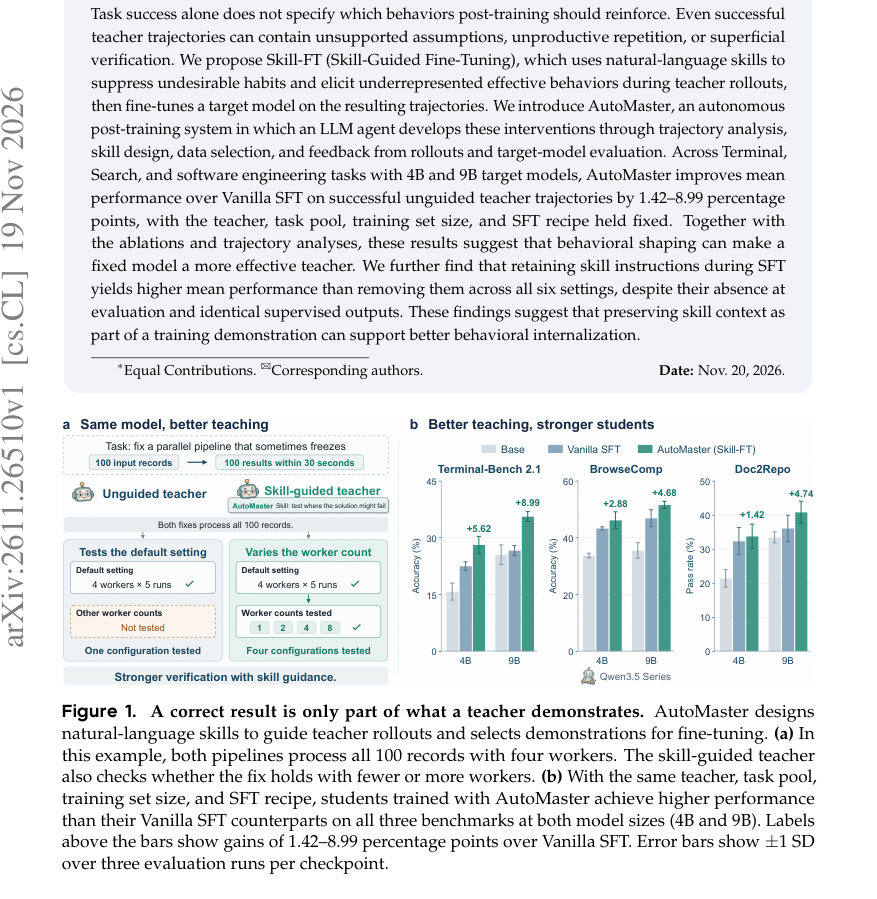
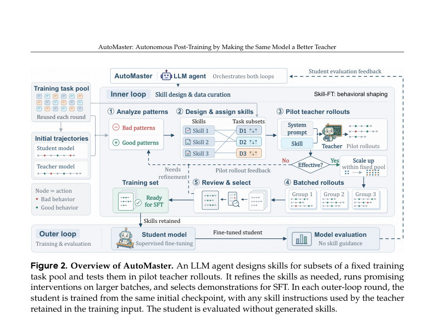
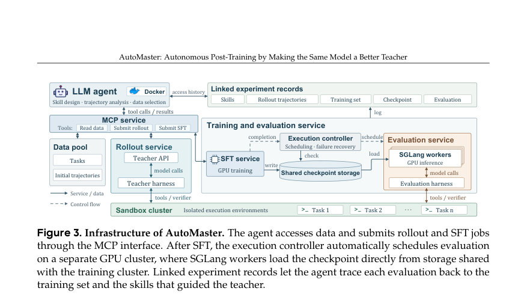

# AutoMaster: Autonomous Post-Training by Making the Same Model a Better Teacher

- **게시일:** 2026-11-22
- **arXiv:** [2611.26510v1](http://arxiv.org/abs/2611.26510v1) · [PDF](https://arxiv.org/pdf/2611.26510v1)
- **저자:** Guoxin Chen, Shuang Sun, Fanzhe Meng, Xinyu Tang, Ruihua Song, Wayne Xin Zhao
- **분야:** cs.CL
- **선정 점수:** 4.22
- **선정 이유:** 최근성 0.5, 인용 영향 0.0 (인용 0회), 저자 영향 0.0 (최고 h-index 0), AI 주제 적합성 3.0, 개발자 관심 0.2, 학술 신호 0.5, 오픈 웨이트·주요 연구조직 신호 0.0

[← 2026-11-22 목록으로 돌아가기](../daily/2026-11-22.html)

<!-- paper-visuals:start -->
## 주요 Figure

> 원문 PDF에서 실제 Figure 캡션과 그림 영역이 함께 확인된 자료만 자동 추출했다.

*Figure · 원문 PDF 1쪽 · Figure 1. A correct result is only part of what a teacher demonstrates. AutoMaster designs*

*Figure · 원문 PDF 4쪽 · Figure 2. Overview of AutoMaster. An LLM agent designs skills for subsets of a fixed training*

*Figure · 원문 PDF 5쪽 · Figure 3. Infrastructure of AutoMaster. The agent accesses data and submits rollout and SFT jobs*

<!-- paper-visuals:end -->

## 한 문장 요약

AutoMaster는 LLM 에이전트가 자연어 '스킬'으로 교사 롤아웃 행동을 형성하고( Skill-FT ), 그 결과 생성된 시연을 보존·선택해 학생 모델을 SFT로 향상시키는 자율적 사후학습 시스템이다.

## 해결하려는 문제

기존의 SFT 기반 사후학습은 '성공한 교사 궤적'만을 기준으로 샘플을 선택하나, 성공 결과만으로는 교사가 시연하는 바람직한 행동(검증 절차, 증거 기반 추론, 비생산적 반복 억제 등)을 규정하지 못한다. 따라서 성공 궤적에도 불구하고 유지되거나 과대평가될 수 있는 비효율적·비검증적 행동이 학생에게 강화될 위험이 있으며, 동시에 바람직한 행동은 성공 궤적 내에서 희소하게 남아 학습되지 못할 수 있다. 본 논문은 동일한 고정 교사로부터 더 나은 '학습 가능한' 시연을 얻는 방법(어떻게 교사 행동을 설계·선택·내재화할 것인가)을 묻는다.

## 핵심 기여

- Skill-FT(스킬 유도 파인튜닝): 자연어로 표현된 스킬을 시스템 프롬프트에 추가해 교사의 롤아웃 행동을 억제·유도하고, 그로 얻은 궤적을 학생 SFT에 사용하도록 제안.
- AutoMaster 프레임워크: LLM 에이전트가 궤적 분석, 스킬 설계·파일럿 테스트, 데이터 선택을 반복하는 내·외부 루프를 통해 자율적으로 개입을 설계·수정·선택하는 시스템을 제시.
- 스킬 컨텍스트의 보존 효과 규명: 스킬 지시문을 SFT 입력에 유지하면(평가 시 스킬 없음) 동일한 시연으로 학습해도 성능이 더 좋아짐을 체계적으로 보여줌.
- 구현·실험 증거: Terminal-Bench 2.1, BrowseComp-Lite, Doc2Repo의 세 도메인과 Qwen3.5-4B/9B 대상 모델에서, 동일 교사·과제풀·훈련 샘플 수·SFT 레시피 하에서 Vanilla SFT보다 평균 1.42–8.99 퍼센트포인트 향상을 보고함.
- 성능 원인 분석: 궤적 사례 분석과 구성요소 절단실험으로(스킬 유도와 데이터 선택 각각) 행동형성(behavioral shaping)이 고정 교사를 더 좋은 교사로 만들 수 있음을 제시함.

## 접근 방법

* AutoMaster는 두 층의 루프로 동작한다.
* (1) 내측 루프: LLM 에이전트가 훈련 과제 풀과 초기 궤적을 분석해 억제할 '나쁜 패턴'과 장려할 '좋은 패턴'을 찾고, 이를 자연어 스킬로 명세하여 시스템 프롬프트(p)에 덧붙인다.
* 설계한 스킬은 파일럿 롤아웃에서 테스트되어 의도한 행동을 유도하는지 검증되며, 유망하면 배치 롤아웃으로 확장해 후보 시연들을 수집한다.
* 에이전트는 시연의 결과(성과와 행동적 특징)를 바탕으로 스킬·적용 범위·데이터 선택을 재설계한다.
* (2) 외측 루프: 내측 루프가 선택한 시연 집합 D_r로부터 동일한 초기 체크포인트 θ0에서 완전 파라미터 SFT를 수행해 학생 θ_r를 얻고(논문은 512 시연, 3 epochs, lr=1e-5, batch=32 등 고정 레시피 사용), 학생을 공식 벤치마크 프로토콜로 평가한다(평가 시 스킬 없음).
* 에이전트는 평가 점수와 실행 궤적을 연관 기록(linked experiment records)하여 다음 라운드의 스킬·데이터 결정에 활용한다.
* 인프라 측면에서 에이전트는 MCP 인터페이스로 도커 기반 롤아웃/훈련 작업을 제출하고, SGLang 실행기와 공유 체크포인트 저장소를 통해 훈련·평가를 자동화한다.

## 주요 결과

- 실험 구성: 각 도메인별 1,000개 고정 훈련 과제풀에서 샘플링. 학생 모델: Qwen3.5-4B, Qwen3.5-9B. 교사: DeepSeek-V4-Pro-Preview(‘teacher’) 고정. 에이전트: Codex with GPT-6 Astra. 모든 SFT는 동일 레시피(512 trajectories, 3 epochs, lr=1e-5, global batch 32, bfloat16)로 수행.
- 주요 정량 성과(표·텍스트 기반): AutoMaster는 모든 6개(3 도메인 × 2 모델크기) 설정에서 Vanilla SFT 대비 평균 성능 향상을 보임. 도표·표에서 보고된 값(평균 ± SD, 세 번 평가의 평균): Terminal-Bench 2.1: Base 4B 15.73±2.25 → Vanilla SFT 22.47±1.12 → AutoMaster 28.09±2.25 (4B ∆+5.62 pp); Base 9B 25.47±2.59 → Vanilla SFT 26.59±1.30 → AutoMaster 35.58±1.30 (9B ∆+8.99 pp). BrowseComp: 4B AutoMaster 46.13±2.98 (∆+2.88 vs Vanilla 43.24±0.54), 9B AutoMaster 51.53±1.25 (∆+4.68). Doc2Repo(mean test pass rate): 4B AutoMaster 33.72±3.58 (∆+1.42), 9B AutoMaster 40.79±3.21 (∆+4.74).
- 통계적 불확실성: 쌍별 부트스트랩(10,000 resamples)로 구한 95% 신뢰구간(Table A6)에서 9B의 세 도메인 모두 하한이 양수(즉 통계적 증거가 일관됨). 4B의 경우 Terminal에서만 CI가 전부 양수, 나머지 두 도메인은 CI가 0을 포함.
- 구성요소 절단실험(Ablaions, Table A4): 스킬 유도 제거(w/o Skill Guidance)와 데이터 선택 제거(w/o Data Selection) 모두 평균 성능을 떨어뜨림. 예: Terminal 4B에서 w/o Skill Guidance 17.60±3.43, w/o Data Selection 20.22±2.25, Vanilla SFT 22.47±1.12, AutoMaster 28.09±2.25로 나타나 두 구성요소의 합성이 중요함.
- 스킬 컨텍스트 보존 효과(Fig.6): 동일한 시연과 SFT 레시피에서 훈련 시 스킬 지시문을 유지(Keep)하면 생략(Remove)보다 평균 2.15–4.01 퍼센트포인트 더 높음(모든 6개 설정에서 Keep>Remove). 예: Figure·텍스트에서 전체 설정에 걸쳐 일관된 이득 보고됨.

## 한계

- 저자가 직접 언급한 제약: 모델 용량 의존성(9B에서의 이득이 4B보다 크고 더 일관됨)이 관찰되어 대상 모델의 용량이 방법의 효과성에 영향을 미침(본문과 Section 5·8에서 기술). 실험은 세 도메인(Terminal, Search, SWE)과 두 모델 크기에서 수행되어 적용 범위가 제한적임(저자 귀납적 제시).
- 저자 명시되지 않았으나 본문으로부터 합리적으로 확인되는 제약(추론):
- - 제한된 교사·에이전트 조합: 모든 실험에서 교사는 DeepSeek-V4-Pro-Preview, 에이전트는 GPT-6 Astra로 고정되어 있어 다른 교사·에이전트 조합에 대한 일반화는 검증되지 않음.
- - 계산·인프라 비용: 전체 파라미터 SFT(512 시연·3 epoch·전원 파라미터 업데이트), 대규모 롤아웃(최대 수만 토큰/태스크) 및 에이전트 주도 반복 실험(최대 5 외부 라운드)은 높은 GPU·시간 비용을 요구함(본문과 Appendix A의 설정 근거). 저자는 비용-효율성 한계나 경량화 대체(예: LoRA) 실험을 보고하지 않음.`- 스킬 보존의 오버핏 위험: 훈련 시 스킬 지시문을 유지하면 성능이 향상되었지만, 스킬 특유의 프롬프트 인공물이나 도메인 특화 규칙을 학생이 과도하게 내재화할 위험과 배포 시 일반화 리스크는 본문에서 평가되지 않음.`

## 개발자 관점

- 스킬 문구를 시스템 프롬프트에 추가해 교사 롤아웃을 유도하고, 그 스킬 문구를 SFT 입력에 그대로 보존하는 것이(평가 시 스킬 없음) 실험적으로 더 나은 학생 성능을 낳음 — 훈련 데이터의 '맥락'을 보존하라.
- AutoMaster처럼 에이전트 주도 내·외부 루프(파일럿 롤아웃 → 배치 롤아웃 → 시연 선택 → SFT → 평가)를 설계하면 스킬 설계·데이터 큐레이션을 자동화할 수 있음. 구현을 위해 MCP, Docker 기반 샌드박스, SGLang 실행 및 공유 체크포인트 저장소 같은 인프라가 유용함(본문 Figure 3·A 인프라 설명).
- 재현성·설정: 논문은 SFT 레시피(512 훈련 궤적, 3 epochs, lr=1e-5, global batch 32, bfloat16, max seq length 131072), 교사 롤아웃 파라미터(Reasoning effort high, temperature 1.0, max tokens 도메인별 상이) 등을 상세히 제시하므로 이를 그대로 따라하면 기본 재현이 가능하나, 교사·에이전트 모델(DeepSeek, GPT-6 Astra)은 공개·상용성 제약이 있을 수 있음.
- 성능 최적화 팁: (1) 스킬은 구체적 절차·적용 조건·검증 방법을 포함해 작성하라(본문에 실린 예시 스킬들 참조). (2) 스킬을 파일럿 롤아웃에서 반복 검증해 의도치 않은 실행 오류나 실패를 조기에 발견하라. (3) 데이터 선택 단계에서 성공 레이블 외의 행동적 지표(검증 절차 유무, 증거-주장 일관성 등)를 고려해 시연을 선별하라.
- 운영·안전성: 스킬로 행동을 유도하면 교사의 시행착오·검증 루틴에 변화를 줄 수 있으므로 배포 전에는 자동화된 검증(수치 체크, 리그레션 테스트 등)을 필수로 구성하라. 스킬이 잘못 작동하면 잘못된 '교수' 사례가 대량 학습 데이터로 들어갈 위험이 있음.

**근거 범위:** 본 분석은 제공된 논문 PDF 본문(본문·그림·표·부록 A·B 전 범위)의 내용에 근거해 작성되었다. 수치(표·그림의 평균·표준편차·부트스트랩 CI), 실험 설정(모델·하이퍼파라미터), 스킬 예시는 PDF에 명시된 값을 그대로 인용했다. 다만 교사·에이전트의 내부 프롬프트 원문 전체, 내부 로그·파라미터(랜덤 시드별 분산 등), 그리고 실제 실행에 필요한 외부 코드·데이터 접근(DeepSeek, GPT-6 Astra 등 상용 모델 접근성)은 PDF만으로 재현 불가능할 수 있다. 해당 부분은 본문 근거와 함께 '재현을 위해 추가 확보가 필요한 요소'로 판단된다.
