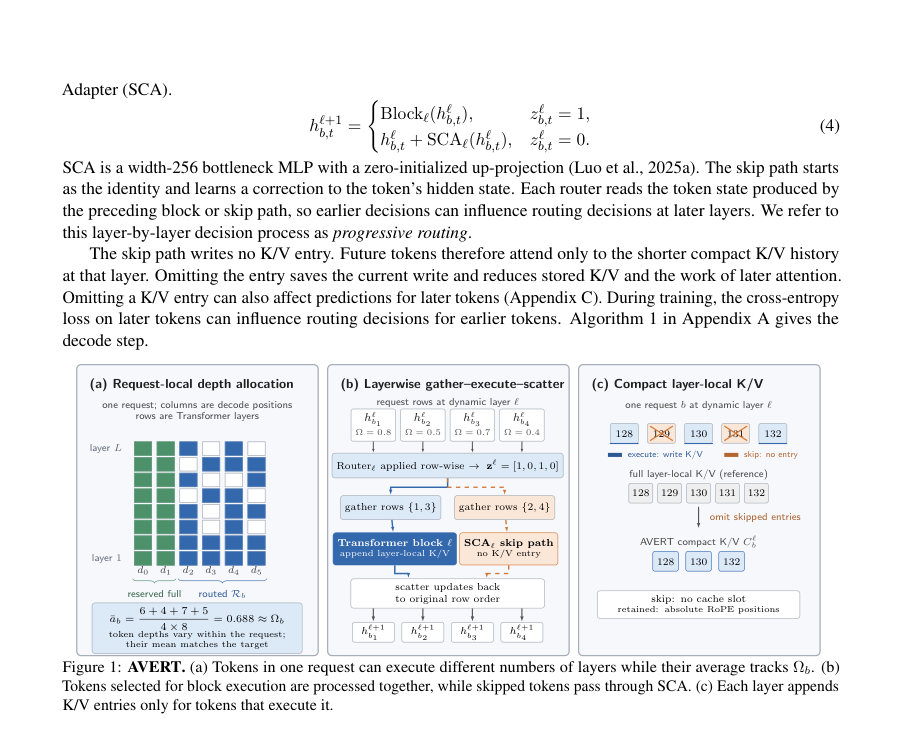
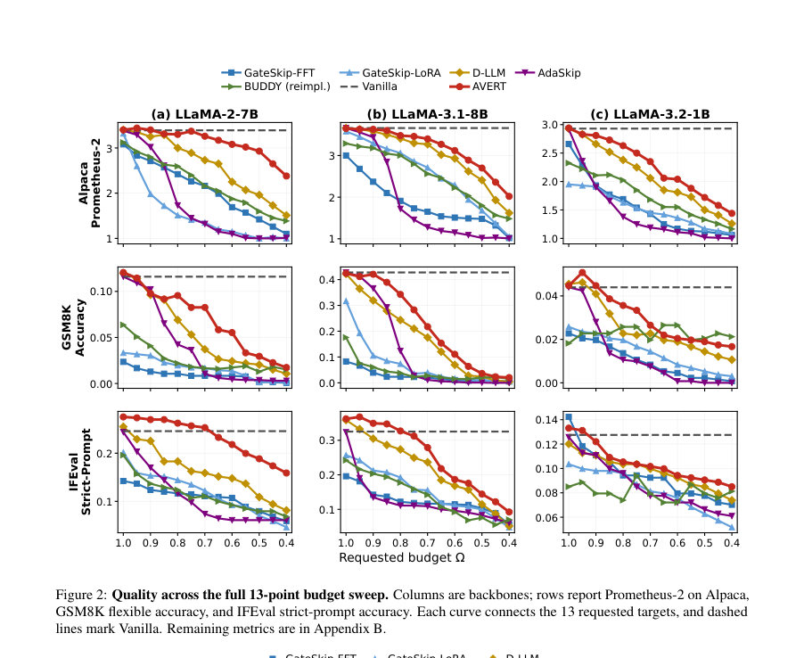
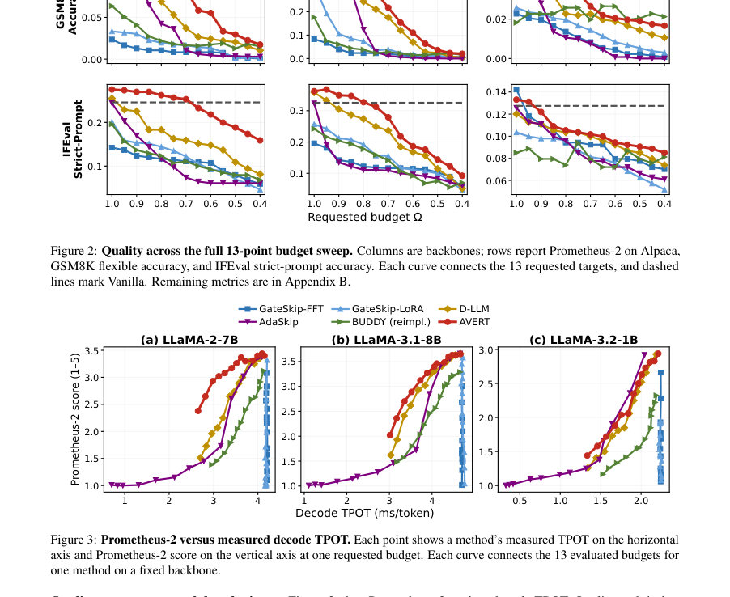

# Average-Depth Variable Execution via Request-Local Token Routing

- **게시일:** 2026-11-23
- **arXiv:** [2611.27738v1](http://arxiv.org/abs/2611.27738v1) · [PDF](https://arxiv.org/pdf/2611.27738v1)
- **저자:** Pengjie Zheng, Mengwei Xie, Huan Yang, Si Wu, Pengfei Hu, Feng Li
- **분야:** cs.AI
- **선정 점수:** 5.69
- **선정 이유:** 최근성 0.4, 인용 영향 0.0 (인용 0회), 저자 영향 0.0 (최고 h-index 0), AI 주제 적합성 2.9, 개발자 관심 0.2, 학술 신호 0.3, 오픈 웨이트·주요 연구조직 신호 1.8

[← 2026-11-23 목록으로 돌아가기](../daily/2026-11-23.html)

<!-- paper-visuals:start -->
## 주요 Figure

> 원문 PDF에서 실제 Figure 캡션과 그림 영역이 함께 확인된 자료만 자동 추출했다.

*Figure · 원문 PDF 4쪽 · Figure 1: AVERT. (a) Tokens in one request can execute different numbers of layers while their average tracks Ωb. (b)*

*Figure · 원문 PDF 7쪽 · Figure 2: Quality across the full 13-point budget sweep. Columns are backbones; rows report Prometheus-2 on Alpaca,*

*Figure · 원문 PDF 7쪽 · Figure 3: Prometheus-2 versus measured decode TPOT. Each point shows a method’s measured TPOT on the horizontal*

<!-- paper-visuals:end -->

## 한 문장 요약

요청별 평균 실행 깊이를 연속 예산에 맞추면서 토큰별로 서로 다른 수의 Transformer 블록을 실행하도록 하는 AVERT(요청-로컬 토큰 라우팅) 방법을 제안한다.

## 해결하려는 문제

서비스 환경에서 각 요청에 대해 '예산(평균 실행 깊이)'을 지정할 수 있으나, 이 예산을 응답 내 개별 토큰들에 어떻게 배분할지는 정의되어 있지 않다. 기존 접근법은 (i) 예산마다 별도 체크포인트를 학습하거나(D-LLM), (ii) 모든 토큰에 대해 동일한 정수 레이어 수를 고정하거나(BUDDY), (iii) 배치 전체의 토큰 분포에 기반한 양자화/임계값을 사용해 일괄 제어하는 등( GateSkip 등) 요청 단위의 연속적 예산을 유지하면서 응답 내부에서 토큰별 가변 깊이를 허용하고, 단일 체크포인트로 서로 다른 예산의 요청들을 같은 배치에서 처리하는 문제를 충분히 해결하지 못한다.

## 핵심 기여

- 요청별 평균 실행 깊이(request-average depth)를 연속 예산으로 정의하고 이를 직접 목표로 하는 학습 손실(Lbudget)을 제시함으로써 각 요청의 라우티드(동적) 토큰들에 대해 평균 실행 비율을 맞추는 공식화와 학습 목표를 도입했다.
- 토큰-레벨이 아니라 요청-평균(request-average) 오브젝티브를 사용하면 동일한 평균 실행률에서 토큰별 오브젝티브보다 생성 품질(예: Prometheus-2, ROUGE-L, BLEU-4)이 더 좋다는 비교·증명(같은 아키텍처·디코딩 조건 하에서의 소거 실험)을 제시했다.
- 요청-로컬(progressive) 라우터, 스킵 경로용 Residual Skip Compensation Adapter(SCA), 스킵 시 K/V 미기록(compact per-layer K/V) 등 구현을 포함해 하나의 체크포인트로 서로 다른 예산의 요청을 동일 배치에서 디코딩하는 시스템을 구현·평가했다.
- 광범위한 실험(세 개 LLaMA 백본, 13개의 연속 예산 포인트, 여섯 가지 주요 품질 지표)을 통해 AVERT가 234개 비교 중 206회에서 최우수 혹은 동률을 달성했고, 단일·혼합 배치에서의 평균 절대 예산 오차가 작다는 실험적 근거를 제시했다.

## 접근 방법

* 아키텍처·학습·추론 절차(본문 기준):
* 라우팅 구조: 각 '라우티드' 레이어 ℓ마다 라우터를 둔다.
* 라우터는 현재 토큰의 숨김 상태 h^ℓ_{b,t}와 그 요청의 스칼라 예산 Ω_b를 입력으로 받아(W^ℓ_h로 상태를, W^ℓ_Ω로 예산을 같은 치수로 투영) RMSNorm → SiLU → 선형층(W^ℓ_o)으로 '실행/스킵' 두 점수(s^ℓ_{b,t} ∈ R^2)를 계산한다(추론 시 더 큰 점수의 동작 선택, 동률은 실행 우선).
* 스킵 경로: 토큰이 블록을 스킵하면 해당 블록을 통과하지 않고 SCAℓ(h) (폭 256의 병목 MLP, 업프로젝션 0으로 초기화)로 잔차 보정된 항등 경로를 지나며 그 레이어의 K/V는 쓰지 않는다.
* 실행하는 토큰은 Attention+FFN을 실행하고 레이어-로컬 K/V 히스토리에 항목을 추가한다.
* 손실·학습: 각 요청 b에 대해 라우티드 위치들의 토큰별 실행 비율 ab,t를 평균하여 ¯a_b를 계산하고, 요청별 절대편차 \|¯a_b − Ω_b\|을 Lbudget로 정의한다(식(2)).
* 전체 손실은 L = L_CE + λ_budget L_budget.
* 훈련시 Gumbel-Softmax(ST)로 정형 결정(순방향 하드, 역전파에 소프트 그래디언트)을 사용한다.
* 백본 가중치는 고정하고 라우터, SCA, LoRA(쿼리/키/값과 FFN 투영들에 rank-16)를 함께 학습한다.
* λ_budget은 첫 에폭에 0→10으로 증가.
* 예산 샘플링: 훈련 마이크로배치의 90%에서는 각 요청이 균등 분포 U[0.4,1.0]에서 독립적으로 예산을 샘플링하고, 나머지 10%는 한쪽 끝점(0.4 또는 1.0)을 배치 전체에 할당.
* 디코딩: 프리필(prefill)은 항상 모든 레이어를 실행(본문에서는 처음 두 디코드 포지션을 강제 실행), 그 이후 라우팅 시작.
* 각 동적 레이어에서 실행으로 선택된 행(토큰들)만 모아(gather) 블록을 병렬 실행하고 K/V를 레이어-로컬 콤팩트 캐시에 append한다.
* 스킵한 토큰들은 SCA로 처리하고 캐시에는 항목을 추가하지 않는다.
* 이후 scatter로 원래 순서 복원하고 다음 레이어로 진행.
* 구현·시스템: 단일 체크포인트로 다양한 예산을 같은 배치에서 처리 가능하며, 스킵 시 K/V 미기록은 캐시 저장량과 후속 어텐션 비용을 줄인다.
* 기본 실험 환경은 NVIDIA A800 80GB, bfloat16 추론, 기본 배치크기 16, 프리필 128 토큰, 생성 128 토큰 등이다.

## 주요 결과

- 평가 설정: 51,564개의 Alpaca 예제로 학습(본문), 1,000개 Alpaca 평가 예제, GSM8K(1,319 문항), IFEval(541 프롬프트, 834 지시) 등으로 품질 측정(Prometheus-2, ROUGE-L, BLEU-4, GSM8K-Flex, IFEval strict SP/SI) 및 시스템 측정(TPOT, peak decode VRAM)을 수행함.
- 광범위 성능: 세 개 LLaMA 백본·여섯 품질 지표·13개의 예산 포인트(0.40–1.00)에서 AVERT는 234개 비교 중 206회에서 최고 또는 동률을 기록함(본문).
- 예산 추적 정확도: 단일-예산 배치에서의 백본별 최대 평균 절대 요청 오차는 0.85, 0.97, 0.94 퍼센트포인트(각각 LLaMA-2-7B, 3.1-8B, 3.2-1B). 혼합-예산 배치에서는 최대 평균 오차가 1.06, 1.15, 0.89 pp로 보고됨(본문 E.2). 예: 60% 예산 실험(480 응답 중)에서 95.83% 응답의 평균 실행률이 목표 ±2 percentage points 이내.
- 혼합 배칭 효율: 요청을 예산별로 그룹화하면 배치가 덜 채워질 때(underfilled) 혼합 배치가 디코드 시간/토큰(TPOT)을 4.3%–21.2%까지 절감함(세 백본, 다양한 워크로드 스큐 상황에서 측정, 본문 4.3–21.2%).
- 품질·시간 트레이드오프 예시: LLaMA-3.1-8B에서 AVERT(Ω=0.55)는 Prometheus-2 = 2.89를 유지하면서 TPOT = 3.519 ms/token을 기록했고, 비교된 AdaSkip(Ω=0.85)는 Prometheus-2 = 2.85, TPOT = 3.942 ms/token였음(본문). 이는 AVERT가 유사 품질에서 더 낮은 TPOT를 달성한 사례로 제시됨 (추가 페어링은 본문과 부록 참조).

## 한계

- 저자가 명시한 한계: (i) 공격적으로 작은 예산(예: Ω≈0.4)에서는 정확도 저하가 발생할 수 있으며 GSM8K와 같은 난이도 높은 태스크에서 특히 두드러짐; (ii) 예산은 요청 시작 시 고정되며 응답 중에 동적으로 변경하는 기능은 구현되지 않음; (iii) 평가가 주로 LLaMA계열에 집중되어 있으며 Qwen2.5-3B 평가는 축소된 실험(세 포인트)으로 제한됨; (iv) 본 구현은 프리필을 항상 전체 깊이로 실행함(프리필 스킵은 별도 체크포인트 실험으로만 보조 평가됨).
- 본문에서 합리적으로 확인되는 제약: (a) 스킵 시 K/V 미기록은 캐시·메모리·성능 이점을 주지만 이후 토큰의 예측에 영향을 줄 수 있음(본문 Appendix C에서 언급); (b) 라우터·SCA·LoRA 등 비병합(non-mergeable) 파라미터가 추가되어 정적 오버헤드(논문에서 ≈240 MiB 등)가 발생함(Table 9); (c) 런타임 오버헤드: LLaMA-3.1-8B 기준 라우터·디스패치·SCA가 합쳐서 0.4363+0.4014+0.1209 ≈0.96 ms/output-token 수준의 추가 비용을 차지함(본문 J.2), 따라서 극단적 저예산 지점이 아니면 총 이득이 크지 않을 수 있음; (d) 학습 데이터와 도메인이 Alpaca(약 51k 예제)에 편중되어 일반화 한계가 존재할 가능성.
- (저자가 구체적으로 명시하지 않은) 재현상·범위 제약: 일부 세부 구현(예: BUDDY 재현, GateSkip의 파라미터 패치)은 논문에서 재현시 주의사항으로 다루었고 본문은 해당 구현·초기화·하이퍼파라미터 민감도에 따라 결과가 달라질 수 있음을 시사함.

## 개발자 관점

- 단일 체크포인트로 다양한 연속 예산을 지원하려면 라우터가 요청-로컬(request-local) 예산 입력(스칼라)을 받아야 하며, 학습시 요청-평균 오류(각 요청의 평균 실행률을 목표로 하는 손실)를 최적화해야 예산 캘리브레이션이 잘 된다.
- 스킵 시 K/V를 캐시에 기록하지 않는 '콤팩트 레이어-로컬 K/V' 구현은 캐시 저장량과 후속 어텐션 비용을 줄여 실운영 메모리 이득을 제공하나, 품질 영향(특히 장기 의존성)에 대해 검증 필요. 실무에서는 K/V 보존/미보존을 워크로드별로 선택 가능하게 만들 것을 권장.
- 스킵 경로 보정용 SCA(폭 256 병목 MLP, zero-init up-proj)는 낮은 예산 구간에서 품질을 회복하는 데 중요하다(Ω=0.4에서 SCA 있음 Prometheus-2 2.02 vs 없음 1.41). 따라서 SCA를 배포 경로에 포함시키는 것이 권장된다.
- 학습·배포 팁: 백본은 동결하고(무거운 가중치 병합 가능), 라우터·SCA·LoRA만 학습하여 파라미터·메모리 부담을 줄인다. LoRA는 mergeable이며 라우터·SCA는 배포 시 별도 파라미터(논문 예: router+SCA 약 125.91M 파라미터)를 유지해야 함(Table 9).
- 시스템 구현: 레이어별 gather–execute–scatter와 레이어-로컬 콤팩트 K/V 캐시 구현이 핵심이다. 배치 팩킹 관점에서 혼합 예산을 허용하면 동일한 요청 집합이라도 배치 채움률(underfill)을 완화하여 TPOT과 전체 대기 시간을 크게 줄일 수 있다(본문에서 4.3–21.2% 개선 보고).

**근거 범위:** 본 분석은 사용자 제공 논문 PDF(본문 및 부록)에 근거해 작성되었음. 모든 기술·수치(예: 비교 횟수, 평균 오차, TPOT 사례, 파라미터·시간 항목 등)는 PDF 본문과 부록의 표·본문 문단에서 직접 추출한 값이다. 코드의 실제 실행 결과나 본문에 명확히 기재되지 않은 구현 세부(예: 분산 훈련 시의 미세 설정, 하드웨어 의존적 미세 튜닝)는 본문에서 확인 가능한 범위를 벗어나므로 생성하지 않았음을 밝힌다.
