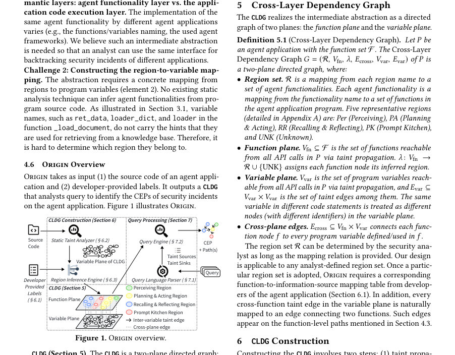
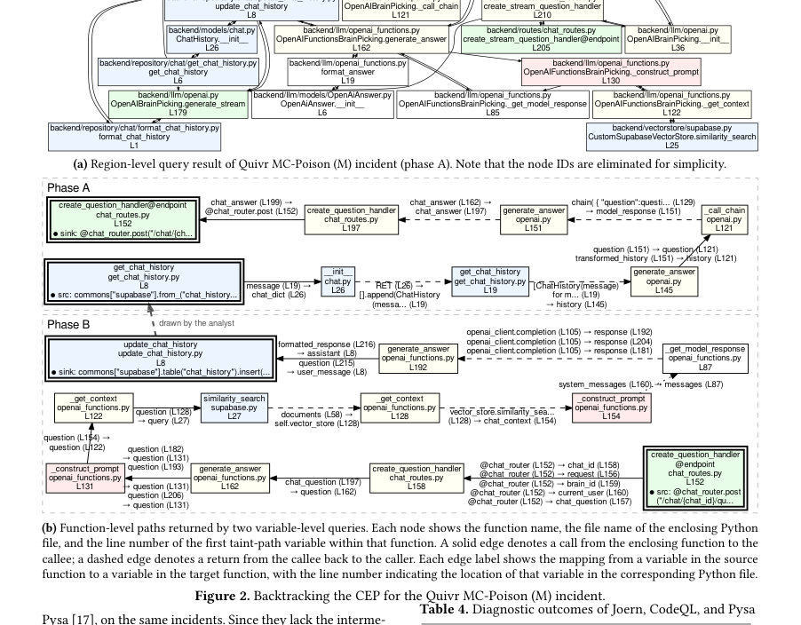
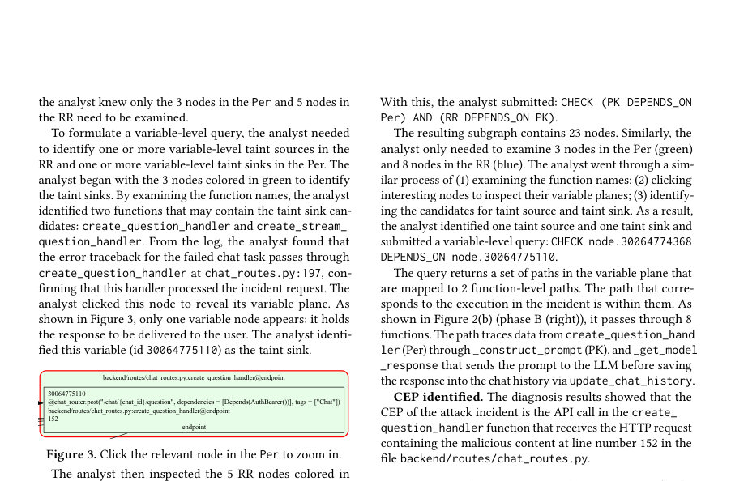

# Backtracking Agent Applications Security Incidents

- **게시일:** 2026-11-22
- **arXiv:** [2611.26525v1](http://arxiv.org/abs/2611.26525v1) · [PDF](https://arxiv.org/pdf/2611.26525v1)
- **저자:** Yicheng Cai, Taegyu Kim, Peng Liu
- **분야:** cs.CR, cs.AI, cs.SE
- **선정 점수:** 4.22
- **선정 이유:** 최근성 0.5, 인용 영향 0.0 (인용 0회), 저자 영향 0.0 (최고 h-index 0), AI 주제 적합성 2.7, 개발자 관심 0.8, 학술 신호 0.3, 오픈 웨이트·주요 연구조직 신호 0.0

[← 2026-11-22 목록으로 돌아가기](../daily/2026-11-22.html)

<!-- paper-visuals:start -->
## 주요 Figure

> 원문 PDF에서 실제 Figure 캡션과 그림 영역이 함께 확인된 자료만 자동 추출했다.

*Figure · 원문 PDF 5쪽 · Figure 1. Origin overview.*

*Figure · 원문 PDF 10쪽 · Figure 2. Backtracking the CEP for the Quivr MC-Poison (M) incident.*

*Figure · 원문 PDF 17쪽 · Figure 3. Click the relevant node in the Per to zoom in.*

<!-- paper-visuals:end -->

## 한 문장 요약

Agent 애플리케이션의 보안 사고 기반으로 정적 taint 분석과 높은 수준의 기능(기능군, region) 추론을 이어주는 Cross-Layer Dependency Graph(CLDG)과 질의언어로 CEP(Compromise Entry Point)를 소수의 질의로 효율적으로 식별하는 도구 Origin을 제안한다.

## 해결하려는 문제

LLM 기반 agent 애플리케이션 사고 조사에서 이용 가능한 자료는 주로 고수준의 trajectory 로그(에이전트 기능 수준)와 소스코드(실행 레벨)뿐이다. 이들 사이의 의미적 격차 때문에 분석가는 많은 함수 호출 후보(CEP 후보)에 대해 코드 내부를 일일이 검사해 해당 호출이 어떤 에이전트 기능에 해당하는지 추론해야 하며, 기존의 로그기반 진단/탐지/정보유출제어 기법은 소스코드 수준의 CEP를 직접 제공하지 못한다. 연구 질문은 (1) 에이전트 기능 레벨과 코드 변수/호출 레벨 사이를 잇는 중간 추상화를 어떻게 정의할지, (2) 그 추상화에서 region(기능군)과 변수 간 매핑을 어떻게 자동화할지이다.

## 핵심 기여

- Cross-Layer Dependency Graph(CLDG)와 질의언어 설계: 기능(함수·region) 평면과 변수 평면을 크로스-플레인 엣지로 연결하여 에이전트 기능 수준 질의를 변수·taint 수준으로 변환 가능하게 함.
- region inference 기법 설계: 개발자 제공의 함수→정보원(내부/외부) 레이블과 taint 전파에 기반한 라벨 전파 규칙(label propagation) 및 조건-행동(condition-action) 규칙을 통해 함수들을 Per/PA/RR/PK/UNK의 region으로 분류함.
- Origin 구현: 소스코드에서 모든 API 호출의 반환값을 시작점으로 하는 컨텍스트·흐름·필드 민감 전방 taint 전파로 변수 평면을 만들고, CLDG를 구성해 분석자가 region 수준 질의를 던져 CEP를 좁히도록 함.
- 개발자 보조 워크플로우: 개발자가 제공하는 함수→정보원 매핑을 LLM으로 보조 수집하고(LLM 보고서 생성 후 인간 검토), 이 지식을 재사용해 CLDG 구성·질의를 효율화함.
- 실세계 사례 평가: 다섯 개 오픈소스 agent 애플리케이션, 여덟 건의 공격 사고 사례에서 Origin이 모든 CEP를 정확히 식별하고(사건당 단일 후보 결과), 원래의 전체 taint 그래프 대비 분석 범위를 64–94% 감소시킴.

## 접근 방법

* 아키텍처(요약): Origin은 CLDG라는 두-평면(함수 평면, 변수 평면) 유향 그래프를 구성한다.
* 함수 평면의 노드들은 taint로 도달 가능한 함수들로 구성되며 각 함수에 region(Per, PA, RR, PK, UNK)을 𝜆로 할당한다.
* 변수 평면은 모든 API 호출 반환값에서 시작하는 전방 taint 전파로 구성된 변수 노드와 변수 간 taint 엣지이다.
* 함수 노드와 그 함수의 변수 노드를 연결하는 교차-평면 엣지(Ecross)를 갖는다.
* 주요 구성요소·알고리즘:
* CLDG 구성: (1) 정적 분석(Joern 기반, Pyrefly 보완)으로 모든 API 호출을 taint 소스 후보로 추출하고 컨텍스트·흐름·필드 민감 전방 전파를 실행해 변수 평면(𝑉var, 𝐸var)을 생성한다; (2) 변수에 등장하는 함수들을 𝑉fn으로 삼고 각 함수와 변수들을 교차-평면 엣지로 연결한다.
* Region inference: 개발자가 제공한 함수→정보원(EXT/INT) 매핑과 LLM-보조 보고서(각 함수의 직접 API 호출들이 EXT/INT/none 등인지 판정)를 입력으로 받는다.
* 라벨 전파 규칙(읽기이면 앞으로, 쓰기이면 뒤로 전파, 프롬프트 조립 라벨은 함수 내부에서 전파)과 9개의 조건-행동 규칙(Table 1)을 결합해 함수의 region을 결정한다.
* 질의언어 및 처리: CHECK (A DEPENDS_ON B) 형태의 region-레벨 논리 질의와 변수-레벨 식별자 질의를 지원한다.
* region 질의는 해당 region 함수들의 변수들을 교차-평면으로 찾아 전방/후방 도달성 교집합을 구해 함수-레벨 결과 그래프로 반환한다.
* → 연산자를 이용해 결과를 단계적으로 좁힐 수 있다.
* 변수-레벨 질의는 변수 평면에서 제어흐름(호출 그래프·CFG)으로 실행 가능 경로만 열거해 taint 경로를 반환한다.
* 구현 세부: Python 약 16KLoC, Joern(v4.0.360) 기반, Pyrefly(v0.45.0) 타입 보완, Joern의 제약(제너레이터, 인스턴스 변수 전파, 동적 디스패치) 보완 패치 포함.

## 주요 결과

- 사례 연구: 다섯 개 오픈소스 agent 애플리케이션(GPT-Researcher, Quivr, aider, MetaGPT, SWE-agent)과 8개의 공격 사고(IPI 및 MC-Poison 계열)에서 평가. Origin은 모든 사건에서 분석가가 단일 후보(사건당 CEP 1개)로 CEP를 정확히 식별함(사건 8/8 정답).
- 분석 축소: CLDG 기반 region-레벨 질의 이후 분석가의 검사 범위는 전체 taint 그래프 대비 64–94%로 감소하여 수작업 소요를 크게 저감(본문 결과 보고).
- 동작 예시(모티베이팅): GPT-Researcher에서 초기 taint 후보 추출 1,895 API 호출 → 로그 기반 가지치기로 1,518 후보로 감소(본문 사례). Origin은 최종적으로 사건당 단일 CEP 후보로 수렴.
- LLM-보조 개발자 레이블링(부록 기준): 총 2,719개 후보 함수에 대해 LLM 보조 결정 실행 결과 2,215개(81.46%)는 결정(Decided), 504개(18.54%)는 unresolved로 남음(부록 Table 12). LLM이 제안한 EXT 레이블 수는 전체에서 200건, INT 제안은 37건(부록 합계). 보고된 전체 제안에 대한 FNR은 0.00, FPR은 EXT 4.19%, INT 0.78%로 제시됨(부록 Table 12).
- 개발자 레이블링 보조 효과: LLM 보조는 개발자의 지식 수집 속도를 15.4–75.0% 향상시키고 정확도는 8.3–50.4% 증가시킨다고 본문(Section 6.1)에서 보고함.

## 한계

- (저자 언급) 범위 제약: 설계는 'predefined workflow' 계열의 에이전트(C1)에 초점을 맞추며, LLM이 런타임에 제어 흐름을 결정하는 OpenClaw류(C2) 및 에이전트 라이브러 프레임워크는 적용 대상에서 제외되어 향후 연구 대상으로 둠.
- (저자 언급) region 규칙의 실용성 한계: region inference의 조건-행동 규칙은 '실용적(practical)'으로 의도되었으며 모든 케이스를 포괄하지 않음(본문 §6.3).
- (저자·본문근거) 개발자 지식 필요성: CLDG 구성은 함수→정보원 매핑(개발자 제공)을 전제로 하며, 이 입력을 얻기 위해 LLM 보조 보고서와 인간 검토가 필요함 — 즉 완전 자동화는 아님(Section 6.1).
- (분석에 의한 합리적 제약) 정적 분석 기반의 한계: 구현은 Joern 기반의 정적 taint 전파로서 동적 바인딩·런타임 환경(예: 동적 코드 생성, 런타임 프레임워크·플러그인 등)에 의해 놓칠 수 있는 동적 경로/타입을 보완하기 위해 여러 패치를 적용했으나 여전히 동적 행위를 완벽히 재현하지 못할 가능성이 있음(본문 구현·수정 사항 근거).

## 개발자 관점

- 재현·구현: 구현은 Python(약 16KLoC)으로 Joern과 Pyrefly 기반이며, 구현에 Joern 한계(제너레이터 파싱, 인스턴스 변수 전파, 동적 디스패치)를 보완하는 패치를 포함함. 소스 코드(Origin) 공개 예정으로 재현 가능성이 높음(본문).
- 레이블링 워크플로우: 단일 번의 개발자 함수→정보원 매핑을 요구하며, LLM 보조 보고서를 생성해 개발자가 검토·수정하는 방식으로 레이블 수집 비용을 크게 절감 가능(본문 §6.1, 부록 F). 자동 라벨링 이후에도 인간 검토가 필요함.
- 운영·배포 관점: CLDG 구축은 애플리케이션 전체의 모든 API 호출을 시드로 하는 전방 taint 전파와 호출 그래프·CFG를 필요로 하므로 대규모 코드베이스에서는 분석 시간·계산 비용이 발생할 수 있음(본문에서 대형 프로젝트 적용 사례 언급 및 LoC 표 참고).
- 안전성·정확성: Origin은 region-레벨로 먼저 좁히고 변수-레벨로 확인하는 설계로 분석가의 수작업을 줄이지만, region 추론 규칙·정적 taint 분석의 한계로 인해 일부 경계 케이스는 인간 판단이 필요함(본문·부록 사례).
- 운영적 제안: 배포 시 개발자에게 함수→정보원 매핑 표를 한번 수집하고 재사용하면 이후 사고 조사에서 가치가 큼. 또한 LLM 보조 레이블링의 출력을 검토할 검증 절차(검토자 체크리스트)를 조직화하면 실무 적용성이 향상됨.

**근거 범위:** 이 분석은 제공된 논문 PDF 본문(주요 본문 및 부록에 포함된 텍스트)을 근거로 작성함. 본문과 부록에서 직접 명시된 수치(예: 사례 수, 후보 수, LLM 보조 라벨링 통계, 성능 개선 범위 등)를 인용했으며, 본문에 명시되지 않은 구현·운영 세부사항은 생성하지 않음. 일부 실험 수치(예: 앱별 상세 FPR/FNR, 속도·정확도 향상 범위)는 본문과 부록의 표/설명을 요약한 것이며, 원문 표 전체를 참조하면 더 상세한 값과 분해가 가능함.
