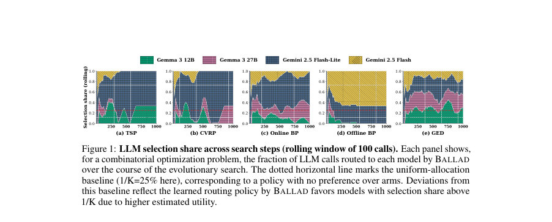
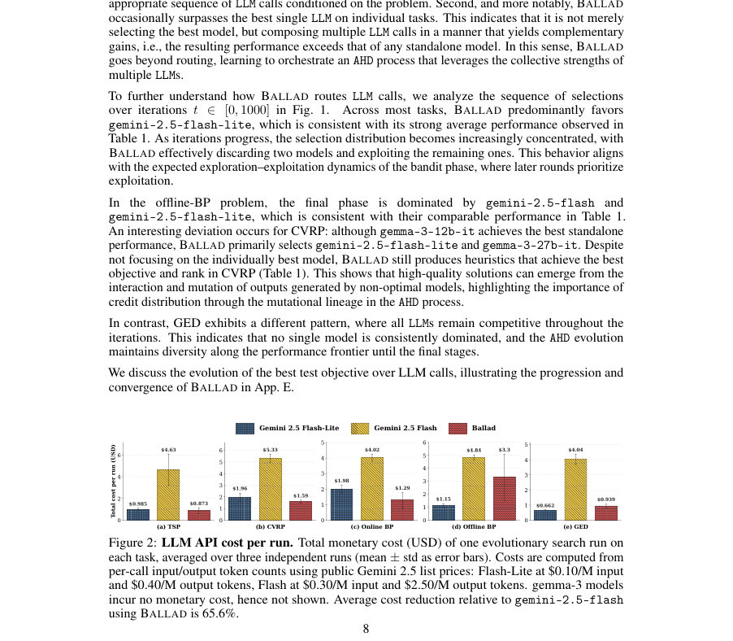
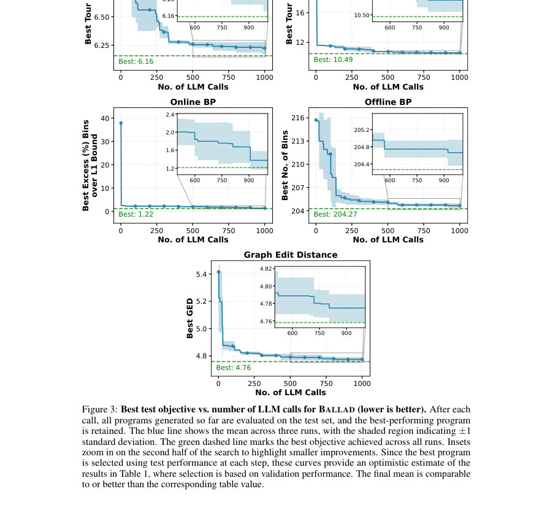

# Ballad: Bandit-Based LLM Routing for Automated Heuristic Discovery

- **게시일:** 2026-11-14
- **arXiv:** [2611.17241v1](http://arxiv.org/abs/2611.17241v1) · [PDF](https://arxiv.org/pdf/2611.17241v1)
- **저자:** Samidha Verma, Ankit Anand, Sayan Ranu
- **분야:** cs.AI
- **선정 점수:** 4.94
- **선정 이유:** 최근성 0.7, 인용 영향 0.0 (인용 0회), 저자 영향 0.0 (최고 h-index 0), AI 주제 적합성 2.3, 개발자 관심 0.0, 학술 신호 0.3, 오픈 웨이트·주요 연구조직 신호 1.6

[← 2026-11-14 목록으로 돌아가기](../daily/2026-11-14.html)

<!-- paper-visuals:start -->
## 주요 Figure

> 원문 PDF에서 실제 Figure 캡션과 그림 영역이 함께 확인된 자료만 자동 추출했다.

*Figure · 원문 PDF 8쪽 · Figure 1: LLM selection share across search steps (rolling window of 100 calls). Each panel shows,*

*Figure · 원문 PDF 8쪽 · Figure 2: LLM API cost per run. Total monetary cost (USD) of one evolutionary search run on*

*Figure · 원문 PDF 20쪽 · Figure 3: Best test objective vs. number of LLM calls for BALLAD (lower is better). After each*

<!-- paper-visuals:end -->

## 한 문장 요약

자동 휴리스틱 발견(AHD) 파이프라인에서 여러 LLM을 온라인 밴딧으로 라우팅해 희귀한 고성능 휴리스틱을 찾아내고 계보 기반 크레딧 전파와 비정상성 적응으로 단일 최고 모델을 능가하거나 비용을 절감하는 BALLAD 알고리즘을 제안한다.

## 해결하려는 문제

대규모 언어모델(LLM)을 반복적으로 호출해 프로그램형 휴리스틱을 돌연변이·교차시키는 자동 휴리스틱 발견(AHD)은 수천 회의 LLM 호출로 비용이 크고, 더 크고 비싼 모델이 항상 더 나은 결과를 준다는 가정이 성립하지 않는다. 따라서 다양한 비용·성능의 LLM 풀에서 어떤 모델을 각 단계에 호출할지 적응적으로 결정하는 문제가 필요하다. 이 문제는 (i) 전체 런에서 단일 최고 해를 찾는 극값(objective), (ii) 한 모델의 출력이 다른 모델의 입력이 되어 보상이 서로 얽히는 DAG(교배 계보) 의존성, (iii) 검색 진행에 따라 모델 유용도가 변하는 비정상성 때문에 기존 라우팅/밴딧 가정들을 위배한다.

## 핵심 기여

- 경험적 관찰: 다섯 개의 NP-hard 조합최적화 문제에서 더 크고 비싼 LLM이 일관되게 우월하지 않음을 보이며 적응형 라우팅의 필요성을 제시한다.
- 문제 정식화: AHD에서의 LLM 라우팅을 연속적 선택 문제로 정식화하고 극값 목표(P1), 교차-팔 coupling(P2), 비정상 보상(P3) 세 가지 특성을 제시했다.
- 알고리즘 설계: 극값 탐색을 위한 부트스트랩 상위분위수-혼합 추정, 휴리스틱 계보(DAG)를 통한 크레딧 전파, 시간창(window) 기반의 신선도 보정 및 고정-예산 기반 탐색 보너스를 결합한 단일 팔 인덱스(Scoreℓ(t))를 제안한 BANDIT 기반 라우터 BALLAD를 제시했다.
- 엔진 통합성: BALLAD는 FunSearch/AlphaEvolve 스타일 파이프라인의 고정 LLM 생성기 대체물로서 프롬프트 구조나 평가기에 대한 변경 없이 드롭인으로 동작한다.
- 실험적 검증: 4개의 LLM(두 유료 Gemini 계열, 두 오픈 Gemma 계열)과 5개 문제에서 BALLAD가 전반적으로 최종 목표값 및 랭크에서 최고의 성능을 보이거나(여러 경우 단일 최고 모델을 능가) 가장 강한 모델을 항상 쓰는 전략에 비해 API 비용을 최대 65.6% 절감함을 보였다.

## 접근 방법

* BALLAD는 각 LLM을 밴딧의 팔(arm)로 보고 매 라운드 평가점수들을 이용해 팔별 점수 Scoreℓ(t)를 계산해 argmax로 선택한다.
* Scoreℓ(t)은 세 항의 합으로 구성된다: (1) hybrid extreme-value base score: 팔의 관측값 버퍼 Oℓ에서 B개의 부트스트랩 샘플의 최대값 분포의 τ-분위수 ˆqτ(ℓ)와 관측최대 max Oℓ을 λ로 혼합한 추정치로, 희귀 고성능 출력을 중시한다; (2) lineage fertility term: 현재 생성된 휴리스틱 ht의 개선(rt = max(0, fP(ht) − bt), bt는 상위 엘리트 풀의 중앙값)을 중심으로 Dmax 깊이까지 조상 노드들에 γ^d로 기하감쇠된 크레딧을 부여하고, 최근 W라운드 내의 크레딧 합을 log(max(e, nℓ))로 나누어 노출 편향을 보정한 ¯Lℓ(t)을 사용한다; (3) exploration bonus: 고정-예산 기준으로 β * sqrt(log T / nℓ) 형태의 UCB 스타일 보너스를 더해 미탐색 팔을 유지한다.
* 선택 후에는 선택한 LLM의 Oℓ을 갱신하고 rt>0이면 계보 그래프 Gt를 통해 크레딧을 전파한다.
* BALLAD는 프롬프트 구성·평가부와는 인터페이스가 명확하여(필요 입력: fP(ht), PaDmax(ht), 선택된 LLM의 ID) 기존 AHD 루프에 쉽게 통합된다.

## 주요 결과

- 테스트 문제: TSP, CVRP(50 노드), Online Bin Packing(5,000 아이템 등), Offline Bin Packing(500 아이템), Graph Edit Distance(Linux dataset).
- LLM 풀: gemini-2.5-flash, gemini-2.5-flash-lite (유료), gemma-3-12b-it, gemma-3-27b-it (오픈, 무료).
- 종합 성능: Table 1 기준 BALLAD는 전체(문제 평균) 목표값과 평균 랭크에서 가장 우수하거나 상위권을 유지하며 '전체 평균 목표값' 항목에서 BALLAD의 Overall Obj. = 45.577 ± 0.195로 보고되었다(평가는 최소화 문제로 낮을수록 우수).
- 단일 모델 대비: BALLAD는 여러 문제에서 후행 관찰(hindsight)의 최선 LLM과 동등하거나 그 이상 성능을 보였고(본문: 'matches or surpasses the best individual LLM'), 일부 문제에서는 어떤 단일 모델보다도 성능이 높아 모델들의 조합·오케스트레이션 효과를 보였다.
- 비용 절감: gemini-2.5-flash 대비 한 런 당 비용이 최대 5.30× 저렴하고 평균 2.86× 저렴하며, 평균 비용 절감률은 65.6%로 보고되었다(Fig.2). 단, gemma-3 계열은 토큰 비용이 0으로 처리되어 그래프에 표시되지 않음(오픈 모델).

## 한계

- 저자 명시 한계: 현재 공식화는 각 LLM을 블랙박스 생성기로 취급하고 고정된 프롬프트 전략을 사용한다. 이로 인해 모델별 맞춤 프롬프트, 변이 연산자, 계보 정보의 통합 등 모델별 최적화 가능성을 배제한다(저자가 명시).
- 실험적 범위 제약(본문에서 합리적으로 확인되는 한계): 평가가 다섯 개의 조합최적화 문제와 네 개(확장 실험에서 최대 9개) LLM에 국한되어 있어 다른 도메인(예: 코드 생성, 자연어 태스크)으로의 외삽은 불확실하다.
- 비용 비교 전제: 확장 실험에서 GPT-5 등 프런티어 모델과의 비용 절감 수치는 '동일한 토큰 사용 가정'에 의존한다고 본문에서 명시하고 있어 실제 비용 절감은 토큰 사용량·요금 구조에 민감하다.
- 이론적 보장 부재: 알고리즘은 실무적으로 설계된 점수 함수를 사용하며 본문에 명시적 수학적 수렴성/레그렛 보장 증명은 제시되지 않았다(문헌 비교와 실험 중심).

## 개발자 관점

- BALLAD는 FunSearch/AlphaEvolve 스타일 AHD 루프에서 고정 LLM 호출기를 대체하는 드롭인 컴포넌트로 구현 가능하므로 기존 파이프라인 변경은 최소화된다.
- 구현에 필요한 최소 정보는 각 라운드의 평가점수 fP(ht), 새로 생성된 휴리스틱의 부모 집합 PaDmax(ht), 호출한 LLM ID이며, 계보 DAG 유지와 최근 W 라운드 크레딧 윈도잉을 효율적으로 구현해야 한다.
- 핵심 하이퍼파라미터(λ, τ, α, β, γ, W, Dmax 등)를 제공해야 하고 본문은 감도 실험(ablations)에서 이들 값의 영향이 중요함을 보여주므로 실전 적용시 검증이 필요하다(부록 App.D에 하이퍼파라미터·하드웨어 설정 참조).
- 비용을 명시적으로 포함시키려면 Scoreℓ(t)에 비용 패널티 항을 추가할 수 있으나 본문 실험에서는 비용-패널티 기반 탐색이 성능을 저하시켰다고 보고되어 비용-효율화는 신중히 설계해야 한다.
- 계보 기반 크레딧은 rt>0(엘리트 기준을 넘는 개선)시에만 전파되므로 평가 함수의 설계와 엘리트 기준(topK median)의 선택이 라우팅에 큰 영향을 준다. 따라서 평가기(fP) 정의와 엘리트 기준 튜닝이 중요하다.

**근거 범위:** 이 분석은 제공된 논문 PDF 본문(서론, 방법, 실험, 표·그림 및 결론)을 기반으로 작성되었다. 부록(App. B, D, E, F, G 등)에 자세한 의사코드·하이퍼파라미터·하드웨어 세부사항이 언급되어 있으나 본 요약에는 부록의 전체 텍스트가 전부 포함되지 않을 수 있다. 표와 그림의 수치(예: 비용 절감률 65.6%, 비용 배수 5.30×, ablation 결과 등)는 본문에 직접 명시된 값을 그대로 사용했으며, PDF에 명시되지 않은 구현 세부(예: 정확한 B, τ 값, W, Dmax의 숫자)는 기술하지 않았다.
