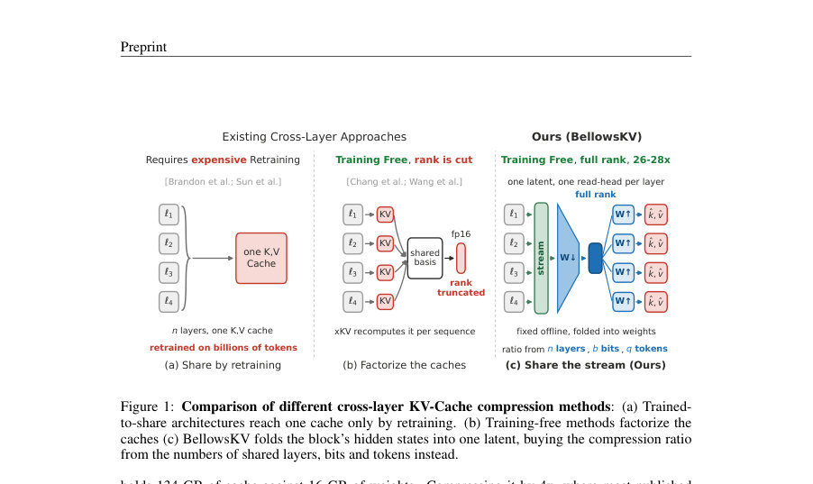
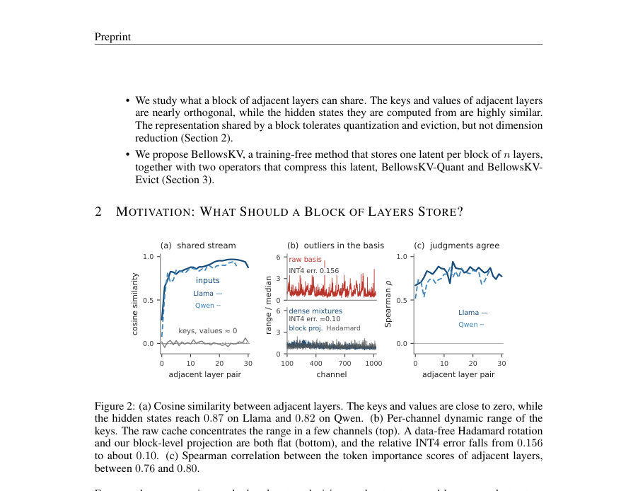
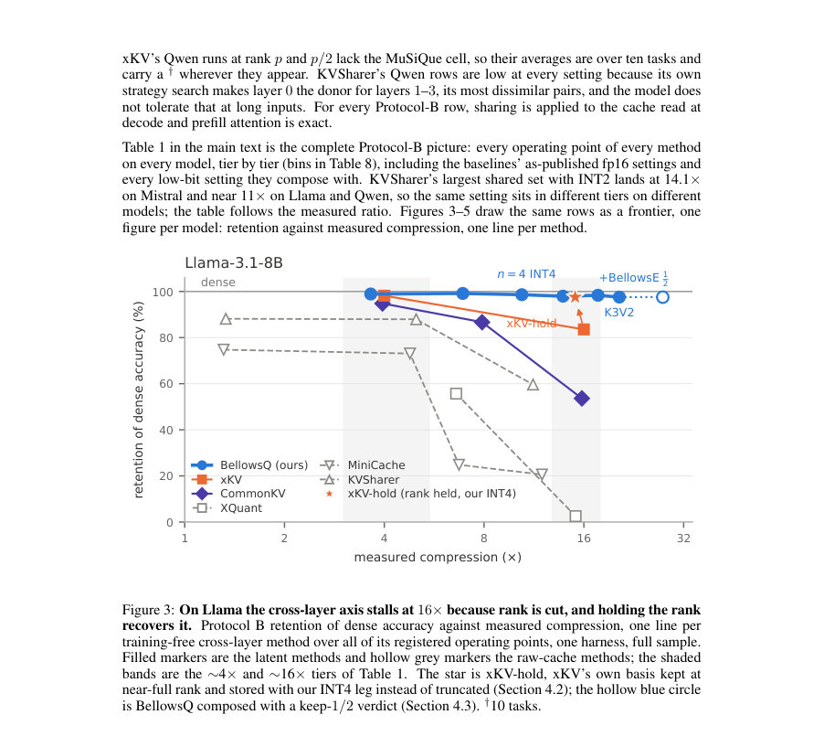

# BellowsKV: One Latent for Many Layers, Expanded on Demand

- **게시일:** 2026-10-27
- **arXiv:** [2610.35023v1](http://arxiv.org/abs/2610.35023v1) · [PDF](https://arxiv.org/pdf/2610.35023v1)
- **저자:** Jiamu Zhang, Hanjie Chen
- **분야:** cs.LG
- **선정 점수:** 6.34
- **선정 이유:** 최근성 1.0, 인용 영향 0.0 (인용 0회), 저자 영향 0.0 (최고 h-index 0), AI 주제 적합성 1.9, 개발자 관심 0.7, 학술 신호 0.3, 오픈 웨이트·주요 연구조직 신호 2.4

[← 2026-10-27 목록으로 돌아가기](../daily/2026-10-27.html)

<!-- paper-visuals:start -->
## 주요 Figure

> 원문 PDF에서 실제 Figure 캡션과 그림 영역이 함께 확인된 자료만 자동 추출했다.

*Figure · 원문 PDF 2쪽 · Figure 1: Comparison of different cross-layer KV-Cache compression methods: (a) Trained-*

*Figure · 원문 PDF 3쪽 · Figure 2: (a) Cosine similarity between adjacent layers. The keys and values are close to zero, while*

*Figure · 원문 PDF 29쪽 · Figure 3: On Llama the cross-layer axis stalls at 16× because rank is cut, and holding the rank*

<!-- paper-visuals:end -->

## 한 문장 요약

KV-cache 메모리 병목을 줄이기 위해 인접 n개 층의 입력 은닉 상태를 하나의 고차원 공유 잠재(latent)로 합쳐, 계층별 투영으로 각 층의 키·값을 복원하는 훈련 불필요한 압축 기법 BellowsKV를 제안한다.

## 해결하려는 문제

대규모 언어모델(LLM)은 과거 토큰의 attention 키·값을 층별로 저장하는 KV-cache로 인해 GPU 서빙 시 메모리 병목이 발생한다. 기존 압축 방법(층 내부에서의 양자화, 채널 차원 축소, 토큰 축출)은 높은 압축비에서 정확도 손실이 크고, 인접 층 간 하나의 압축된 캐시를 공유하는 기존 교차-층(cross-layer) 방법들도 높은 압축비에서 성능이 급락한다. 본 연구는 인접 층 간 표현의 성질을 분석하여, 어떻게 하면 메모리 예산 내에서 정확도를 최대한 유지하면서 더 높은 압축비를 달성할 수 있는지를 탐구한다.

## 핵심 기여

- 인접 층들에 대해: KV-cache 내 키·값 표현은 서로 다르지만 입력 은닉 상태(input hidden states)는 매우 유사하다는 실증적 관찰을 제시함.
- BellowsKV라는 '훈련 불필요'한 교차-층 압축 방법을 제안함 — n개의 인접 층의 입력 은닉 상태를 토큰당 하나의 공유 잠재(latent)로 매핑하고, 추론 시 각 층이 층별 투영(layer-specific projection)으로 자신의 키·값을 복원하도록 설계함.
- 잠재 표현을 차원 축소 대신 유지한 상태에서 두 가지 압축 전략을 제시: BellowsKV-Quant(잠재를 저정밀로 저장)와 BellowsKV-Evict(블록 단위로 공유된 토큰 축출 결정).
- 잠재에 지배적(outlier) 채널이 없어 저정밀 양자화가 거의 무손실임을 보고하고, 층들이 토큰 중요도를 매우 유사하게 랭킹하므로 블록 단위 공유 축출이 효과적임을 보임.
- Llama-3.1-8B, Mistral-7B, Qwen2.5-7B에서의 실험으로 BellowsKV-Quant가 3.6×에서 약 99%의 전체 캐시 정확도 보존, 13–14×에서 97–98% 보존을 달성하여 기존 최강 교차-층 방법(16×에서 최대 84% 보존)보다 우수함을 보고함.

## 접근 방법

* BellowsKV는 훈련을 필요로 하지 않는 교차-층 KV-cache 압축 프레임워크이다.
* 핵심 아이디어는 인접 n개 층의 입력 은닉 상태들을 토큰당 하나의 공유 잠재(latent)로 매핑(mapping)하고, 추론 시 각 층이 그 잠재에서 자신의 키·값을 읽어오기 위해 층별 투영(layer-specific projection)을 적용하도록 하는 것이다.
* 구현 세부사항(논문 본문 기준):
* 잠재는 차원 축소를 하지 않고 원래(또는 전체) 차원으로 유지한다(저차원으로 줄이는 것이 동일한 메모리 예산에서 정확도 손실이 더 큼을 근거로 함).
* BellowsKV-Quant: 공유 잠재를 저정밀(low-precision)로 저장하여 메모리를 줄인다.
* 저정밀 저장이 거의 무손실인 이유는 잠재에 지배적인 outlier 채널이 존재하지 않기 때문이라고 기술함.
* BellowsKV-Evict: 블록(block) 단위로 하나의 공유된 토큰 축출(eviction) 결정을 사용한다.
* 이는 인접 층들이 토큰 중요도를 매우 유사하게 랭킹하기 때문에 가능하다고 설명함.
* 전체 방법은 훈련 없이 동작하며, 추론 시 각 토큰마다 하나의 공유 잠재를 저장하고 각 층은 자신의 키/값을 복원하기 위한 가벼운 투영 연산을 수행한다.

## 주요 결과

- 평가 대상 모델: Llama-3.1-8B, Mistral-7B, Qwen2.5-7B(논문 본문에서 보고된 모델들).
- 압축 성능(논문 요약 기준): BellowsKV-Quant는 약 3.6× 압축에서 전체 캐시 정확도의 약 99%를 보존함.
- 고압축 영역에서도 성능 유지: 13–14× 압축에서 BellowsKV-Quant는 약 97–98%의 전체 캐시 정확도를 유지함.
- 기존 최강 교차-층 방법과 비교: 기존 방법은 16× 압축에서 최대 약 84%의 정확도 보존을 보였음(따라서 BellowsKV가 더 높은 보존률을 달성).

## 한계

- 저자가 명시적으로 언급한 한계: 제공된 초록(및 본문 발췌)에는 저자 측에서 명시한 구체적인 한계가 별도로 기록되어 있지 않음.
- 본 논문에서 합리적으로 확인되는 한계 및 제약: (1) 실험이 Llama-3.1-8B, Mistral-7B, Qwen2.5-7B 세 가지 모델에 대해 보고되어 있어 범용성(다른 아키텍처·규모·작업군)에 대한 추가 검증이 필요하다; (2) 방법은 '인접 층의 입력 은닉 상태가 유사하다'는 관찰에 의존하므로, 이 특성이 성립하지 않는 아키텍처나 조건에서는 효과가 떨어질 수 있다; (3) 잠재를 전체 차원으로 유지하므로 메모리 절감은 잠재의 저정밀화 또는 축출에 의존하며, 계층별 투영 연산이 추론 시 추가 계산/지연을 유발할 가능성이 있다(초록에서 성능·지연의 구체적 수치·측정은 제공되지 않음).

## 개발자 관점

- 재현성: 논문에 의해 공개된 코드 저장소가 제공됨(요약에 명시됨), 이를 통해 실제 서빙 환경에 통합된 구현을 확인하고 실험을 반복할 것(특히 quantization 비트수, 블록 크기, n(인접 층 수) 설정 등 하이퍼파라미터 확인 필요).
- 구현·배포: 추론 파이프라인에 '토큰당 하나의 공유 잠재' 저장 및 '층별 투영'을 추가해야 하므로, KV-cache 데이터 구조와 GPU 메모리 레이아웃을 수정해야 함(잠재의 저정밀 저장과 블록 단위 축출 로직을 서버 코드에 통합).
- 성능 검증: 목표 모델 및 워크로드(대화 길이, 툴 호출 패턴, 롱-호라이즌 작업)에 대해 정확도(또는 LM 성능 지표)와 지연을 비교 검증할 것. 특히 압축비(예: 3.6×, 13–14×)별로 서비스 품질을 모니터링해야 함.
- 비용: KV-cache 메모리 사용량을 크게 줄여 GPU 인스턴스 당 처리 가능한 컨텍스트 길이나 동시 세션 수를 늘릴 수 있으나, 계층별 투영으로 인한 추가 연산 비용과 양자화/복원 비용을 고려해 종합적인 비용-지연 분석이 필요함.
- 안전성·유지관리: 모델 아웃풋 민감도가 높은 워크로드에서는 높은 압축비 사용 시 미세한 성능 저하가 사용자 경험에 영향을 줄 수 있으므로 Canary 테스트 및 롤백 경로를 마련할 것.

**근거 범위:** 본 분석은 제공된 논문의 초록(논문 PDF 본문 추출 실패로 인한 초록 사용)을 기반으로 작성되었으며, 본문 전체를 직접 검토하지 못해 세부 구현(예: 잠재 매핑의 정확한 수학적 정의, 양자화 비트수, 블록 크기, 평가 데이터셋·메트릭, 추론 지연 수치 등)은 확인하지 못했다. 위의 모든 수치(예: 보존률, 압축배수, 대상 모델)는 초록에 명시된 값에 근거하며, 세부 실험 설정이나 추가 결과는 원문 본문 및 공개된 코드 저장소를 통해 확인해야 한다.
