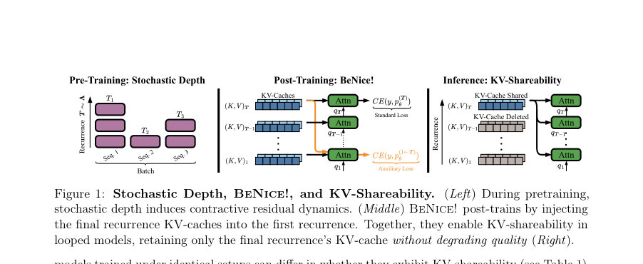
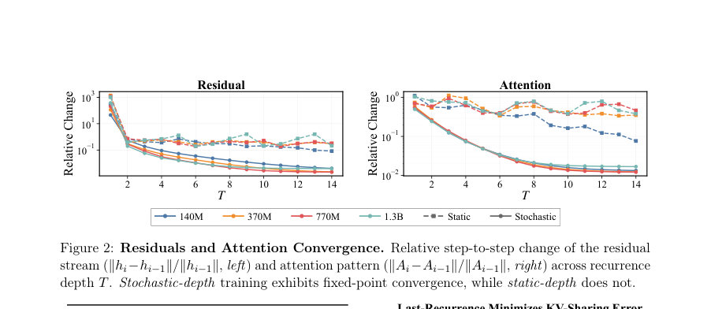
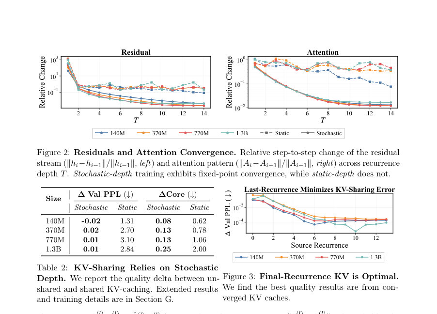

# BeNice! Closing Looping's Inference-Memory Gap via KV-Sharing

- **게시일:** 2026-10-24
- **arXiv:** [2610.31633v1](http://arxiv.org/abs/2610.31633v1) · [PDF](https://arxiv.org/pdf/2610.31633v1)
- **저자:** Hayden Prairie, Jacob M. Ryan, Taylor Berg-Kirkpatrick, Daniel Y. Fu
- **분야:** cs.LG
- **선정 점수:** 6.91
- **선정 이유:** 최근성 0.8, 인용 영향 0.0 (인용 0회), 저자 영향 1.7 (최고 h-index 17), AI 주제 적합성 1.9, 개발자 관심 0.7, 학술 신호 0.3, 오픈 웨이트·주요 연구조직 신호 1.6

[← 2026-10-24 목록으로 돌아가기](../daily/2026-10-24.html)

<!-- paper-visuals:start -->
## 주요 Figure

> 원문 PDF에서 실제 Figure 캡션과 그림 영역이 함께 확인된 자료만 자동 추출했다.

*Figure · 원문 PDF 2쪽 · Figure 1: Stochastic Depth, BeNice!, and KV-Shareability. (Left) During pretraining,*

*Figure · 원문 PDF 5쪽 · Figure 2: Residuals and Attention Convergence. Relative step-to-step change of the residual*

*Figure · 원문 PDF 5쪽 · Figure 3: Final-Recurrence KV is Optimal.*

<!-- paper-visuals:end -->

## 한 문장 요약

루프드(반복) 언어모델의 추론 시 KV 캐시가 반복마다 독립적으로 생겨 메모리 사용이 선형으로 증가하는 문제를, 사전학습에서의 확률적 깊이(stochastic depth)로 수렴하는 잔차( residual ) 역학을 유도하고 사후학습 BeNice! 손실로 첫 반복의 잔차 편차를 보정해 최종 반복의 KV를 모든 반복에 공유(KV-sharing) 가능하게 하여 메모리·추론 효율을 크게 개선한다.

## 해결하려는 문제

루프드(반복) 아키텍처는 파라미터 수를 고정한 채 반복 수로 품질을 확장할 수 있으나, 추론 시 각 반복마다 별도의 키·값(KV) 캐시를 생성해 KV 캐시 메모리가 반복 수에 따라 선형으로 증가하는 문제가 있다. 일부 이전 작업은 최종 반복의 KV를 앞선 반복들과 공유해 메모리를 줄이는 KV-sharing을 제안했으나, 모든 모델에서 성능 유지가 보장되지 않으며, 동일한 학습 설정에서도 KV-shareability가 일관되게 나타나지 않는다는 한계가 있다. 본문은 어떤 조건이 KV-shareability를 가능하게 하는지, 실패 원인은 무엇인지, 이를 어떻게 후처리로 보정할 수 있는지를 연구한다.

## 핵심 기여

- KV-shareability의 발생 기제를 분석하고, 반복 블록에서의 수렴(fixed-point) 거동이 키·값 캐시의 수렴과 KV-shareability와 연관됨을 이론적(수렴·바운드)·실험적으로 규명함(Section 3, Theorem 1).
- 사전학습 단계에서 확률적 깊이(stochastic depth)를 사용하면 반복 간 잔차(residual) 역학이 수축(contractive)되어 고정점 수렴을 촉진하고 KV-shareability 출현을 돕는다는 관찰 및 근거를 제시함(Section 3.1, Fig.2, Table 8).
- BeNice!라는 사후학습(post-training) 방법을 제안하여 최종 반복의 KV 캐시를 첫 반복에 주입한 하이브리드 롤아웃을 보조 손실로 학습함으로써 첫 반복에서 발생하는 토큰-독립적(토큰 불변) 잔차 편향을 보정하고 KV-shareability를 실용적으로 달성함(Section 4, Eq.1, Table 4–5).
- KV-sharing이 다른 KV 압축 기법들과 호환됨을 보임: 멀티-라텐트 어텐션(MLA), Kimi delta attention(KDA) 같은 메모리 효율적 시퀀스 믹서들과 KV-캐시 양자화(fp8, mx(fp)8, nvfp4 등)에 대해 합성(조합) 가능함을 실험으로 보임(Section 5.2, Fig.6–7).
- 메모리 제한이 있는 장기 컨텍스트 추론 시 시뮬레이션을 통해 KV-sharing이 캐시 적중률 증가(최대 31.4%/8.1 포인트), 처리량 최대 23.6% 증가, p90 TTFT(첫 토큰 응답 시간) 최대 83.6% 감소와 같은 실무적 이득을 가져옴을 보여줌(Section 5.3, Fig.8–10).

## 접근 방법

* 전체 접근은 두 단계로 구성된다.
* (1) 사전학습: 각 시퀀스마다 서로 다른 반복 깊이 T를 샘플링하는 per-sequence stochastic depth(Λ∼Poisson(µrec))로 사전학습하여 반복 블록 R의 잔차 역학을 수축적(contractive)으로 유도하고 반복별 표현들이 공통의 고정점으로 수렴하도록 장려한다(Section 4.1, Prairie 등 설정 참조).
* 이로써 최종 반복의 KV가 다른 반복들의 KV에 근접하도록 만든다.
* (2) BeNice!
* 사후학습: 사전학습된 모델에 대해 표준 언어모델 손실 CE(y,p^{(T)}_θ)와 함께 보조 손실 γ·CE(y,p^{(1←T)}_θ)를 최소화한다(식 (1)).
* 여기서 p^{(1←T)}_θ는 '첫 반복의 쿼리·잔차는 그대로 두고 KV는 최종 반복의 KV를 재사용'하는 하이브리드 예측자다.
* 보조 항은 첫 반복이 최종 KV와 호환되는 잔차를 생성하도록 학습해 토큰-독립적 기저(basis) 이동을 보정한다.
* 학습 시 T는 사전학습과 동일한 분포 Λ에서 샘플한다.
* 또한 BeNice!은 multi-latent attention(MLA)와 Kimi delta attention(KDA) 같은 시퀀스 믹서에도 동일한 아이디어(최종 반복의 latent/state를 재사용)로 확장 가능하다(Section 4.2, K절).
* 저용량 파라미터 대체로는 LoRA 기반의 저랭크(BeNice!†)도 적용해 키·값 프로젝션에 랭크-8 어댑터로 미세조정하여 파라미터 수천~수만 개만 업데이트하는 버전도 보고함(Section J).
* 이론적 근거로는 반복블록 R이 κ-Lipschitz(κ<1)일 때 ht 수렴이 키·값 투영의 수렴을 보장하며 교체 오차가 잔차 차이로 바운드됨을 보임(Theorem 1, Section D).

## 주요 결과

- KV-shareability은 모든 루프드 모델에서 자동으로 발생하지 않음(예: 공개된 Parcae 모델들 중 일부는 공유 시 품질 대폭 저하; Table 1).
- Stochastic-depth 학습은 반복 간 잔차 및 어텐션 패턴의 고정점 수렴을 유도하며, 같은 설정의 static-depth 모델들보다 공유·비공유 간 품질 차이가 훨씬 작음(예: Table 8 및 Fig.2).
- BeNice! 사후학습은 KV-sharing을 활성화하면서 기준(비공유) 품질을 유지 또는 개선함: 예로 770M와 1.3B 공개 체크포인트에 대해 표준 파인튜닝과 비교 시, 표준 FT는 공유 시 Validation PPL이 각각 11.86→21.61(+9.75 PPL) 및 10.79→18.52(+7.73 PPL)로 악화된 반면, BeNice!는 11.85→11.86(+0.01) 및 10.79→10.78(−0.01)로 공유 시에도 PPL을 지킴(Table 5).
- 신규 학습한 Parcae 계열(140M/370M/770M/1.3B)에서도 BeNice!은 Core 및 Core-Extended 성능을 유지하거나 향상시키며 KV-sharing을 가능하게 함(예: Core 기준 최대 +8.35 포인트, Core-Extended 최대 +4.56 포인트 개선; Table 4).
- KV-sharing은 다른 KV 압축 기법과 상호 보완적: MLA/KDA 변형과의 조합 및 KV-캐시 양자화(fp8, mxfp8, nvfp4 등)와 함께 적용해도 큰 성능 저하 없이 조합 가능함(Section 5.2, Fig.6–7). 단, 일부 MLA 모델은 규모가 커지며 공유 실패를 보였고(Section L, Table 12), KDA는 비교적 공유에 관대했다. ️️️️️️️️️️️️️️️️️️️️️️️️️️️️️️️️️️️️️️️️️️️️️️️️️️️️️️️️️️️️️️️️️️️️️️️️️️️️️️️️️️️️️️️️️️️️️️️️️️️️️️️️️️️️️️️️️️️️️️️️️️️️️️️️️️️️️️️️️️️️️️️️️️️️️️️️️️️️️️️️️️️️️️️️️️️️️️️️️️️️️️️️️️️️️️️️️️️️️️️️️️️️️️️️️️️️️️️️️️️️️️️️️️️️️️️️️️️️️️️️️️️️️️️️️️️️️️️️️️️️️️️️️️️️️️️️️️️️️️️️️️️️️️️️️️️️️️️️️️️️️️️️️️️️️️️️️️️️️️️️️️️️️️️️️️️️️️️️️️️️️️️️️️️️️️️️️️️️️️️️️️️️️️️️️️️️️️️️️️️️️️️️️️️️️️️️️️️️️️️️️️️️️️️️️️️️️️️️️️️️️️️️️️️️️️️️️️️️️️️️️️️️️️️️️️️️️️️️️️️️️️️️️️️️️️️️️️️️️️️️️️️️️️️️️️️️️️️️️️️️️️️️️️️️️️️️️️️️️️️️️️️️️️️️️️️️️️️️️️️️️️️️️️️️️️️️️️️️️️️️️️️️️️️️️️️️️️️️️️️️️️️️️️️️️️️️️️️️️️️️️️️️️️️️️️️️️️️️️️️️️️️️️️️️️️️️️️️️(원문 수치·세부 표 참조).

## 한계

- 저자가 명시한 한계: 확률적 깊이(stochastic depth)로 수축 역학을 유도하는 것은 KV-shareability의 필요조건에 가깝지만 충분조건이 아니며(Section 3.2), 일부 모델(예: Parcae 770M, 1.3B)은 stochastic-depth로 학습되었음에도 KV-sharing 시 고정점이 달라지는 실패를 보였음(토큰-독립 기저 이동 발생). BeNice!은 이러한 잔차 편향을 사후학습으로 보정하지만, 사후 학습(파인튜닝)이 필요하다는 점은 실무적 비용으로 작용한다(Section 3.2, 4.2).
- 실험적 제약(본문에서 합리적으로 확인되는 한계): 성능·지연 개선(throughput, TTFT)은 Mooncake 실무 트레이스 기반 시뮬레이션 및 sglang 구현에서 측정되었으나(Section 5.3), 완전한 프로덕션 배포 환경(다양한 하드웨어·스케줄러·운영 환경)에서의 검증은 제한적임. 또한 MLA 변형 등 일부 시퀀스 믹서는 규모 확장 시에도 KV-sharing 실패를 보였고(Section L, Table 12), 모든 시퀀스 믹서·루프드 설계에 대해 보편적으로 검증된 것은 아니다.
- 추가 고려사항: BeNice!의 최적 하이퍼파라미터(예: γ, 학습률)는 모델 규모·데이터·finetune 예산에 따라 달라지며, 논문은 특정 설정(예: BeNice! 최적 lr≈1.25e-4, γ≈0.01을 보고) 을 제시하지만 일반화는 추가 실험이 필요함(Section O).

## 개발자 관점

- 사전학습 단계에서 per-sequence stochastic depth(Λ∼Poisson(µrec))를 사용하면 반복 블록의 잔차가 수축적 역학을 갖도록 유도되어 KV 캐시 수렴과 KV-shareability 출현 가능성을 높임(Section 4.1). 운영 전용 모델을 새로 설계할 때 이를 고려하라.
- 이미 학습된 루프드 모델은 BeNice! 사후학습으로 실용적으로 KV-sharing을 활성화할 수 있음: 표준 LM 손실 + γ·보조손실(첫 반복에 최종 KV 사용) 구조로 적은 추가 데이터(논문에서는 140M 토큰 수준의 파인튜닝 사용)를 통해 공유 시 품질을 회복 가능(Section 4.2, I).
- 첫 반복의 첫 레이어에서 발생하는 토큰-독립적 기저 이동을 진단/모니터링하라. 간단한 'Naive patching'(오류 서브스페이스의 평균을 첫 레이어에 더함)이나, 더 효율적인 방법으로는 LoRA 기반 저랭크 업데이트(키·값 프로젝션에 rank-8 등)를 사용해 수만 개 파라미터만 업데이트하여 BeNice!-유사 효과를 얻을 수 있음(Section E, J).
- KV-sharing은 KV-양자화(fp8, mxfp8, nvfp4 등)와 메모리-효율적 시퀀스 믹서(MLA, KDA)와 조합 가능하나, 각 조합의 동작을 별도 검증해야 함(Section 5.2). 특히 MLA 변형은 규모에 따라 공유 실패가 발생하므로 테스트가 필요하다.
- 추론 시스템 설계 관점: KV-sharing으로 KV 메모리 사용을 크게 줄이면(예: 1.3B Parcae에서 HBM 63.82 GB → 21.60 GB, 66.2% 절감), 캐시 용량 증가로 캐시 히트율·처리량·응답시간이 개선되므로 메모리-제약 환경(엣지, 작은 GPU/가속기)에서 유용함. 다만 실환경 측정·통합(예: 그래프·버퍼·동시성 정책) 필요(Section 5.3, Fig.8–10).

**근거 범위:** 이 분석은 제공된 논문 PDF 본문(본문·부록 포함)에 근거하여 작성되었음. 본문에서 명시된 표(Table 1–16), 그림(Fig.1–12) 및 수식(식 1, Theorem 1 등)을 직접 인용·요약했으며, 본문에 직접 나타나지 않은 세부 구현·운영 파라미터(예: 전체 파인튜닝 비용의 정확한 GPU 시간, 프로덕션 환경 배포 결과)는 기술하지 않았음. 논문에 보고된 일부 수치는 표·그림의 맥락에 따라 요약했으므로, 원문 표·그림을 함께 확인하면 더 정확한 숫자·세부 비교를 얻을 수 있음.
