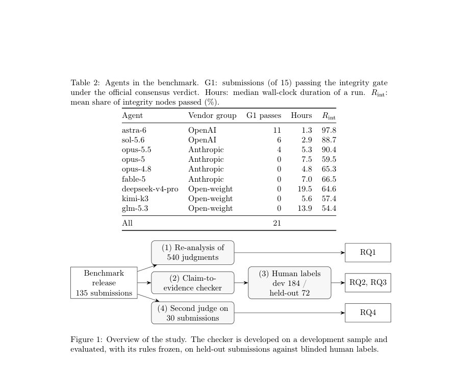
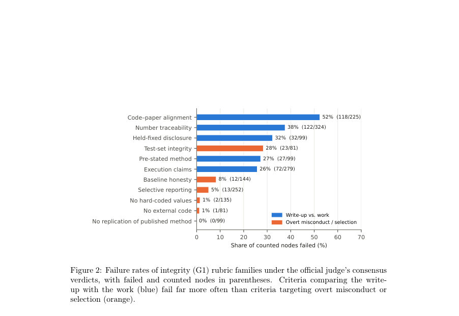
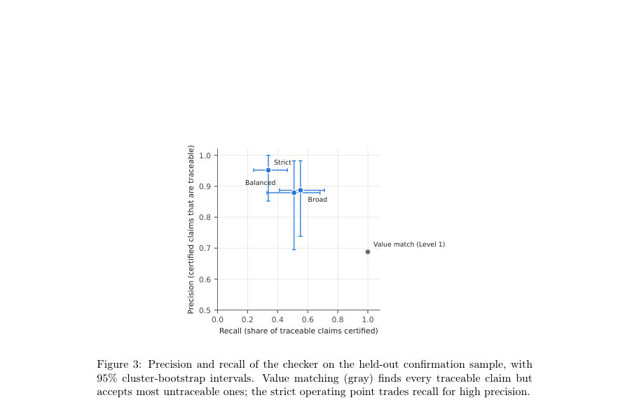

# Beyond fabrication: Misattributed numbers in papers written by AI research agents

- **게시일:** 2026-10-30
- **arXiv:** [2610.38691v1](http://arxiv.org/abs/2610.38691v1) · [PDF](https://arxiv.org/pdf/2610.38691v1)
- **저자:** Mosab Alfaqeeh, Omar Hourani, Muath Hourani, Hashem Alfaqeeh
- **분야:** cs.AI, cs.CL, cs.DL
- **선정 점수:** 4.76
- **선정 이유:** 최근성 0.8, 인용 영향 0.0 (인용 0회), 저자 영향 0.0 (최고 h-index 0), AI 주제 적합성 3.0, 개발자 관심 0.2, 학술 신호 0.8, 오픈 웨이트·주요 연구조직 신호 0.0

[← 2026-10-30 목록으로 돌아가기](../daily/2026-10-30.html)

<!-- paper-visuals:start -->
## 주요 Figure

> 원문 PDF에서 실제 Figure 캡션과 그림 영역이 함께 확인된 자료만 자동 추출했다.

*Figure · 원문 PDF 13쪽 · Figure 1: Overview of the study. The checker is developed on a development sample and*

*Figure · 원문 PDF 22쪽 · Figure 2: Failure rates of integrity (G1) rubric families under the official judge’s consensus*

*Figure · 원문 PDF 26쪽 · Figure 3: Precision and recall of the checker on the held-out confirmation sample, with*

<!-- paper-visuals:end -->

## 한 문장 요약

AI 연구 에이전트가 작성한 논문에서 보고된 수치가 실제로 그 실험에서 나온 것인지 판별하기 위해, 저자들은 에이전트의 실행 아티팩트와 논문 내 숫자를 결합해 결정적(deteministic) 방식의 claim-to-evidence 체커를 설계·검증하고 인간 라벨링 및 교차 심사를 통해 '위조(fabrication)'와 '오지정(misattribution)'을 구별했다.

## 해결하려는 문제

최근 AI 연구 에이전트는 실험을 실행하고 완결된 논문을 생성할 수 있게 되었고, 조직은 이러한 보고된 수치에 의존해 의사결정을 한다. 기존 무결성 검사는 보통(1) 논문 내부 일관성 검증(예: statcheck, GRIM)이나 (2) 보고값이 에이전트 출력 어디엔가 존재하는지 확인하는 값 매칭에 그쳤다. 그러나 이들 방식은 '보고된 값이 실제로 그 값이 주장하는 실험·메트릭·시드(run)에서 나온 것인가'라는 근원적 증거(프로비넌스)를 확보하지 못한다. 본문은 (i) 공식 LLM 심사자의 노드별 판단을 재분석하고, (ii) 한 건의 값 수준에서 인간 라벨을 수집해 오지정(misattribution)과 부재(fabrication)의 비중을 측정하며, (iii) 실행 아티팩트로부터 근거를 결정적으로 추적하는 체커를 제안·검증하고, (iv) 다른 벤더의 심사자와 비교해 심사자 의존도를 평가하는 것을 문제로 삼는다.

## 핵심 기여

- 에이전트 무결성 실패의 실증적 특성화: 공식 판정과 인간 라벨을 통해, 본 벤치마크에서 지원되지 않는 숫자들은 주로 '오지정'(값은 에이전트의 파일에 존재하지만 잘못된 실험/메트릭/런에 연결됨)이라는 사실을 보였다 (Sections 5.1–5.2).
- 검증된 결정적 claim-to-evidence 체커 제안: 실행 아티팩트(텍스트형 결과 파일)에서 숫자를 추출하고 문맥 토큰 중첩 점수와 per-claim decoy(값 변형) 보정으로 근거를 점수화하는 모델-프리 방법을 설계·고정 운영점으로 검증했다 (Sections 4.2, 5.3).
- 벤치마크 전반의 계량적 측정: 99개 제출물에 체커를 적용해 에이전트별로 보고된 숫자의 추적 가능성(테레이서빌리티) 차이를 보여주고, 공식 심사자 순위와 일관되면서도 세부적 분해를 제공했다 (Section 5.4).
- 심사자 강건성 분석: 다른 벤더의 두 번째 LLM 심사자를 사용해 공식 심사자의 에이전트 순위는 보존되지만 절대 합격률은 심사자에 따라 달라짐을 보였다 (Section 5.5).

## 접근 방법

* 전체 워크플로는 네 축으로 구성된다.
* (1) 공식 심사자 판정 재분석: Into the Unknown 공개 릴리스의 540개 심사 출력을 노드 수준(2,376개의 카운트된 G1 노드)으로 추출해 실패율을 루브릭 패밀리별로 집계하고 심사자 자기일관성을 계산한다.
* (2) 결정적 claim-to-evidence 체커: 논문(LATEX)에서 숫자 청구(claim)를 추출(소수점·백분율·지수형 포함, 정수 제외, 문맥 창 160자 또는 표의 행/열/캡션)하고, 작업 디렉터리의 결과 파일(JSON/CSV/TSV/로그/텍스트)에서 증거 엔트리를 인덱싱한다.
* 체커는 세 단계로 판정한다.
* Level 1 값 매칭: 보고값이 어떤 엔트리 값과 반올림 정밀도 수준에서 일치하는지 확인.
* Level 2 프로비넌스 점수: claim 문맥의 토큰 집합과 증거 엔트리의 키/경로 토큰 집합의 정규화된 중첩 점수 s(c,e)를 계산하고, 가장 높은 항목 S(c)를 취한다.
* Per-claim decoy 보정: 원값 주변의 10개(±2,4,6,8,10) decoy값으로 동일 점수를 계산해 실제 점수가 decoy들보다 뛰어난지(순위기반 p값) 검증한다.
* 최종 판정은 엄격(strict: 점수 τ=0.12, p≤0.1), 균형(balanced) 및 광범위(broad) 세 운영점으로 고정했다.
* (3) 인간 라벨링: 개발셋(10개 제출 중 실사용 184개 청구, 튜닝/테스트 분할)과 확인셋(9개 제출에서 72개 청구; 최종 분석에선 8개 제출 72개 중 60개의 실청구)에서 두 명의 라벨러가 블라인드로 각 청구를 traceable / wrong source / not found / not a claim으로 라벨링.
* (4) 두 번째 심사자 비교: 다른 벤더(Claude Opus 5.5)로 샘플 30개 제출을 동일 루브릭과 툴체인으로 재채점해 심사자 간 차이를 분석한다.
* 모든 부분은 결정적·재현 가능한 방식으로 설계되었고, 체커 운영점은 라벨 수집 전에 고정되었다.

## 주요 결과

- 공식 심사자 재분석: 공개된 540개 심사에서 450건이 무결성 실패, 86건이 불완전성(incompleteness) 판정. G1(무결성) 노드 2,376개 중 469개 실패(대부분 고신뢰). 실패는 주로 '코드–논문 정렬'(52% 실패, 118/225)과 '숫자 추적성'(38%, 122/324) 같은 '작성물과 작업의 일치' 기준에서 집중적으로 발생하고, '하드코딩', '외부 코드 사용' 등 명백한 부정행위 기준은 거의 발동하지 않음(1% 내외). 심사자 반복 간 완전일치 비율은 90.0%로 동일 심사자 내 반복은 안정적.
- 인간 라벨(총 256 청구): 실청구 기준(설정·추출 오류 제외)으로 보면, 미지원(unsupported) 청구 53건 중 47건(89% 원시합계; 인구 재가중치 81%)이 'wrong source'—즉 해당 값은 에이전트 파일에 존재하지만 다른 실험/메트릭/런/통계에 해당—이고, 'not found'는 소수(6건)에 불과. 확인샘플에서 두 라벨러 간 상호합의는 매우 높아 Cohen's κ = 0.89(네등급), 0.96(이진)로 보고됨.
- 체커 성능(운영점 'strict' 고정): 개발+확인 합산 211개의 실청구 중 체커는 85건을 인증(certified)했고 그중 78건이 라벨상 traceable로 확인되어 전체 정밀도 0.92(78/85, 정확 95% CI 0.84–0.97). 확인(held-out) 샘플에서는 29건 인증 중 27건 traceable(정밀도 0.93). 커버리지(전체 실청구 대비 인증 비율)는 약 23%이고, 엄격 운영점의 재현율(모든 traceable 대비 인증 비율)은 개발 0.39, 확인 0.34로 약 1/3 수준(보수적 인증).
- 값 매칭(Level 1)의 한계: 단순 값 존재 매칭은 부적절함을 드러냈다—값 매칭은 미지원(unsupported) 청구의 87–95%를 통과시키므로 오지정 오류를 판별하지 못함. 데코이(decoy) 실험에서, 잘못된(인위적) decoy 값들도 88%가 값 매칭으로 포함됨.
- 데코이 보정의 역할: 데코이 기반 p-테스트는 거짓 인증(편의적 잘못된 값 인증)을 줄임. 엄격 체커의 데코이 수용률은 개발 기준 전체 decoy에 대해 1.3%로 낮음(오탐 방지). 문맥 점수는 오지정 탐지에 가장 기여하여, 토큰 기반 중첩 점수 도입 전후로 정밀도가 크게 향상됨(0.77 → 0.92). 서로 보완적인 구성요소임(문맥 점수는 오지정 방지, 데코이 검정은 우연 일치 방지). 결론적으로 체커는 '양성 인증'에 대해 높은 신뢰도를 제공하나 '부정'은 인간 검토로 전달해야 함을 시사함(비검증 ≠ 허위).   

(수치 요약) 체커 strict: 정밀도 ≈ 0.92(78/85), 커버리지 ≈ 23%, 재현율 ≈ 0.34(held-out), 데코이 수용률 1.3% 개발, 값 매칭은 미지원 청구의 87–95% 통과, 전체 처리한 제출 99개, 14,577개 청구 인덱싱 완료.)  

추가: 벤치마크 전역 적용 결과, astra-6는 제출당 평균 체커 인증 비율 75.6%, sol-5.6 62.8%인 반면 다수 에이전트는 7.8–17.3% 수준(예: opus-5.5 13.8%). 체커는 99개 제출(총 14,577개 청구)을 완료함.   

심사자 강건성: 30개 제출 샘플을 두 번째 벤더 심사자로 재채점한 결과 두 심사자는 에이전트 순위를 보존했으나 절대 G1 합격률은 달랐음(공식 심사자는 G1에서 6개 제출 합격, 두 번째 심사자는 동일 샘플에서 12개 합격). 두 번째 심사자는 평균적으로 G1 노드 실패율을 제출당 5.4포인트 덜 기록(웨일콕슨 p=0.014).

## 한계

- 저자가 명시한 한계: 단일 벤치마크(Into the Unknown), 아홉 에이전트, 15개 과제에 대한 연구이므로 다른 도메인·에이전트·허니스팅 환경에서는 '오지정 대 부재' 비율이 달라질 수 있음. 체커는 논문이 LATEX로 제공되고 결과가 텍스트 기반의 기계판독 가능한 파일(JSON/CSV/TSV/로그 등)에 저장되는 릴리스의 속성에 의존하므로, PDF 전용 제출물이나 바이너리/데이터베이스에 저장된 결과에 대해서는 직접 적용하기 어렵다.
- 라벨링 관련 제약: 인간 라벨은 두 명의 라벨러(연구진 소속)로부터 얻었고 라벨링 규칙은 개발 단계에서 정교화되었음. 확인 샘플에서 합의는 높았지만 외부 패널에 의한 독립 검증은 없음. 'Not found'는 공개된 아티팩트에 없다는 의미로, 저장되지 않았거나 외부 문헌에서 인용된 값은 본 연구에서 '부재'로 분류될 뿐 '위조'로 단정하지 않음.
- 체커 한계: 체커는 '프로비넌스(근거 추적)'를 인증하지만 실험의 과학적 타당성(예: 실험 설계 결함, 통계적 오류)은 판정하지 않음. 또한 현행 strict 운영점은 보수적이어서 전체 추적 가능 청구의 약 1/3만 인증하므로 자동화 적용 범위가 제한적임.
- 심사자 비교의 제약: 두 번째 심사자 분석은 30개 제출 샘플(대부분 단일 반복)로 수행되어 벤더 상호작용 검정의 통계력이 제한적이며, 관찰된 완화 경향(더 관대한 두 번째 심사자)이 특정 벤더 편향의 증거로 확정되지는 않음.

## 개발자 관점

- 감사(감리) 우선 관점(provenance-first)을 도입하라: '값 존재 여부'가 아니라 '어떤 런(run)이 그 값을 만들었는가'를 질문해야 한다. 보고 문서가 값 자체를 재타이핑하지 않고 결과 파일에서 값을 삽입하게 하면 오지정 오류를 대폭 줄일 수 있다.
- 자동화 파이프라인 설계: 결정적 체커(문맥-키 토큰 중첩 점수 + per-claim decoy 보정)를 사용해 자동으로 인증 가능한 청구만 '자동 승인'하고, 비인증(uncertified)은 LLM 기반 분류기나 인간 검토로 라우팅하라. 체커는 재현 가능하고 감사 가능하므로 운영 기록에 포함시키기 적합하다.
- 루브릭·심사자 관리: 벤치마크나 내부 감사 시 심사자 모델·벤더를 명시하고 가능하면 교차 심사(다른 벤더의 심사자 또는 결정적 검사기 병행)를 도입하라. 심사자에 따라 절대 합격률이 달라지므로 절대 수치보다는 상대 순위를 함께 보고하라.
- 아티팩트 표준화: 결과 파일에 명확한 키(예: metric_name, seed, run_id, dataset, aggregation_type)와 구조화된 메타데이터를 포함하면 자동 추적률이 크게 향상된다. 에이전트 설계 시 실험 기록(시드·스플릿·메트릭·설정)의 저장과 보고서 연동을 의무화하라.
- 운영·확장 고려사항: 체커는 기계판독 가능한 결과 파일을 전제하므로, 대규모/대용량 결과 파일(논문 릴리스에서 일부 제출은 10GB 이상) 처리를 위한 시간·저장 공간 예산과 bulk 데이터 필터링 전략이 필요하다.

**근거 범위:** 본 분석은 제공된 논문 PDF 본문(제공된 페이지 텍스트)을 근거로 작성되었으며, 모든 수치와 인용은 논문 본문에서 직접 추출한 값에 기반함. 표·그림의 시각적 요소는 텍스트 서술로부터 해석했으며, 논문에 포함되었으나 텍스트로 명시되지 않은 비공개 구현 세부사항이나 외부 데이터는 포함하지 않았음.
