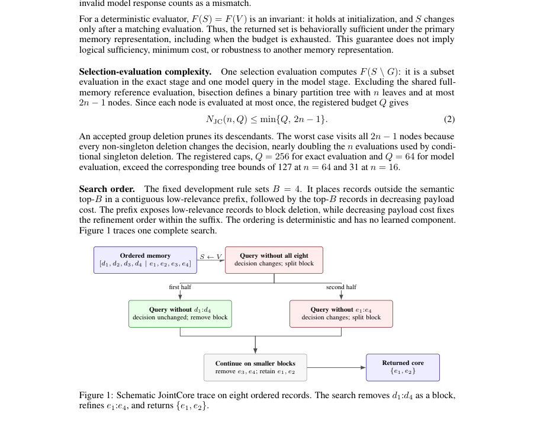
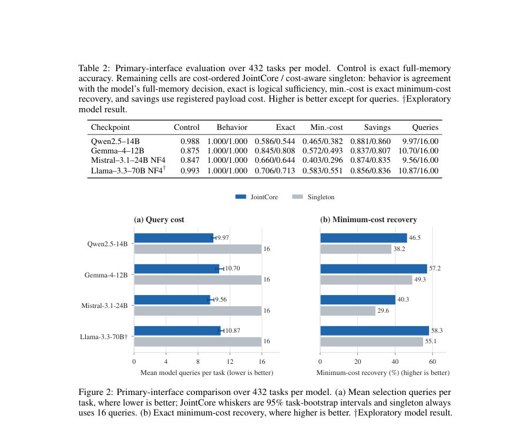
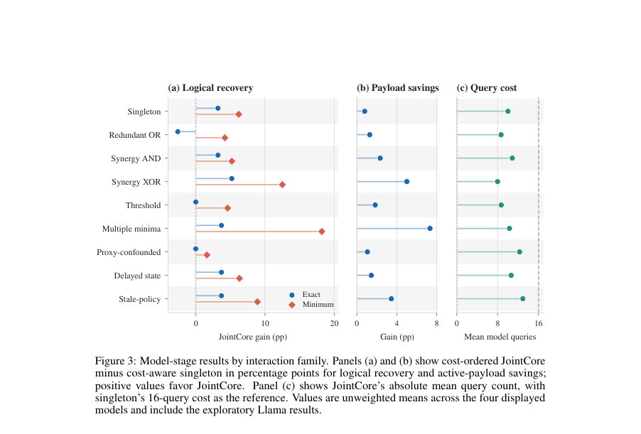

# Beyond Marginal Influence: Interaction-Aware Memory Selection for LLM Agents

- **게시일:** 2026-10-19
- **arXiv:** [2610.23266v1](http://arxiv.org/abs/2610.23266v1) · [PDF](https://arxiv.org/pdf/2610.23266v1)
- **저자:** BHVSP Subrahmanyam, Neeraj Choudhary
- **분야:** cs.LG, cs.AI
- **선정 점수:** 5.22
- **선정 이유:** 최근성 0.4, 인용 영향 0.0 (인용 0회), 저자 영향 0.0 (최고 h-index 0), AI 주제 적합성 3.0, 개발자 관심 1.0, 학술 신호 0.8, 오픈 웨이트·주요 연구조직 신호 0.0

[← 2026-10-19 목록으로 돌아가기](../daily/2026-10-19.html)

<!-- paper-visuals:start -->
## 주요 Figure

> 원문 PDF에서 실제 Figure 캡션과 그림 영역이 함께 확인된 자료만 자동 추출했다.

*Figure · 원문 PDF 3쪽 · Figure 1: Schematic JointCore trace on eight ordered records. The search removes d1:d4 as a block,*

*Figure · 원문 PDF 6쪽 · Figure 2: Primary-interface comparison over 432 tasks per model. (a) Mean selection queries per*

*Figure · 원문 PDF 7쪽 · Figure 3: Model-stage results by interaction family. Panels (a) and (b) show cost-ordered JointCore*

<!-- paper-visuals:end -->

## 한 문장 요약

의사결정 시 전체 메모리와 동일한 동작을 보존하는 최소 비용의 메모리 부분집합(behavioral sufficiency)을 찾기 위해, 관련도·비용 순서 기반의 블록 삭제 탐색 알고리즘 JointCore와 이를 평가하는 정확한 정답 오라클을 갖춘 벤치마크 JointCoreBench를 제안해 모델-검색 오류를 분리하고 선택 쿼리 수를 줄인다.

## 해결하려는 문제

LLM 에이전트의 메모리 선택은 보통 개별 레코드의 관련도나 영향도 순위에 의존하지만, 레코드들 간에 중복성(redundancy)이나 결합적 필요성(joint necessity)이 있을 때 개별 평가로는 충분한(behaviorally sufficient) 부분집합을 식별하지 못한다. 따라서 각 의사결정에 대해 전체 메모리와 동일한 결정을 유지하면서 비용을 최소화하는 부분집합을 효율적으로 찾는 문제가 필요하다. 기존 평가는 정확한 최소-비용 충분집합의 기준(오라클)을 제공하지 않아 탐색(search) 오류와 모델(판정) 오류를 분리할 수 없다.

## 핵심 기여

- JointCoreBench: 9개 상호작용(싱글턴, 중복 OR, 결합 AND, XOR, 임계치, 다중 최소집합, 프록시 혼동, 지연 상태, 구식 정책 결합)과 6개 워크플로 도메인, 여러 지원 크기와 메모리 크기(n∈{8,16,32,64})를 포함하고 모든 충분집합과 최소-비용 해를 열거하는 정확 오라클을 제공하는 벤치마크(정확 단계 6,912 조건, 모델 단계 n=16에서 모델별 432 과제).
- JointCore: 레코드를 관련도·등록비용 기준으로 정렬하고 블록 단위 삭제를 먼저 검사한 뒤 실패 시 분할하는 그룹-삭제(delta-debugging 유사) 탐색기법을 제안하여 부분집합 평가(모델 쿼리) 수를 줄임.
- 두 단계 평가 프로토콜: (1) 오라클 기반 정확 단계로 탐색 알고리즘의 검색 성능을 검증해 모델 판정 오류와 분리, (2) Qwen/Gemma/Mistral/Llama 계열 모델을 이용한 모델-매개 평가로 인터페이스(삭제·UNKNOWN·PENDING·카운터팩추얼·레이블) 의존성 검사.
- 정량적 비교와 분석: 정확 단계에서 cost-ordered JointCore가 모든 6,912 조건에서 최소-비용 충분집합을 회복하고(100%), 부분집합 평가를 30.00 → 11.13으로 62.9% 절감하며(활성 메모리 절감 87.8%), 모델 단계에서도 평균 쿼리를 16.00 → 10.28로 감소시키는 등(최소-비용 회복 평균 50.6% vs 43.1%) 효율적 기준선을 제시.

## 접근 방법

* 문제 설정: 상태의 typed memory V={1..n}와 각 레코드 등록비용 ci가 주어질 때, 보존 집합 S⊆V가 F(S)=F(V) (full-memory 결정과 동일)를 만족하면 행동적 충분성(behavioral sufficiency)이라 정의하고 비용 c(S)=∑i∈S ci가 최소인 해를 찾는다.
* JointCore 알고리즘: 초기 S=V, 레코드 전체 순서(개발 규칙: 상위 B=4를 suffix로, 나머지 low-relevance prefix로 배치, suffix는 payload 비용 내림차순 정렬)를 루트 그룹으로 FIFO 큐에 넣고 반복한다.
* 각 그룹 G에 대해 F(S	o G)를 평가(오라클 또는 모델 쿼리).
* 결정이 변하지 않으면 G를 삭제(그리고 그 하위 그룹들 스킵), 변하면 G를 반으로 쪼개어 큐에 넣는다.
* 단일원소가 쪼개졌을 때도 결정 변경이면 보존한다.
* 정지 조건은 큐 소진 또는 선택 예산(Q: 정확단계 256, 모델단계 64) 도달.
* 복잡도: 이진 분할 트리로 노드 수 ≤2n−1, 각 노드는 최대 한 번 평가.
* 비교기준: random-B, semantic top-B, independent leave-one-out(각 레코드 삭제를 V와 비교), cost-aware conditional singleton backward selection(조건적 단일원소 제거), legacy JointCore, 그리고 정확 오라클(상한).
* 벤치마크 구성: 9개 상호작용 패밀리 × 6 도메인 × 지원크기(2,4) × n∈{8,16,32,64} × 기타 라벨로 6,912 정확 조건; 모델 단계는 n=16에 대해 모델별 432 과제.

## 주요 결과

- 정확(오라클) 단계(6,912 조건): cost-ordered JointCore는 모든 조건에서 논리적(정확) 충분성을 달성하고(Exact suff.=1.000) 최소-비용 회복도 1.000으로 정확 오라클과 일치함. 활성 페이로드 절감은 0.878(=87.8%). 부분집합 평가 수는 cost-aware singleton의 30.00에서 JointCore의 11.13으로 감소(62.9% 절감). Legacy JointCore는 평균 10.96 평가이나 일부(6.7%)에서 최소-비용을 놓침.
- 모델(주요 인터페이스: UNKNOWN 마스크와 YES/NO 라벨) 단계(모델당 432 과제): 모든 조건에서 두 방법 모두 모델의 전체메모리 행동을 보존(behavior retention=1.0). 모델별 평균 쿼리(JointCore / singleton): Qwen 9.97/16.00, Gemma 10.70/16.00, Mistral 9.56/16.00, Llama 10.87/16.00. 전체 모델의 비가중 평균 쿼리는 10.28 vs 16.00(약 35.8% 감소). 네 모델 모두에서 쿼리 감소는 Holm-보정된 유의검정에서 p<.001.
- 최소-비용 회복(정확 기준, 모델 판정 기반 선택 결과 비교): JointCore 평균 50.6% vs cost-aware singleton 43.1% (모델 단계의 서술적 비교). 상호작용별 차이는 multiple-minima와 XOR 가족에서 JointCore 유리(최대 +18.2pp, +12.5pp).
- 인터페이스 민감도(108개 robustness 과제 하위집합): 메모리/레이블 표현을 바꾸면 방법 순위가 뒤집히는 경우 관찰됨. 예: Gemma에서는 카운터팩추얼 값이 singleton에 유리(82.4%/86.1%), Llama는 물리적 삭제에서 singleton에 유리(70.4%/72.2%), 일부 모델은 direct-action 또는 A/B 라벨에서 상반된 결과. 저장소 복원(fallback) 규칙이 적용되면 일부 모델은 항상 전체 메모리를 복원해 페이로드 절감이 0이 됨.

## 한계

- 저자가 명시한 한계: 벤치마크가 생성된(workflow-generated) 합성 과제로 구성되어 실제 에이전트 이력의 상호작용 분포를 반영하지 않음(통일된 문법·horizon 라벨, 긴 자율 롤아웃 미포함). 행동적 충분성은 모델 오류를 보존할 수 있어 진실(causal importance)을 보장하지 않음. 모델·인터페이스 범위 제한(12B 컷오프 비사전등록, 양자화·로딩 경로 차이), 삭제/UNKNOWN/PENDING/카운터팩추얼/레이블은 상호 교환 불가하며 관찰된 뒤집힘은 일반화 한계를 의미함. 등록된 활성 페이로드는 토큰 수·지연 또는 실제 비용을 대체하지 않음. 배포 시 권한·검토·아카이브 등 보안·윤리적 제어 필요.
- 본문에서 합리적으로 확인되는 한계(분리): JointCore의 행동적 충분성 보장은 '기본(주) 인터페이스가 결정론적'이라는 가정 하에 유효하며, 다른 메모리 표현이나 비결정적 모델 응답에서는 보장이 사라짐. 모델-매개 평가에서의 최소-비용 회복은 모델의 판정 오류에 민감하므로 선택 전략 자체의 최종 유용성(배포 효율성)은 추가 검증(자연 이력, 장기 트레이스 필요)을 요구함. 실험에서 제시된 하드웨어·소프트웨어 구성은 제공되나 총 실행시간·스토리지·라이선스 목록과 같은 재현 관련 세부 사항은 불완전함(논문 체크리스트 지적).

## 개발자 관점

- 그룹(블록) 삭제(단계적 분할) 방식은 단일원소 기반 조건적 제거보다 모델 쿼리를 크게 줄일 수 있음(실험: 평균 쿼리 16→≈10). 실무 적용 시 레코드 정렬(관련도 prefix + 상위 B의 비용 내림차순)과 블록 사이즈 설정(B=4 등)을 구현상의 휴리스틱으로 고려하되 데이터셋 특성에 맞게 튜닝할 것.
- 검증 절차를 분리(정확 오라클 단계와 모델-판단 단계)하면 탐색 알고리즘의 검색 오류(search error)와 모델 판정 오류(model error)를 구분할 수 있어 알고리즘 개발과 모델 개선을 독립적으로 다루기 용이함. 가능하면 합성 오라클 또는 규칙 기반 검사로 기초 검증을 수행하라.
- 메모리 생략을 표현하는 인터페이스(물리 삭제 vs UNKNOWN 마스크 vs PENDING vs 카운터팩추얼 값)와 결정 레이블 형식(semantic YES/NO vs direct-action vs A/B)은 결과에 큰 영향을 미치므로 배포 전 대상 시스템과 동일한 입력·출력 인터페이스로 강건성 테스트를 반드시 수행할 것.
- 배포 시에는 선택기로 인해 삭제된(또는 비활성화된) 레코드의 안전성·규정 준수(권한·동의·출처 보존)를 보장하는 보조 인프라(신뢰된 아카이브, 접근 제어, 인간 검토, 보수적 규칙)를 설계해야 함. 또한 모델 쿼리 자체가 민감 정보를 노출할 수 있으므로 로그·쿼리·응답에 대한 보안 대책을 마련할 것.
- 재현성을 위해 논문에 제공된 코드/데터(저자가 공개한 GitHub)와 함께 실행 시간·저장소 요구량·모델 라이선스 정보를 보강하라(논문 체크리스트에서 이 항목들이 불완전하다고 지적됨).

**근거 범위:** 이 분석은 제공된 논문 PDF 본문(페이지 1–18 전체)과 표·그림·부록에 기초해 작성했습니다. 주요 정량치는 본문 Table 1, Table 2 및 관련 텍스트에서 직접 추출했습니다. 외부 코드·실행시간·라이선스의 세부 항목 등 PDF에 명시되지 않은 구현·운영 세부사항은 포함하지 않았습니다.
