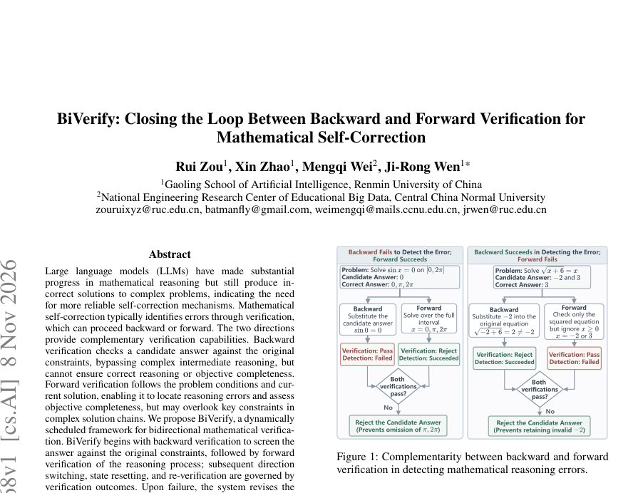
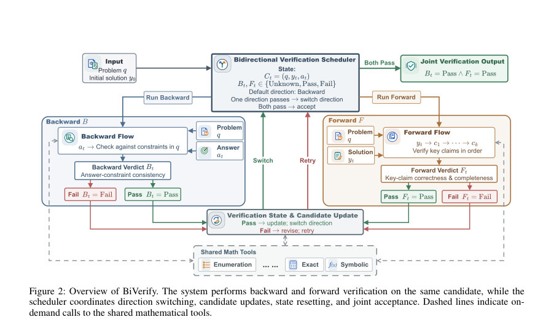
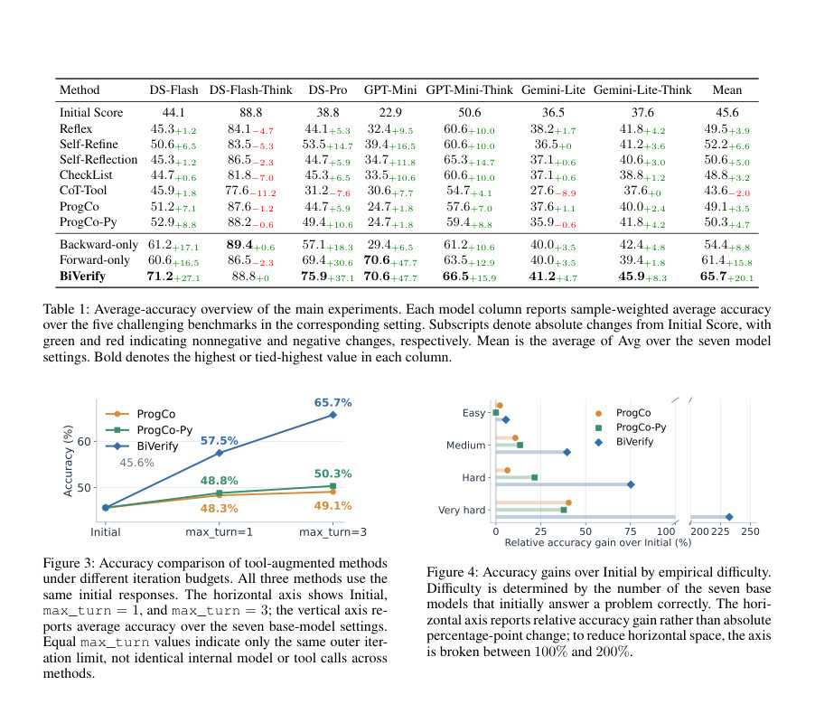

# BiVerify: Closing the Loop Between Backward and Forward Verification for Mathematical Self-Correction

- **게시일:** 2026-11-10
- **arXiv:** [2611.11368v1](http://arxiv.org/abs/2611.11368v1) · [PDF](https://arxiv.org/pdf/2611.11368v1)
- **저자:** Rui Zou, Xin Zhao, Mengqi Wei, Ji-Rong Wen
- **분야:** cs.AI
- **선정 점수:** 4.90
- **선정 이유:** 최근성 0.7, 인용 영향 0.0 (인용 0회), 저자 영향 0.0 (최고 h-index 0), AI 주제 적합성 2.1, 개발자 관심 0.0, 학술 신호 0.6, 오픈 웨이트·주요 연구조직 신호 1.6

[← 2026-11-10 목록으로 돌아가기](../daily/2026-11-10.html)

<!-- paper-visuals:start -->
## 주요 Figure

> 원문 PDF에서 실제 Figure 캡션과 그림 영역이 함께 확인된 자료만 자동 추출했다.

*Figure · 원문 PDF 1쪽 · Figure 1: Complementarity between backward and forward*

*Figure · 원문 PDF 4쪽 · Figure 2: Overview of BiVerify. The system performs backward and forward verification on the same candidate, while the*

*Figure · 원문 PDF 6쪽 · Figure 3: Accuracy comparison of tool-augmented methods*

<!-- paper-visuals:end -->

## 한 문장 요약

BiVerify는 답(answer) 중심의 역방향 검증과 과정(reasoning) 중심의 순방향 검증을 하나의 스케줄러로 닫힌 루프에서 조정해 동일한 후보 해답이 두 방향 모두를 통과할 때까지 검증·수정하는 수학적 자기수정(framework)이다.

## 해결하려는 문제

대형 언어모델(LLM)은 복잡한 수학 문제에서 다단계 추론과 정확 계산에서 여전히 오답을 낸다. 기존의 자기수정은 검증을 통해 오류를 찾지만, 역방향 검증(답을 문제 조건으로부터 바로 검사)은 중간 추론을 우회해 답 관련 제약을 빠르게 검사하지만 추론의 타당성이나 목적적 완전성을 보장하지 못하고, 순방향 검증(문제 조건과 해설 절차를 따라 검증)은 중간 단계 오류 위치화와 완전성 검증이 가능하지만 긴 추론 체인에서 핵심 제약을 놓칠 수 있다. 기존 연구들은 두 방향의 상호 보완적 성격을 활용하는 순서와, 동일 후보가 반복 수정될 때 각 방향의 검증 상태(예: 이전 검증 결과의 무효화)들을 어떻게 조정할지에 대해 충분히 다루지 않았다.

## 핵심 기여

- 역방향(답 중심)과 순방향(과정 중심) 검증의 상호보완적 역할을 체계적으로 정의하고 정리함: 역방향은 답 관련 제약 검사를, 순방향은 정렬된 핵심 주장과 과정·완전성 검증을 담당함.
- Bidirectional 검증을 닫힌 루프에서 동적으로 스케줄링하는 프레임워크 BiVerify 제안: 스케줄러가 후보(답)과 양쪽 검증 상태를 유지·전환·재설정하며 동일 후보가 양방향을 모두 통과할 때만 수용함.
- 공유 수학 도구(심볼릭·방정식해결·열거·제약검사·정확 계산 등)를 도입해 논리적 추론과 정밀 연산을 분리하고, 도구 출력을 증거로 사용하도록 설계함.
- 다섯 개의 도전적 수학 벤치마크(총 170문제)와 7개 베이스 모델(DeepSeek, GPT, Gemini 계열)에서 광범위한 실험을 수행해 공개 기준선 및 단방향 검증 대비 성능 향상을 실증함.

## 접근 방법

* 구성요소와 작동 절차(논문 본문 기준):
* 입력과 후보: 문제 q와 사전 생성된 초기 해설 y0에서 답 추출 a0를 얻고 초기 후보 C0=(q,y0,a0)를 구성한다.
* 실험은 모든 방법이 동일한 초기 해설을 사용하도록 통제함(온도 0, max_turn=3 외부 예산).
* 공유 수학 도구(Atool): Tsym, Teq, Tenum, Tcon, Tarith 등(심볼릭 단순화, 방정식 해법, 열거/계수, 제약 검사, 정확 산술)로 구현되며 본문에서 SymPy와 Z3를 사용한다고 명시함.
* 도구 출력은 판정 증거(evidence)이며 판정 자체는 인간 설계된 심사자(agent)가 수행한다.
* 역방향 검증(Backward): AB_flow(q, a_t)를 통해 답 a_t가 문제 q의 필요조건을 만족하는지 검사하는 검증 흐름 V^B_t를 생성.
* AB_ver는 도구 증거와 검증 추적 E^B_t를 반환하고 Pass/Fail 판정을 내린다.
* 실패 시 위반된 제약·툴 출력이 에비던스로 기록된다.
* 순방향 검증(Forward): AF_flow(q,y_t,a_t)가 순서화된 핵심 주장 K_t=(c_{t,1},...,c_{t,n})와 검증 흐름 V^F_t를 생성.
* AF_ver는 주장들을 순서대로 점검(세맨틱 함의 q∧previous \|= claim 형태의 이상적 목표)하고 최초 실패 주장 위치 k_t와 증거 E^F_t, Pass/Fail 판정을 반환한다.
* 실패는 후보 수정 또는 검증 흐름(목표·툴 할당) 수정의 근거가 된다.
* 스케줄러 S: 각 시점의 상태 Σ_t=(C_t,B_t,F_t,d_t)를 유지(B_t,F_t∈{Unknown,Pass,Fail}, d_t∈{B,F}).
* 초기 방향은 B(역방향).
* Accept 조건은 동일한 후보에 대해 B=Pass ∧ F=Pass일 때이다.
* 실패 시 A_update(C_t, E^{dt}_t, dt)가 후보 수정 제안 bC_t를 만들고 스케줄러는 제안 채택(=> 후보 교체, 양쪽 상태 리셋) 또는 흐름 정교화(검증 흐름만 수정, 후보 유지)를 선택한다.
* 후보가 바뀌면 이전의 검증 상태는 새로운 후보로 이전되지 않음.
* 운영·예산: 외부 반복 예산은 max_turn=3(최대 4개의 실제 검증 이벤트 허용).
* 검증 도중 도구 호출과 모델 호출을 조합하여 증거를 수집하고, 도구 결과는 재사용·캐시 가능.
* 판정 책임 분리: 도구는 실행·계산을 담당하고, 판정(심사자)은 도구 결과를 근거로 Pass/Fail을 판단하며 스케줄러가 최종 수용 여부를 결정한다.

## 주요 결과

- 평균 성능: BiVerify의 7-모델 평균(Mean) 최종 평균 정확도는 65.7%로 초기(Initial) 45.6%보다 +20.1%-p 향상, 논문에서 평가한 가장 강한 공개 기준선보다 평균 +13.5%-p 높음(논문 본문 수치).
- GPT 설정에서 최대 우위: GPT 계열(논문 표 기준)에서 BiVerify는 70.6%로, 해당 설정에서의 공개 기준선 대비 최대 +31.2%-p 우위를 기록함(본문 서술).
- 단방향 대비: BiVerify는 Backward-only 및 Forward-only 대비 각각 평균 +11.3%-p, +4.3%-p 향상하여 양방향 폐쇄 루프의 이점을 보임(표 1).
- 오류 교정/손상: 동일한 1,190 인스턴스에서 BiVerify는 초기 오답(W)을 정답(C)으로 바꾼 비율 W→C가 40.3%인 반면 ProgCo는 9.4%, ProgCo-Py는 12.2%였음. 초기 정답에 대한 손상(C→W) 비율은 BiVerify 4.1%로 ProgCo(3.7%), ProgCo-Py(4.2%)와 유사하여 더 공격적으로 수정하지 않으면서 더 많은 오류를 교정함.
- 순·역방향 기여 분해: BiVerify는 최종적으로 261개의 초기 오답을 교정하고 22개의 초기 정답을 손상시켜 순(net) 교정 수 239를 기록함(표 8). 역방향과 순방향의 누적 순이익은 각각 +199, +40으로 비대칭적 보완을 보였음(본문 Fig.6). 261개의 최종 교정 사례 중 95.0%는 한 번 교정된 이후 최종까지 유지되어 교정의 안정성이 높음(유지율 약 90.6% 포함 설명).」「이벤트 수준·타이밍: 전체 향상의 84.6%가 초반 두 검증 이벤트에서 발생했으며, 스케줄러는 대부분의 샘플을 역방향으로 시작한 뒤 증거에 따라 같은 방향 재검증·전환·종료를 수행함(Fig.5).","자원·비용 실험(DeepSeek-Flash 기준): BiVerify는 ProgCo-Py보다 LLM 호출 수는 더 많지만(27.82 vs 21.96), 총 토큰 소비는 적고(0.534M vs 1.078M), Python 실행 횟수는 적으며(8.44 vs 11.67) 평균 처리시간은 짧음(7.2분 vs 20.2분)이라고 보고함(본문 Table 7).

## 한계

- 저자 명시 한계: BiVerify의 적용 영역 확장(예: 과학적 추론·코드 생성)은 향후 연구 과제로 남아있음(결론에 명시).
- 본문·실험에서 확인되는 제약(분석적):
- - 데이터·범위 제약: 평가가 다섯 벤치마크(총 170문제)와 7개 베이스 모델 설정에 한정되어 있어 다른 문제 유형·대규모 배포 시 일반화가 추가 검증을 필요로 함.
- - 초기 해설 의존성: 모든 비교에서 동일한 '사전 생성된 초기 해설'을 출발점으로 사용했으며(공정성 제어), 이 접근은 초기 응답 품질에 민감함(초기 해설이 다르면 결과가 달라질 수 있음).」「- 비결정적/스케줄링 효과: 스케줄러가 사례별 증거에 따라 다양한 경로를 선택하므로(예: B→F, B→B→F 등) 경로별 성능 차이는 설명적이며 무작위화된 인과 검증은 없음(본문 명시).」「- 도구·판정 의존성: SymPy·Z3 등 외부 도구의 정확성과 심사자(agent)의 판정 방식에 의존하므로, 도구 오류나 판정 설계 오류가 전체 결과에 영향 줄 수 있음.」「- 부분적 비단조성: 후기 이벤트에서 일부 샘플이 일시적 교정 후 다시 오답으로 회귀하는 사례(27건) 등 비단조적 변화가 존재함.

## 개발자 관점

- 재현·구현: 코드와 구성은 공개되어 있으며(저자 제공 GitHub 링크), 구현 시 SymPy·Z3 같은 심볼릭·제약 도구와 LLM 판정자(agent)를 분리하여 적용해야 함(논문 본문에서 명시).
- 입력·예산 통제: 실험은 동일 초기 해설과 온도 0, 외부 반복 예산 max_turn=3을 사용해 공정 비교를 보장하였으므로 재현 시 동일 통제 설정을 맞출 것.
- 증거·판정 설계: 도구 결과는 '증거'로 취급하고 최종 Pass/Fail 판정은 전용 adjudication agent가 하도록 설계해야 한다(도구 결과를 절대적 판정으로 쓰지 않음).
- 흐름 대 후보 수정 분리: Aupdate와 스케줄러 규칙을 통해 '검증 흐름의 수정'과 '후보(답)의 수정'을 명확히 구분해야 안정적 동작을 기대할 수 있음.
- 캐싱·비용 최적화: 논문에서 캐싱(327 cache hits)을 통해 Python 실행을 줄였고, LLM 호출 수와 총 토큰 사용량은 상충될 수 있으므로 실전 배포 시 툴 호출·캐시 전략을 설계해 비용을 최적화할 것(논문 Table 7 참고).」「안전성·로그·감사: 각 검증 이벤트의 증거(trace)와 도구 출력이 판정 근거로 사용되므로, 운영 시스템에서는 증거 로그를 보관해 판정 근거를 추적 가능하게 해야 함.」「확장성 고려: 논문은 수학 문제에 초점을 맞춤. 과학적 논증·코드 생성 등으로 확장하려면 중간 주장 정의와 검증 흐름 설계, 도구 능력(예: 프로그래밍 인터프리터) 재검토가 필요함.

**근거 범위:** 본 분석은 제공된 논문 PDF 본문(본문 및 부록 포함)의 텍스트를 근거로 작성되었다. 주요 수치(정확도, 교정·손상 비율, 비용 지표 등)는 본문·표·부록에서 직접 인용하였다. 내부 프롬프트 템플릿, 에이전트의 세부 프롬프트·구현 코드의 런타임 파라미터 등은 PDF에 상세히 공개되지 않았으므로 해당 항목은 본문 근거로는 확인하지 못했음을 밝힌다.
