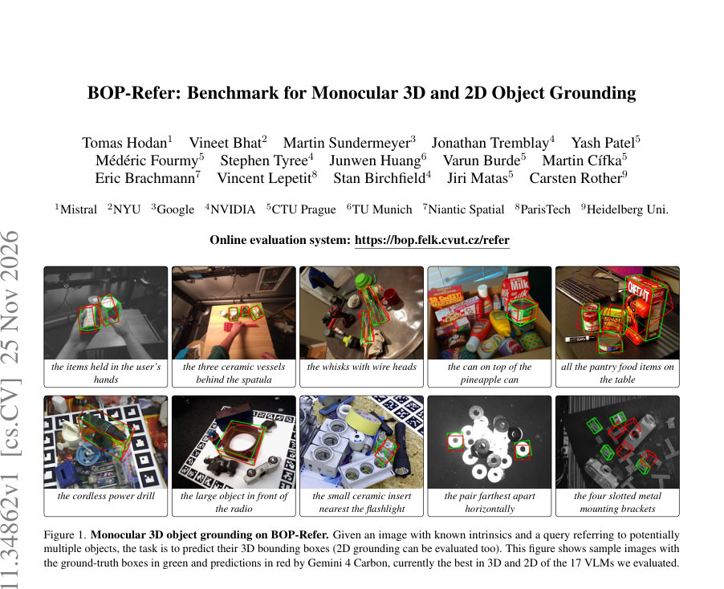
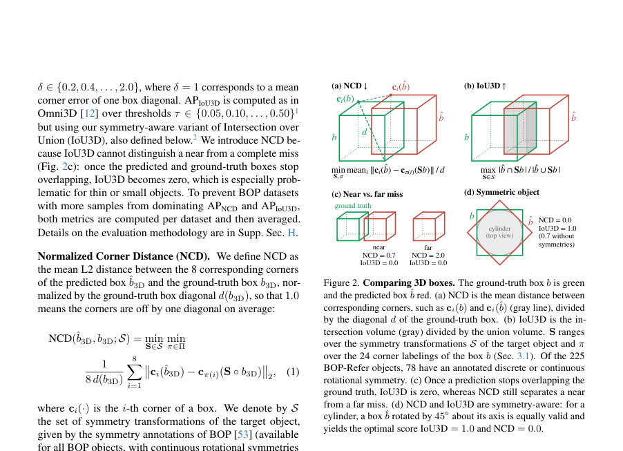

# BOP-Refer: Benchmark for Monocular 3D and 2D Object Grounding

- **게시일:** 2026-11-26
- **arXiv:** [2611.34862v1](http://arxiv.org/abs/2611.34862v1) · [PDF](https://arxiv.org/pdf/2611.34862v1)
- **저자:** Tomas Hodan, Vineet Bhat, Martin Sundermeyer, Jonathan Tremblay, Yash Patel, Médéric Fourmy, Stephen Tyree, Junwen Huang, Varun Burde, Martin Cífka, Eric Brachmann, Vincent Lepetit, Stan Birchfield, Jiri Matas, Carsten Rother
- **분야:** cs.CV, cs.AI, cs.RO
- **선정 점수:** 6.63
- **선정 이유:** 최근성 1.3, 인용 영향 0.0 (인용 0회), 저자 영향 0.0 (최고 h-index 0), AI 주제 적합성 1.5, 개발자 관심 0.0, 학술 신호 0.8, 오픈 웨이트·주요 연구조직 신호 3.1

[← 2026-11-26 목록으로 돌아가기](../daily/2026-11-26.html)

<!-- paper-visuals:start -->
## 주요 Figure

> 원문 PDF에서 실제 Figure 캡션과 그림 영역이 함께 확인된 자료만 자동 추출했다.

*Figure · 원문 PDF 1쪽 · Figure 1. Monocular 3D object grounding on BOP-Refer. Given an image with known intrinsics and a query referring to potentially*

*Figure · 원문 PDF 4쪽 · Figure 2. Comparing 3D boxes. The ground-truth box b is green*

![Figure 3. BOP-Refer vs. Omni3D [12] data distribution. BOP-Refer (1,803 object instances in the 1,400 test images of 9 sub-datasets)](../assets/papers/bop-refer-benchmark-for-monocular-3d-and-2d-object-grounding/figure-3.jpg)

*Figure · 원문 PDF 26쪽 · Figure 3. BOP-Refer vs. Omni3D [12] data distribution. BOP-Refer (1,803 object instances in the 1,400 test images of 9 sub-datasets)*

<!-- paper-visuals:end -->

## 한 문장 요약

다양한 BOP 데이터에서 생성·검증한 자연어 지시문으로 단안(카메라 내재값 제공) 3D 및 2D 객체 그라운딩을 평가하는 벤치마크 BOP-Refer를 제안하고, 17개 최전선 VLM을 체계적으로 비교해 단안 3D 그라운딩에서 거리·크기(메트릭 스케일) 추정이 주요 실패 원인임을 규명했다.

## 해결하려는 문제

단일 RGB 이미지(카메라 내재값 제공)와 자연어 지시문으로 지칭된 물체들의 3D(오리엔티드 3D 박스) 및 2D(아모달 축정렬 박스) 위치를 예측하는 단안 3D/2D 그라운딩 문제를 다룬다. 기존 벤치마크는 실내/주행 등 장거리·카테고리 수준의 설정이 많고 2D와 3D를 동일 데이터에서 비교하거나 물체의 대칭성 처리를 고려한 평가는 부족했으며, 단안에서의 크기-거리 미정비성 때문에 3D 그라운딩이 특히 어려운 점이 해결해야 할 핵심 질문이다.

## 핵심 기여

- BOP-Refer: 9개의 BOP 서브셋(총 225개 객체)을 기반으로 한 단안 3D 및 2D 그라운딩 최초의 벤치마크를 제안하고, 검증용 1,400 / 테스트용 1,400 이미지-질의 쌍을 제공함.
- VLM 생성 및 인간 검증 절차로 만든 자유문(referring expressions)을 각 이미지에 대응시키고, 3D 모델과 주어진 6DoF 포즈에서 파생한 정확한 아모달 3D·2D GT 박스를 제공함.
- 대칭성을 고려하는 두 가지 3D 비교 함수 도입: 대칭을 처리한 IoU3D 변형과 근/원 오차를 구분할 수 있는 Normalized Corner Distance(NCD)를 정의하여 대칭 객체에 대해 동등한 박스를 허용함.
- Gemini, GPT, Claude, Qwen, Gemma 계열을 포함한 17개 최전선 VLM(12개 폐쇄·상업 모델, 5개 오픈웨이트 모델)과 몇몇 3D 특화 파이프라인을 동일 조건에서 체계적으로 평가해 단안 3D 그라운딩의 난이도를 정량적으로 보여줌.
- 테스트 분할에 대한 온라인 평가 시스템(비공개 GT로 채점, 퍼블릭 리더보드)과 개발용 공개 검증 분할을 제공함.

## 접근 방법

* 벤치마크와 평가 절차 중심의 접근이다.
* 데이터는 9개 BOP 데이터셋(HOT3D, HANDAL, HOPEv2, LM, HB, YCB-V, T-LESS, ITODD, IPD)의 이미지, 카메라 내재값, 3D 객체 모델, GT 6DoF 포즈로 구성된다.
* 질의(query)는 두 개의 생성 VLM(GPT-5.4, Gemini 3.1 Pro)이 장면 그래프(정규화된 2D 박스, 깊이, 가시성, 외관 렌더 설명, 쌍별 공간 관계 등)를 입력으로 받아 후보 표현 5개를 생성하고, Claude Opus 4.7의 자동검증(14개 기준)과 인간 리뷰어(25명)의 검증·수정 과정을 거쳐 최종 하나를 선택한다.
* 3D 평가를 위해 저자들은 객체의 주어진 6DoF 포즈와 3D 모델로부터 아모달 3D 박스를 도출하고, 객체별 주석된 대칭군 S를 이용해 점수 함수에서 대칭을 최적화한다.
* 평가 지표로는 대칭을 고려한 IoU3D 기반 APIoU3D(τ ∈ {0.05,...,0.50})와 새로운 NCD(코너 평균 L2 거리 / 대각선) 기반 APNCD(δ ∈ {0.2,...,2.0})를 사용한다.
* 각 VLM은 이미지·질의·형식 사양을 입력으로 받아 2D/3D 포맷(문서화된 포맷 사용 또는 통일된 프롬프트)으로 응답하도록 프롬프트하고, 각 모델을 3회 반복 실행해 평균·표준편차를 보고한다.
* 추가로 SAM 3, Depth Anything 3 등 외부 모듈을 결합한 변형(예: 2D 박스→마스크→깊이 역투영)과 WildDet3D·Boxer·SAM3D 같은 파이프라인도 비교 실험에 포함했다.

## 주요 결과

- 전체 평가: 17개 VLM 중 가장 높은 2D 성능은 Gemini 4 Carbon으로 APIoU2D = 72.6%를 기록했으나 동일 모델의 3D 성능은 APIoU3D = 12.4%로 매우 낮았다(3D 임계값이 더 관대함에도 낮음).
- APNCD(3D, NCD 기반)로 보면 Gemini 4 Carbon이 60.3% APNCD를 기록해 상대적으로 근접한 예측을 더 잘 수행하지만 APIoU3D는 여전히 낮아 격차가 큼(예: Carbon APNCD=60.3% vs. APIoU3D=12.4%). Claude Opus 5.5는 APNCD=46.5%(APIoU3D 5.3% 언급)이다.
- 2D 대조: Gemini 4 Argon과 Claude Opus 5.5는 각각 APIoU2D 69.1%와 69.0%로 상위권을 형성해 최신 VLM들이 2D 그라운딩에서는 상당히 양호한 성능을 보였다.
- 어블레이션(중요 결과): (1) 각 대상의 카메라 중심 거리(절대 거리)를 질의에 제공하면 APNCD가 큰 폭으로 개선되어 예: Gemini 4 Carbon은 60.3% → 87.5%로 증가하고 APIoU3D는 12.4% → 58.7%로 상승함(다른 강한 VLM도 유사한 개선). (2) 정답 2D 박스를 제공하면 APNCD 변화는 작아 3D 실패가 주로 거리/스케일 추정에 있음이 드러남. (3) 깊이 맵 제공(센서 깊이)은 예측성능을 크게 향상시키며, Boxer가 센서 깊이 사용 시 APNCD=79.6%·APIoU3D=42.8%를 기록함. 예측된 단안 깊이는 보통 중간 개선을 줌(예: WildDet3D+DA3 개선).
- 데이터 특성: BOP-Refer는 근거리(manipulable objects) 중심(중앙 깊이 중앙값 76 cm, 중앙 부피 528 cm^3)으로 Omni3D 같은 기존 대규모 3D 데이터셋과 분포가 뚜렷하게 다름(Omni3D는 가구/차량 규모 및 다미터 거리 대상이 많음).

## 한계

- 저자가 명시한 한계: (1) 단일 정밀 단안 뷰는 본질적으로 크기-거리 불변성(size-distance ambiguity)을 가지므로 메트릭 스케일(거리·절대 크기) 추정이 가장 큰 오류 원인이라고 저자들이 진단함. (2) BOP-Refer는 평가 전용으로 학습 분할을 제공하지 않음(재생성 툴킷을 통해 사용자가 데이터 생성 가능). (3) 본 논문에서 평가된 VLM들은 BOP-Refer 환경에 특화되어 학습되지 않았고, 동일 모델이 다른(예: Omni3D, KITTI 기반) 벤치마크에서는 높은 성능을 보일 수 있음.
- 본문에서 합리적으로 확인되는 한계: (1) APIoU3D값이 낮아 IoU 기반 지표는 근접 실패와 완전 실패를 구분하지 못하므로 NCD 같은 보완 지표가 필요함. (2) 실험은 각 모델을 하나의(대표) 구성으로만 테스트했으며(비용 문제), 프롬프트/파라미터 튜닝에 따른 성능 변화 가능성이 있으나 본문에서는 제한된 설정만 보고됨. (3) 일부 외부 모듈(깊이 예측기, SAM 3 등)에 따라 결과가 크게 달라져 전체 파이프라인 재현 시 외부 컴포넌트 선택이 성능에 큰 영향을 미침.

## 개발자 관점

- 재현성: 저자들이 툴킷과 온라인 평가 시스템을 공개했으며(검증 분할 GT 공개, 테스트 분할은 서버 채점), 질의 생성 파이프라인(장면 그래프 기반)과 프롬프트·출력 형식 등 구현 세부는 본문과 보충자료(Supp. Secs.)에 기술되어 있어 재현이 가능하나 상업형 VLM은 접근성·비용 문제로 완전 재현이 어렵다.
- 입력 요건: 3D 과제는 카메라 내재값(K)을 필수로 필요로 하므로 실제 배포 시 카메라 보정이 전제되어야 하며, 실험에서 카메라 내재값 제공은 모델들이 초점을 맞추는 핵심 정보였음.
- 실용 파이프라인: 단안 3D 그라운딩의 실용적 개선은 (1) 대상의 절대 거리(또는 신뢰할 수 있는 깊이)를 확보하거나 (2) 강한 물체 크기 priors(예: 객체별 물리적 크기 분포) 및 문맥적 크기 추론을 모델에 통합하는 방향에서 효과가 큼. 센서 깊이 또는 외부 깊이 예측기를 결합하면 성능이 크게 개선됨(예: Boxer + 센서 깊이).
- 평가 설계: 대칭성을 처리하는 NCD·대칭-aware IoU3D 도입은 산업용·회전대칭 물체가 많은 현실적 데이터에 필수적이므로 구현 시 객체별 대칭 주석을 고려해야 함.
- 비용·운영: 대형 상업형 VLM을 다수 평가하는 실험은 상당한 계산·비용 소요(저자 언급)와 모델별 출력 길이 제한(예: 토큰 캡 문제)이 있으므로 대규모 비교평가 설계 시 예산·출력 캡 관리·반복실험 수를 고려해야 함.

**근거 범위:** 이 분석은 제공된 논문 PDF 본문(주요 본문과 표·그림·실험 섹션)을 기반으로 작성했으며, 본문이 자주 보충자료(Supp. Secs.)를 참조하므로 일부 구현·세부 결과(예: per-threshold APIoU3D 세부 표)는 보충자료에만 명시되어 있다면 본문에서 직접 언급된 수치와 분석을 우선으로 사용했다. 보충자료의 상세 값이나 코드·로그 등은 본문 내 참조를 통해 확인 가능하나 본문에 명시되지 않은 수치는 생성하지 않았다.
