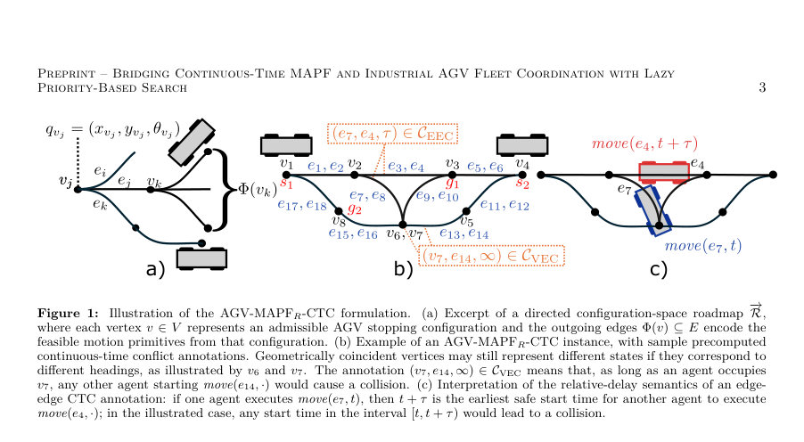
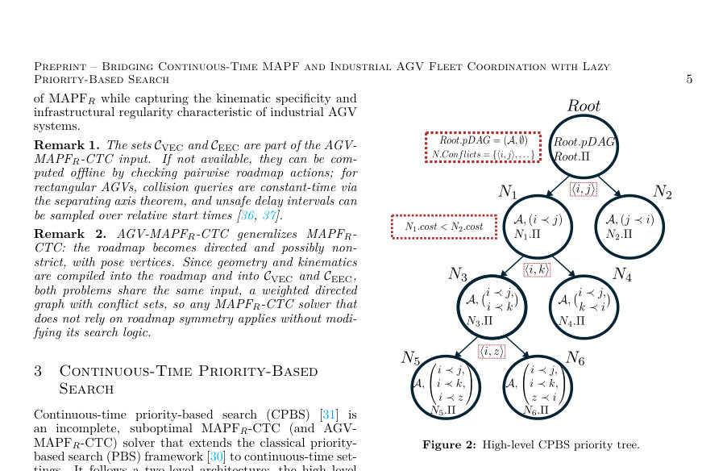
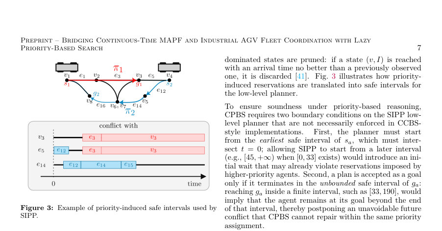

# Bridging Continuous-Time MAPF and Industrial AGV Fleet Coordination with Lazy Priority-Based Search

- **게시일:** 2026-11-24
- **arXiv:** [2611.30874v1](http://arxiv.org/abs/2611.30874v1) · [PDF](https://arxiv.org/pdf/2611.30874v1)
- **저자:** Federico Signorile, Raffaele Carli, Alessandro Bertogli, Roberto Olmi, Sven Koenig, Mariagrazia Dotoli
- **분야:** cs.RO, cs.AI, cs.MA
- **선정 점수:** 4.76
- **선정 이유:** 최근성 1.1, 인용 영향 0.0 (인용 0회), 저자 영향 0.0 (최고 h-index 0), AI 주제 적합성 2.8, 개발자 관심 0.6, 학술 신호 0.3, 오픈 웨이트·주요 연구조직 신호 0.0

[← 2026-11-24 목록으로 돌아가기](../daily/2026-11-24.html)

<!-- paper-visuals:start -->
## 주요 Figure

> 원문 PDF에서 실제 Figure 캡션과 그림 영역이 함께 확인된 자료만 자동 추출했다.

*Figure · 원문 PDF 3쪽 · Figure 1: Illustration of the AGV-MAPFR-CTC formulation.*

*Figure · 원문 PDF 5쪽 · Figure 2: High-level CPBS priority tree.*

*Figure · 원문 PDF 7쪽 · Figure 3: Example of priority-induced safe intervals used by*

<!-- paper-visuals:end -->

## 한 문장 요약

연속시간 MAPFR과 산업용 AGV 인프라 간의 간극을 메우기 위해, CTC(사전계산 연속시간 충돌) 주석을 이용해 CPBS(연속시간 우선순위 기반 탐색)를 재정의·분석하고, 노드의 저작(materialization)을 지연하는 Lazy-CPBS를 제안하여 재계획 비용을 줄이고 산업 레이아웃에서의 실용성을 개선한다.

## 해결하려는 문제

연속시간 MAPF(MAPFR)는 연속적인 시간·기하학적 충돌 회피를 제공하지만, 산업용 AGV 도로망은 매우 연결도가 높고 경로 대체가 많아서 SIPP 기반의 안전구간 관리와 다중 에이전트 상호작용 처리가 폭발적으로 증가한다. 이로 인해 기존의 MAPFR(특히 최적 해를 찾는 CCBS 계열)은 산업 환경에서 확장성·실행시간 면에서 실무 요구를 충족시키기 어렵다. 또한 우선순위 기반 방법(CPBS)은 우선순위 수정 시 하위 에이전트의 재계획 비용(안전구간 재구성·여러 SIPP 호출)이 커지는 문제가 있어, 실제 AGV 인프라에 적용하기 위한 비용·견고성의 균형을 맞추기 어려운 상황이다.

## 핵심 기여

- AGV-MAPFR-CTC라는 AGV 특화 구성공간(configuration-space) MAPFR 변형을 공식화하고, 로드맵 엘리먼트 간의 사전계산 연속시간 충돌(CTC)을 문제 입력으로 포함시켜 기존 MAPFR 솔버의 재사용을 가능하게 함.
- CPBS의 SIPP 저수준 플래너에 필요한 경계조건(시작은 t=0과 교차하지 않는 earliest safe interval에서, 목표는 무한대(unbounded) safe interval에 도달해야 함)을 식별하여 CPBS의 의미론적 사운드함을 보장하고 조기 목표 판별을 허용함.
- 우선순위 탐색 공간(priority search space)의 구조적 분석을 수행하여 우선순위 정제가 어떤 에이전트들에만 영향을 주는지, 언제 재계획을 피할 수 있는지 명확히 함(전이적 폐쇄와 재계획 대상 집합 DN(y) 등).
- Lazy-CPBS 알고리즘 제안: 고수준 노드의 저작(materialization)을 확장 시점까지 지연하고(자식의 경로는 자식이 확장될 때만 계산), 부모에서 미리 계산한 ReplanList(재계획 대상 순서)를 저장하고 자식들은 |ReplanList|가 작은 순으로 우선 확장하여 불필요한 SIPP 호출을 제거함.
- 표준 MAPF 벤치마크(여러 로드맵 생성법, CDT·k-sPRM, 100/700 샘플)와 산업용 AGV 로드맵(디지털 트윈에서 추출)에서 실험하여 CPBS 기반 솔버가 최적 MAPFR(예: CCBS)이 도달할 수 있는 에이전트 수보다 훨씬 많은 에이전트에 대해 효과적임을 보이고, Lazy-CPBS가 CPBS 대비 재계획 오버헤드를 크게 줄이며 산업 레이아웃에서 가장 일관된 견고성/실행시간 트레이드오프를 제공함.

## 접근 방법

* 아키텍처 개요: 고수준은 부분 우선순위 관계를 나타내는 pDAG(priority-directed acyclic graph)를 깊이우선 탐색하는 priority tree(PT)이고, 저수준은 SIPP 기반 단일 에이전트 플래너이다.
* 입력 로드맵은 CTC(정점-간선 CVEC, 간선-간선 CEEC)를 오프라인으로 주석하여 런타임에 기하학적 충돌 검사를 반복하지 않고 예약(reservation)으로 변환한다.
* CPBS(기존 방식): 충돌 ⟨i,j⟩ 선택 후 두 자식(i≺j, j≺i)을 즉시 materialize(부모의 pDAG에 간선 추가 → 영향을 받는 에이전트 집합 DN(y)를 위상정렬로 얻어 순차적으로 안전구간을 재설정·상위 예약을 삽입하고 SIPP 호출)하여 충돌검사를 즉시 수행하고 조기 목표 판별을 허용한다.
* SIPP 경계조건: (1) 시작은 t=0과 교차하는 earliest safe interval에서 시작해야 함.
* (2) 목표는 무한대(unbounded) safe interval에서 종료해야 함(우선순위 의미 보존).
* 구조적 성질: 충돌은 비교 불가능한(incomparable) 에이전트 간에만 발생, 자식 추가는 사이클을 생성하지 않음, x≺y 추가 시 y와 그 후손만 재계획 대상(DN′(y)) 등.
* Lazy-CPBS: 부모 노드에 ReplanList(TopoFrom(pDAG, affected_agent))를 미리 저장하고 자식은 materialize하지 않은 상태로 스택에 넣음; 노드가 팝되어 확장될 때만 MaterializeNode 실행(저수준 재계획 수행).
* 자식 우선순위는 \|ReplanList\|가 작은 쪽을 먼저 푸시하여 값비싼 재계획을 늦춤/회피.
* 구현 노트: 안전구간 테이블과 충돌 달력은 각 워커(병렬화 시) 로컬로 유지하고, 로드맵·CTC는 읽기 전용 공유 가능, pDAG의 정규화 키를 사용해 생성 상태 표를 관리하도록 제안됨.

## 주요 결과

- 실험 환경 및 비교대상: 표준 MAPF 벤치마크(den, Berlin, random, maze, warehouse, empty16, empty256)에서 CDT·k-sPRM 로드맵(100/700 정점) 사용; 비교 알고리즘은 PSIPP-CTC(=PP), CPBS, Lazy-CPBS, CCBS(및 PSIPP-CTC 기반 재시작 변형 PP+RR, PP+DR). 하드웨어: Intel Core i7-12700H(14코어,20스레드), 16GB RAM. 런타임 캡: 30초 per run.
- Lazy-CPBS 효과: 벤치마크(100/700 CDT 등)에서 CPBS 대비 실행시간을 평균 2–4× 단축(논문 저자 보고). 산업 레이아웃(레이아웃 A–E)에서는 재계획 지연으로 CPBS 대비 실행시간 22–59% 절감(저자 보고).
- 확장성·견고성: CPBS 기반 솔버(CPBS, Lazy-CPBS)는 최적화형 MAPFR 솔버(CCBS)가 도달 가능한 에이전트 수를 훨씬 넘는 에이전트 수에 대해 성공적이었다. CCBS는 충돌이 증가하면 빠르게 비실용적이 되었고(산업 레이아웃에서 대략 10명 안팎에서 성공률이 사라짐), 최저 SoC를 달성했지만 운영 포인트에 도달하지 못함.
- 비교 요약: PP(우선순위 한 번만) 는 성공 시 가장 빠르지만 밀집 시 매우 취약함. 재시작 기법(PP+RR, PP+DR)은 신뢰도를 개선하지만 일관성은 떨어짐. Lazy-CPBS는 산업 레이아웃에서 가장 일관된 신뢰도/실행시간 균형을 제공했고, 일부 레이아웃에서는 CPBS보다 더 많은 에이전트를 해결(논문: Lazy-CPBS가 CPBS보다 1.3–1.6× 더 많은 에이전트까지 도달한 사례 보고).
- 정량적 운영 사례: 산업 레이아웃 별로 Lazy-CPBS는 레이아웃 A,C,D,E의 운영대수 근방에서 모든(또는 대부분의) 인스턴스를 해결했고, 레이아웃 B에서는 약 80%의 인스턴스 성공률을 기록(본문 서술).

## 한계

- 저자 명시 한계: 현재 구현은 ‘가장 엄격한’ 실시간 산업 요구를 아직 충족하지 못함; 병렬·구역 분산(zone-distributed) 고수준 구현과 추가 가속화가 필요하며 완전성(completeness)·이론적 보장 연구와 lifelong planning(지속적 작업 스트림) 통합이 향후 과제임.
- 데이터·실험 범위에서 드러나는 제약(본문 근거): AGV-MAPFR-CTC는 CTC(사전계산 충돌 주석)를 전제로 하므로 주석이 없으면 오프라인 계산 비용이 필요(논문 Remark 1). 산업 레이아웃 전체는 기밀로 일부 상세(전체 레이아웃, 정확한 도면)는 공개 불가하여 외부 재현에 제한이 있음. 고도로 연결된/대규모 로드맵에서는 안전구간(Iv, Ie) 수와 분기(branching factor)가 급증해 메모리·북키핑 비용이 커지며 여전히 확장성 한계가 존재함(논문 실험에서 CPBS·CCBS 한계 관찰).
- 방법론적 한계: Lazy-CPBS는 탐색 공간과 의미론을 바꾸지 않으므로 완전성·최적성 보장은 제공하지 않음(논문은 불완전·근사적 접근으로 기술). SIPP의 경계조건(특히 목표의 무한대 safe interval 요구)은 구현에 민감하여 기존 SIPP 구현을 직접 재사용할 때 주의가 필요함.

## 개발자 관점

- 산업 배포 전 CTC(정점-간선 CVEC, 간선-간선 CEEC)를 오프라인으로 미리 계산·저장하라(사전 충돌 주석으로 런타임의 반복적 기하학 충돌 검사를 피함). 직사각형 AGV의 충돌은 Separating Axis Theorem으로 상수시간 검사 가능하므로 샘플링 기반으로 unsafe delay interval을 산출해 CTC를 구성하라(논문 Remark 1).
- AGV 환경에서는 로드맵을 구성공간(configuration-space)으로 만들고 포즈(위치+방향)를 정점으로 다루어 비홀로노믹 제약을 로드맵에 컴파일하라(본문의 AGV-MAPFR-CTC 모델).
- SIPP를 CPBS 계열에서 쓸 때 반드시 두 경계조건을 준수하라: (1) 시작 상태는 t=0과 교차하는 earliest safe interval에서 시작, (2) 목표는 unbounded(무한대) safe interval에 도달해야만 수락. 이 조건은 우선순위의 의미 보존에 필수적이다(섹션 3.2).
- Lazy-CPBS 구현 실무 팁: 고수준 노드는 pDAG와 함께 부모에서 계산한 ReplanList(Topological order of affected agents)를 저장하라. 자식은 materialize하지 않은 채 스택에 보관하고, 노드가 팝될 때 MaterializeNode로 그때 재계획을 수행하라. 자식 푸시 순서는 |ReplanList| 작은 쪽 우선으로 하여 값비싼 재계획을 회피·지연하라. 이렇게 하면 많은 자식의 저작 비용을 없앨 수 있다(논문 밝혔다).
- 병렬·배포 권장사항: roadmap·CTC·heuristic은 읽기전용으로 공유하고, 각 워커는 로컬 safe-interval 테이블과 충돌 달력을 유지하라. 전역적으로는 frontier와 생성 상태(정규화된 pDAG 키)만 동기화하면 된다(섹션 3.3 제안). 이는 고수준 병렬화를 통해 실시간 요구에 더 근접시키는 실용적 경로다. 구현상 메모리·북키핑(많은 safe interval) 비용을 모니터링하고, 빈번한 재계획을 줄이기 위해 ReplanList 기반 탐색 우선순위를 권장한다. 또한 산업용 도입 전 디지털 트윈에서 충분한 시뮬레이션으로 충돌 밀집 구간을 검증하라.

**근거 범위:** 이 분석은 제공된 논문 PDF 본문(제목, 초록 및 본문 섹션 1–8, 알고리즘·그림·표·참조 포함)을 기반으로 작성되었다. 본문에서 직접 언급된 수치(예: 실험 하드웨어, 런타임 캡 30s, 로드맵 생성(CTD/k-sPRM), 벤치마크명, '실행시간 2–4× 단축' 및 '산업 레이아웃에서 22–59% 절감' 등)는 그대로 인용하였다. 기밀성으로 인해 산업 레이아웃의 모든 상세 수치는 공개되지 않았고 일부 구체적 인스턴스별 통계(예: 각 레이아웃에서 정확한 에이전트별 성공률 표)는 본문에 요약·그래프 형태로만 주어져 있어 세부 숫자는 본문 서술을 근거로 요약하였다. 소스 코드(C++ 구현)와 외부 인터페이스 정보는 본문에서 링크로 제공된 내용을 참조했다.
