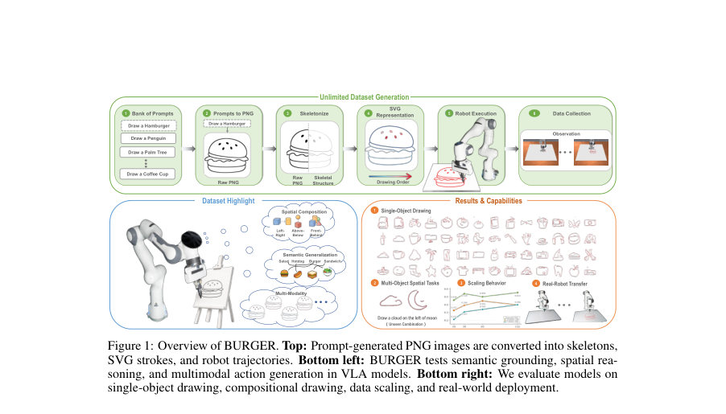
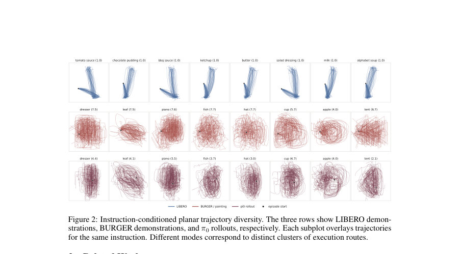
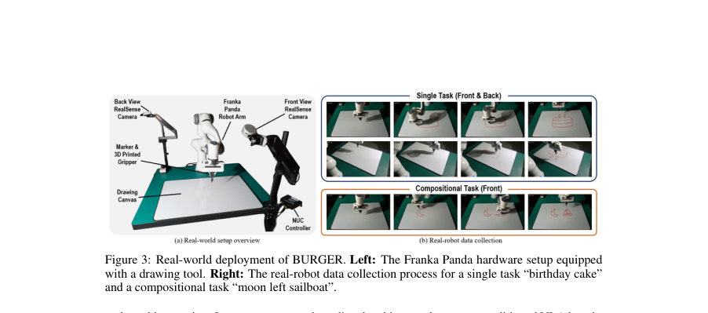

# BURGER: Benchmarking and Understanding Robotic Generalization via Embodied Drawing

- **게시일:** 2026-11-01
- **arXiv:** [2610.40532v1](http://arxiv.org/abs/2610.40532v1) · [PDF](https://arxiv.org/pdf/2610.40532v1)
- **저자:** Xiangyu Xu, Bangshuai Peng, Ziyi Liu, Mengjie Zhao, Chenhao Lu, Zhengyang Fan, Huazhe Xu, Kaizhe Hu
- **분야:** cs.RO, cs.AI
- **선정 점수:** 4.32
- **선정 이유:** 최근성 0.5, 인용 영향 0.0 (인용 0회), 저자 영향 0.0 (최고 h-index 0), AI 주제 적합성 2.8, 개발자 관심 0.5, 학술 신호 0.6, 오픈 웨이트·주요 연구조직 신호 0.0

[← 2026-11-01 목록으로 돌아가기](../daily/2026-11-01.html)

<!-- paper-visuals:start -->
## 주요 Figure

> 원문 PDF에서 실제 Figure 캡션과 그림 영역이 함께 확인된 자료만 자동 추출했다.

*Figure · 원문 PDF 2쪽 · Figure 1: Overview of BURGER. Top: Prompt-generated PNG images are converted into skeletons,*

*Figure · 원문 PDF 3쪽 · Figure 2: Instruction-conditioned planar trajectory diversity. The three rows show LIBERO demon-*

*Figure · 원문 PDF 4쪽 · Figure 3: Real-world deployment of BURGER. Left: The Franka Panda hardware setup equipped*

<!-- paper-visuals:end -->

## 한 문장 요약

언어 지시어로 표현된 대상과 공간 구성을 로봇 팔로 스케치하게 하는 대규모 합성·실세계 궤적 데이터셋과 평가 파이프라인(BURGER)을 제시하고, 이를 통해 여러 Vision–Language–Action(VLA) 모델의 데이터 스케일링, 언어·공간 그라운딩, 다중모달 행동 학습 및 실로봇 전이 성능을 진단한다.

## 해결하려는 문제

현재 VLA(vision–language–action) 아키텍처가 언어 조건의 연속적·장기적 로봇 행동(특히 다중모달 궤적)을 대규모 데이터에서 얼마나 잘 학습·일반화하는지는 불명확하다. 실제 로봇에서 다양한 시연을 대규모로 수집하는 비용이 높아 통제된 규모·다양성으로 비교·진단할 수 있는 데이터셋과 평가법이 필요하다. 기존 벤치마크은 (1) 초기 관찰에서 답을 유추할 수 있는 시각적 지름길(shortcut)에 취약하고, (2) 단일 목표 지향 조작에 초점을 맞춰 궤적의 내재적 다중모달성, 언어·공간·행동 오류를 세밀히 분해해 분석하기 어렵다.

## 핵심 기여

- BURGER: 언어 프롬프트→PNG→스켈레톤→SVG→로봇 궤적으로 변환하는 스케일러블 파이프라인을 제안하여 시뮬레이션(ManiSkill/SAPIEN 기반)과 실로봇(Franka Panda)에서 실행 가능한 언어조건 드로잉 데이터셋을 구축함.
- 데이터셋: 132개의 단일-객체 과제와 150개의 구성적(compositional) 과제를 포함하고 각 과제당 100개의 시뮬레이션 시연을 제공(단일-객체 13,200, 구성적 15,000, 총 28,200 시연). 실로봇은 10개 단일-객체 클래스 × 10시연 = 100 실시연을 수집함.
- DINOv3 기반 스케치 전용 유사도 평가기 설계 및 사용자 연구로 CLIPScore 대비 사람 평가와의 정렬성(스피어만, 켄달 τb, 쌍별합의) 향상을 검증함.
- BURGER를 사용해 대표적 VLA 모델(π0, π0.5, π0-FAST, OpenVLA, OpenVLA-OFT 등)의 데이터 스케일링, 언어·공간 일반화, 다중모달 궤적 보존 능력, 그리고 모델별 실패 패턴을 진단함.
- 실로봇 배포 실험: π0.5를 실로봇 데이터(100 시연)로 파인튜닝하여 시각적-폐회로(visual closed-loop) 작업, 인간 개입 처리, 다중모달 행동 재현 및 시뮬레이션과의 공훈련(13,200 시뮬레이션 시연과의 co-train) 기반 sim-to-real 전이를 시연함.

## 접근 방법

* 파이프라인: (1) GPT-Image 2를 이용한 텍스트→4×4 그리드 PNG 스케치 생성(프롬프트 템플릿 사용), (2) PNG를 이진화·스켈레톤화(모폴로지 처리)하여 픽셀 기반 그래프를 구성하고 경로를 추출, (3) 경로 샘플링·스무딩·휴리스틱 기반 '사람같은' 획 순서 정렬로 SVG 생성(Algorithm 1/2), (4) SVG를 ManiSkill(주로 SAPIEN 백엔드) 등 시뮬레이터 또는 로봇 제어 인터페이스로 리플레이하여 연속적 엔드이펙터 궤적(획-리프트 포함)과 관절/프로프리오셉션 데이터를 기록.
* 평가지표: DINOv3 고정 백본 위에 투-레이어 MLP 프로젝션 헤드와 코사인 분류기를 학습(교차엔트로피 + supervised contrastive)하여 클래스 중심을 만들고 생성 캔버스와의 코사인 유사도로 평가함.
* 학습·평가 프로토콜: LeRobot 포맷 데이터 사용, π0·π0.5는 flow-matching 연속 동작 목표로 파인튜닝, π0-FAST 등은 FAST 토크나 액션 청킹(token/chunk) 방식으로 후학습.
* 에피소드 종료는 엔드이펙터 리프트(높이 임계값)로 처리하여 종료 학습 포함.

## 주요 결과

- 데이터셋 규모: 132 single-object 과제 + 150 compositional 과제, 과제당 100 시연 → 총 28,200 시뮬레이션 시연(단일-객체 13,200, 구성적 15,000). 실로봇 데이터: 10 클래스 × 10 시연 = 100 시연.
- 궤적 다중모달성(LIBERO 대비): 같은 궤적 표현/클러스터 절차(k=24)하에서 LIBERO는 평균 1.09 effective modes/명령, BURGER는 평균 7.13 modes/명령으로 약 6.6× 증가(본문). 부록 실험에서는 k∈{8,12,16,24,32,48}에서 BURGER는 Neff 약 3.63→9.22 범위를 보였고 k=24일 때 6.57배 차이를 보고함.
- DINOv3 기반 평가기와 인간 판단 상관: Spearman ρ = 0.834 (CLIPScore 0.592), Kendall τb = 0.655 (CLIPScore 0.433), Pairwise agreement = 0.875 (CLIPScore 0.803).
- 데이터 스케일링: π 계열(flow-matching) 모델(π0, π0.5)은 (클래스 수 C 및 시연 수 T 증가 모두에 대해) 성능(평균 target similarity)이 전반적으로 향상되는 경향을 보였으나(Fig.6), π0-FAST(autoregressive/FAST tokenization)는 스케일 증가에 대해 더 불안정한 추세를 보였음(정량값은 그림 기반 비교).
- 다중모달 궤적 보존: π0 훈련 시 롤아웃의 effective modes는 훈련 데모(4.0–7.7 modes/task) 대비 롤아웃 2.1–6.7 modes로 다중모달성을 상당 부분 보존함(본문). 정성적으로 π0.5는 동일 지시어에서 서로 다른 헬멧 드로잉 모드를 생성함(그림 7).

## 한계

- 저자가 명시한 한계: (1) 접촉·브러시 역학과 같은 물리적 복잡성을 추상화하여 '스케치 수준' 획 생성에 집중하므로 브러시·유화 등 접촉-풍부한 예술 매체의 동역학을 다루지 않음. (2) 자동 생성 파이프라인과 획 순서 휴리스틱으로 인해 데이터가 인간 시연과 다를 수 있는 편향을 계승할 가능성이 있음(자연적 인간 드로잉 행동을 완전히 대표하지 못함).
- 본문·실험에서 확인되는 제약(저자 진술과 구분): (1) 학습된 언어 그라운딩은 훈련된 객체 범주 내에서는 유효하지만 훈련에 없는(미등록된) 객체 카테고리로의 일반화는 실패함(실험 관찰). (2) 구성적 과제에서 객체 수준 품질(형태·세부)이 공간 관계를 맞췄더라도 저하되는 경우가 있으며, 특히 수평 관계뿐 아니라 수직 관계까지 확장될 때 더 어려움이 있음. (3) 일부 모델은 초기 엔드이펙터 위치 민감성, 종료 실패(overdraw), 또는 특정 출발점·방향으로 편향되는 등 모델별 고유 실패 패턴이 나타나며, 이는 작업-안정성에 제약을 줌.

## 개발자 관점

- 재현·데이터 생성: 텍스트→이미지(4×4 그리드) 생성(예: GPT-Image 2) → PNG 이진화·스켈레톤화 → 그래프 기반 경로 추출 → 휴리스틱 기반 획 정렬 → SVG로 변환 → 시뮬레이터/로봇으로 리플레이(ManiSkill/SAPIEN, MuJoCo, Isaac Sim 지원). 파이프라인 소스·파라미터(샘플링 간격 Δ, 획 정렬 규칙 등)를 문서화해야 재현 가능성이 높음.
- 평가 및 메트릭: CLIPScore보다 도메인 특화된 임베딩(고정 DINOv3 + 프로젝션 헤드 + supervised contrastive) 기반의 클래스 중심 유사도가 인간 판단과 더 잘 정렬하므로 드로잉/스케치 도메인에서는 도메인 특화 메트릭 권장.
- 모델링·학습: flow-matching(π계열)은 데이터 스케일(클래스 수·시연 수)에 대해 더 안정적이고 다중모달 궤적을 보존하는 경향이 있음. 반면 autoregressive/토크나이즈(FAST 등)는 액션 청킹(chunk length, H)에 민감하여 청킹 길이를 늘리면 접촉 유지 및 실행 일관성이 개선될 수 있음(예: OpenVLA-OFT H=1 vs H=8 결과).
- 시뮬레→실로봇 전이: 100개의 실시연으로 π0.5를 파인튜닝해 실배포 가능한 정책을 얻었고, 시뮬레이션 데이터(예: 13,200 시연)와의 공동훈련(co-training)도 시뮬→실 전이에 도움이 됨. 실환경에서는 다중 카메라(전·후)를 사용하고 깊이 기반으로 로봇 팔을 분리해 스트로크를 추출하는 파이프라인이 실용적임.
- 안전성·운영: 에피소드 종료는 엔드이펙터 리프트로 제어되므로 오버드로우·종료 실패 가능성에 대비해 안전 임계(리프트 높이, 시간 한계)와 휴리스틱 기반 실패 감지(과다 각도 회전, 접촉 상실 등)를 구현할 것.

**근거 범위:** 이 분석은 제공된 논문 PDF 본문 전체(본문 및 부록)에 근거하여 작성되었다. 표와 표기(예: Table 1의 'Contact' 열)는 PDF 형식에서 축약·정렬 방식 때문에 해석의 여지가 있어 'Contact 수(또는 비율)'로 기술하였으며, 그림 기반의 정성·정량 결과 수치는 본문·부록에 명시된 값을 그대로 인용하였다. 표 형식·캡션이 불분명한 경우 원문 표기와 완전히 동일하게 복원하지 못했을 수 있음.
