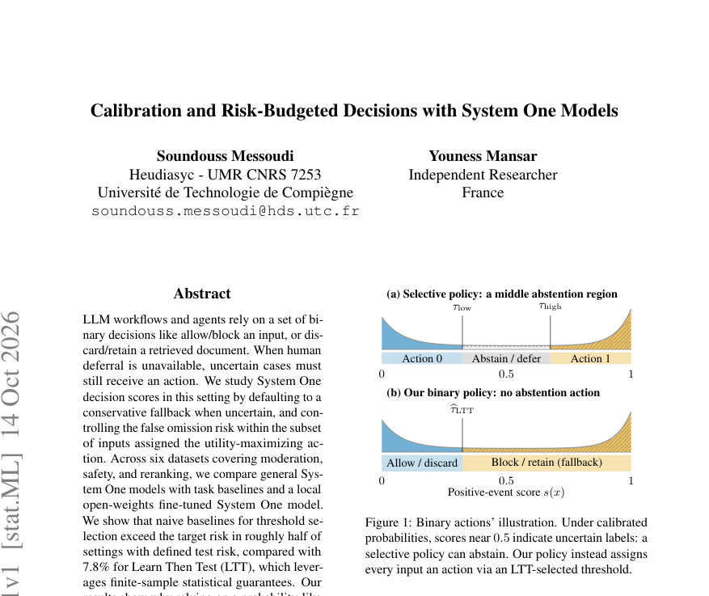
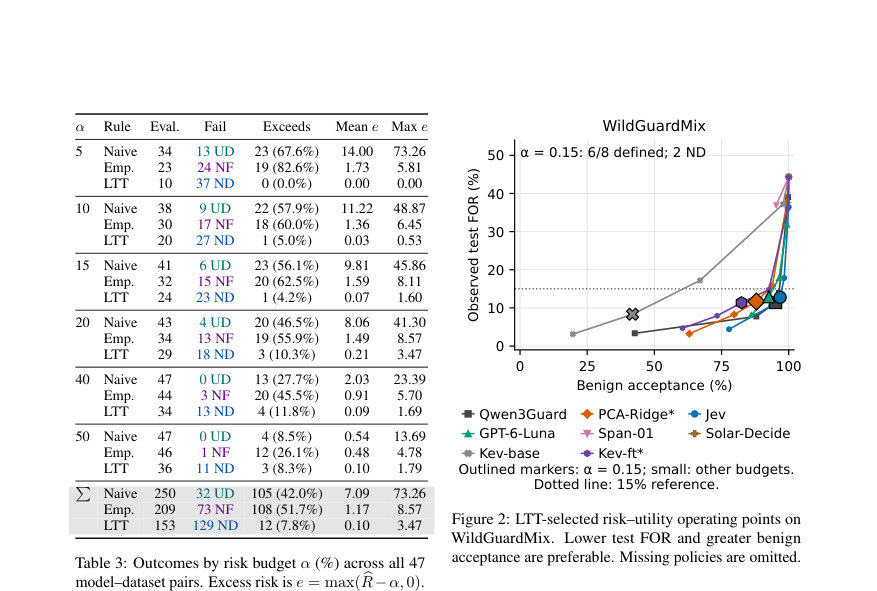
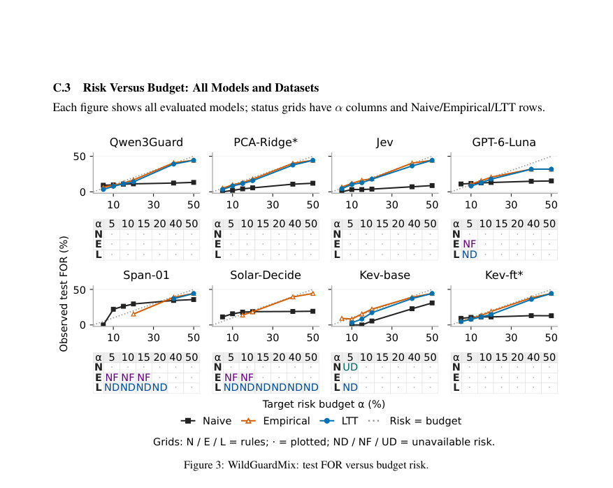

# Calibration and Risk-Budgeted Decisions with System One Models

- **게시일:** 2026-10-15
- **arXiv:** [2610.19811v1](http://arxiv.org/abs/2610.19811v1) · [PDF](https://arxiv.org/pdf/2610.19811v1)
- **저자:** Soundouss Messoudi, Youness Mansar
- **분야:** stat.ML, cs.LG
- **선정 점수:** 5.67
- **선정 이유:** 최근성 1.1, 인용 영향 0.0 (인용 0회), 저자 영향 0.0 (최고 h-index 0), AI 주제 적합성 2.2, 개발자 관심 0.3, 학술 신호 0.5, 오픈 웨이트·주요 연구조직 신호 1.6

[← 2026-10-15 목록으로 돌아가기](../daily/2026-10-15.html)

<!-- paper-visuals:start -->
## 주요 Figure

> 원문 PDF에서 실제 Figure 캡션과 그림 영역이 함께 확인된 자료만 자동 추출했다.

*Figure · 원문 PDF 1쪽 · Figure 1: Binary actions’ illustration. Under calibrated*

*Figure · 원문 PDF 7쪽 · Figure 2: LTT-selected risk–utility operating points on*

*Figure · 원문 PDF 21쪽 · Figure 3: WildGuardMix: test FOR versus budget risk.*

<!-- paper-visuals:end -->

## 한 문장 요약

비교적 저비용의 'System One' 결정 점수에 대해 임계값 기반 정책을 Learn Then Test(LTT)로 통계적으로 인증해 특정 하위집합(utility-maximizing action)에 대한 False Omission Rate(FOR)를 유한표본 보증으로 제어하면서 유용한 부정(negative-action) 비율을 최대화하는 방법을 제안·평가한다.

## 해결하려는 문제

LLM 워크플로우에서 취해야 할 이진(예: 허용/차단, 폐기/보관) 결정이 인간 전가 없이 자동으로 이루어져야 할 때, 모델 점수의 불확실성(특히 점수의 비보정성)이 안전상 치명적 오류(예: 허용되어서는 안 되는 항목의 통과)를 유발할 수 있다. 기존의 직관적 정책(예: 점수를 확률로 가정하고 τ=α로 임계값 설정)이나 단순 경험적 선택은 테스트 시 목표 위험(예: FOR)을 초과할 수 있으며, 보정(calibration) 자체도 데이터셋·도메인에 따라 심하게 달라져 배포 보증으로는 불충분하다. 연구 질문은 (Q1) System One 점수의 확률적 신뢰도와 분리 능력, (Q2) Naive/Empirical/LTT 임계값 정책들이 위험 초과와 유틸리티를 어떻게 절충하는지, (Q3) 일반 System One 인터페이스와 경량 로컬 미세조정 모델 간 결과 차이를 규명하는 것이다.

## 핵심 기여

- System One 유형의 결정 점수를 대상으로 False Omission Rate(FOR)를 조건부 위험으로 정의하고 유한표본 통계 보증을 통해 임계값을 인증하는 LTT 적용법을 이진 정책에 특화해 정식화했다 (Algorithm 1 및 정리 1).
- Naive(τ=α), Empirical(관측 FOR ≤ α을 만족하는 τ 선택)과 LTT(활성화 수준 δ=0.10)를 비교하여 실제 배포 맥락에서 Naive·Empirical이 자주 목표 위험을 초과하고 LTT가 유의미하게 더 적은 초과(빈도 7.8%)를 보인다는 경험적 증거를 제시했다.
- 여섯 개(Moderation, Safety, Reranking 포함) 데이터셋과 여러 System One 및 베이스라인 모델(Qwen3Guard, Jev, GPT-6-Luna, Span-01, Solar-Decide, PCA-Ridge, Kev-base/ft 등)을 사용해 점수 진단(AUROC, AP0, ECE, Brier)과 운영 지표(TNR, FOR, 유틸리티)를 체계적으로 보고했다.
- 로컬 오픈-가중치 경량 미세조정(Kev-ft)을 통해 일반 인터페이스가 인증을 반환하지 못할 때(비배포) 상당한 정책 가용성·유틸리티 회복이 가능함을 보였고, 비용·지연 측면에서 로컬 미세조정 모델이 경쟁력 있는 운영 대안임을 제시했다.

## 접근 방법

* 문제 설정: Y∈{0,1}에서 Y=1이 고위험 대상이며 s(x)∈[0,1]는 높은 값이 Y=1을 지지하도록 정렬된 점수이다.
* 정책은 임계값 τ로 πτ(x)=0 if s(x)<τ(유틸리티-최적화된 Action 0), 1 if s(x)≥τ(보수적 폴백 Action 1)를 반환한다.
* 주목하는 위험은 negative-action(시스템이 Action 0을 취하는 집합) 내의 FOR R(τ)=P(Y=1 \| s(X)<τ)이다.
* 목표는 R(τ)≤α라는 모집단 수준의 위험 예산을 만족하면서 µ(τ)=P(s(X)<τ)를 최대화하는 임계값을 선택하는 것이다.
* 적용 방법: Learn Then Test(LTT)를 이진 조건부 위험에 특화해 사용한다.
* Dfit(임계 후보 그리드 생성)와 독립의 Dcal(보정 표본)을 분리하고, 후보 τ1..τM을 고정된 순서로 검사한다(최대 200 midpoints + endpoints).
* 각 후보에 대해 Nj=\|{i: s(Xi)<τj}\|, Kj=∑Yi1{s(Xi)<τj}를 계산하고 이항 하한 꼬리 p값 pj=∑_{k=0}^{Kj} C(Nj,k) α^k (1−α)^{Nj−k}을 사용해 H_j: R(τj)>α를 검사한다.
* pj≤δ인 후보들로 구성된 '인증 접두사'에서 bτ로 test-set 상의 bµcal,j 최대화를 통해 τ를 선택한다.
* 구현 세부: δ=0.10, 지원 하한은 max(25, ⌈log δ / log(1−α)⌉) (식 (2))으로 스크리닝.
* 비교 정책: Naive(τ=α), Empirical(관측 bRcal ≤α인 τ 중 FPR 최소화), LTT(알고리즘1).
* 평가 지표: AUROC, AP0, ECE, Brier, TNR(유틸리티), 테스트 FOR 및 초과(e=max( bRtest −α,0)) 등.

## 주요 결과

- 데이터셋·모델 전반에서 '보정(ECE) 좋음'이 곧 배포 적합성을 의미하지 않음(예: Jev의 ECE가 WildGuardMix에서 0.034이나 SciDocs에서 0.29로 큰 변동). (본문 Table 2)
- 전 모델·데이터셋(총 47 모델–데이터 쌍, Table 3) 집계: Naive 정책은 정의된 테스트 위험 설정에서 약 42.0%의 빈도(105/250)로 목표 위험 α를 초과했고 평균 초과는 7.09 퍼센트포인트, 최대 초과는 73.26pp를 기록했다. Empirical는 51.7% 빈도(108/209)로 초과했고 평균 초과 1.17pp(최대 8.57pp)였다. 반면 LTT는 초과 빈도 7.8% (12/153)와 평균 초과 0.10pp(최대 3.47pp)를 기록해 훨씬 적은 초과를 보였다. (본문 Table 3)
- LTT의 보수성: δ=0.10 기준에서 α=0.05일 때 후보의 21.3%만 인증(배포 가능)되며 α=0.5로 완화하면 가용성은 76.6%로 증가한다(본문). 즉 LTT는 불확실 시 비배포(⊥)로 안전하게 대체한다.
- 사례: α=0.15에서 Aegis의 Span-01는 Naive로는 유틸리티 95.3%에 달하지만 테스트 FOR가 60.9%로 예산 초과(치명적 실패), 반면 동일 상황에서 LTT는 비배포로 안전 처리했다. (본문 Table 4)
- 로컬 미세조정: Kev-base는 α=0.15에서 LTT 인증을 1/6 데이터셋에서만 반환한 반면 Kev-ft(≈10k 예제로 2 epoch 미세조정)은 6/6에서 인증을 반환해 가용성을 전체 예산·데이터셋 기준으로 13/36 → 31/36으로 확장시켰다. (본문 섹션 6.3 및 Table 4)  

## 한계

- 저자 명시: (1) LTT의 유한표본 보증은 Dcal과 배포 샘플이 동일한 분포(P)에서 i.i.d.로 추출된다는 가정에 의존하므로 배포·적대적 분포 이동하에서는 성능·위험 제어를 보장하지 못하며 주기적 재보정 또는 분포 이동 적응 필요성이 있다. (2) 이항 인증의 본질적 표본 요건으로 인해(식 (2): Nj ≥ ceil(log δ / log(1−α))) 보정 표본이 작거나 α가 엄격하면 LTT가 비배포(⊥)를 빈번히 반환하여 정책 가용성이 떨어질 수 있다. (3) 로컬 오픈모델 적응(Kev-ft)은 인증 회복에 유효하지만 라벨이 달린 학습 데이터(Dfit)와 훈련용 컴퓨팅이 필요해 콜드스타트 상황에서 불가능할 수 있다. (본문 'Limitations' 섹션)
- 본문에서 합리적으로 확인되는 제약: (4) 평가에 사용된 여섯 개 영어 벤치마크는 언어·도메인 다양성·실제 배포 상황을 완전 대변하지 못하며, reranking 실험은 구성된 문서 혼합을 사용하고 ATBench는 잘린 궤적의 회고적 분류를 사용해 측정된 FOR의 의미·전이성이 제한될 수 있다. (5) Empirical 정책은 관측 값에 기반하므로 유한표본 변동으로 인해 보증이 없다는 점이 실제 실험에서 빈번한 위험 초과(표본 대비 51.7% 초과 빈도)로 확인되었다.

## 개발자 관점

- 운영상 치명적 오류가 비대칭적일 때(예: 허용 시 피해)에는 점수를 '확률처럼 취급'하여 단순히 τ=α로 설정하는 Naive 방식이 위험할 수 있으므로, 별도의 보정 샘플(Dcal)과 통계적 인증 절차(LTT)를 도입해 모집단위험을 유한표본 수준에서 통제해야 한다.
- LTT 적용 실무 요건: (a) Dfit(임계 후보 그리드 생성용)과 Dcal(독립 보정) 데이터 분리, (b) 후보 그리드 고정(최대 200 midpoints + {0,1}), (c) δ(본 실험은 0.10) 설정, (d) 지원 하한은 max(25, ⌈log δ / log(1−α)⌉)로 스크리닝 — 특히 α가 작을수록 더 많은 Dcal 지원이 필요하다(식 (2)).
- 가용성·안전의 절충: LTT는 초과 빈도를 크게 줄여주지만 후보 인증 실패 시 비배포(⊥)를 반환해 유틸리티가 급감할 수 있음. 따라서 처음에는 일반 System One API를 평가하고, 인증이 불충분하면 라벨을 모아 경량 오픈-가중치 모델로 미세조정하는 워크플로우가 실용적이다(본 논문에서 Kev-ft 사례).
- 비용·지연 고려: PCA-Ridge는 API 비용 측면에서는 매우 저렴하나 임베딩 추출 파이프라인 때문에 지연(ms/예제)이 매우 크다(예: 5,247 ms/예제), 반면 로컬 미세조정 모델(Kev-ft)은 낮은 비용($0.0030/1k)과 낮은 지연(≈98 ms/예제)으로 비용·지연 균형에서 유리하다(Table 5).
- 배포 권고: LTT로 인증된 정책이 없을 때는 명시적 폴백(차단/보관 등 보수적 행동)을 구현하고, 배포 후 분포 이동을 감지하면 재보정·재인증 파이프라인을 가동할 것(논문 'Discussion' 및 'Limitations').

**근거 범위:** 이 분석은 제공된 논문 PDF 본문(본문, 표, 알고리즘, 한계 및 부록)을 근거로 작성되었다. 모든 정량적 수치(예: Table 2–5, Table 3의 집계, 식(2), δ/α 관련 수치 등)는 본문 또는 표에서 직접 인용하였다. 본문 외부의 추가 구현 세부(예: 실 운영 API의 변화 가능성)나 후속 결과는 반영되지 않았다.
