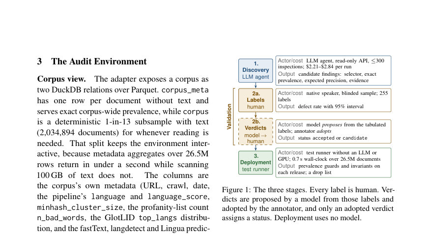
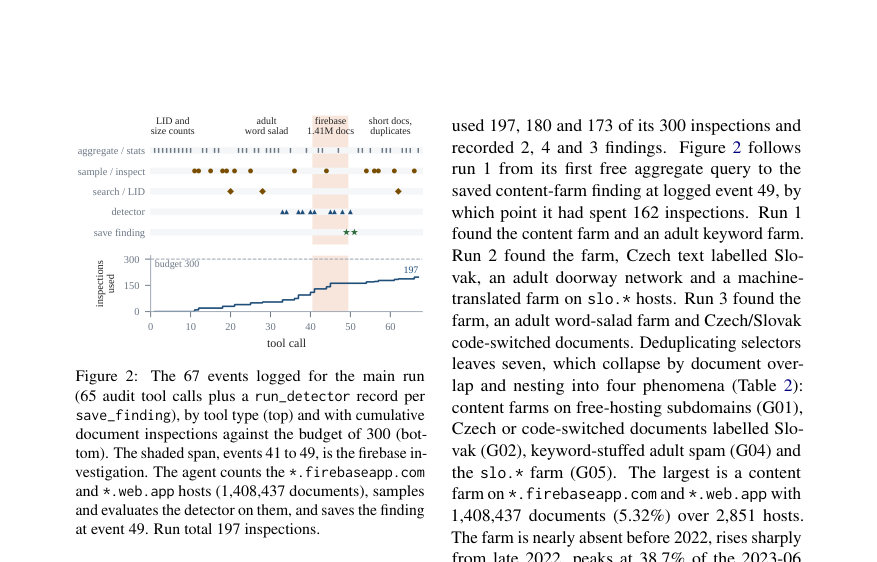
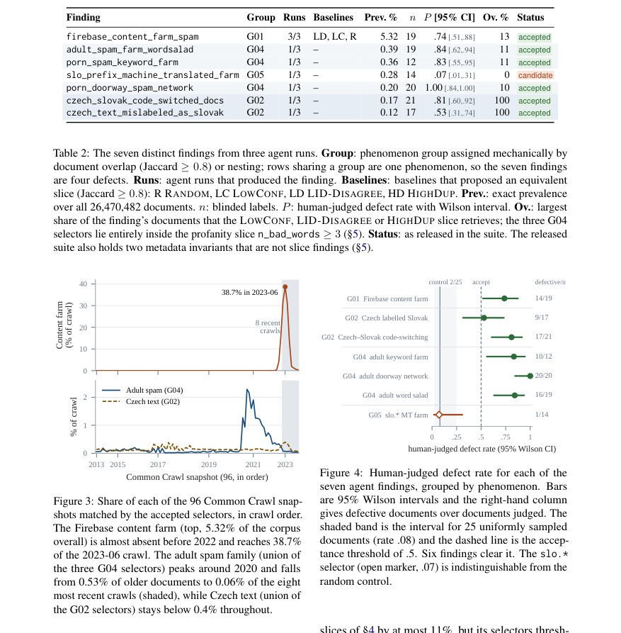

# Can an Agent Debug a Web Corpus? Agentic Auditing of Slovak FineWeb2

- **게시일:** 2026-10-25
- **arXiv:** [2610.31636v1](http://arxiv.org/abs/2610.31636v1) · [PDF](https://arxiv.org/pdf/2610.31636v1)
- **저자:** Marek Šuppa, Ivan Vykopal, Jaroslav Kopčan
- **분야:** cs.CL
- **선정 점수:** 4.28
- **선정 이유:** 최근성 0.5, 인용 영향 0.0 (인용 0회), 저자 영향 0.0 (최고 h-index 0), AI 주제 적합성 3.0, 개발자 관심 0.2, 학술 신호 0.6, 오픈 웨이트·주요 연구조직 신호 0.0

[← 2026-10-25 목록으로 돌아가기](../daily/2026-10-25.html)

<!-- paper-visuals:start -->
## 주요 Figure

> 원문 PDF에서 실제 Figure 캡션과 그림 영역이 함께 확인된 자료만 자동 추출했다.

*Figure · 원문 PDF 3쪽 · Figure 1: The three stages. Every label is human. Ver-*

*Figure · 원문 PDF 5쪽 · Figure 2: The 67 events logged for the main run*

*Figure · 원문 PDF 6쪽 · Figure 3: Share of each of the 96 Common Crawl snap-*

<!-- paper-visuals:end -->

## 한 문장 요약

LLM을 한 번만 호출해 도구를 사용하는 에이전트가 26.5M 문서 Slovak FineWeb2를 읽기 전용·예산화된 API로 조사하여 재현 가능한 메타데이터 기반 검사(실행 가능한 테스트)를 생성하고, 원어민 검증을 거쳐 경보·회귀 테스트 모음으로 배포했다.

## 해결하려는 문제

대규모 다언어 전처리 파이프라인(FineWeb2)은 수천 언어에 동일한 절차를 적용하므로 특정 언어에서 발생하는 실패 양상을 예상·검증하지 못한다. 수작업 감사는 확장성이 없고 일회성이며, 전체 코퍼스에 LLM을 분류기로 돌리면 비용이 크고 설명 가능성이 낮다. 따라서 적은 비용으로 반복 실행 가능한 방식으로 언어별 결함을 찾아 검증하고 장기적으로 회귀검사로 재사용할 수 있는 방법이 필요하다.

## 핵심 기여

- 읽기 전용·예산화된 감사 환경(Parquet 위 DuckDB 어댑터)과 11개 도구를 갖춘 에이전트형 코퍼스 디버거 프레임워크를 구현하고 공개했다.
- 에이전트(LLM)를 한 번만 사용해 '발견 → 원어민 블라인드 검증 → 모델 제안·수용으로 판정 → LLM 불필요한 배포 가능한 YAML 테스트'의 3단계 워크플로우를 제시했다.
- Slovak FineWeb2(26,470,482문서)에서 3회 에이전트 실행(각 run inspection 예산 300, 실제 사용 197/180/173, 비용 $2.21–$2.84)으로 7개 발견(4개 현상 그룹)을 보고하고, 그중 6개는 원어민 블라인드 라벨이 지지함(정밀도 범위 .53–1.00).
- 발견을 메타데이터 전용 셀렉터로 컴파일해 전체 코퍼스에서 정확한 유병률을 산출하고, 그 테스트 모음이 GPU 없이 전체 26.5M 문서를 0.7초(벽시계)로 스캔하며 재사용 가능함을 보였다.
- 비교 실험에서 같은 모델을 고정 샘플(네 가지 정적 전략: RANDOM, LOWCONF, LID-DISAGREE, HIGHDUP)에 넣은 결과(예산 동일) 최선의 정적 전략(LOWCONF)이 에이전트 단일 실행보다 더 많은 유효 셀렉터를 검증했고(4개, $1.03), 에이전트는 측정·특성화·테스트 생성을 제공함을 보였다. 프레임워크·테스트·검증 데이터·에이전트 궤적을 공개했다.

## 접근 방법

* 환경 구성: 코퍼스는 두 관계로 노출된다 — corpus_meta(26.5M 행, 텍스트 없음, 메타데이터 집계에 사용)와 corpus(텍스트가 있는 결정적 1/13 샘플, 2,034,894 문서)로 분리해 집계는 빠르게, 텍스트 읽기는 제약되게 설계.
* 에이전트 도구: 11개 도구(schema, aggregate, sample_documents, inspect_document, search_text, domain_stats, crawl_stats, sentence_lid, run_detector, evaluate_detector, save_finding) — 집계는 무료, 문서 읽기는 검사 예산(inspection)으로 비용 부과.
* 에이전트 루프·프롬프트: 시스템 프롬프트는 도구, 발견 스키마(재현 가능성·정량성·근거 요구), 예산 한계(문서 검사 예산 300), 거짓 선입견 차단(결함·이웃언어 언급 금지)을 명시.
* 작업 흐름: 에이전트가 통계로 방향을 잡고 가설을 세우며 증거·반증을 확보, run_detector로 유병률을 측정하고 evaluate_detector로 표본 정밀도를 확인한 뒤 save_finding으로 증거·셀렉터·예상 정밀도를 기록.
* 실험 설정: claude-sonnet-5를 Claude Code CLI로 사용(세 번의 에이전트 실행, 각 run ≤300 inspections·≤250 turns), 네 가지 정적 베이스라인(RANDOM, LOWCONF: language_score < 0.8, LID-DISAGREE: 보조 LID 불일치 3.12% 등, HIGHDUP: minhash_cluster_size ≥100)과 예산을 맞춰 비교.
* 검증: 원어민 블라인드 라벨링(총 358 뽑음, 최종 255 라벨 사용 — 에이전트 발견당 25 샘플 목표; 대조군 40)으로 '결함' 정의는 언어 라벨이 cs/mix/other 또는 유용성 판단이 junk인 경우.
* 결과물: 각 발견은 YAML 테스트(셀렉터, 증거, 예상 정밀도, 상태 accepted/candidate)로 저장되어 향후 크롤에 대해 회귀 검사로 사용 가능.

## 주요 결과

- 발견 요약(표 기반, 3개 에이전트 실행 → 중복 제거해 7개 셀렉터, 4개 현상 그룹): 1) firebase/web.app 콘텐츠 팜: 전체의 5.32% (1,408,437문서), 세 번의 런 모두 발견, 인간 라벨 정밀도 0.74 (n=19), static-slice overlap 13%, 상태 accepted.
- 2) adult 관련 스팸(세 가지 변형, G04): word-salad 0.387% (102,474문서), 정밀도 0.84 (n=19); keyword farm 0.359% (94,946문서), 정밀도 0.83 (n=12); doorway network 0.198% (52,354문서), 정밀도 1.00 (n=20). 모든 G04 셀렉터는 profanity-count(n_bad_words ≥3) 메타데이터 슬라이스 내부에 있음.
- 3) Czech/Slovak 혼·오라벨링(G02): code-switched 0.167% (44,251문서), 정밀도 0.81 (n=21); Czech mislabeled as Slovak 0.120% (31,795문서), 정밀도 0.53 (n=17). 두 셀렉터는 LID-DISAGREE 슬라이스(보조 LID 불일치) 내부(겹침 100%).
- 4) slo.* 접두사 기계번역 팜: 0.279% (73,835문서), 인간 라벨 정밀도 0.07 (n=14)으로 블라인드 라벨이 지지하지 않아 상태 candidate로 배포.
- 6/7 발견은 인간 블라인드 라벨로 지지됨(정밀도 .53–1.00), 비교 대조 통제에서의 결함률은 0.08(25문서). 하나는 미지지(슬로 접두사 MT 팜). (출처: Table 2, Fig.4)

## 한계

- 저자 명시 한계: 범위 제한 — 단일 언어(Slovak), 단일 코퍼스, 세 번의 에이전트 실행(추가 비공식 run 1회 있음), 에이전트가 검사 예산의 58–66%만 사용함.
- 검증 한계(저자 언급): 원어민 라벨은 단 한 명이 255문서를 라벨링(발견별 12–21, 중앙값 19)해 정밀도 추정의 신뢰구간이 넓음; 라벨링은 두 차례에 걸쳐 수행되어 'junk' 기준이 중간에 명확해졌음(117 라벨은 첫 패스 이후 유지됨) — 단일 코더 디자인은 코더 간 일치도 불평가; 라벨은 정밀도(precision)만 측정, 셀렉터의 재현율(recall)은 측정하지 않음.
- 비교 실험 제약(저자): 정적 베이스라인은 에이전트가 가진 도구(집계·정밀도 측정·정적 슬라이스 전체 유병률 산출 등)를 가지지 않았음; profanity-ranked 샘플(가장 profane 300개)은 모델에 돌리지 않음; 판정(버딕트)은 모델이 제안하고 어노테이터가 수용하는 방식으로 이루어져 독립적 심사를 하지 않음.
- 비용·안정성(저자): 본 방법은 파이프라인이 이미 계산한 메타데이터에 의존하므로(셀렉터가 메타데이터 전용일 때 정확한 유병률 산출 가능) 텍스트 의존 셀렉터는 본 비용·정확성 이점을 잃음. 회귀 가드는 자연 변동으로 쉽게 트리거될 수 있어 알람이 거짓양성일 수 있음; 일부 호스트 패턴은 시간이 지나며 변동함.

## 개발자 관점

- 재현·배포: 어댑터는 Parquet 위 DuckDB로 corpus_meta(메타데이터 전체)와 텍스트가 있는 결정적 1/13 샘플을 분리해 설계했고, 모든 도구 호출을 JSONL 궤적으로 기록해 조사 재생(trajectory replay)이 가능하다(대부분 로그 재현 가능성 확인됨).
- 테스트 구현: 에이전트가 생성한 셀렉터는 메타데이터 전용이면 run_detector로 전체 코퍼스에 대해 정확한 유병률을 즉시 계산할 수 있고, save_finding은 YAML(셀렉터·증거·예상 정밀도·상태)을 생성해 회귀 검사로 사용 가능하다. 배포 시 테스트 실행은 26.5M 문서를 0.7초 벽시계·약 13s CPU(20코어)로 완료되어 매우 저비용.
- 비용 관점: 에이전트 발견 비용은 한 run당 $2.21–$2.84(claude-sonnet-5)로 낮지만, 고정 샘플 기반 정적 전략(예: LOWCONF $1.03)이 동일 예산에서 더 많은 유효 셀렉터를 검증할 수 있음. 전체 문서 텍스트를 LLM으로 분류하면 종량 기준으로 $12,309(원시 토큰 가격)–$90,456(실행 오버헤드 포함)으로 매우 비쌈(논문 비교 수치).
- 검증 요구: 원어민 블라인드 라벨링은 필수(발견당 ~20샘플 권장), 라벨링 기준(예: 'junk' 정의)을 사전 명확화해야 함. 자동화된 판정은 모델 제안 + 인간 채택의 흐름을 쓸 수 있으나 독립적 인적 심의가 중요함.
- 안전성·데이터 관점: 메타데이터 상의 관례적 버그(예: language_score가 1.00001로 출판되는 문제)는 소비자가 확률로 해석할 때 문제를 일으키므로 점검·정규화 필요. 발견은 '패치'(drop list)로도 출력 가능하지만 메타데이터 결함은 삭제가 아니라 테스트로 남겨야 버그가 은폐되지 않음.

**근거 범위:** 이 분석은 제공된 논문 PDF 본문(본문과 부록 포함)에서 직접 추출한 내용에 근거한다. 표·숫자(예: 세부 유병률, 라벨 수, 비용 수치)는 논문 본문과 표(Table 2, Table 3, Table 4 등)에서 명시된 값을 그대로 사용했다. 논문 외부 구현·추정치는 만들지 않았고, 부록의 추가 런(claude-opus-5)과 그 보고는 본문에서 명시된 대로 '프로토콜 밖'으로 취급해 표시했다.
