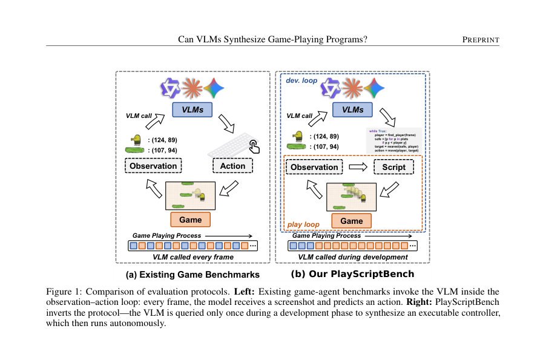
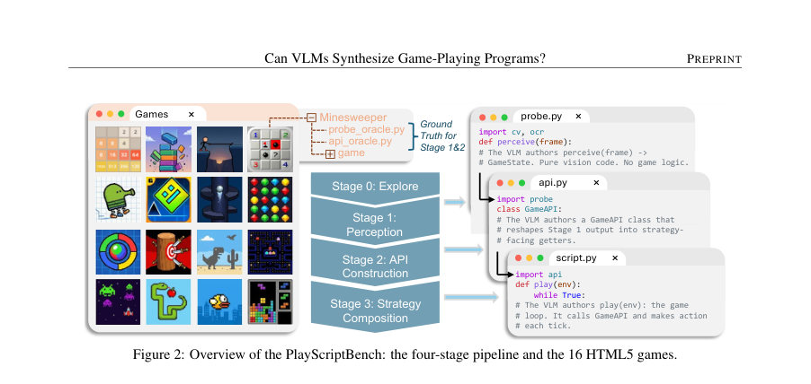
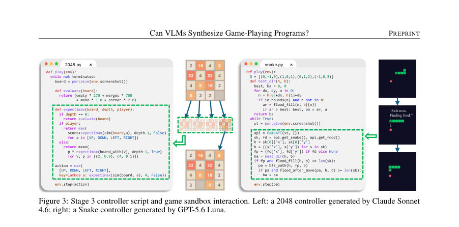

# Can Vision-Language Models Synthesize Executable Game-Playing Programs?

- **게시일:** 2026-11-23
- **arXiv:** [2611.27741v1](http://arxiv.org/abs/2611.27741v1) · [PDF](https://arxiv.org/pdf/2611.27741v1)
- **저자:** Yao Tong, Jiaxin Qi, Dingyu Zhang, Jianqiang Huang
- **분야:** cs.AI
- **선정 점수:** 4.99
- **선정 이유:** 최근성 0.4, 인용 영향 0.0 (인용 0회), 저자 영향 0.0 (최고 h-index 0), AI 주제 적합성 3.0, 개발자 관심 0.8, 학술 신호 0.8, 오픈 웨이트·주요 연구조직 신호 0.0

[← 2026-11-23 목록으로 돌아가기](../daily/2026-11-23.html)

<!-- paper-visuals:start -->
## 주요 Figure

> 원문 PDF에서 실제 Figure 캡션과 그림 영역이 함께 확인된 자료만 자동 추출했다.

*Figure · 원문 PDF 2쪽 · Figure 1: Comparison of evaluation protocols. Left: Existing game-agent benchmarks invoke the VLM inside the*

*Figure · 원문 PDF 3쪽 · Figure 2: Overview of the PlayScriptBench: the four-stage pipeline and the 16 HTML5 games.*

*Figure · 원문 PDF 4쪽 · Figure 3: Stage 3 controller script and game sandbox interaction. Left: a 2048 controller generated by Claude Sonnet*

<!-- paper-visuals:end -->

## 한 문장 요약

PlayScriptBench를 제안하며, VLM이 단일 개발 쿼리로 시각 입력만으로 실행 가능한 게임 플레이용 파이썬 컨트롤러(스크립트)를 합성할 수 있는지를 4단계(Explore, Perception, API Construction, Strategy Composition) 파이프라인과 16개 HTML5 게임 벤치마크로 평가한다.

## 해결하려는 문제

기존 비전-언어 게임 벤치마크는 대부분 각 프레임마다 VLM을 호출해 행동을 출력하는 '프레임 단위 인-루프' 방식을 채택한다. 이 방식은 (1) 모델 추론에 게임 루프가 동기화되어 실시간 상호작용에 비현실적이며, (2) 게임 길이에 비례해 VLM 호출 비용이 누적되는 한계가 있다. 또한 프레임별 즉시 추론은 장기 전략·동적 디버깅·코드화된 영속적 지식 축적 능력을 평가하지 못한다. 논문은 이러한 한계를 해결하기 위해 VLM이 한 번의 개발 단계에서 시각 정보를 압축한 재사용 가능한 실행 코드(컨트롤러)를 합성할 수 있는지를 평가하는 문제를 제기한다.

## 핵심 기여

- Explore–Perception–API Construction–Strategy Composition의 네 단계 파이프라인을 제안하여 컨트롤러 합성 과정을 탐색, 상태 인지, 전략적 인터페이스 구성, 전략 합성으로 분해하고 각 단계를 개별 채점 가능하게 설계함.
- 16개 HTML5 게임(러너·아케이드·퍼즐·플랫포머, 총 4장르)으로 구성된 PlayScriptBench 벤치마크와 브라우저 기반 샌드박스를 공개하여, 인퍼런스 중 게임을 일시정지해 결정 품질만을 평가하도록 함.
- 관찰(Perception)과 전략(Strategy)을 분리·진단할 수 있는 Oracle–VLM probe 메커니즘과 복합 지표(Joint = Perception×Strategy under Oracle)를 도입함.
- 최전선 VLM 13종에 대한 대규모 평가를 통해 시각 인지 능력이 전략적 게임 플레이로 선형 전이되지 않음을 보이고, 퍼셉션-API-전략 단계별 주요 실패 모드를 규명함.
- 스크립트 합성 방식이 VLM을 프레임마다 호출하는 방식보다 시드 아마타이제이션(재사용) 측면에서 자원(호출 횟수·토큰·시간) 효율이 크다는 정량적 증거 제시.

## 접근 방법

* PlayScriptBench는 VLM에게 한 게임에 대해 네 가지 산출물을 작성하도록 요구한다.
* Stage 0(Explore): VLM이 간단한 플레이 스크립트를 생성해 샌드박스에서 단기 롤아웃을 실행하고, 후속 '분석가' 호출이 롤아웃 스크린샷과 stdout을 구조화된 마크다운(게임 단계, 액션 효과, 시각 레이아웃, 역학 등)으로 요약한다.
* Stage 1(Perception): Explore에서의 통찰과 예시 프레임을 입력받아 perceive(frame) 함수와 Constants dataclass를 작성하여 원시 RGB 프레임에서 구조화된 게임 상태를 반환한다(프레임-투-프레임 델타가 필요한 경우 서명 확장).
* Stage 2(API Construction): Stage1 출력(혹은 Oracle)을 받아 GameAPI 클래스를 구현해 전략용 getter·판단 메서드를 노출한다.
* Stage 3(Strategy Composition): play(env) 함수를 작성해 매 프레임 perceive()와 GameAPI를 호출하며 닫힌 루프 실행 컨트롤러를 완성한다.
* 평가 인프라는 고정 프롬프트 템플릿, prepend 코드(작성된 perceive/API를 실행 컨텍스트에 주입), 그리고 Oracle 모드(전략 평가용)와 VLM-probe 모드(전체 파이프라인 평가)를 제공한다.
* 샌드박스는 컨트롤러 합성 중 게임을 일시정지해 인퍼런스 지연이 게임 결과를 왜곡하지 않도록 구현한다.
* 성능 평가는 Stage1의 Per.(정밀도/재현율 기준), Stage2의 API.
* (메서드별 기능 정합), Stage3의 전략 점수(게임별 raw 점수를 모델 간 min-max 정규화) 및 Joint(Obsg×Strag 평균)로 이루어진다.

## 주요 결과

- 벤치마크는 16개 게임(4장르)에서 13개 VLM을 평가했으며(예: GPT-5.6 Luna, Qwen 3.6 Plus, Claude Sonnet 4.6 등), 표준 지표의 장르 평균(모델 평균)은 Obs.(관찰) = 0.46, Stra.(전략, 정규화) = 0.335, Joint = 0.155로 보고됨(Table 1, Avg.). 이는 현재 최전선 VLM들이 시각 인지 능력과 실행 가능한 닫힌 루프 전략 능력 모두에서 큰 격차를 보인다는 것을 의미함.
- 관찰 능력과 전략 성능은 강하게 선형 상관하지 않음. 예: GPT-5.6 Luna는 Obs. 최고(0.53, Claude Sonnet 4.6와 동률)를 기록했지만 Stra.에서는 중하위(0.255)였고, 반대로 Qwen 3.6 Plus는 중간 Obs.(0.47)에도 Runner·Arcade에서 높은 Stra.(0.600) 및 전체 Joint 최고(0.265)를 달성함—관찰과 전략은 독립적 능력 축임(부록의 Spearman ρ=0.340, p=0.255).
- 파이프라인 절단 실험(Table 2): Stage0(Explore) 제거 시 GPT-5.6 Luna의 Obs.가 0.685→0.395로 −42.3% 감소(Per. 0.793→0.463, API. 0.576→0.327). Qwen 3.6 Plus는 0.472→0.345(−26.9%)로 감소. Oracle을 VLM의 자체 Stage1/2로 대체하면 전략 점수가 거의 붕괴함(예: GPT-5.6 Luna 0.255→0.013, Qwen 3.6 Plus 0.600→0.052), 즉 인지 오류가 전략 실패로 증폭됨.
- 자원 효율 비교(Table 3): Qwen 3.6 Plus 기준으로 본 논문 방법은 1시드에서 VLM 호출 횟수 5.0 vs 인-루프 214.1(≈42.8× 감소), 토큰 27.4K vs 2270.6K(≈82.9× 감소). 10시드에서 전체 실행 시간은 19.7분(본 방법) vs 42.1분(인-루프), 전략 점수 0.600 vs 0.357(본 방법이 더 높음; 단, Stra.은 Oracle 조건임).

## 한계

- 저자가 명시한 한계: PlayScriptBench는 '결정론적(deterministic), 유계 상태(bounded-state)' 게임군을 대상으로 한다. 합성된 컨트롤러는 런타임에 VLM을 호출해 전략을 온라인으로 수정하지 못하며(온라인 적응 불가), 따라서 오픈월드·확률적·비결정적 환경에는 적합하지 않다. 저자 제안의 향후 과제는 런타임 스크립트 정제(온라인 VLM 피드백)와 게임군 확장이다.
- 본문 실험에서 확인되는 제약(저자가 아닌 관찰로 확인된 한계): (1) 퍼셉션 단계의 불안정성이 API·전략 단계에서 치명적 실패로 증폭되어 end-to-end 성능을 갉아먹음(Perception→API cascade). (2) Stage3에서는 구문상 유효하지만 전략적으로 무의미한 코드가 빈번히 생성되어 실행은 되나 점수가 낮음(전략적 추론 부족). (3) Oracle-conditioned 전략 점수 사용의 필요성: VLM-probe(완전 엔드투엔드) 모드는 대부분 모델에서 거의 0으로 수렴해 판별력이 상실됨—이는 벤치마크의 진단성에는 유리하나 실전 적응성 평가에는 한계가 있음.

## 개발자 관점

- 재현·구현 관련: 평가 허브는 (1) 고정된 프롬프트 템플릿과 prepend 코드(작성된 perceive/API를 실행 컨텍스트에 주입), (2) 샌드박스(Playwright 기반 headless Chromium)에서의 '추론 중 게임 일시정지' 구현(요청AnimationFrame·타이머·performance 훅을 패치해 일시중지 후 재생)으로 구성되어 있다. 이 구조를 그대로 따라야 동일 비교가 가능하다.
- 디버깅·진단 팁: 각 단계별 산출물을 독립적으로 채점(Per./API./Strategy)하고 'API-on-GT'와 Oracle probe를 활용해 퍼셉션 오류와 API 로직 오류를 분리하라. Perception에는 프레임별 허용오차(픽셀/각도/상대값)를 게임별로 설정해야 하며(논문에 tol. 표 제공), perceive() 예비 검증(self-verify) 루틴을 포함시키면 안정성이 높아짐.
- 자원·배포 관점: 스크립트 합성 방식은 시드 다회 평가에서 VLM 호출·토큰 비용을 대폭 절감(수십배)하므로 배포 환경에서 비용을 줄이고자 할 때 유리하다. 다만 합성된 컨트롤러가 환경 변화에 적응하지 못하는 점을 보완하려면 경량화된 온라인 리파인먼트 루프를 추가 고려해야 함.
- 안전성·신뢰성: VLM이 생성한 CV 파이프라인은 색상 임계치·좌표 계산 등에서 '환각(hallucinated thresholds)'을 자주 가짐(P1). 따라서 실제 배포 전에는 제한된 대표 프레임 세트로 자동 검증하고, 실패 시에는 탐색(Explore) 재실행 또는 수동 보정 절차를 두는 것이 필요함.
- 실행 허들: 전략 스크립트에 대해 다중 시드(예: 10시드)로 평균·표준편차를 보고하라. 많은 HTML5 게임은 난수성이 있어 단일 시드 결과만으로 판단하면 과대평가될 수 있음.

**근거 범위:** 이 분석은 제공된 논문 PDF 본문(본문·표·부록 포함)만을 근거로 작성되었다. 주요 수치(표 1–3, 표 2의 절단 실험 결과, 파이프라인 설계, 게임 목록, 평가 기준 등)는 PDF 내 표와 본문에서 직접 인용하였다. 다만 논문에 포함된 전체 코드·프롬프트 원문과 게임별 모든 세부 수치(각 모델의 게임별 정규화 전 raw 점수의 전체 분포 등)는 부록 일부에 나열되어 있으나 본 요약에서는 핵심 표·본문에서 확인 가능한 대표 수치들만 발췌해 정리했음을 밝힌다.
