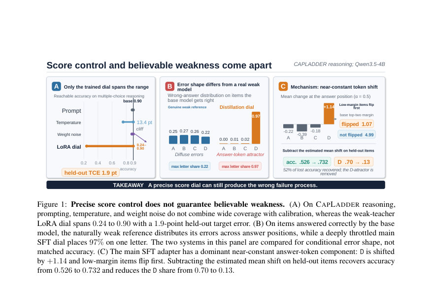
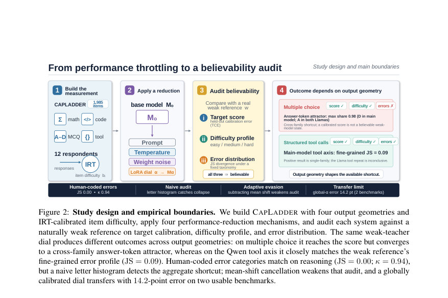

# Can We Make an LLM Dumber, or Is It Just Playing Dumb? An Empirical Study of Believable Performance Throttling

- **게시일:** 2026-11-13
- **arXiv:** [2611.15568v1](http://arxiv.org/abs/2611.15568v1) · [PDF](https://arxiv.org/pdf/2611.15568v1)
- **저자:** Chengguang Gan, Yunhao Liang, Hanjun Wei, QingHao Zhang, Shiwen Ni
- **분야:** cs.CL
- **선정 점수:** 7.19
- **선정 이유:** 최근성 0.7, 인용 영향 0.0 (인용 0회), 저자 영향 0.0 (최고 h-index 0), AI 주제 적합성 2.9, 개발자 관심 0.6, 학술 신호 0.6, 오픈 웨이트·주요 연구조직 신호 2.5

[← 2026-11-13 목록으로 돌아가기](../daily/2026-11-13.html)

<!-- paper-visuals:start -->
## 주요 Figure

> 원문 PDF에서 실제 Figure 캡션과 그림 영역이 함께 확인된 자료만 자동 추출했다.

*Figure · 원문 PDF 2쪽 · Figure 1: Precise score control does not guarantee believable weakness. (A) On CAPLADDER reasoning,*

*Figure · 원문 PDF 4쪽 · Figure 2: Study design and empirical boundaries. We build CAPLADDER with four output geometries and*

<!-- paper-visuals:end -->

## 한 문장 요약

벤치마크 점수를 임의로 낮추는 '성능 다이얼'(약한 교사 LoRA 어댑터)을 도입하고, IRT로 보정된 CAPLADDER 벤치마크와 로그잇·옵션 순열 진단으로 만들어진 낮은 점수가 '자연스러운 약한 모델'의 실패 과정과 일치하는지 실증적으로 평가한다.

## 해결하려는 문제

벤치마크 점수는 모델 능력의 대리 지표로 널리 사용되지만, 점수를 인위적으로 낮췄을 때 그 실패 분포가 실제로 능력이 낮은 모델과 같은지(즉 'playing dumb'인지) 는 검증되지 않았다. 기존의 단순한 제어 수단(프롬프트 지시, 샘플링 온도, 가중치 노이즈 등)은 원하는 점수로의 정밀한 보정이나 인간-약한참조와 유사한 실패 과정 재현이 가능한지 불명확하다. 본 연구는 '신뢰할 만한 성능 저하(believable performance reduction)'를 점수 보정(target calibration), 항목 난이도 구조(item-difficulty structure), 오류 분포 유사성(error-distribution similarity) 세 축으로 정의하고 이를 본문에서 측정 가능한 방식으로 검증한다.

## 핵심 기여

- 측정도구: IRT로 항목 난이도를 적합한 CAPLADDER(총 1,985개 항목, 수학·코드·객관식 추론·도구 사용) 공개 및 '신뢰 가능한 성능 저하'의 세 축(점수 보정, 난이도 프로필, 오류 분포)을 운영화함 (§3, Appendix A).
- 실증분리: 단순한 약한-교사(weak-teacher) LoRA 저차원 어댑터(다이얼)가 추론·도구 축에서 미지의 목표 점수 범위를 정밀하게 재현(held-out TCE = 1.9pt)하나, 프롬프트·온도·가중치 노이즈 등 기초적 제어는 동일한 범위와 보정 정밀도를 달성하지 못함 (§5).
- 메커니즘 규명: 객관식에서 다이얼은 모델-특이적 '정답 토큰(attractor)' 집중을 반복적으로 발견(최대 97% 오류가 한 문자에 집중). 로그잇 개입(평균 시프트 추정·감산)과 옵션 순열을 통해 이는 위치(토큰) 기반의 거의 상수성 편향임을 규명함 (§7).
- 경계 규정: 동일한 전역 α 설정은 다른 벤치마크로 잘 전이되지 않음(사용 가능한 2개 공개 벤치마크에서 평균 14.2pt 오차). Qwen 계열에서는 구조화된 도구 호출 축에서 더 자연스러운 저하(JS = 0.09)를 보였으나 이 결과는 단일 계열에 국한됨 (§8–§9).

## 접근 방법

* 기본 모델 M0(Qwen3.5-4B 등)에 대해 약한 교사(w, 예: Qwen3-1.7B)로부터 생성한 정답을 이용해 LoRA(low-rank adapter) 방식으로 distillation-style 어댑터를 학습하고, 어댑터 강도를 스칼라 α로 조절하는 '다이얼'을 만든다.
* 어댑터는 rank r=32로 설정(αLoRA=32, 저장된 스케일 γ=1)하고 어텐션 쿼리/키/값/출력 및 FFN의 gate/up/down 투영에 적용한다.
* 학습은 3 epoch, lr=1e-4, cosine 스케줄(3% warmup), 유효 배치 16으로 진행하며 디코딩은 greedy 사용(본문 수치들은 캘리브레이션/테스트 분할로 평가).
* 비교 대조군으로는 (i) 프롬프트로 '의도적 저성능' 지시, (ii) 샘플링 온도 조정, (iii) 전체 가중치에 i.i.d.
* 가우시안 노이즈 주입을 사용했다.
* 점수 보정은 캘리브레이션 분할에서 등단조(isotonic) 회귀로 α↦accuracy 함수를 추정해 역함수로 목표 τ에 해당하는 α⋆를 얻고, 테스트 반집합에서 평균 절대 오차인 TCE(held-out target calibration error)를 계산한다(§3, §4, Appendix N).
* 오류 분석은 세 표현(eabs: 절대 정답-토큰 히스토그램, erel: 금지자 상대 위치, ehuman: 인간 분류 오류 카테고리)과 JS divergence로 비교한다(§3, §7, Appendix B).
* 진단적으로는 각 항목의 정답 위치 로그잇 변화 ∆를 관찰하고(ℓ_on − ℓ_off), 절반-절반에서 평균 시프트를 추정해 테스트 절반의 정답 로그잇에서 빼는 개입으로 인과적 영향을 확인하며, 옵션 내용과 레이블(토큰) 위치를 분리하기 위해 옵션 순열 실험을 수행했다.

## 주요 결과

- 점수 보정: CAPLADDER reasoning에서 메인 SFT LoRA 다이얼은 테스트-홀드아웃 그리드(80%, 60% 목표)에 대해 TCE = 1.9 포인트를 달성하고, 측정 가능한 단조 범위에서 정확도 0.90 → 0.24까지 확장 가능(reach 0.24–0.90)함(§5, Table 8–9).
- 대조 방법 한계: 프롬프트 지시(여러 API 실험 포함)는 목표 수준을 재현하지 못해 평균 목표 미스 42–47pt(일부 프런티어 API는 60%까지 천장 유지 후 급락), 온도는 최대 13.4pt 정도 하락 후 포화, 가중치 노이즈는 대역에서 거의 변하지 않다가 단절적으로 성능 붕괴(표 2–3, §5).
- 객관식 실패 과정 불일치: 다이얼이 약한참조와 동일 정확도 지점으로 보정되더라도(answer-matched) 오류 분포는 다름. 예: matched accuracy 지점에서 메인 다이얼의 최대 정답-토큰 점유율(max eabs) = 0.46 vs 약한참조 0.27이고, 깊게 스로틀할수록 최대 점유율이 0.97까지 상승해 실험군이 하나의 문자(예: Qwen에서는 D, Llama 모델에서는 A)로 수렴함(§6, Table 15).
- 로그잇 시프트 메커니즘 및 개입: α=0.5에서 평균적으로 정답 위치의 D가 +1.14 등 근-상수 롯짓 상승을 보였고(다른 글자는 ≤0.4 변화), 이 평균 시프트를 한 절반의 항목에서 추정해 나머지 절반의 정답 로그잇에서 빼면 잃은 정확도의 52–59%(메인 SFT α=2.0에서 52%; OPD α=0.5에서 59%)를 회복하고 정답-토큰 어트랙터를 제거함(§7, Tables 12–13).
- 옵션-내용 대 위치 추적: 옵션 내용을 섞는 실험에서 토큰 위치(라벨)에 편향이 따라감(스로틀된 모델은 라벨 D를 0.665 비율로 유지), 즉 편향이 옵션 내용이 아니라 위치(정답 토큰)와 연관됨을 확인함(§7). 

       
    

## 한계

- 저자가 밝힌 한계: believability는 특정 약한참조(w), 과제 분포, 오류 분류에 상대적인 운영적 정의이며 내부 능력의 동등성을 주장하지 않는다. 도구 사용에서의 긍정 결과는 Qwen 계열에 한정된 단일-계열 결과이고, 전이 실험은 사용 가능한 2개 공개 벤치마크에 근거해 평균 14.2pt 오류를 보고한다. 사용된 모델은 공개 9B 이하이며, 항목은 영어 중심이다. 인간 연구는 오류-범주 주석 연구이며 출처 식별 실험이 아니다. 각 구성마다 단일 학습 실행만 보고하므로 학습 무작위성 불확실성이 있다(본문 명시).
- 본문에서 확인되는 추가 제약: CAPLADDER의 응답자 풀은 12개 모델로 IRT 2PL 난이도 적합에 사용되었으나 풀 크기가 작아 항목별 난이도가 아닌 3등분(쉬움/중간/어려움) 용도로만 신뢰할 수 있음(Appendix A). 수학·코드 축은 생성 잘림(truncation) 문제로 인해 '트렁케이션-인식' 판독이 필요하며 일부 축에서는 단조적 α 곡선이 보장되지 않음(코드 축은 비단조적 부분 존재).
- 측정·실험 범주: 결과는 주로 Qwen3.5-4B 기반 실험에 집중되어 있고 Llama 크로스-체크는 일부(객관식 어트랙터 재현)만 포함되어 도구 축의 일반성은 미확인이다.

## 개발자 관점

- 재현성: 논문은 사용된 프롬프트(시스템/유저 메시지), 생성 예산(각 축별 non-thinking/ thinking 토큰 한계), LoRA 설정(rank=32, αLoRA=32, 적용 모듈(어텐션 쿼리/키/값/출력, FFN gate/up/down)), 학습 하이퍼파라미터(3 epochs, lr=1e-4, cosine 스케줄, 배치16)를 본문에 명시하므로 동일 아키텍처·교사 모델로 재현 가능. 다만 각 실험은 단일 시드 실행이라 랜덤성 평가 필요(본문 한계).
- 검증·감시: 낮은 점수만으로 능력이 낮다고 판단하지 말 것. 점수 보정·난이도 프로필·오류 분포(특히 eabs 같은 출력 통계)를 함께 평가해야 하며, 단일 통계(예: 정답-토큰 히스토그램)는 비적응적 공격에는 강력하지만 평균-시프트 보정(adversary가 로그잇에서 추정한 상수 벡터를 빼는 방식)으로 우회될 수 있다(§7, §9).
- 방어·완화: 로그잇-시프트 추정을 통해 다수의 제조된 서명(signature)을 제거하고 잃은 정확도의 다수를 회복할 수 있으므로(52–59% 회복), 감사 시스템은 로그잇 레벨 진단·개입을 포함해야 함. 또한 답안키 분포의 하한(min_c p_c)은 한쪽(음의 상관) 인증서로 사용 가능(식(6)), 이 인증서는 출력 통계 기반 서명을 제거해도 여전히 의미 있음(§9, Appendix K).
- 설계 권고: '전역 α' 하나로 모든 벤치마크·축을 제어하려 하지 말고 축별·벤치마크별 재보정이 필요하다(전이 실험 평균 오차 14.2pt). 구조화된 출력(예: 함수 호출 JSON)에서는 위치 기반 토큰 어트랙터가 불가능하거나 덜 효과적이므로 출력 기하(output geometry)를 고려한 제어·감사 설계가 중요함(§8).
- 운영·비용: OPD(교사 쿼리 기반) 같은 방법은 실패했지만 제어 실험으로서 유용했고, 교사 쿼리 비용(본문 예: OPD 쿼리는 약 $13.58 비용)은 실험 설계·운영 비용 산정에 포함해야 함(Appendix M). 또한 다이얼 학습은 적은 자원으로 가능하지만(LoRA 저차원 업데이트) 의도치 않은 쉬운 '숏컷'을 배우는 위험이 있으므로 로그잇·옵션 레벨 단위 진단을 기본으로 배치해야 함.

**근거 범위:** 이 분석은 제공된 논문 PDF 본문 전체(본문, 표, 부록 참조)를 기반으로 작성되었다. 본문에 명시된 숫자와 구현 세부사항만 사용했으며, 저자가 명시적으로 기록하지 않은 반복성(시드별 분산) 등은 추정하지 않았다. 일부 실험(예: 전이 실험의 벤치마크 수, 교사 비용)은 본문에 주어진 범위 내에서 보고되었고, 추가 세부 구현(예: 모든 학습 시드)에 대한 확인은 PDF 밖의 자료가 필요할 수 있다.
