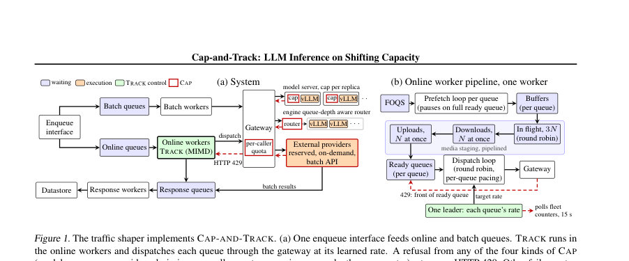
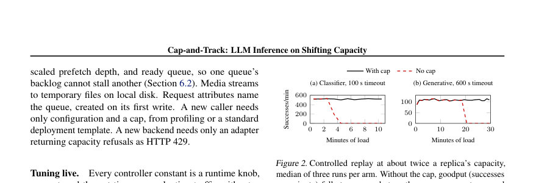
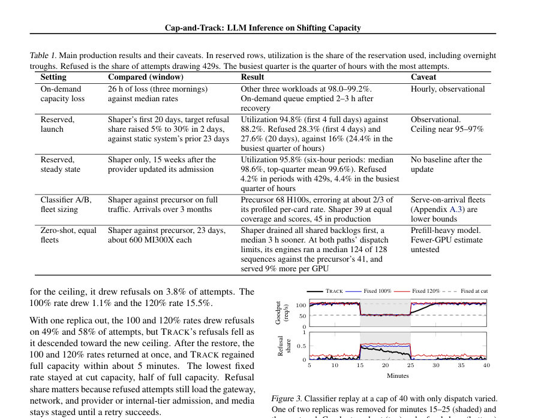

# Cap-and-Track: Optimizing LLM Inference Request Dispatch Across Shifting Capacity

- **게시일:** 2026-11-19
- **arXiv:** [2611.24891v1](http://arxiv.org/abs/2611.24891v1) · [PDF](https://arxiv.org/pdf/2611.24891v1)
- **저자:** Benjamin Novotny, Doug Szeto, Chang Wang, Shicheng Chen, George Zhihua Yuan, Bob Kamma, Michael Ge, John Xin Zhou, Andrea Olgiati
- **분야:** cs.LG
- **선정 점수:** 5.37
- **선정 이유:** 최근성 1.3, 인용 영향 0.0 (인용 0회), 저자 영향 0.0 (최고 h-index 0), AI 주제 적합성 2.7, 개발자 관심 0.2, 학술 신호 0.3, 오픈 웨이트·주요 연구조직 신호 0.8

[← 2026-11-19 목록으로 돌아가기](../daily/2026-11-19.html)

<!-- paper-visuals:start -->
## 주요 Figure

> 원문 PDF에서 실제 Figure 캡션과 그림 영역이 함께 확인된 자료만 자동 추출했다.

*Figure · 원문 PDF 4쪽 · Figure 1. The traffic shaper implements CAP-AND-TRACK. (a) One enqueue interface feeds online and batch queues. TRACK runs in*

*Figure · 원문 PDF 6쪽 · Figure 2. Controlled replay at about twice a replica’s capacity,*

*Figure · 원문 PDF 7쪽 · Figure 3. Classifier replay at a cap of 40 with only dispatch varied.*

<!-- paper-visuals:end -->

## 한 문장 요약

생성형 요청 길이와 공급(레플리카·프로바이더) 용량이 변하는 환경에서, 리소스가 포화될 때 빠르게 거부(CAP)를 발생시키고 그 거부율만으로 디스패치 속도를 적응적으로 조정(TRACK)해 대기·실행을 분리하고 전체 좋은 처리량(goodput)을 유지하는 운영형 LLM 지향 비동기 인퍼런스 조정 설계와 대규모 배포 결과를 제시한다.

## 해결하려는 문제

기존의 고정 디스패치율 또는 엔진 내부에 긴 큐를 허용하는 방식은 (1) 생성형 모델의 출력 길이를 입장 시 알 수 없어 토큰 기반 한계로 보호하기 어렵고, (2) 프로바이더 풀의 용량 감소·프리엠션·플릿 리사이즈처럼 공급이 변할 때 고정율은 용량을 따라가지 못해 과부하(타임아웃·재시도 폭주) 또는 유휴(낭비된 가속기)에 빠진다. 또한 엔진 내부에 대량의 대기작업이 있으면 연결·메모리·타임아웃 문제로 실패가 장기화되며, 통계적 예측(출력 길이 예측 등)으로는 실시간 변동을 따라잡기 어렵다. 연구 질문은 “거부(HTTP 429)라는 실패 신호만으로 어떻게 디스패치율을 안전하고 효율적으로 추종(follow)하여 공급 변화에 적응할 수 있는가”이다.

## 핵심 기여

- CAP-AND-TRACK 설계: (i) 포화 자원에서의 fail-fast 거부(CAP), (ii) 거부율만을 이용해 상승·후퇴하는 TRACK 디스패처, (iii) 실행 외부의 내구 우선순위 큐(FOQS)를 조합해 대기와 실행을 분리한 전체 아키텍처를 제안하여 플릿을 평균적 부하에 맞춰 운영하게 함.
- 운영·엔지니어링 기법 정교화: 일관 해시 기반 워커 배치, 리더-폴링(15s) 방식의 단일 컨트롤러, 동결(hysteresis)과 페이싱, 라운드로빈 서비스, 로컬 재시도·미디어 스테이징 등 TRACK 규칙을 안정적으로 대규모에 적용한 구현 세부를 제시.
- 실제 증거 제공: 제어된 실험(리플레이, 에뮬레이터)과 대규모 실전 배포(동시 동일 트래픽 A/B 테스트 두 건 포함)를 통해 CAP의 필요성과 TRACK의 성능·적응성을 정량적으로 보고.
- 운영 교훈과 실무 권장안 공개: 엔진 큐 제한·거부만으로 추적·조정할 것, 디스패치 상태 유지, 배치·타임아웃·큐 깊이 동시 조정, 플릿은 신선도(freshness) 기준으로 사이즈 결정 등 실무적 지침을 정리함.

## 접근 방법

* 아키텍처 요약: 생산 시스템은 프로듀서가 FOQS(내구 우선순위 큐)에 작업을 넣으면 여러 워커가 큐에서 리스(lease)해 게이트웨이와 모델 서버(내부) 또는 외부 프로바이더로 디스패치한다.
* CAP(거부)는 포화 자원(모델서버의 per-replica cap, 프로바이더의 HTTP 429, 게이트웨이의 토큰 쿼터, 또는 큐-깊이 기반 라우터)이 즉시 HTTP 429를 반환하는 메커니즘이다.
* CAP는 엔진 내부에 긴 큐가 쌓이는 것을 막고 초과 작업을 외부(FOQS)에 남겨 둔다.
* TRACK 알고리즘: 용량 도메인(제공자 토큰 도메인·서빙 풀)마다 리더가 15초 간격으로 각 큐의 전역 성공·429·실패 카운트를 집계해 거부 비율(refusal share)을 계산한다.
* 목표 거부율 미만이면 비율을 +3%로 승압하고(최소 0.1/s 기준), 목표 초과 시 세 단계의 감쇄 계수(≤50%: ×0.99, 50–65%: ×0.85, >65%: ×0.5)를 적용하는 MIMD형 승증·승감(곱셈) 규칙을 사용한다.
* 구현 세부: 각 큐는 소비율에 따라 충분한 워커에만 배치(일관 해시), 리더는 워커 카운트 변경 시 동결(hysteresis)해 불필요한 감쇄를 방지, 거부된 요청은 워커의 ready queue 앞쪽으로 즉시 복귀해 미디어 재스테이징 비용을 줄임, 우선순위에 따라 고우선 작업 우선 소모.
* 턴키 규정: 엔진 캡은 배치 크기 근처(예: max_num_seqs=128, 서버 캡 140)로 약간 오버서브스크립션하여 배치가 빈 상태를 줄이도록 설정.

## 주요 결과

- CAP의 효과(리플레이): 모델서버의 per-replica cap이 없으면(큐가 엔진 내부에 쌓이면) 리플레이 실험에서 goodput가 몇 분 내 0으로 붕괴했다(그림 2). CAP(거부) 적용 시 goodput이 안정 유지되었음.
- TRACK vs 고정율(리플레이·실 엔진): 실 엔진 리플레이에서 TRACK은 호스트당 평균 108.5 req/s를 기록해 고정 100%(107.0) 및 120%(109.5)율과 비슷한 처리량을 달성했고(표 C1), TRACK은 고정 120%보다 훨씬 적은 거부 비율(예: TRACK 거부율 ~0.04–0.05 refused/completion vs 고정 120%는 0.18–0.19 등 표 C1 수치 참조)을 보임.
- 동적 용량 적응(프로덕션·온디맨드 손실): 온디맨드 풀의 대규모 용량 손실 동안 TRACK은 별도 재구성 없이도 거부(429)를 감지해 디스패치율을 낮추었고, 공급 복구 후 2–3시간 내 큐를 비우며 복구(그림 4).
- 대규모 생산 A/B: 동일 트래픽 A/B에서 분산형 CAP+TRACK(샤퍼)는 분절적 고정율 전신(precursor)에 비해 분류기(classifier)를 43% 적은 H100(샤퍼 39 vs 전신 68)으로 서빙했고(커버리지·스코어 동등), 동일 규모의 zero-shot 플릿들에서는 샤퍼가 공유 백로그를 중앙에서 먼저(중앙값 3시간 빨리) 배출함.
- 예약 용량 이용률: 프로바이더의 admission 업데이트 이후 샤퍼는 15주 동안 예약 용량의 평균 95.8%를 사용했고(백로그가 있던 주는 99.1%), 초기 정적 시스템 대비 런칭 초기에 사용되지 않는 예약 용량이 절반 이상 감소(정적 88.2% vs 샤퍼 첫 4일 94.8%) 등 관찰 결과가 보고됨.

## 한계

- 저자 명시 한계(논문 본문): 재생(replay)과 두 건의 same-traffic A/B를 제외한 많은 프로덕션 결과는 관찰적(observational)이며 인과 검증이 제한적이다.
- 저자 명시 기술적 범위 제한: (1) 테스트된 실엔진 리플레이의 request shape는 주로 classifier 형태였고(리얼 엔진 TRACK 테스트베드), 생성형 워크로드는 주로 프로덕션 관찰로 평가되었음, (2) 대화형/세션형(인터랙티브·agent-session) 트래픽에는 적용·평가하지 않았음.
- 구현·운영 제약(본문에서 합리적으로 확인 가능): CAP-AND-TRACK는 “대기가 허용되는(work can wait)” 작업과 즉시 거부(HTTP 429)를 제공하는 백엔드가 전제다. 즉 저지연 대화형 SLO에는 부적절할 수 있다. 또한 프로바이더의 admission은 불투명(opaque)하므로 TRACK은 429 신호에 의존하며 프로바이더 내부 정책 변화에는 관찰적 적응만 가능하다.
- 공유 도메인 컨트롤러 이슈: 에뮬레이터에서 서로 다른 TRACK 컨트롤러가 동일 용량 도메인을 공유하면 용량을 거의 균등 분할했으나(시뮬레이션), 이 경우의 상호작용·공정성 문제를 광범위하게 평가하진 않았음.

## 개발자 관점

- 엔진 내부 큐를 캡(발생하는 거부로 바꿈): 모델서버의 per-replica cap을 켜서 기다리는 작업을 즉시 429로 반환하도록 하라(예: max_num_seqs≈배치, 서버 캡 약간 오버서브스크립션).
- 엔진에 오래 기다리게 하지 말라: 실행 내부에 많은 작업이 쌓이면 연결·메모리·타임아웃 문제로 시스템 복구가 길어진다. 큐는 외부(내구 큐)로 내리고 엔진 내부 큐는 짧게 유지하라.
- 배치 크기·CAP·타임아웃을 함께 조정하라: 배치 증가만으로는 지연·타임아웃을 악화시킬 수 있으므로 waiting limit과 타임아웃을 같이 고려해야 한다(본문 예: 배치 320으로 늘리자 대기제한을 300→100으로 낮춰 타임아웃이 크게 줄어듦).
- 디스패처에 상태를 유지하라: 거부율을 추적하고 현재 목표 비율을 저장하는 상태가 필요하다. 무상태(job) 방식은 거부 기반 추종에 적합하지 않음.
- 거부(HTTP 429)만 피드백으로 사용하라: 타임아웃·네트워크 오류를 포함하면 잘못된 후퇴를 유발하므로 CAP의 라벨된 거부만 사용해 디스패치를 조정해야 한다(본문에서 네트워크 지연으로 인한 오탐 사례 보고).」「단일 리더·해시 배치·동결(hysteresis)으로 대규모 안정성 확보: 리더가 15s 폴링으로 집계·전파하고 워커 수 변경 시 동결(예: 10 폴)·일관 해시로 배치해 리더 교체·배포 중 과도 감쇄를 줄여라.」「로컬 재시도·미디어 스테이징으로 비용 절감: 거부된 요청은 같은 워커의 ready queue 앞에 남기고 미디어를 스테이지해 재시도 시 재전송·재스테이징 비용을 줄여라.」「운영 정책: TRACK 상수(목표 거부율, 증가폭 3%, 감쇄 단계 등)는 런타임 노브로 운영 중 실시간 튜닝 가능하게 하고, 플릿 크기는 신선도(freshness) 목표와 우선순위에 기반해 결정하라 — 더 작은 플릿은 비용 절감 가능하지만 낮은 우선순위 작업의 대기 시간이 늘어남.

**근거 범위:** 이 분석은 제공된 논문 PDF 본문 전체(본문, 부록, 표·그림)에 근거해 작성되었다. 본문에서 직접 명시된 수치(예: A/B 결과의 H100 수, 예약 용량 이용률, 리플레이와 표 C1의 per-host goodput·refusal 수치, 처리·복구 시간 등)를 인용했다. 관찰적 비교(프로덕션 런)의 인과성 한계와 프로바이더 내부 정책의 불투명성 등은 본문에서 저자가 명시한 대로 보고했으며, 논문에 명시되지 않은 내부 로그·설정의 추가 상세(예: 일부 구현의 내부 파라미터 값, 프로바이더 측 세부 정책 포인트)는 재구성하지 않았다.
