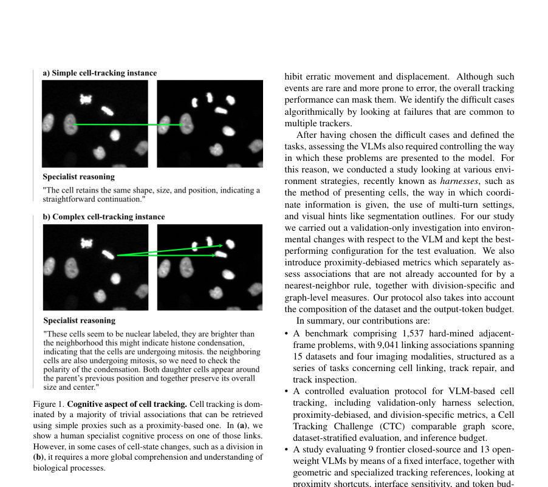
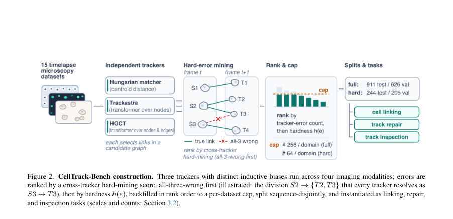
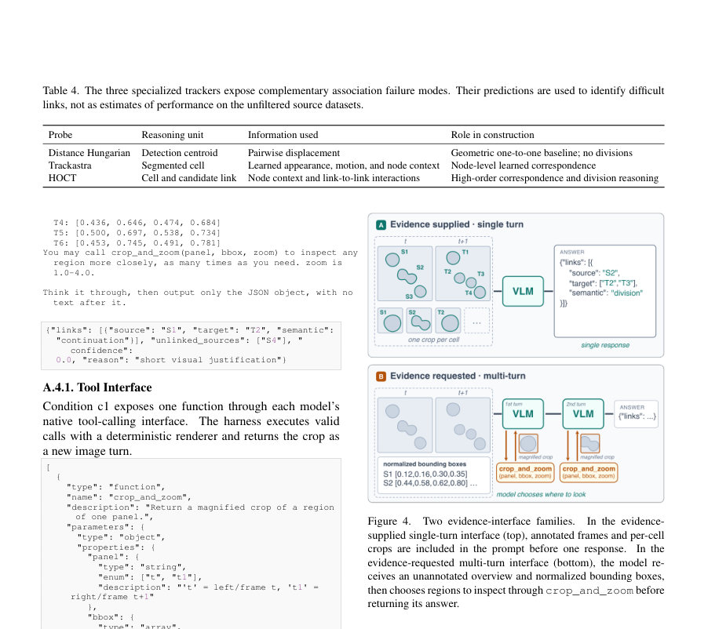

# CellTrack-Bench: Microscopic Cell Tracking Benchmark for Vision-Language Models

- **게시일:** 2026-10-25
- **arXiv:** [2610.31566v1](http://arxiv.org/abs/2610.31566v1) · [PDF](https://arxiv.org/pdf/2610.31566v1)
- **저자:** Ilan Theodoro, Jordão Bragantini, Loïc A. Royer
- **분야:** cs.CV
- **선정 점수:** 4.78
- **선정 이유:** 최근성 0.5, 인용 영향 0.0 (인용 0회), 저자 영향 0.0 (최고 h-index 0), AI 주제 적합성 1.7, 개발자 관심 0.2, 학술 신호 0.8, 오픈 웨이트·주요 연구조직 신호 1.6

[← 2026-10-25 목록으로 돌아가기](../daily/2026-10-25.html)

<!-- paper-visuals:start -->
## 주요 Figure

> 원문 PDF에서 실제 Figure 캡션과 그림 영역이 함께 확인된 자료만 자동 추출했다.

*Figure · 원문 PDF 2쪽 · Figure 1. Cognitive aspect of cell tracking. Cell tracking is dom-*

*Figure · 원문 PDF 3쪽 · Figure 2. CellTrack-Bench construction. Three trackers with distinct inductive biases run across four imaging modalities; errors are*

*Figure · 원문 PDF 12쪽 · Figure 4. Two evidence-interface families.*

<!-- paper-visuals:end -->

## 한 문장 요약

세포 추적의 인지적 어려운 사례(인접 프레임의 링크식별·수정·검사)를 VLM이 해결할 수 있는지 평가하기 위해 15개 데이터셋에서 '전문 추적기들이 공통으로 실패한' 어려운 링크를 채굴해 CellTrack-Bench라는 하드-미닝 벤치마크(1,537문제, 9,041 링크)를 만들고, 고정된 인터페이스(harness)·토큰 예산·근접 편향 제거 지표 등을 사용해 22종(폐쇄·오픈) VLM을 비교·분석했다.

## 해결하려는 문제

기존의 세포 추적 알고리즘(특히 tracking-by-detection 기반)은 위치 기반 근접성에 크게 의존해 대부분의 평이한 연속 연결은 잘 처리하지만, 세포 분열·형태변화·급격한 이동 등 '인지적' 판단이 요구되는 희귀한 어려운 경우에서 실수를 반복한다. VLM이 이러한 인지적 보정(오류 식별·수정·우선순위화) 역할을 수행할 수 있는지, 그리고 일반 목적 VLM이 전문 추적기들과 비교해 실제로 유용한지(근접성 숏컷에 의존하지 않는지)를 평가할 필요가 있다.

## 핵심 기여

- 15개 소스(CTC 10개 + 5개 박테리아), 4개 영상 모달리티에 걸쳐 1,537개의 '하드-마이닝' 인접-프레임 문제와 총 9,041 링크 어노테이션으로 구성된 CellTrack-Bench 구축 (hard subset은 서로 다른 3개 추적기(Hungarian distance, Trackastra, HOCT)의 공통 실패를 기준으로 선정).
- VLM 평가를 위한 통제된 프로토콜 제안: 3개 작업(링크링, 트랙 수리, 트랙 검사), sequence-disjoint 분할, 근접성 편향을 제거하는 NN-Residual F1 및 분열 전용 F1, CTC 유사 그래프 편집 기반 Subgraph-LNK 지표, 고정된 하니스(harness) 선택 절차(검증 전용) 및 고정 토큰 예산(총 8192토큰, 답변용 2048 예약).
- 입력·도구 표준화(harness) 설계·비교: 8개 evidence 조건(좌표 기반·이미지 기반·도구 사용 등)을 검증에서 실험해 c1(개요 + 정규화 바운딩박스 + 모델 요청형 crop_and_zoom 도구)를 최종 고정함.
- 9개 폐쇄형·13개 오픈형 VLM(예: GPT-5.6 변형들, Claude 계열, Gemma 4 등)을 동일 고정 인터페이스로 벤치마크하고 실패 모드(근접성 숏컷 의존, 분열 처리 부진, 편향된 플래깅 등)를 상세 분석.
- 재현성 파이프라인·모델 출력 저장물 공개: 원저장소를 통해 원본 데이터셋에서 벤치마크를 재생성하는 파이프라인과 저장된 모델 출력·추적기 출력 제공(단, 원 데이터셋·어노테이션 자체는 라이선스로 재배포 불가).

## 접근 방법

* 벤치마크 구성 및 평가 방식(본문 기준):
* 데이터 선택·분할: 15개 소스 데이터(CTC 10 + bacterial 5)에서 시퀀스 단위로 검증/테스트를 시퀀스-비중첩으로 분할(CTC: seq01=val, seq02=test; bacterial은 id로 분할).
* 하드-마이닝: 후보 인접-프레임 링크(약 1.5M 후보)에서 세 가지 상이한 인덕티브 바이어스 추적기(Hungarian 거리 기반 1:1 배정; Trackastra(트랜스포머 기반 연관 예측); HOCT(고차 상호작용 모델))의 공통 실패(q(e)=공통 실패 개수)를 주요 '어려움' 신호로 사용.
* 학습 추적기들은 3-폴드로 서로 보지 못하게 훈련/평가해 채굴 시 도메인 누수를 방지.
* 문제 단위: 각 벤치마크 항목은 '작은 이웃(항상 5개 source 셀)'과 그 다음 프레임의 후보 타깃들로 구성.
* 세 작업 정의: (i) cell linking: 모델이 직접 모든 올바른 연결을 예측, (ii) track repair: 알고리즘 추적기의 제안 그래프에 대해 추가/삭제/의미(continuation/division) 수정을 예측, (iii) track inspection: 검토가 필요한 tracker 결정(소스 단위 플래그)을 반환하여 인간-검토 우선순위화.
* 하니스와 도구: 8개 증거 제시 방식 실험(좌표 기반 바운딩 박스, 세그멘테이션 아웃라인, 사전 제공 crops vs 모델 요청 crop_and_zoom 도구, 단일/멀티턴 등).
* 검증에서 성능 최적 조건(c1)을 고정하고, 테스트는 이 고정 하니스로 수행.
* 측정지표: item 수준의 F1(소스,타깃,semantic 튜플)으로 Overall F1; NN-Residual F1(최근접-중심 규칙으로 설명될 수 없는 링크만 샘플링하여 F1 계산)으로 근접성 숏컷 저항성 측정; Division F1(분열 링크 전용); Subgraph-LNK(CTC의 그래프-에디트 비용을 로컬 이웃으로 적용한 스코어)로 그래프 수준 영향 평가.
* 평가 실행: 모든 모델을 동일한 c1 하니스·토큰 예산(8192 총, 2048 답변 예약), 동일 파서·스코어러로 단일(저장된) 완성(completion) 수집.
* 하드 검증(205 이웃)으로 하니스 선택 후, 하드 테스트(244 이웃)에서 최종 순위 집계.

## 주요 결과

- 벤치마크 규모: 전체 재현된 벤치마크는 1,537 neighborhood 문제와 9,041 링크 어노테이션(하드 테스트는 244 항목, 1,220 소스, 3,200 타깃, 1,426 링크 등).
- 하드-마이닝 통계: 세 추적기가 모두 실패한 링크는 후보 약 1.5M 중 4,222개(0.28%); 독립 가정 하 기대치는 약 33.2개(0.0022%)로, 관찰값이 훨씬 큼(추적기 오류가 독립이 아님을 경험적으로 보강).
- 하니스 선택: 검증에서 c1(개요 이미지 + 정규화 바운딩 박스 + crop_and_zoom 도구)가 평균 Primary F1 0.609로 다음 베스트 c8(0.547) 대비 유의하게 우수(95% 계층적 부트스트랩 CI = [0.005, 0.120])해 최종 고정됨. 요청된 출력 예산은 항목당 8,192 토큰(2,048은 최종 구조화 응답에 예약).
- 최상위 성능(폐쇄형 최고): GPT-5.6 (sol)은 Link F1 0.811, Repair F1 0.815, Inspect F1 0.631을 기록했으며, Subgraph-LNK 0.767(Nearest-centroid 대비 ∆NN +0.274)를 달성. 이 모델의 NN-residual F1는 0.723, Division F1는 0.787으로 근접성 숏컷을 넘는 성능을 보임.
- 오픈웨이트 최고·한계: Gemma 4 31B는 Link F1 0.641로 오픈웨이트 중 가장 높지만 Subgraph-LNK 0.484, NN-residual F1 0.149, Division F1 0.103으로 근접성 의존이 강함(즉, 총 F1은 높더라도 어려운 사례에서는 취약). 전반적으로 모든 오픈웨이트 모델은 NN-기반 바닥값을 넘지 못하는 경우가 많음(많은 경우 ∆LNK 음수). 표에서 9개의 폐쇄형 모델 중 상위권이 NN 기준을 넘어서며, 다수 오픈형 모델은 수정을 적용하면 그래프 성능을 악화시키기도 함(리페어에서 음의 ∆LNK 발생). 예: 13개 오픈웨이트 중 6개는 그래프 개선 대신 악영향을 줌(본문).  
    (벤치마크 표·본문에 수치 분산 있음—본문에서 직접 언급된 주요 수치만 포함.)

## 한계

- 저자가 직접 밝힌 한계: 원본 CTC·박테리아 데이터셋 라이선스 때문에 벤치마크 항목 자체(이미지 및 어노테이션)를 재배포하지 못하며, 대신 벤치마크를 재생성하는 파이프라인과 저장된 모델 출력만 공개함(재현을 위해 원본 데이터 접근 필요).
- 저자가 직접 밝힌 한계: 벤치마크는 '로컬 인접 프레임'의 어려운 링크에 초점을 맞추어 전체 시퀀스 연속 추적(장기적 시간적 문맥)과는 다르며, 분할 검증(시퀀스-비중첩) 및 하드 미닝 절차 때문에 전체 시퀀스 성능과는 수치적으로 동일하지 않음(CTC의 전체 LNK와 완전히 동일하지 않음).
- 본문에서 확인되는 제한(분석적 추론): 벤치마크는 분할(segmentation)을 입력으로 가정하여 검출(detection) 오류는 평가하지 않음—따라서 실제 파이프라인에서의 end-to-end 성능(분할 실수 포함)은 별도로 검증 필요.
- 본문에서 확인되는 제한(분석적 추론): 하드-마이닝은 세 종류의 추적기 오류 공통 부분을 사용하므로 이들 추적기의 편향·약점을 반영한 샘플링이 될 수 있으며, 다른 유형의 어려움(예: 장기 가려짐, 희귀 세포종 등)은 과소표집될 수 있음.

## 개발자 관점

- 재현·데이터: 벤치마크 항목 자체는 재배포 불가(원본 라이선스). 재현하려면 논문 GitHub(파이프라인)에서 소스 데이터셋을 다운로드하고 벤치마크 생성 스크립트를 실행해야 함. 논문은 시퀀스-비중첩(split by sequence) 규칙·폴드 구성·K(하드/top-K) 값을 명확히 기술(검증용 K=64, 확장 K=256 등).
- 인터페이스·토큰 예산: 하니스(c1) 고정(개요 이미지 + 정규화 바운딩박스 + crop_and_zoom 도구). 각 항목에 대해 모델 출력 예산을 8,192 토큰으로 제한하고 2,048토큰을 구조화 응답에 예약함. 실제 배포 시에는 API 호출 비용·응답 길이·잘림(truncation) 위험(예: 일부 오픈 모델은 높은 비율로 응답이 잘림)을 고려해 예산을 조정해야 함.
- 안전성·검증: 일부 오픈모델은 '수리' 작업에서 그래프 성능을 악화시키므로(음의 ∆LNK) 자동 적용 전에 제안 편집을 시뮬레이션/검증하는 롤백·검증 단계 필요. Inspection(플래깅) 결과도 플래그 수에 따라 효용이 달라지므로(무분별한 플래깅은 예산 초과 시 비효율) 플래그 캘리브레이션 및 예산 기반 평가가 필수.
- 성능·비용 절충: 폐쇄형 최신 VLM(예: GPT-5.6 variants)은 어려운 사례에서 유의미한 개선을 보였지만 API 비용·지연·재현 가능성 측면에서 운영 비용이 큼. 대규모 오픈 모델은 근접성 숏컷에 의존하는 경향이 있어 추가 학습·파인튜닝 또는 도메인 특화 모듈 결합(예: 추적기+VLM 보정) 전략이 필요.
- 평가 재현 팁: Subgraph-LNK(로컬 AOGM 적응), NN-Residual F1, Division F1 같은 지표를 함께 보고해야 학습된 모델이 근접성 숏컷에 의존하는지 여부를 식별할 수 있음. 또한 하니스 선택은 검증 전용으로 고정해야 과적합을 피함.

**근거 범위:** 이 분석은 제공된 논문 PDF 본문(페이지 1–16, 부록 포함)에 근거해 작성함. 모든 정량적 수치(예: 문제·링크 수, 모델별 주요 성능 지표, 하드-마이닝 통계, 하니스 선택 근거, 토큰 예산 등)는 본문과 표에서 직접 확인 가능한 값만 포함함. 다만 표의 열 배치·캡션 해석 때문에 일부 표의 특정 열(여러 그래프·지표가 한 행에 나열된 경우) 레이아웃을 본문 문장과 교차 확인해 핵심 수치만 발췌했으며, 표의 세부 열 순서에 따른 오해 가능성이 있어 가장 명시적으로 본문에서 서술된 수치(예: GPT-5.6(sol)의 LNKsub=0.767, NN-residual=0.723, Division F1=0.787 등)를 우선 인용했음을 밝힘.
