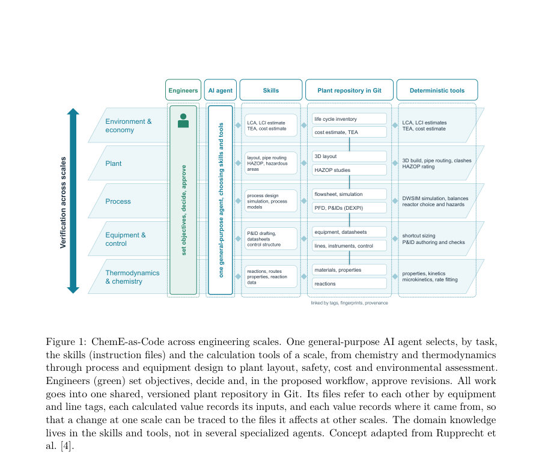
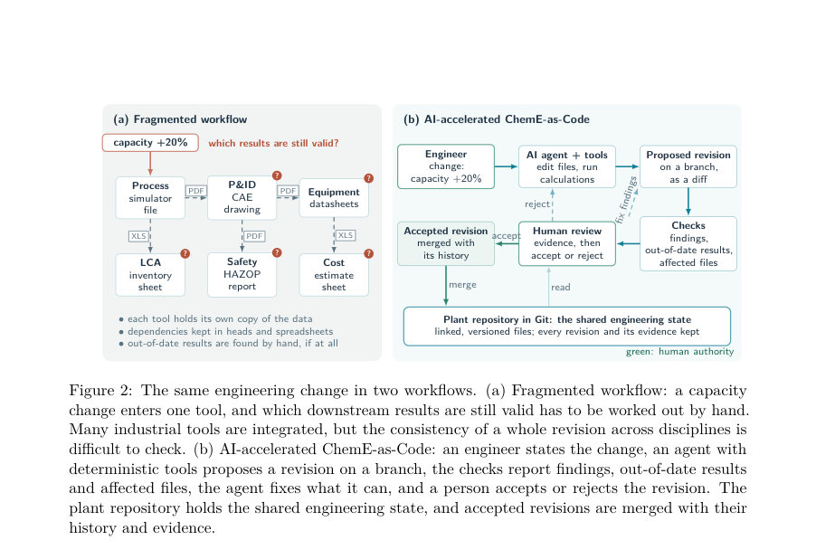
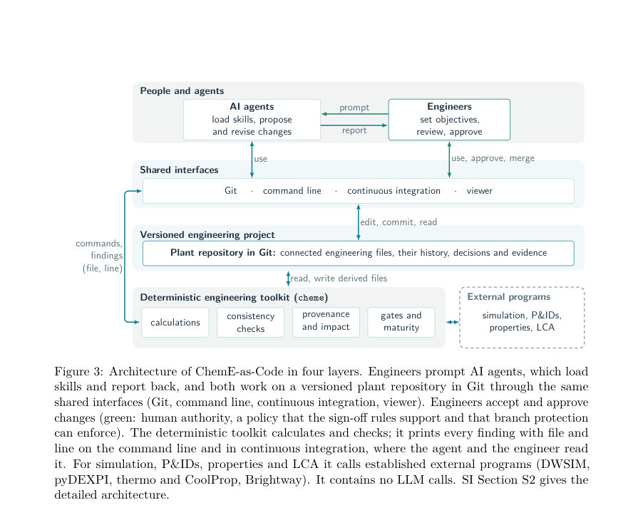

# ChemE-as-Code: An Open-Source Platform for Agentic AI in Chemical Engineering

- **게시일:** 2026-11-06
- **arXiv:** [2611.07947v1](http://arxiv.org/abs/2611.07947v1) · [PDF](https://arxiv.org/pdf/2611.07947v1)
- **저자:** Artur M. Schweidtmann
- **분야:** cs.AI
- **선정 점수:** 5.32
- **선정 이유:** 최근성 1.1, 인용 영향 0.0 (인용 0회), 저자 영향 0.0 (최고 h-index 0), AI 주제 적합성 3.0, 개발자 관심 0.9, 학술 신호 0.3, 오픈 웨이트·주요 연구조직 신호 0.0

[← 2026-11-06 목록으로 돌아가기](../daily/2026-11-06.html)

<!-- paper-visuals:start -->
## 주요 Figure

> 원문 PDF에서 실제 Figure 캡션과 그림 영역이 함께 확인된 자료만 자동 추출했다.

*Figure · 원문 PDF 3쪽 · Figure 1: ChemE-as-Code across engineering scales. One general-purpose AI agent selects, by task,*

*Figure · 원문 PDF 7쪽 · Figure 2: The same engineering change in two workflows. (a) Fragmented workflow: a capacity*

*Figure · 원문 PDF 9쪽 · Figure 3: Architecture of ChemE-as-Code in four layers. Engineers prompt AI agents, which load*

<!-- paper-visuals:end -->

## 한 문장 요약

ChemE-as-Code는 공장 전체를 하나의 Git 리포지토리로 표현하고, LLM 기반 에이전트가 외부의 결정론적 계산 도구와 '스킬' 파일을 사용해 설계를 생성·수정하며, 각 값의 출처와 검사 결과를 기록해 인간 검토자가 승인하도록 하는 오픈소스 플랫폼을 제안한다.

## 해결하려는 문제

화학공정 설계는 시뮬레이션, P&ID, 장비 데이터, 레이아웃, 안전·환경 평가 등 여러 결합된 문서에 의존하며 이들 간의 종속성이 명시적으로 기록되지 않아 변경이 다른 문서의 숫자와 일치하지 않게 만드는 경우가 빈번하다. AI 에이전트가 빠르게 제안·수정하면 사람의 검토가 병목이 되며, 기존 생성 모델들은 설계의 결정 근거를 함께 기록하지 못한다. 이에 대한 세 가지 연구 질문(RQ1~RQ3): (RQ1) 프로젝트를 에이전트와 사람이 편집 가능한 연결된 기계 판독 파일로 표현할 수 있는가, (RQ2) 자동화된 검사로 불일치·구버전 결과·영향 파일을 찾을 수 있는가 및 파생 파일을 재생성 가능한가, (RQ3) 범용 에이전트가 제시된 스킬·도구로 상호결합된 설계 업무를 수행할 수 있는가이다.

## 핵심 기여

- Chemical Engineering-as-Code 관점(엔지니어링 지식을 연결된 기계 판독 파일로 취급, 에이전트는 스킬을 불러 절차 수행)을 ‘다섯 가지 전환’으로 정리한 패러다임 제시
- 오픈소스 플랫폼 ChemE-as-Code 구현: 하나의 Git 리포지토리, cheme 툴킷(포맷팅·검증·렌더·생성), 스킬 파일 세트, 결정론적 계산 도구, 연속적 검증(체크) 시스템으로 구성
- 공정화학부터 공정·장비·배관·제어·레이아웃·HAZOP·TEA·LCA까지 범위를 포괄하는 도구와 109개 스킬 집합 제공(버전 1.1.0 기준)
- 각 계산값에 입력·도구 버전·증거를 기록하는 프로비넌스(fingerprint, provenance)와 466개 규칙 기반 체크로 파일·라인 단위의 불일치·구버전 표시 구현
- 천연가스 기반 암모니아 플랜트 사례(개념→기본엔지니어링 단계)를 통해 에이전트가 다분야 패키지(시뮬레이션, DEXPI P&ID, 레이아웃, HAZOP, 데이터시트, 릴리프, TEA, LCI)를 생성·수정함을 시연하고, 체크의 탐지 범위·한계 평가

## 접근 방법

* 플랫폼 아키텍처는 (1) 플랜트 전체를 하나의 Git 리포지토리(권위 파일과 파생 파일로 구분)로 유지하고, P&ID는 DEXPI 2.0.1로 저장하며 그 외 메타·구성은 YAML 파일과 버전화된 JSON Schema로 검증하는 방식, (2) 결정론적 계산 도구(DWSIM 시뮬레이터, pyDEXPI, thermo/CoolProp, Brightway 등과 플랫폼 자체의 밸런스·치수 산정·3D 라우팅·HAZOP 등)를 LLM 호출 없이 독립적으로 실행하여 수치 생성, (3) '스킬'은 작업 절차와 어느 도구를 호출할지, 어느 결정을 사람에게 맡길지 명시한 짧은 지시 파일로 에이전트가 로드해 사용, (4) 에이전트 작업 루프는 파일 편집→cheme fmt→cheme validate(466 규칙 기반 체크)→체크 결과(파일·라인·심각도·힌트)를 읽고 수정→CI에서 동일한 체크로 검증, (5) 파생 파일은 입력의 fingerprint와 생성 도구 버전을 기록하여 동일 입력·같은 도구 버전이면 바이트 단위 재생성 보장, (6) 단계별 게이트(조건 검사 집합)와 사람의 승인을 통한 sign-off를 제안된 워크플로우로 규정한다.

## 주요 결과

- 사례 결과: 천연가스 암모니아 플랜트(기본 설계)에서 에이전트가 수렴된 DWSIM 시뮬레이션, DEXPI P&ID 시트, 장비·라인·계측 리스트, 제어 루프·데이터시트, 라우팅된 3D 레이아웃, HAZOP(16 nodes, 67 deviations, 72 시나리오, 평가 항목 다수), 8개의 릴리프 케이스, AACE class 4 추정치, TEA, LCI 데이터셋 및 46개의 기록된 의사결정 등 다분야 패키지를 생성·수정함
- 체크·상태: 보고된 상태에서 0개의 에러와 268개의 경고, 개념 게이트 7개와 기본 게이트 13개 통과, 상세 게이트 5개 중 3개 통과, 계산 성숙도(calculation maturity)는 두 번째 단계인 'balanced'로 보고됨
- 플랫폼 구성 통계: 코어(버전 1.1.0) 약 143,000줄의 Python 코드와 약 3,000개의 테스트 함수, 109개의 스킬, 466개의 규칙이 구현됨
- API 비용·작업량: 개념+엔지니어링 총 63 세션에서 기록된 API 비용은 USD 255.31(공개 리포지토리 기록), 이 중 설계(디자인) 세션 56회에 기록된 비용은 USD 224(논문 본문 서술)임
- 검증·복원성: 파생 파일은 입력 fingerprint와 도구 버전을 기록하며 '같은 입력과 같은 도구 버전'으로 재생성하면 바이트 단위 동일 출력이 보장된다고 보고됨(논문 본문 및 SI 언급). 또한, 주입된 결함(fault injection) 및 설계 변경 실험에서 체크는 '규칙이 다루는 영역'을 찾아내지만 그 외는 놓침을 관찰함(예: 데이터시트와 플로우시트의 duty 불일치가 규칙으로 비교되지 않아 보고되지 않음).

## 한계

- 저자가 명시한 한계: 이번 사례는 워크플로우가 작동함을 보여주지만 설계의 품질이나 생산성 향상을 입증하지 못함(독립 엔지니어의 검토 없음).
- 저자가 명시한 한계: 체크와 게이트는 코드화된 규칙이 검토 가능한 범위만 검사하며 모든 엔지니어링 오류를 찾아내지 못하므로 인간 검토를 대체하지 못함.
- 본문에서 확인되는 한계: 불일치 탐지는 플랫폼이 기록한 명시적 종속성에만 의존하므로, 수작업으로 복사된 값이나 기록되지 않은 의존성은 탐지되지 않음(예시: 데이터시트의 열량과 플로우시트의 열량 불일치가 체크되지 않음).
- 본문에서 확인되는 한계: 파생 파일은 자동으로 재계산되거나 자동으로 무효화되어 수정되지 않으며 사람이 또는 에이전트가 명시적으로 재생성해야 함으로 자동 적응성에 한계가 있음(자동 수정 없음). 또한 사례에서 일부 계산은 대체 열역학 모델(Peng–Robinson)을 사용했고, 그 결과 해당 혼합물이 벤치마크된 범위를 벗어난 것으로 표기되는 등 도구·방법 선택의 한계가 존재함(본문 사례 언급).

## 개발자 관점

- 엔지니어링 프로젝트를 하나의 Git 리포지토리로 관리하면 원자적 리비전·이력 관리가 가능하므로 설계 변경 추적과 롤백이 쉬워짐(단, Git은 의미적 병합을 모르므로 체크가 필요).
- 파일 표현: P&ID는 DEXPI 2.0.1, 나머지는 YAML + 버전화된 JSON Schema를 사용해 스키마 수준에서 자동 검증하면 잘못된 타입·단위·누락 필드를 초기에 잡을 수 있음.
- 에이전트 설계: 절차는 '스킬' 파일(버전 관리 가능한 런북)로 두고, 숫자 계산은 결정론적 도구에서 수행해 결과의 출처·버전·입력 fingerprint를 기록하면 재현성과 감사가 확보됨.
- 검증·CI: 각 규칙을 체크로 구현(논문에서는 466개 규칙)하고 체크 결과를 파일·라인 단위로 출력해 에이전트와 사람이 동일한 정보를 보게 하면 에이전트가 실패한 테스트를 다루는 소프트웨어 개발자 흐름과 유사하게 동작시킬 수 있음.
- 운영·안전: 인간의 승인(sign-off)은 플랫폼에서 필수적이며, 브랜치 프로텍션과 게이트를 통해 자동 병합을 차단하고 책임 있는 엔지니어의 승인을 요구해야 함(사례에서는 오히려 리뷰어 에이전트가 수락해 독립적 검토가 없었음). 또한 체크로 커버되지 않는 안전 이슈는 HAZOP 팀 등 사람의 재검토가 필요함을 명시적으로 유지해야 함(저자 권고).

**근거 범위:** 이 분석은 제공된 논문 PDF 본문에서 직접 추출한 텍스트를 근거로 작성되었음. 본문과 보조로 인용된 SI(부속자료)의 일부 상세 구현·수치(예: SI에만 있는 검사 목록, 도구별 내부 구현)는 제공 PDF에 일부만 포함되어 있어 완전 검증이 어려울 수 있다. 비용/토큰/에너지 추정 등은 논문 본문이 보고한 수치 및 저자의 추정치를 그대로 기술했으며, 외부 검증은 수행하지 않았음을 밝힌다.
