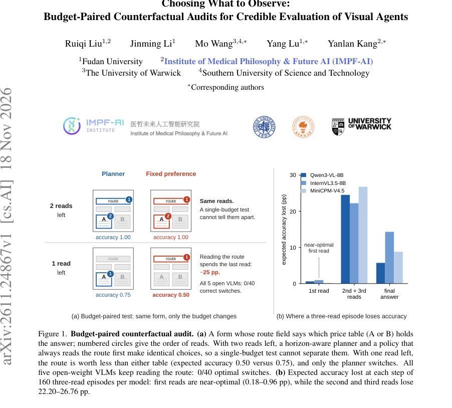
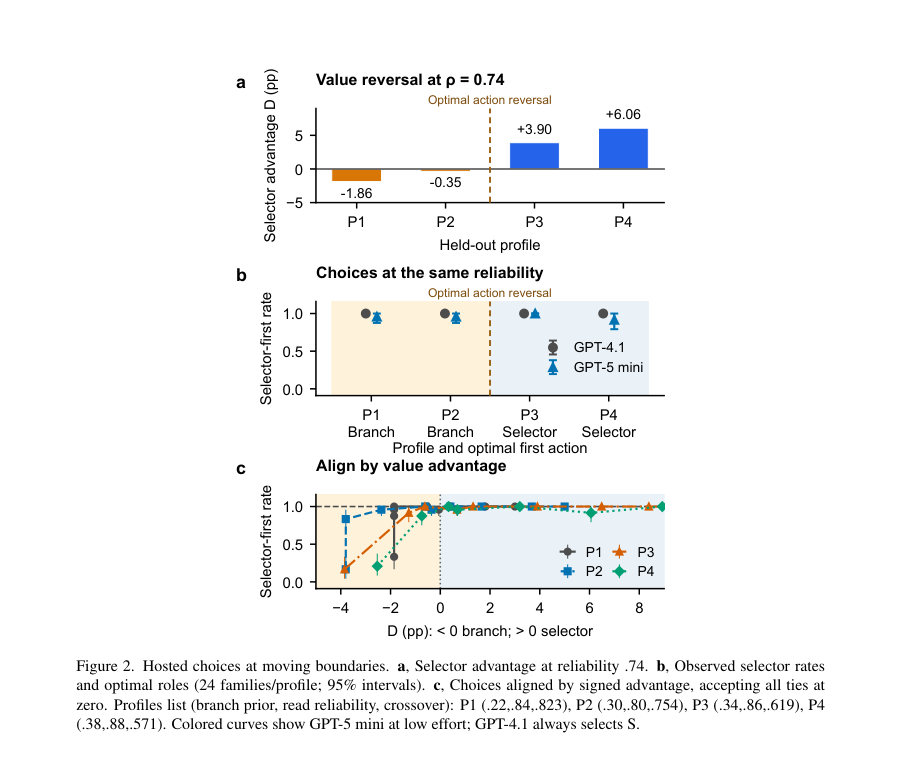
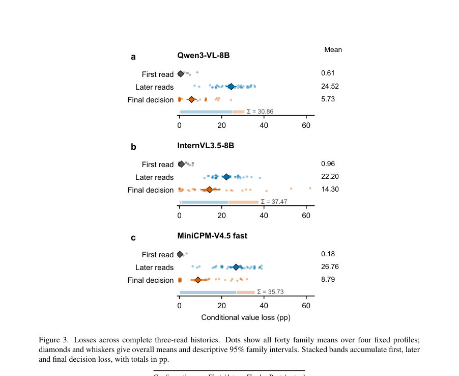

# Choosing What to Observe: Budget-Paired Counterfactual Audits for Credible Evaluation of Visual Agents

- **게시일:** 2026-11-19
- **arXiv:** [2611.24867v1](http://arxiv.org/abs/2611.24867v1) · [PDF](https://arxiv.org/pdf/2611.24867v1)
- **저자:** Ruiqi Liu, Jinming Li, Mo Wang, Yang Lu, Yanlan Kang
- **분야:** cs.AI
- **선정 점수:** 5.56
- **선정 이유:** 최근성 1.3, 인용 영향 0.0 (인용 0회), 저자 영향 0.0 (최고 h-index 0), AI 주제 적합성 2.2, 개발자 관심 0.2, 학술 신호 0.2, 오픈 웨이트·주요 연구조직 신호 1.6

[← 2026-11-19 목록으로 돌아가기](../daily/2026-11-19.html)

<!-- paper-visuals:start -->
## 주요 Figure

> 원문 PDF에서 실제 Figure 캡션과 그림 영역이 함께 확인된 자료만 자동 추출했다.

*Figure · 원문 PDF 1쪽 · Figure 1. Budget-paired counterfactual audit. (a) A form whose route field says which price table (A or B) holds*

*Figure · 원문 PDF 8쪽 · Figure 2. Hosted choices at moving boundaries. a, Selector advantage at reliability .74. b, Observed selector rates*

*Figure · 원문 PDF 9쪽 · Figure 3. Losses across complete three-read histories. Dots show all forty family means over four fixed profiles;*

<!-- paper-visuals:end -->

## 한 문장 요약

공개 증거와 지역 바인딩을 고정한 채 남은 관찰 예산 또는 과제 값 경계만 바꾼 예산-쌍대(counterfactual) 감사와 정확한 유한-호라이즌 연속값 회계를 도입해, 시각 에이전트의 관찰(읽기) 계획성과 최종 의사결정 손실을 분해·정량화한다.

## 해결하려는 문제

저해상도 개요에서 제한된 고해상도 크롭(읽기) 예산을 분배해야 하는 시각 에이전트의 경우, 단일 예산 조건에서의 정답 정확도는 '어디를 보는가', '남은 읽기에 어떻게 적응하는가', '관찰 종료 후 어떻게 답하는가'라는 세 요인을 섞어버려 정책의 실제 계획(호라이즌 인식) 여부를 판별할 수 없다. 이로 인해 고정된 역할(예: 항상 selector 먼저 읽기)과 예산에 민감한 플래너를 구별할 수 없고, 전체 롤아웃에서 손실이 어느 단계에서 발생했는지 측정하기 어렵다.

## 핵심 기여

- 공개 증거와 지역 바인딩을 동일하게 유지하면서 오직 남은 예산(또는 선언된 과제 값 경계)만 변경하는 예산-페어드(counterfactual)·값-페어드 테스트 설계로 호라이즌(remaining-budget) 민감성 검사 가능하게 제시함.
- 유한-호라이즌 상태에서 각 합법적 관찰의 정확한 연속값(Vb, Qb)을 계산하고, 성능 차등 항등식(정식화된 회계)을 사용해 기대 정확도 손실을 각 관찰 단계(획득 손실 δ)와 최종 결정 손실(η)으로 분해하는 정확한 궤적 반환(return) 회계법 제시.
- 제어된 결정(40개 페어드 라우팅 앵커), 3-읽기 계층, 및 자연 스캔 문서(FUNSD)에서의 실험적 감사로, 다수의 공개 가중 VLM들이 예산 변화에 적응하지 못하고(예: 5개 오픈 모델 모두 40/40에서 최적 전환을 하지 않음) 실제 손실이 주로 이후 읽기(라우팅 단계)에 집중됨을 보여줌.

## 접근 방법

* 논문은 유한-호라이즌 믿음상태(framework)와 선언적 태스크 모델을 사용한다.
* 공개 문맥 C(질문·규칙·개요·검증된 바인딩)와 장면 사전 πC, 읽기 채널 MC를 가정하고 잠재 장면 X와 이로부터 결정되는 이진 정답 Y = f(X)를 정의한다.
* 관찰 히스토리 Ht = ((Ai, Zi))i<t 에 대해 후방확률 pH = Pr(Y=1 \| C, H)를 쓰고, V0(H) = max(pH, 1−pH), Qb(H,a) = E[Vb−1(H ⊕ (a,Z)) \| C,H,a], Vb(H)=maxa Qb(H,a)로 최적 연속값을 정의한다.
* 획득 기회 손실 δb(H,a)=Vb(H)−Qb(H,a)와 최종 결정 손실 η(H,ŷ)=V0(H)−Pr(Y=ŷ \| C,H)를 도입한다.
* 페어드 테스트는 동일한 바인딩·공개 증거 하에서 b=2와 b=1 등 예산만 바꾼 상태(예: 공정(fair) 앵커)를 설계해 고정-셀렉터 정책과 호라이즌-민감 플래너를 분리한다.
* 전체 롤아웃 회계는 등식 VB(H0) − Jµ = Eµ,MC[∑t δB−t(Ht,At) + η(HB,ˆY)] (Eq. 9)를 사용해 각 단계 손실과 최종 손실을 합산한다(Algorithm 1).
* 실험에서는 다섯 오픈 가중 VLM(Qwen3-VL-4B/8B/32B, InternVL3.5-8B, MiniCPM-V4.5 fast)과 호스티드 GPT-4.1·GPT-5 mini를 평가하고(입력: 검증된 바인딩을 포함한 구조화 텍스트 상태, BF16, temperature=0, JSON prefix-tree 디코더 등), 제어된 패널(40 families × 여러 프로파일·신뢰도), 3-읽기 계층(8-영역)과 FUNSD 기반 자연 문서 패널을 실행하여 획득/종단 요청을 수집·분석한다.
* 불법 출력은 miss로 처리하고 묶음(가족) 단위 부트스트랩으로 신뢰구간을 산출한다.

## 주요 결과

- 40개 페어드 라우팅 앵커에서 평가한 다섯 공개 가중 VLM은 모두 40/40에서 최적의 branch→selector 전환을 수행하지 못했음(즉 0/40 최적 전환). 앵커 상태에서의 평균 손실(anchor loss)은 모델별로 12.50–15.62 percentage points(pp)인 반면, 비-앵커 상태 평균 손실은 0.59–0.85 pp로 낮아 표면 평균이 큰 앵커 손실을 가릴 수 있음을 보임 (본문·Table 3).
- 3-읽기 계층(160 에피소드/체크포인트)에서 첫 읽기 손실은 0.18–0.96 pp로 거의 최적에 근접했으나, 두 번째와 세 번째 읽기에서의 손실 합은 22.20–26.76 pp로 대다수 손실이 이후 읽기에서 발생함(또한 최종 결정 손실은 추가로 5.73–14.30 pp; 실현 정확도 범위 53.75%–57.50%) (Fig. 3, Table 5).
- 호스티드 모델은 예산 적응 가능성을 보여줌: GPT-5 mini는 이미지+맵 입력에서 48/48 최적 전환을 달성했으며(map-only도 47/48), GPT-4.1은 map-only에서 44/48 전환을 달성하는 등 호라이즌 인식 행동은 달성 가능함(본문).
- FUNSD 자연 문서 패널에서 Qwen3-VL-8B의 한-크롭(selection) 성능 이득은 '큐레이션된(reference revised)' 스코어링에서 24.44 pp[8.89,41.11]였으나 원본 레퍼런스 스코어링으로는 10.56 pp[−0.56,24.44]로 유의하지 않은 결과로 떨어짐(스코어 정의에 민감). Qwen3-VL-8B의 두-크롭 파이프라인은 네이티브 전체 이미지 읽기 대비 70.0% vs 83.3%로 성능이 낮고 호출·토큰 비용은 더 큼(예: two-crop은 native보다 호출 수·토큰 사용량이 대체로 증가; Table A38).
- 상세 운영 계측: 예컨대 Qwen3-VL-8B의 한-크롭 파이프라인은 페이지당 평균 호출 2회·입력 토큰 901.2·디코드된 입력 면적 0.561 Mpixel인 반면 네이티브는 호출 1회·입력 토큰 824.8·0.766 Mpixel 등으로 파이프라인 설계에 따른 배포 비용 차이가 관찰됨.

## 한계

- 저자가 명시한 한계: 정확한 평가기는 선언된 사전(prior)과 읽기 채널, 검증된 바인딩, 짧은 고정 읽기 예산을 전제로 하며(따라서 오픈 씬에서는 학습된 관찰 모델이 필요함), 다섯 공개 모델이 Qwen 유래 언어 구성요소를 공유하고 명시적 추론 단계가 없는 제약된 디코딩을 사용하므로 다른 모델군·자유형 추론·학습된 비주얼 채널에 일반화가 검증되지 않음. 호스티드 모델 결과는 분리된 프로토콜·시점의 엔드포인트에서 얻었으므로 직접 비교가 아님. FUNSD 참조는 AI 보조로 큐레이션되었고 선행 학습 데이터에 포함되었을 가능성이 있음.
- 실험적·범위적 제약(본문에서 확인되는 한계): 제어된 태스크는 영역 수가 작고 이진 레이블·짧은 예산에 제한되어 있어 개방형 장면의 확장성·계산적 트랙터빌리티(정확한 열거 비용은 노드 수 증가) 문제가 있음. 정확한 연속값 산출은 작은 설정에서 가능하나 많은 후보 지역·연속값 분포를 갖는 실제 문제로의 확장은 학습된 값 추정기의 오차(논문은 2ϵ 규칙을 제시)가 성능 보증을 좌우함.
- 수리적/실행적: 일부 진단(예: 개발에서의 진단-양성 상태) 클래스가 세 모델에서 발견되지 않아 특정 수리적 수리(terminal repair)의 일반성 검증이 불완전함.

## 개발자 관점

- 평가 설계: 시각 관찰(읽기) 정책을 평가할 때는 동일한 공개 증거와 바인딩을 유지한 채 예산만 바꾼 페어드(counterfactual) 상태를 포함해 호라이즌 민감성을 직접 검사해야 고정-역할 휴리스틱과 계획적 정책을 구별할 수 있다.
- 회계·디버그: 각 관찰 히스토리에 대해 Qb,Vb를 계산하고 획득 손실 δ와 최종 손실 η로 분해하면 '어느 단계에서 가치가 손실되는지'를 정확히 귀착(credit)할 수 있어 정책 개선 지점(획득 vs 최종 해석)을 명확히 할 수 있다.
- 재현·구현: 제어된(영역이 작은) 문제에서는 전수 열거로 정확한 값을 얻을 수 있으나 후보 지역 수가 늘어나면 값 추정기(학습 모델)를 도입해야 하며, 추정 오차 ε가 있으면 2ε 이내에서 행동 우선순위 보장 및 최대 B 단계에서 최대 2Bε의 전체 손실 상한을 제공함(논문 근거).
- 배포·비용: 크롭 기반 파이프라인은 네이티브 전체 이미지 읽기와 비교해 호출(call) 수, 입력 토큰, 디코드 픽셀 면적 측면에서 비용이 크게 달라지므로 비교 시 '호출·토큰·픽셀'을 명시적으로 보고하고, 동일한 전체-이미지 기준과 매칭된 리더 비교를 제공해야 함.
- 스코어링 투명성과 안전성: 자연문서 평가는 참조(reference) 정의와 정규화(normalization)에 민감하므로 저장된(동일한) 모델 출력에 대해 여러 스코어링 정의를 비교·공개하고, 큐레이션이 모델 성능 결론에 미친 영향을 보고해야 함. 또한 단순한 '공개 상태(ledger) 재포맷'은 최종 결정 손실을 일반적으로 해결하지 못하므로 획득·추론 정책 자체를 개선해야 함.

**근거 범위:** 이 분석은 제공된 논문 PDF 본문을 근거로 작성되었으며 초록은 보조로만 사용했습니다. 본문에 제시된 수치(예: 0/40 전환, 12.50–15.62 pp 앵커 손실, 0.18–0.96 pp 첫 읽기 손실, 22.20–26.76 pp 후속 읽기 손실, FUNSD의 24.44→10.56 pp 스코어 변화 등)만 인용했습니다. 표 일부(예: Table 4의 형식)는 PDF 레이아웃에 따라 해석이 모호할 수 있어 본문 서술(텍스트)에서 직접 언급된 수치와 진술을 우선으로 반영했습니다.
