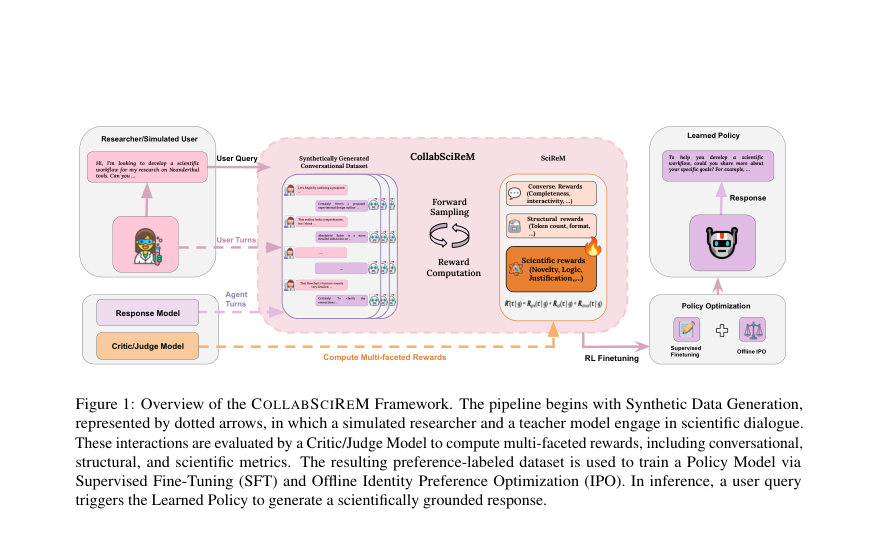
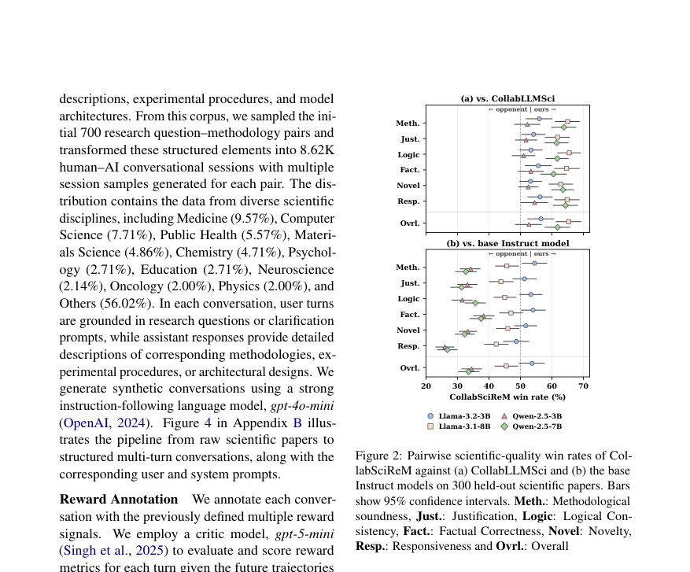
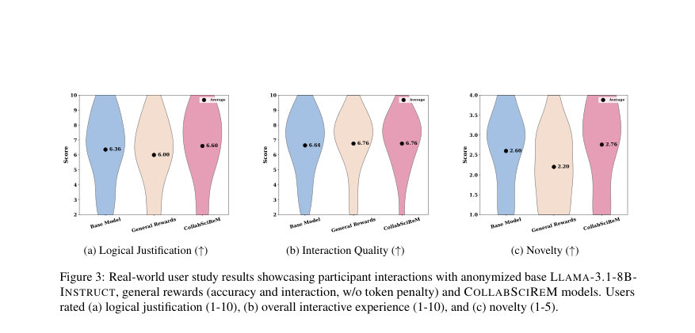

# CollabSciReM: Aligning Language Models for Scientific Conversations via Science-Aware Reward Decomposition

- **게시일:** 2026-10-21
- **arXiv:** [2610.27901v1](http://arxiv.org/abs/2610.27901v1) · [PDF](https://arxiv.org/pdf/2610.27901v1)
- **저자:** Sasi Kiran Gaddipati, Gollam Rabby, Sören Auer
- **분야:** cs.CL, cs.AI
- **선정 점수:** 6.73
- **선정 이유:** 최근성 1.1, 인용 영향 0.0 (인용 0회), 저자 영향 0.0 (최고 h-index 0), AI 주제 적합성 1.9, 개발자 관심 0.2, 학술 신호 1.0, 오픈 웨이트·주요 연구조직 신호 2.5

[← 2026-10-21 목록으로 돌아가기](../daily/2026-10-21.html)

<!-- paper-visuals:start -->
## 주요 Figure

> 원문 PDF에서 실제 Figure 캡션과 그림 영역이 함께 확인된 자료만 자동 추출했다.

*Figure · 원문 PDF 2쪽 · Figure 1: Overview of the COLLABSCIREM Framework. The pipeline begins with Synthetic Data Generation,*

*Figure · 원문 PDF 5쪽 · Figure 2: Pairwise scientific-quality win rates of Col-*

*Figure · 원문 PDF 8쪽 · Figure 3: Real-world user study results showcasing participant interactions with anonymized base LLAMA-3.1-8B-*

<!-- paper-visuals:end -->

## 한 문장 요약

과학적 대화에서 정확성·방법론적 타당성·간결성 사이의 균형을 맞추기 위해 대화 세션 보상을 대화 품질, 과학적 엄격성, 구조적 효율성으로 분해한 목표조건화 보상 프레임워크 CollabSciReM과 다차원 평가척도 SCIQUALITY를 제안하고 합성 대화 데이터로 LLAMA/QWEN 계열 모델을 보상별로 미세조정해 평가한 연구이다.

## 해결하려는 문제

기존의 정렬(alignement) 기법들은 개별 응답 수준이나 일반적 협업 보상에 초점을 맞추어 장기적 다중 턴 과학적 대화에서 요구되는 방법론적 타당성, 근거 제시, 논리적 일관성과 토큰 효율성을 동시에 달성하지 못한다. 일반 협업 보상은 응답을 압축하여 토큰 효율을 높이지만 과학적 엄밀성을 희생시키는 경향이 있으며, 단일턴 정확성 중심 벤치마크는 멀티턴 연구 대화의 연속성과 정당성을 평가하지 못한다.

## 핵심 기여

- CollabSciReM: 세션 보상을 대화 품질(Rgen), 과학적 엄격성(Rsci), 구조적 효율성(Rstruct)으로 분해한 목표조건화 세션 보상 프레임워크를 제안함.
- SCIQUALITY: 300편의 홀드아웃 논문 기반으로 다중 턴 연구 대화를 6개 차원(방법론적 타당성, 정당화, 논리적 일관성, 사실정확성, 신규성, 응답성)으로 비교평가하는 쌍별(LM-judge) 평가 체계를 도입함.
- 데이터·코드·모델 공개 및 합성 학습 데이터: 700개의 연구질문–방법론 쌍에서 생성한 8.62K 합성 멀티턴 과학 대화 코퍼스를 구축·공개함.
- 실험적 검증: 동일 데이터·학습절차에서 과학무관 일반 협업 보상(CollabLLMSci) 대비 CollabSciReM이 SCIQUALITY에서 선호도를 높이고(예: 응답 길이 동등 조건에서 65.3% 우위), 여러 멀티/싱글턴 벤치마크 및 사용자 전문가 연구에서 개선을 보였음을 보임.
- 보상 구성의 역할 규명: 각 보상 성분(Rsci, Rstruct, Rgen)의 제거·감소 실험(절제·민감도·ablation)을 통해 각 성분이 과학적 정확도·간결성·대화 품질에 기여함을 제시함.

## 접근 방법

* 문제설정은 목표조건(goal)-멀티턴 대화로, 상태는 대화 기록 sj=(u1,m1,...,uj)로 정의하고 목표조건화 정책 πθ로 응답 mj를 샘플링한다.
* 전체 세션 보상 R*(τ\|g)를 Rgen+Rsci+Rstruct로 분해하여 각 항은 다중 속성의 가중합으로 계산한다.
* Rgen은 Accuracy, Interactivity, Clarity, Completeness 등, Rsci는 Justification, Logical Flow, Novelty 등, Rstruct는 토큰 페널티(λ·\|τ\|tokens)와 포맷 준수로 구성된다.
* 합성 데이터 생성에는 gpt-4o-mini를 사용자/교사로 활용해 700 연구질문–방법론 쌍에서 8.62K 대화를 생성했고, 보상 스코어링(분류)은 gpt-5-mini 비평가(critic)를 사용해 각 토큰/턴에 대해 이산화된 점수({0,0.5,1}; 정확성은 {0,1})를 부여했다.
* 학습은 두 단계로 진행되어 우선 SFT(LoRA r=32, α=16, 4-bit NF4 정량화 등)로 지도학습을 수행한 뒤 오프라인 Identity Preference Optimization(IPO, β=0.2)으로 선호 최적화를 실시했다.
* 보상 기대치는 향후 4턴(최대 깊이 4)까지의 포워드 샘플링으로 근사한다.
* 평가판정자는 DeepSeek-V4-Pro(다른 모델 계열)를 사용하여 SCIQUALITY의 쌍별 판정을 수행했고, 추가로 MT-Bench-STEM, MINT, GPQA-D, MMLU-Valid, TheoremQA 등의 벤치마크와 전문가 블라인드 사용자 연구를 병행했다.
* 하드웨어는 4×NVIDIA H100(80GB)로 실험을 수행했다.

## 주요 결과

- 학습 데이터 및 설정을 고정한 비교에서 CollabSciReM은 CollabLLMSci 대비 SCIQUALITY에서 모든 네 모델(Llama-3.2-3B, Llama-3.1-8B, Qwen-2.5-3B, Qwen-2.5-7B)에서 선호되었고, 응답 길이를 맞춘 조건에서도 65.3%의 승률을 달성함(논문 본문 언급).
- 7B·8B 계열에서 CollabSciReM은 10개의 단일·멀티턴 벤치마크 설정 중 8곳에서 주 평가지표에서 CollabLLMSci를 능가했다고 보고함(본문).
- LLAMA-3.1-8B에서 GPQA-D 정확도가 베이스(22.56%) 대비 CollabSciReM에서 31.65%로 +9.09%p 향상하며 이때 토큰 사용량은 62.8% 감소하여 정확도 대비 토큰 효율(Accuracy per Token)이 3.8배 증가함(본문: GPQA-D 수치와 토큰 변화 명시).
- MT-Bench-STEM: LLAMA-3.1-8B-CollabSciReM이 전체 점수 7.15로 베이스(6.83) 및 CollabLLMSci(7.02)보다 높았고 응답당 토큰 수는 베이스 대비 33.9% 적음(표1). QWEN-2.5-7B-CollabSciReM은 SR@5에서 69.63%로 베이스(66.07%)보다 높았고 응답 길이는 28.1% 단축됨(표1).
- 전문가 블라인드 사용자 연구에서 CollabSciReM은 novelty에서 일반-보상 변종보다 유의미하게 높았고(평균 차이 0.56, 95% CI [0.16,0.96], p=0.023), 응답 무(無)환각 비율은 CollabSciReM 52% vs 일반-보상 44% vs 베이스 40%로 보고됨(본문).

## 한계

- 저자가 명시한 한계: (1) CollabSciReM의 이득이 일관적이지 않음 — LLAMA-3.1-8B에서 MINT와 여러 3B 설정에서는 CollabLLMSci나 베이스를 못 따라감. (2) 실험에서는 계산 예산 제약으로 오프라인 IPO를 사용했으며 온라인 RL 기법(PPO/GRPO 등)이 일반화 성능 개선에 유망함. (3) 합성 데이터 생성·보상 주석에 gpt-4o-mini와 gpt-5-mini를 사용했으므로 교사·비평가 모델의 강도(teacher/critic strength)가 하류 성능에 미치는 영향을 체계적으로 연구할 필요가 있음. (4) 합성 대화는 확장성은 있지만 실제 인간 전문가 상호작용 데이터로 보정해야 현실 타당성(ecological validity)이 더 높아짐.
- 본문과 실험 범위에서 드러나는 추가 제약(분명히 구분): (a) 수학적·계산집약적 분포(예: TheoremQA, 일부 MINT 항목)에서는 베이스 모델이 경쟁력이 있어 보상 설계의 이득이 도메인에 따라 제한적임. (b) 3B급 소형 모델에서는 보상 분해의 이득이 일관되지 않음(용량·가중치 민감도). (c) 보상 스코어링과 판정에 LLM 기반 비평가·심판을 사용하므로 평가 편향이나 LLM-간 상호선호 현상 가능성은 완전히 제거되지 않음(논문은 다른 계열 심판 사용으로 완화 시도했음).

## 개발자 관점

- 재현성·구현: 저자는 코드·합성 데이터·평가 스크립트·미세조정된 모델을 공개했으므로 재현 가능성이 높으나 합성 데이터 생성과 보상 주석 단계는 외부 API(gpt-4o-mini, gpt-5-mini)를 사용하므로 동일한 파이프라인을 재현하려면 같은 API 접근권·비용이 필요하다.
- 학습·하이퍼파라미터: 미세조정은 SFT(LoRA r=32, α=16, 4-bit NF4 양자화) 후 IPO(β=0.2)로 진행되며 최대 시퀀스 길이 4096, 학습률 SFT 1e-5·IPO 5e-6, 에폭 SFT 7·IPO 8 등의 설정이 본문/부록에 상세하게 제공되어 있어 실무 적용 시 해당 표를 그대로 참고하면 됨(Appendix B, Table 4).
- 비용·인프라: 실험은 4×NVIDIA H100(80GB)에서 수행되었고, 합성 데이터 생성·보상 채점에 외부 상용 LLM API를 사용하므로 클라우드 비용과 API 비용을 고려해야 함.
- 배포·운영: CollabSciReM은 과학적 권고에 중점을 두므로 제품화 시 '보조 도구'로서 인간 담당자의 검토(인간-in-the-loop)를 권장함. 특히 고위험 분야(의학, 화학 등)에서는 출력의 최종 책임을 인간 연구자에게 둘 것을 명시해야 함.
- 안전성·모니터링: 구조적 토큰 페널티와 과학적 보상 항목(Rsci)이 환각을 줄였으나 완전히 제거하지는 못했으므로 배포 환경에서는 환각 감지·정정 모듈 및 출처/근거 제시(검증 가능한 인용)의 강제화를 고려해야 함.

**근거 범위:** 논문 PDF 본문(메인 텍스트 및 부록) 기반 분석이다. 본 요약과 수치는 PDF에 명시된 표와 본문 문장을 근거로 작성했으며, 일부 하이퍼파라미터·구성(예: 가중치 γ, λ 값, LoRA·IPO 상세)은 부록 표를 인용했다. PDF에서 제공된 정보 외의 미확인 구현 세부사항이나 외부 비용 수치는 포함하지 않았다.
