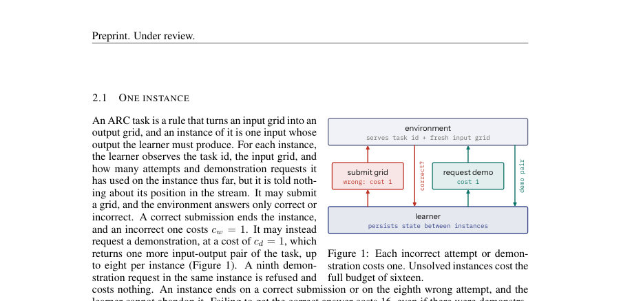
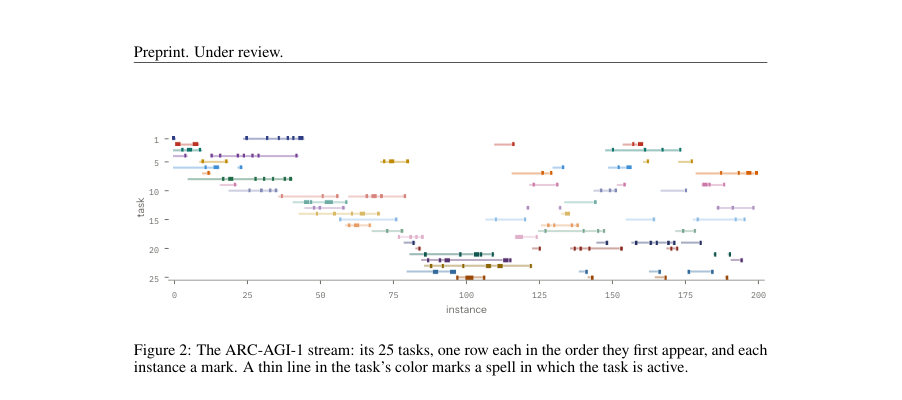
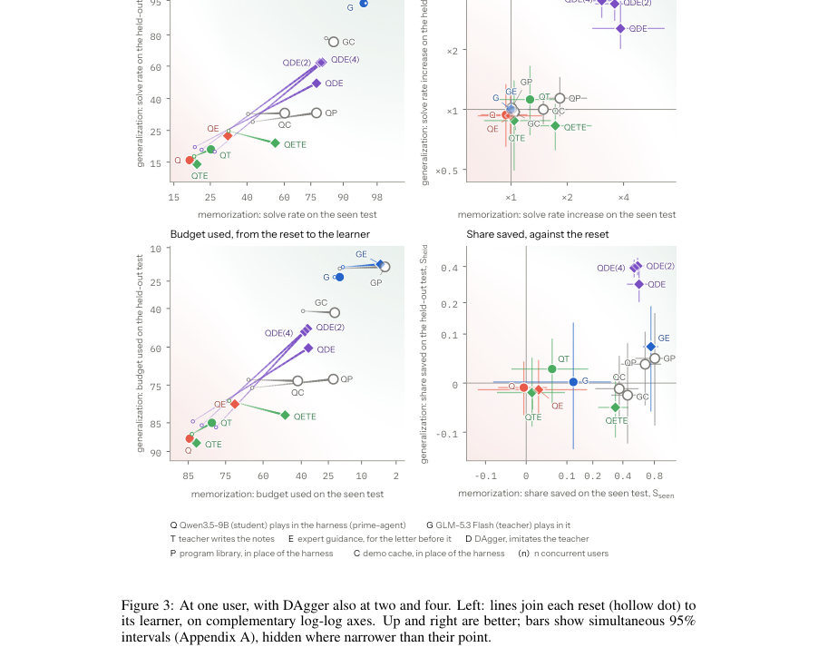

# Continual-ARC: Measuring Skill Acquisition over a Working Lifetime

- **게시일:** 2026-11-12
- **arXiv:** [2611.14505v1](http://arxiv.org/abs/2611.14505v1) · [PDF](https://arxiv.org/pdf/2611.14505v1)
- **저자:** Daniel Lenton
- **분야:** cs.LG
- **선정 점수:** 4.59
- **선정 이유:** 최근성 0.7, 인용 영향 0.0 (인용 0회), 저자 영향 0.0 (최고 h-index 0), AI 주제 적합성 2.1, 개발자 관심 0.5, 학술 신호 0.3, 오픈 웨이트·주요 연구조직 신호 1.0

[← 2026-11-12 목록으로 돌아가기](../daily/2026-11-12.html)

<!-- paper-visuals:start -->
## 주요 Figure

> 원문 PDF에서 실제 Figure 캡션과 그림 영역이 함께 확인된 자료만 자동 추출했다.

*Figure · 원문 PDF 3쪽 · Figure 1: Each incorrect attempt or demon-*

*Figure · 원문 PDF 4쪽 · Figure 2: The ARC-AGI-1 stream: its 25 tasks, one row each in the order they first appear, and each*

*Figure · 원문 PDF 6쪽 · Figure 3: At one user, with DAgger also at two and four. Left: lines join each reset (hollow dot) to*

<!-- paper-visuals:end -->

## 한 문장 요약

ARC 기반의 지속적(lifelong) 스트림인 Continual-ARC를 제안하여 에이전트 하니스(메모리/프롬프트 기반)와 가중치(파라미터) 기반 학습을 동일한 스케일에서 비교하고, 실험에서 하니스만의 지속성은 명시적 전문가 지도 없이는 기억화·일반화에서 한계가 있음을 보였다.

## 해결하려는 문제

기존의 지속학습·에이전트 벤치마크는 (1) 특정 응용 도메인에 편중되어 모델 사전지식의 영향을 받을 수 있고, (2) 각 인스턴스를 한 번만 제공하여 재방문에서의 암기(메모리)와 추상학습(일반화)을 구분할 수 없으며, (3) 주로 한 종류의 학습자(메모리 기반 또는 가중치 업데이트 기반)만 가정해 양자 비교가 어렵다는 한계를 가진다. 본 논문은 이러한 문제를 해결하기 위해 도메인 지식이 필요 없는 ARC 규칙을 사용한 '반복·성장하는' 스트림을 설계하고, 동일 프로토콜에서 메모리(하니스)와 가중치(파라미터) 학습을 비교하는 것을 연구 질문으로 제시한다.

## 핵심 기여

- Continual-ARC 벤치마크 설계: ARC-AGI(1/2/3) 편을 이용해 동일 작업이 휴지기(dormant gap) 후 새 인스턴스로 반복 출현하고 새로운 과제도 계속 유입되는 lifelong 스트림 프로토콜을 정의함(피드백 비용 체계, 인스턴스별 시도·데모 비용, 실패시 전체 예산 비용 등 포함).
- 통일된 측정지표 제안: 인스턴스별 사용 예산 비율 U, 스트림 학습만을 분리해 재설정(reset) 대비 학습가능 예산에서의 비율 L(share learned), 스트림 후 동결 상태에서의 'seen'과 'held-out' 테스트로 각각 암기(Sseen)·일반화(Sheld) 측정하는 정의를 제시함(공식과 평가 절차 포함).
- 다양한 학습자 비교 실험: 프롬프트 기반 바닥선(무상태 C0, 데모 캐시 C), 프로그램 유도(P), 하니스(prime-agent)를 여러 설정(지속/비지속/전문가 지도/교사가 노트 작성)으로, 그리고 가중치 기반 DAgger(LoRA 어댑터)로 비교 실행하고 결과·분석을 공개함.
- 핵심 발견: 하니스(메모리/프롬프팅) 만으로는 대부분의 경우 단순 데모 캐시보다 적게 학습하며(특히 일반화에는 거의 이득 없음), 명시적 전문가 지도를 주면 하니스의 암기 성능이 크게 개선될 수 있으나 여전히 미시적 한계가 존재함. 반면 가중치 업데이트(DAgger)는 본 스트림에서 유의미한 암기·일반화 이득을 보였음.
- 오픈 리소스·검증 절차 제공: 스트림·측정 방법·코드·실험 기록을 공개하고, 외부 제출물을 사설 검증(private set)으로 확인하는 프로세스를 설계하여 재현성을 확보함.

## 접근 방법

* 벤치마크 구성과 평가 프로토콜(요약):
* 인스턴스 수준 규칙: 각 인스턴스에서 학습자는 작업 ID와 입력 격자만 보고 제출(answer)하거나 데모를 요청하거나(각 요청 비용 cd=1, 최대 dmax=8) 제출이 틀리면 비용(cw=1, 최대 wmax=8)이 부과된다.
* 실패한 인스턴스는 전체 예산 Cmax=cw*wmax + cd*dmax = 16을 소비한 것으로 계산된다.
* 인스턴스·셋의 평균 예산 사용률 U와 해결률 P를 측정한다.
* 스트림 구성: ARC-AGI-1 트랙을 중심으로 25개 훈련 작업을 선택해 Re-ARC 생성기로부터 200개의 신선한 인스턴스를 제공(각 작업 8회), 활성 작업 수 nc=4, 스펠(활성 연속수)과 휴지기(rest)가 확률분포로 결정되어 작업이 돌아오도록 설계됨(스펠 약 3, 휴지기 약 30, 평균으로 새 작업은 약 4 인스턴스마다 유입).
* 스트림 후 평가: 스트림 후 학습자를 동결한 상태로(학습자 상태는 스트림 종료 시 상태에서 시작) 두 가지 테스트 수행 — seen 테스트(스트림에서 만난 25개 작업 각각의 새로운 인스턴스 4개, 총 100개)로 암기 측정, held-out 테스트(스트림에 없는 100개 평가 작업)로 일반화 측정.
* 학습 측정 공식: reset(매 인스턴스 전 상태 초기화) 대비 학습가능 예산 Λ로 L = (U0 - U) / Λ, 테스트별 저장비율 S = (U0(E) - U(E)) / U0(E) 등으로 정규화하여 보고.
* 학습자/방법군(요약):
* Floors: C0(무상태 인터랙션), C(데모 캐시 — task별 데모 저장 및 무료 재사용).
* Program library (P): 모델에게 Python 프로그램을 유도하여 데모를 재현하면 저장하고, 반환 시 먼저 프로그램 실행을 시도하는 방식.
* Agent harness(prime-agent): 프롬프트 기반 도구(저장 노트·파일 등)와 자동 개선 도구를 가진 에이전트 인터페이스로 여러 변형 실행(Q0: 상태 초기화, Q: 지속, QA: 매 종결 후 광범위 저장 지시, QE: 전문가 지도(프로그램 작성·검증·저장), 교사가 노트를 작성해 전달하는 변형(QT,QTE,QETE) 포함).
* Weights: DAgger 기반 online imitation으로 GLM-5.3 Flash를 교사로 하여 Qwen3.5-9B의 LoRA 어댑터를 라운드별로 업데이트(QDE).
* 학습·추론 세부 스케줄과 컴퓨트는 부록 H에 기술.
* 실험 설정: 주로 ARC-AGI-1에서 Qwen3.5-9B(Q)와 GLM-5.3 Flash(G)를 사용해 prime-agent 하니스와 비교.
* 일부 실험에 GPT-6 Luna, hermes-agent, openclaw 등 추가.
* 집단(regime) 설정에서는 nu in {1,2,4} 사용자가 비중복 작업으로 동시에 시스템을 사용하며 상태는 라운드 사이에만 갱신됨.

## 주요 결과

- 핵심 정량 결과(ARC-AGI-1, 논문 본문 수치 발췌): DAgger(QDE, Qwen의 가중치 업데이트)는 스트림에서 L = +0.43 [0.33,0.54], seen 테스트에서 Sseen = +0.57 [0.48,0.67], held-out에서 Sheld = +0.29 [0.23,0.35]로 가중치 학습이 일반화 이득을 보였음(95% 구간 표기).
- 프롬프트/메모리 바닥선: 데모-캐시(C) 대비 절대 이득으로 데모 캐시는 seen 테스트에서 Sseen = 0.37 [0.26,0.51] (Qwen), 0.44 [0.34,0.57] (GLM)을 보이며 이는 단순히 데모를 재사용해 데모 비용을 절감한 효과임. 프로그램 라이브러리(P)는 seen 테스트에서 QP Sseen = 0.65 [0.46,0.86], GP Sseen = 0.81 [0.59,1.00]로 암기 성능이 높았으나 held-out에서는 거의 이득을 보이지 않음(예: QP Sheld = 0.03 [-0.02,0.09]).
- 하니스(프롬프트 기반)의 한계: 기본 하니스(python 능력 포함)만으로는 대체로 데모-캐시 바닥선보다 학습이 적었으며(예: Q의 지속성은 유의미한 개선 없음, Sseen ≈ −0.01), 하니스가 자율적으로 저장하지 못하는 사례가 관찰됨 — 예: prime-agent가 저장을 보여주도록 설계되었어도 하니스가 글로벌 저장을 하지 않음. 하니스가 저장·재사용하지 않아 GLM(교사)의 경우에도 저장된 규칙이 returns에서 작업 인스턴스로 도달한 경우가 40/154에 불과하였음(하니스 UI/프롬프트 제약).
- 전문가 지도 효과: 하니스에 명시적 전문가 지침(프로그램 작성·검증·저장 절차)을 주자 GE(또는 H-E)가 seen 테스트에서 Sseen = 0.74 [0.64,0.84] 등으로 크게 개선되었음. 교사가 노트를 직접 작성하고 둘 다 지도를 받는 QETE는 Qwen에서 Sseen = 0.34 [0.26,0.42]를 보였음.
- 집단 사용자 효과: DAgger를 2명·4명 사용자 환경에서 실행하면(각 사용자는 비중복 작업 집합을 가짐) held-out 일반화 이득이 증가 — 예: QDE(2) Sheld ≈ 0.40, QDE(4) Sheld ≈ 0.39로 보고되어 더 다양한 학습데이터가 일반화에 도움을 줌(수렴은 2사용자 이후 감소).

## 한계

- 저자가 명시한 한계: 논문의 대부분 실험은 상대적으로 작은 모델(Qwen3.5-9B, GLM-5.3 Flash)과 가장 쉬운 트랙(ARC-AGI-1)에 집중되어 있어, 더 큰(프론티어) 모델과 ARC-AGI-2/3 트랙에 대한 추가 실험이 필요함(논문 본문 및 Section 6에서 제시).
- 검증·재현 관련 제한: 외부 제출물 검증은 사설 셋(private set)을 사용하며 이 셋의 규칙은 공개하지 않음(의도적 제약). 또한 스트림과 테스트는 고정된 시드로 결정되므로 다른 시드에 대한 추가 변동성 분석이 필요할 수 있음(부록에 시드·파라미터 제공).
- 방법론적 한계(본문에서 합리적으로 확인되는 것): 하니스가 실패한 원인 중 일부는 하니스 설계(프롬프트·UI)가 본 도메인에 최적화되어 있지 않았기 때문으로 판단되며, 이는 다른 도메인이나 더 큰 모델에서는 달라질 수 있음. 전문가 지도가 성능을 끌어올렸지만 그 지도를 자동으로 생성·유지하는 방법(즉, 하니스가 스스로 전문가 지도를 얻는 방법)은 본 연구에서 다루지 않음.
- 범위 제약: 제시된 결과는 ARC 스타일의 추론·격자 변환 과제에 대한 것이며, 자연어·코드·실세계 작업 등 다른 범주의 작업으로 직접 일반화할 수 없음.

## 개발자 관점

- 재현성: 코드·스트림 파라미터·프롬프트·실험 기록을 공개(논문과 부록에 경로 명시). 스트림은 결정론적(seed=0 등)으로 동일 인스턴스 순서를 보장하므로 재현 가능한 실험 설계임. 검증 파이프라인은 외부 제출물을 private set으로 자동 검증하는 프로세스를 제공함(검증 시 절차와 제약 존재).
- 구현·아키텍처: 인스턴스의 '판정(verdict)'은 저장 이전에 반환되어야 하며(저장이 판정 이후에 일어나도록 설계됨), 이는 저장 전략이 판정 결과를 반영하게 하므로 구현 시 주의해야 함. 하니스 어댑터를 만들 때는 저장·로딩 정책(몇 개 항목을 보여주는지 등)이 성능에 큰 영향을 줄 수 있음(본문: prime-agent는 인스턴스당 6개 항목만 노출하여 저장이 도달하지 않는 문제가 관찰됨).
- 운영·배포 비용: 대규모 실험(특히 ARC-AGI-2/3 전 방법·모델 재현)은 API 비용·컴퓨트 비용이 큼 — 논문은 일부 보수적으로 '수천~수만 달러' 수준의 비용이 들 수 있음을 언급함(ARC-AGI-3 보정에 약 580 USD 예시 포함). 실제 배포 환경에서는 호출 비용과 실시간 응답 품질(타임아웃·토큰 캡)에 유의해야 함.
- 안전·제어: 하니스가 외부 코드(예: Python 프로그램)를 작성·실행하는 경우 안전·격리(sandbox)가 필수임 — 본 연구는 하니스 실행을 제한하는 샌드박스 설정을 사용했고, 유사한 구성 권장(본문 Appendix D 참조).
- 설계 시 교훈: (1) 단순한 '무엇을 저장할지' 프롬프트만으로는 충분치 않으며 전문가 수준의 저장 규칙·검증 절차를 하니스에 내장하거나, 하니스가 효율적으로 프로그램을 합성·검증·인덱싱하도록 설계해야 한다. (2) 가중치 기반 업데이트(예: LoRA+DAgger)는 소량의 스트림 데이터에서도 일반화 이득을 얻을 수 있으므로 하니스 인프라를 '내부 모델을 계속 훈련시키는 인프라'로 설계하는 방향이 바람직함(하니스는 얇게 유지하고 가중치로 지속적 지식을 축적).

**근거 범위:** 이 분석은 제공된 논문 PDF 본문(메인 텍스트와 표·그림·부록에서 인용된 수치)을 근거로 작성되었음. 핵심 수치(예: L, Sseen, Sheld)와 실험적 관찰은 본문 및 표에서 직접 발췌하였고 95% 신뢰구간은 논문 표기 그대로 인용함. 다만 표의 여러 행·열(특히 다양한 방법 변형의 약어 매핑)은 본문 설명과 표를 함께 참조해 해석했으며, 일부 방법 이름별 상세 수치 매칭(예: 특정 약어의 모든 열 값)은 본문에서 명확히 구분되어 있으나 표 해석의 모호성이 있을 수 있어 신뢰도를 '높음(본문 기반)'으로 표기하되 표의 복수 변형·부록(H, E 등)의 세부 설정은 원문 부록을 함께 확인하는 것을 권고함.
