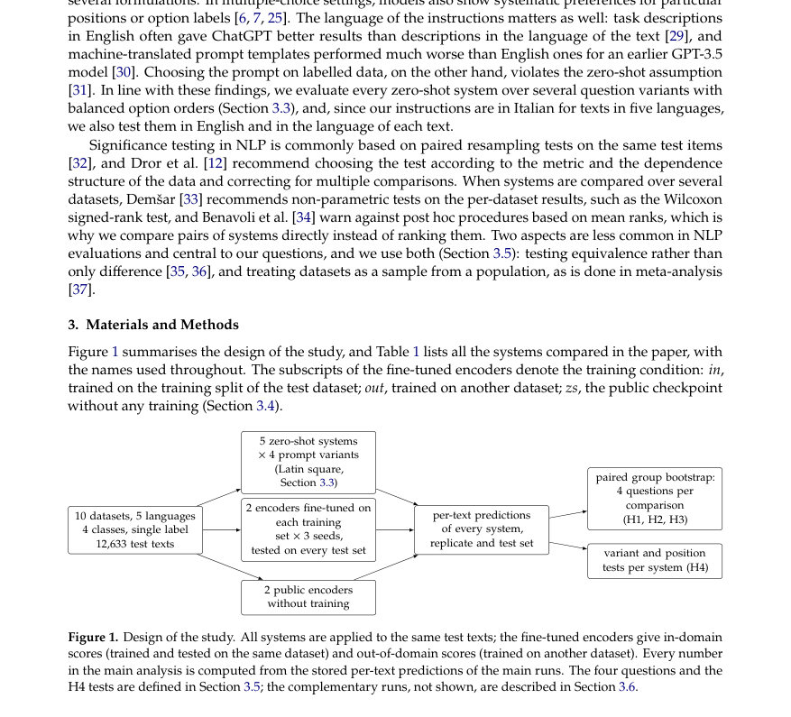
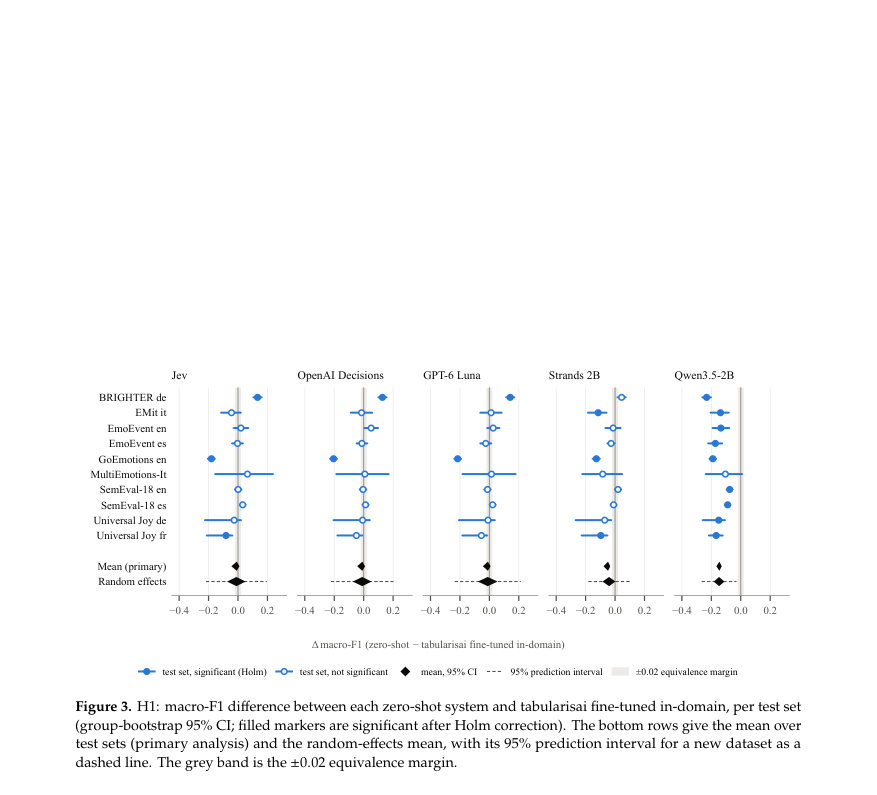
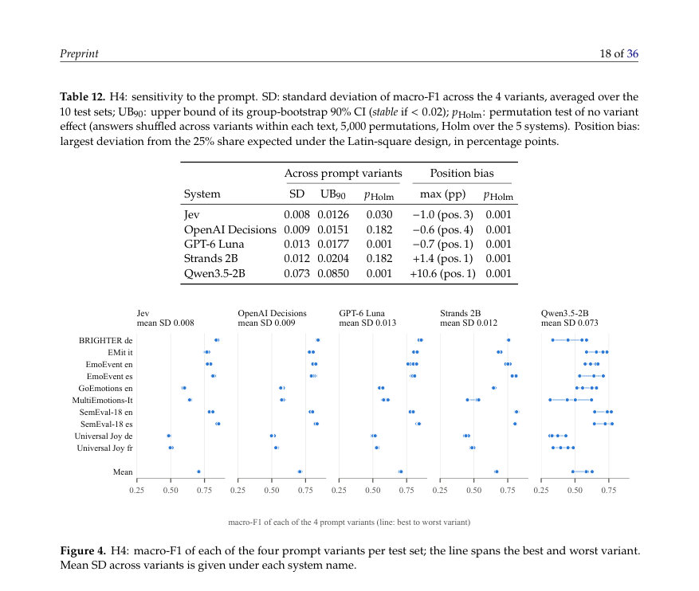

# Decision Models for Multilingual Emotion Classification: A Comparative Study Against LLMs and Encoders

- **게시일:** 2026-11-23
- **arXiv:** [2611.27721v1](http://arxiv.org/abs/2611.27721v1) · [PDF](https://arxiv.org/pdf/2611.27721v1)
- **저자:** Alessandro Piccolo, Francesco De Nicolò, Francesco Manco, Eufemia Lella
- **분야:** cs.CL, cs.AI, cs.LG
- **선정 점수:** 5.24
- **선정 이유:** 최근성 0.4, 인용 영향 0.0 (인용 0회), 저자 영향 0.0 (최고 h-index 0), AI 주제 적합성 3.0, 개발자 관심 0.3, 학술 신호 0.5, 오픈 웨이트·주요 연구조직 신호 1.0

[← 2026-11-23 목록으로 돌아가기](../daily/2026-11-23.html)

<!-- paper-visuals:start -->
## 주요 Figure

> 원문 PDF에서 실제 Figure 캡션과 그림 영역이 함께 확인된 자료만 자동 추출했다.

*Figure · 원문 PDF 4쪽 · Figure 1. Design of the study. All systems are applied to the same test texts; the fine-tuned encoders give in-domain*

*Figure · 원문 PDF 14쪽 · Figure 3. H1: macro-F1 difference between each zero-shot system and tabularisai fine-tuned in-domain, per test set*

*Figure · 원문 PDF 18쪽 · Figure 4. H4: macro-F1 of each of the four prompt variants per test set; the line spans the best and worst variant.*

<!-- paper-visuals:end -->

## 한 문장 요약

여러 최신 ‘decision 모델’과 범용 LLM, 그리고 in‑domain으로 미세조정한 다국어 인코더들을 10개 소셜미디어 감정 데이터셋(5개 언어)에서 제약된 4개 감정(joy, sadness, anger, fear) 분류로 비교하여, 레이블 없는(제로샷) 시스템이 미세조정 대안이 될 수 있는지와 ‘decision’ 인터페이스가 제공하는 이점(품질·지연·확률 출력 등)을 통계적 불확실성까지 고려해 평가했다.

## 해결하려는 문제

기존에는 감정 분류에 대해 (1) 도메인별로 레이블을 모아 인코더를 미세조정하는 방식이 성능이 우수하지만 데이터 확보·주석 비용이 크고 다른 데이터셋으로의 일반화가 약하다는 한계가 있고, (2) 범용 LLM의 제로샷 접근은 프롬프트 민감성과 세분화된 감정 과제에서 성능 저하가 보고되어 왔다. 2026년 등장한 decision 모델들은 정해진 선택지에 대한 옵션별 확률을 반환하고 지연(latency)·프롬프트 민감성에서 이점을 주장하지만, 여러 decision 모델을 여러 언어·데이터셋에서 미세조정 인코더 및 범용 LLM과 통계적 불확실성(동일 텍스트에 대한 페어드 비교, 동등성 검정, 메타분석 포함)까지 고려해 체계적으로 비교한 연구가 부재했다. 논문은 (H1) 제로샷 시스템이 in‑domain 미세조정 인코더와 동등한지(±0.02 macro‑F1), (H2) 다른 데이터셋으로 학습된 인코더에 비해 제로샷이 우수한지, (H3) 동일 기반 모델에서 decision 인터페이스가 품질·지연 측면에서 유리한지, (H4) 프롬프트·옵션 순서에 안정한지를 검증한다.

## 핵심 기여

- 여러 decision 모델(Jev, OpenAI Decisions, Strands Decider 2B)과 범용 LLM(GPT-6 Luna, Qwen3.5-2B), 그리고 두 다국어 인코더(tabularisai, XLM-EMO)를 10개 소셜미디어 감정 데이터셋(5개 언어, 테스트 합계 12,633문장, 전체 수집 66,619문장)에서 동일한 테스트 텍스트 기반으로 페어드 비교하고 불확실성을 추정한 최초의 체계적 비교.
- decision 인터페이스의 장점·단점을 동등성 검정(TOST, margin 0.02), 페어드 부트스트랩(B=10,000), Holm 보정, 랜덤효과 메타분석(REML + Hartung–Knapp) 등으로 엄밀히 평가하고 결과를 '이 데이터셋에서'와 '새 데이터셋에 일반화될 가능성'으로 구분해 보고.
- 같은 기반 모델 쌍(OpenAI Decisions vs GPT‑6 Luna, Strands Decider 2B vs Qwen3.5‑2B)과 라벨 스코어링(label scoring) 실험으로 ‘decision 포맷’ 효과와 전용 학습(어댑터/지식증류) 효과를 분리한 분석.
- 프롬프트 문구·옵션 순서를 라틴스퀘어로 균형화한 4개 변형을 사용해 프롬프트 민감성(H4)을 정량화하고, 확률 출력의 보정(ECE, multiclass Brier)과 지연·토큰 비용(제한적 측정)을 함께 제시하고, 전체 예측과 분석 스크립트를 공개해 재현을 지원. 

## 접근 방법

* 테스크 및 데이터: 네 가지 감정(joy, sadness, anger, fear) 단일 라벨 분류.
* 10개 공개 소셜미디어 데이터셋(영어·독일어·스페인어·프랑스어·이탈리아어), 테스트 총 12,633문장(데이터셋 총합 66,619문장).평가 지표: 클래스 불균형 고려를 위해 4클래스 macro‑F1(0–1) 사용, 차이를 포인트(1 point = 0.01 macro‑F1)로 표기.제로샷 시스템: Jev(API), OpenAI Decisions(/v1/decisions on gpt-6-luna), Strands Decider 2B(local, hobson-v21), GPT-6 Luna(API, Responses endpoint, reasoning 비활성), Qwen3.5-2B(local, greedy).Decision 모델들은 구조화된 질문(이탈리아어 지시문, 4개 옵션+설명) 입력 → 옵션별 확률 반환.일반 LLM들은 동일 내용의 직렬화된 프롬프트를 받아 자유응답(단, 응답이 정확히 하나의 클래스 이름일 때만 유효)로 사용.프롬프트 변형: 단어·옵션 순서가 다른 4개 변형으로 라틴스퀘어(각 감정이 네 변형에서 네 위치를 균형 있게 차지).미세조정 인코더: tabularisai(합성 데이터 기반 공개모델)와 XLM-EMO(사전적절화된 XLM-T 기반) 공개체크포인트를 가져와 각 데이터셋별로 분류 헤드 교체 후 fine‑tune.
* 학습 하이퍼파라미터(논문 본문): AdamW lr=2e-5, warmup 10%→linear decay, weight decay 0.01, batch 32, maxlen 128, up to 20 epochs, early stopping(5 evals), 손실에 클래스 역빈도 가중치 적용(w_c = N/(4 n_c)).각 fine‑tune 구성은 3개 랜덤 시드(42,43,44)로 반복.평가 설정: 모든 시스템은 동일 테스트 텍스트에 적용(제로샷은 각 변형 4회), 결과는 변형 평균을 기본 점수로 사용.불확실성·통계: 페어드 그룹 부트스트랩(B=10,000, 동일 텍스트 그룹 재샘플링), Holm 다중비교 보정, 동등성 검정(TOST, δ=0.02 기본), Wilcoxon signed‑rank(일관성), 랜덤효과 메타분석(REML + Hartung–Knapp)으로 새 데이터셋에서의 예측 범위(95% prediction interval) 추정.보정 및 보조실험: 라벨 스코어링(label scoring)으로 decision 포맷 효과 분리(Qwen 계열), 온톨로지(프롬프트 언어: 이탈리아어 기본, 보조로 영어·텍스트 언어별 실험), 확률 보정(temperature scaling), 보정 지표(ECE, multiclass Brier), 지연(latency) 측정(클라이언트‑API 포함 및 GPU 1요청 대조 측정).

## 주요 결과

- 제로샷 상위 3개 시스템(Jev, OpenAI Decisions, GPT-6 Luna)은 평균적으로 in‑domain으로 미세조정된 인코더보다 약 1 포인트(macro‑F1 기준, 0.01) 낮게 나타났음(논문 요약·본문). 그러나 테스트셋 크기와 예측 상관관계로 인해 데이터는 4–5 포인트의 차이를 배제할 수 없어(H1에 대해 결론 불가, 'inconclusive').
- 제로샷(상위 3개)과 Strands Decider 2B는 다른 데이터셋으로 학습된 인코더(tabularisai_out 등)를 평균적으로 8–15 포인트(0.08–0.15 macro‑F1) 앞섬(논문은 tabularisai에 대해서는 새 데이터셋으로의 일반화 가능하다고 평가, XLM-EMO에 대해서는 본 데이터셋에서만 일관성 있음). 이 결과는 레이블이 없는 상황에서 제로샷이 다른 데이터셋에서 학습된 모델을 대체할 수 있음을 시사함(H2).
- 프롬프트 언어 영향은 대체로 작음: 각 텍스트의 언어로 지시문을 바꿔도 결과 차이는 1포인트 미만(논문 요약). 제로샷 상위 시스템의 프롬프트에 대한 표준편차(SD)는 약 1포인트 수준으로 안정적(논문 본문).
- decision 엔드포인트 대조: OpenAI Decisions의 품질은 GPT-6 Luna와 유사(동일 기반 모델 사용)하나 median latency는 약 1/5 수준(통제된 단일요청 측정에서 GPT-6/Decisions 비율 5.38 [5.10,5.64], 표 26). Jev는 OpenAI Decisions보다 더 빠름(표 26의 통제 측정에서 OpenAI/JeV 비율 2.46).
- 같은 규모(약 2B 파라미터)에서 Strands Decider 2B는 Qwen3.5-2B보다 약 10 포인트 높은 성능을 보였으며(this gap은 decision 포맷 자체가 아니라 어댑터/증류로 인한 학습 효과에 기인한다고 분석함). 라벨 스코어링 실험은 포맷·학습 효과 분리를 지원함(본문 Table 11 등).  또한 Strands(결정형)과 Qwen 라벨스코어링의 비교로 학습이 성능 차이를 만들었음을 제시함.」「단일 데이터셋별 성능 차이는 매우 큼: 어떤 데이터셋에서는 미세조정된 인코더가 제로샷보다 최대 22포인트까지 이김(논문 요약). 특히 규모가 큰 GoEmotions 데이터셋에서는 미세조정이 큰 폭으로 우세함.」「확률 출력·보정: decision 모델은 옵션별 확률을 바로 제공함. ECE·Brier 측정과 온도 보정(temperature scaling) 결과도 보고됨(보정 후 일부 비교에서 차이 축소).」「지연·비용: API 기반 측정(네트워크 포함)과 로컬 GPU 측정이 함께 보고됨. 표본 통제(한 번에 1요청)에서 median latencies: Jev 156 ms, OpenAI Decisions 385 ms, GPT‑6 Luna 2,069 ms(표 26). 로컬 GPU의 Strands Decider 2B는 예시 측정에서 median 65 ms(표 28, GPU 측정). 비용은 토큰 기반 계산을 제시하나 일부 가격(외부 출처)은 확인되지 않음(본문 명시).

## 한계

- 저자가 명시한 한계:
- - H1(제로샷과 in‑domain 미세조정의 동등성) 결론 불가: 동일 텍스트에서의 예측 상관관계가 낮아 90% CI 폭이 넓어 δ=0.02(±2포인트) 동등성 검정을 만족시키기에는 검정력이 부족함(시험 데이터셋 규모로는 4–7배 더 큰 테스트셋이 필요했을 수 있음).
- - decision 모델의 내부는 블랙박스(특히 Jev와 OpenAI Decisions)이며 학습 데이터·절차가 공개되지 않아 원인 추정과 일반화에 제약이 있음. Strands Decider 2B의 read‑out/어댑터 훈련도 완전한 문서화가 없음.
- - XLM-EMO의 공개 체크포인트는 이미 일부 데이터(예: SemEval-2018)를 학습에 사용했으므로 XLM-EMO 관련 비교는 8개 테스트셋으로 제한됨(본문).

## 개발자 관점

- 레이블이 전혀 없을 때의 강력한 기본(default): 제로샷 decision 모델(Jev, OpenAI Decisions)과 범용 LLM(GPT-6 Luna)은 라벨 없는 상황에서 실무적으로 '강한 디폴트'가 될 수 있음(평균적으로 in‑domain 미세조정보다 약 1포인트 낮음).
- decision 모델의 장점: 옵션별 확률 출력과 낮은 지연. OpenAI Decisions는 동일 모델 기반인 GPT-6 Luna 대비 지연이 약 5분의1로 낮아 실시간성·비용/처리량 제약이 있는 배포 환경에서 유리(통제 측정).
- 모델 선택 시 고려: 같은 크기 모델이라도 특화된 어댑터/증류로 학습된 decision 모델(Strands 2B)이 일반 LLM보다 큰 성능 차이를 만들 수 있으므로(약 +10포인트 사례), 단순 포맷보다 학습 과정이 중요함.
- 미세조정 권장 조건: 충분히 큰 in‑domain 데이터(예: GoEmotions와 같은 큰 코퍼스)가 확보되어 있다면 미세조정이 큰 이득을 주므로 라벨을 모을 수 있으면 미세조정 실시. 반면 레이블 부족 시 제로샷 우선 전략이 합리적임.
- 재현·안정성 권장: 미세조정 결과는 랜덤 시드 민감성이 있으므로(논문은 3시드 평균 사용) 재현을 위해 여러 시드 평균 및 결과·예측 저장 권장. 제로샷은 프롬프트 변형에 대해 평균적으로 SD≈1포인트 수준이나(논문), 라틴스퀘어와 복수 변형 테스트를 도입해 프롬프트 민감성을 점검할 것. 또한 확률이 필요한 시스템(의사결정 파이프라인)에는 decision 엔드포인트가 더 간편하고 해석성이 좋음. 다만 폐쇄형 API의 동작·비용·정책(데이터 수집 여부 등)에 유의할 것.

**근거 범위:** 이 분석은 제공된 논문 PDF 본문(수록된 표와 본문 설명, 부록 표기 포함)을 근거로 작성되었다. 본문에 명시된 수치(데이터셋 크기, 매개변수, 통계 방법, 주요 결과, 표의 지연·비용 등)를 직접 인용·요약했으며, 저자가 명시적으로 밝히지 않은 내부 구현 세부사항(비공개 모델의 학습 데이터·구조 등)은 추정하지 않았다. 일부 비용 항목과 API 요금은 논문이 외부 출처를 참조해 '검증되지 않음'으로 표기한 만큼 그 부분은 원문 표기를 따랐다.
