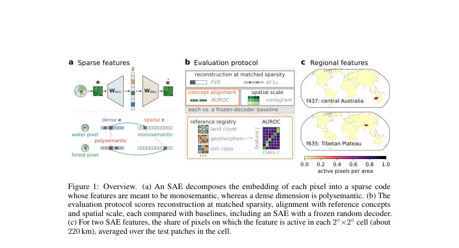
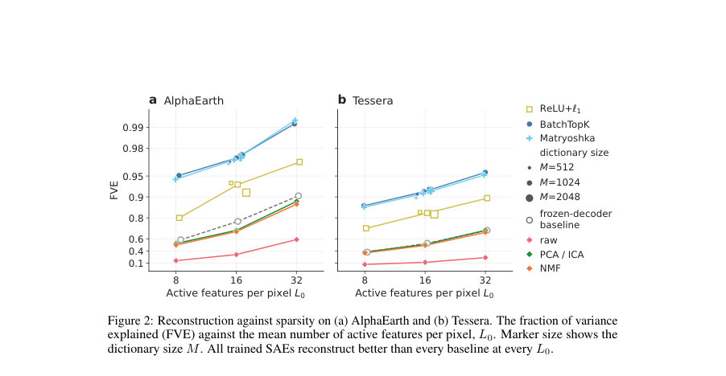
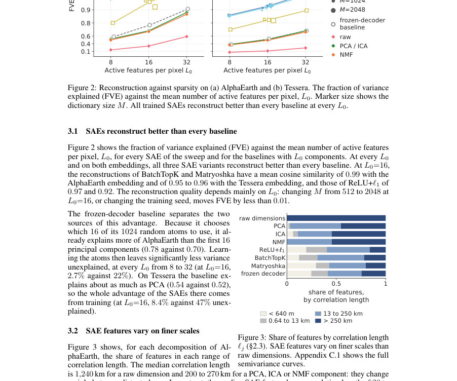

# Decomposing Earth Embeddings with Sparse Autoencoders

- **게시일:** 2026-11-10
- **arXiv:** [2611.11398v1](http://arxiv.org/abs/2611.11398v1) · [PDF](https://arxiv.org/pdf/2611.11398v1)
- **저자:** Vitus Benson, Fanny Yang, Markus Reichstein
- **분야:** cs.LG, cs.CV, physics.geo-ph
- **선정 점수:** 4.26
- **선정 이유:** 최근성 0.7, 인용 영향 0.0 (인용 0회), 저자 영향 0.0 (최고 h-index 0), AI 주제 적합성 2.6, 개발자 관심 0.2, 학술 신호 0.8, 오픈 웨이트·주요 연구조직 신호 0.0

[← 2026-11-10 목록으로 돌아가기](../daily/2026-11-10.html)

<!-- paper-visuals:start -->
## 주요 Figure

> 원문 PDF에서 실제 Figure 캡션과 그림 영역이 함께 확인된 자료만 자동 추출했다.

*Figure · 원문 PDF 2쪽 · Figure 1: Overview. (a) An SAE decomposes the embedding of each pixel into a sparse code*

*Figure · 원문 PDF 7쪽 · Figure 2: Reconstruction against sparsity on (a) AlphaEarth and (b) Tessera. The fraction of variance*

*Figure · 원문 PDF 7쪽 · Figure 3: Share of features by correlation length*

<!-- paper-visuals:end -->

## 한 문장 요약

지구 관측 임베딩(AlphaEarth, Tessera)을 과완전 사전 위의 희소 오토인코더(SAE)로 분해해, 재구성 성능·개념 정렬·공간 스케일 관점의 평가 프로토콜로 해석 가능하고 지역화된 희소 피처를 얻는 방법을 제안하고 실험적으로 검증한다.

## 해결하려는 문제

기존 지구 관측 임베딩은 밀집(dense) 차원이 여러 무관한 지리·물리적 개념을 섞어(polysemantic) 표현하므로 해석이 어렵고 지역 간 전이 시 강건성 검증(예: 입력 분포 변화 탐지)이 불완전하다. 기존 SAE/해석성 평가 방법(예: LLM 기반 자동 해석)은 위성 픽셀에 직접 적용하기 어렵고, 지리적 공간 자기상관과 스케일 문제가 있어 지구 임베딩 전용의 평가 기준과 비교대상이 필요하다.

## 핵심 기여

- 지구 관측의 픽셀 단위 임베딩(AlphaEarth, Tessera)에 대해 SAEs를 적용해 과완전 사전(overcomplete dictionary) 위의 희소 코드로 분해한 첫 연구를 제시함.
- 지구 임베딩용으로 설계된 평가 프로토콜을 제안함: (1) 동일 희소성(L0)에서의 재구성(평균 제곱오차·FVE), (2) 레퍼런스 맵과의 개념 정렬(폴디드 AUROC, 임계값 0.65 기준 그룹별 정렬), (3) 피처의 공간 스케일(정규화 semivariance와 상관 길이)으로 구성되고, 항상 '고정된 랜덤 디코더(frozen-decoder)' SAE를 포함한 베이스라인과 비교하도록 설계됨.
- 세 가지 SAE 변형(ReLU+ℓ1, BatchTopK, Matryoshka BatchTopK)과 PCA/ICA/NMF 및 고정 랜덤 디코더를 비교·분석하여, 동일 희소성에서 학습된 SAE가 재구성 성능에서 모든 베이스라인을 능가함을 보였음.
- 두 가지 응용(라벨 없이의 세부 지표 서브컨셉 발견, downstream 모델의 영역적용성(area-of-applicability) 기반 OOD 탐지)을 실험적으로 시연했으나 실무 적용에는 아직 신뢰성 한계가 있음을 보고함.

## 접근 방법

* 입력은 10 m 픽셀당의 지구 임베딩(e ∈ R^D): AlphaEarth(D=64, 공간·시간 self-attention 기반), Tessera(D=128, 픽셀 시계열 기반)을 사용한다.
* SAE는 과완전 선형 디코더 W_dec ∈ R^{D×M}와 인코더 W_enc ∈ R^{M×D}로 구성하고, 정규화된 디코더 원자(atom)를 컬럼으로 가지며 사전(사전열)을 과완전하게(M≫D) 둔다.
* 인코딩은 z = S(W_enc e + b_enc)이고 재구성은 ê = W_dec z + b로 정의한다.
* Sparsifier는 세 가지 변형을 사용한다: ReLU+ℓ1(활성화 ReLU, 손실에 ℓ1 페널티로 희소 유도), BatchTopK(배치 레벨에서 평균 k 활성 유지, 테스트 시 픽셀별 임계치 적용), Matryoshka BatchTopK(다중 스케일 재구성 제약을 추가해 coarse-to-fine 구조 유도).
* 실험 설정: 주로 M=1024, k ∈ {8,16,32}를 사용(추가적으로 M ∈ {512,2048}으로 검증), 디코더 열은 매 스텝 정규화, 학습은 선형 디코더와 인코더 동시 최적화(고정 랜덤 디코더 실험은 디코더 고정, 인코더만 학습).
* 평가는(1) 동일 L0에서 FVE·MSE와 코사인 유사도,(2) 개념 정렬: 레퍼런스 제품(레퍼런스 레지스트리의 14 범주·3 연속 제품)과 클래스별 폴디드 AUROC(정렬 기준 AUROC≥0.65) 및 20개 개념 그룹으로 집계,(3) 공간 스케일: 정규화된 semivariance γ_j(h)/σ_j^2 및 상관 길이 ℓ_j 정의.
* 베이스라인: raw 임베딩, PCA/ICA/NMF(D 컴포넌트), 고정 랜덤 디코더 SAE.
* 데이터는 MajorTOM 기반으로 랜덤 샘플 210k 패치(64×64 픽셀), train≈100k, val≈10k, test≈100k.
* 구현·리소스: 단일 A100/A40 GPU 사용, 학습 시간 중간값 AlphaEarth 22분, Tessera 58분, 전체 스윕 108 runs ≈73 GPU·h.
* 코드·데이터 레시피 공개.

## 주요 결과

- 재구성: 모든 학습 SAE 변형이 동일 L0에서 PCA/ICA/NMF/원시·고정랜덤(decoder) 등 모든 베이스라인을 능가함(그림 2). 예: L0=16에서 BatchTopK·Matryoshka의 AlphaEarth에 대한 코사인 유사도 0.99, Tessera에 대해 0.95–0.96; ReLU+ℓ1는 0.97(AlphaEarth)·0.92(Tessera).
- 학습이 남긴 이득(학습된 사전 vs 고정 랜덤 디코더): AlphaEarth에서 고정랜덤은 처음 16개 PC(0.70)보다 더 설명함(0.78)이나 학습된 사전은 불설명 분산을 훨씬 줄여 L0=16에서 미설명 분산이 약 2.7%인 반면 고정랜덤은 약 22%로, 학습으로 남는 이득이 큼(‘학습된 SAE가 AlphaEarth에서 미설명 분산을 8배 가량 줄인다’는 서술과 일치). Tessera에서는 고정랜덤이 PCA(0.54 vs 0.52)와 유사해 SAEs의 장점은 학습에서 오며(L0=16에서 학습 SAE 미설명 8.4% vs 베이스라인 47% 미설명이라 기술됨).
- 공간 스케일: 원시 임베딩 차원의 중앙 상관 길이는 약 1,240 km, PCA/ICA/NMF는 200–270 km인 반면 SAE 특징의 중앙 상관 길이는 20–33 km로 훨씬 더 미세 스케일 변화를 캡처함. SAE의 패치 내(≤640 m) 분산 비중은 23–32%로 원시 차원(9%)보다 큼. 고정랜덤 디코더도 유사한 미세 스케일 분포(중앙값 ~23 km)를 보여 이 성질은 희소성 자체에서 비롯됨.
- 개념 정렬(모노시맨틱성): 원시 차원은 20개 개념 그룹 중 중앙값 12 그룹과 정렬되나(PCA는 9), Matryoshka SAE의 경우 672개의 live 특징 중 88%가 ≤1 그룹과 정렬(8% 정확히 1, 80%는 없음)으로 훨씬 더 구체적임. 그러나 고정랜덤 디코더도 89%가 ≤1 그룹과 정렬하여 이 결과는 희소성으로 설명될 수 있음. 또한 선택된 raw 차원은 한 그룹을 구분하는 성능(폴디드 AUROC 평균 0.84)에서 SAE 선택 특징(평균 0.75)보다 우수함(즉 SAE 특징이 더 특이적이지만 반드시 더 좋은 검출기는 아님).
- 응용: (1) 서브컨셉 발견: 목본성(woody vegetation) 관련 세 특징(f139,f124,f35)의 상위 활성 패치 분포가 지역적으로 집중됨(예: f139 상위 패치의 80%가 열대우림 기후, f124의 39%가 고온 반건조, f35의 91%가 아한대/대륙성 기후), 다만 이러한 특징들은 지역적 성격을 띄어 레이블로 엄밀 검증 필요. (2) 영역적용성 기반 OOD 탐지: canopy height 대상에서는 BatchTopK 코드의 ridge-weighted 거리로 오류 순위화 성능이 원시 임베딩 거리보다 개선되는 경우가 많음(AlphaEarth: 88개 홀드아웃 중 77개, Tessera 75개에서 개선; 중앙값 Spearman ρ 증가 +0.17, +0.21). elevation 대상에서는 개선이 없음. AlphaEarth에서는 고정 랜덤(비학습) 희소 코드도 동일한 이득을 보였고 Tessera에서는 약 1/3 수준의 이득(+0.07)만 관찰되어 이득의 일부는 희소성·거리 가중치에 기인함을 시사함.

## 한계

- 저자가 명시한 한계: (1) 많은 SAE 단일 피처 통계(개념 정렬 수, 공간 스케일)는 학습된 사전과 고정 랜덤 디코더 사이를 구분하지 못하므로 희소성 자체의 효과를 분리해야 함. (2) SAE 피처 다수가 지역적(regional)이며 전 지구적·개념 순수성(concept-purity)을 보장하지 않음. (3) 영역적용성 사례는 타깃 의존적이며 오직 공변량 변화(covariate shift)에 대해서만 신호를 주므로 개념 변화(concept shift)나 라벨 변화(label shift)까지 탐지하지 못함.
- 추가로 본문·실험 범위에서 확인되는 제약: 재구성 평가에 사용된 디코더는 선형이며 비선형 디코더를 사용하면 결과가 달라질 수 있음(논문은 선형 디코더만 고려). 레퍼런스 제품들은 해상도·연도 차이와 자체 오류가 있어 개념 정렬 평가는 레이블 불확실성의 영향을 받음. 서브컨셉 발견의 정성적 일치(기후·생물군계와의 매칭)는 무작위 지역적 분할과도 유사한 수준의 합의도를 보일 수 있어 추가 검증(현장 자료)이 필요함. 응용(특히 AoA)은 합성 홀드아웃 기반 평가였고 실제 전이 시나리오의 복합적 변화에는 성능이 알려져 있지 않음.

## 개발자 관점

- 재현성·데이터: 실험은 MajorTOM 기반 210k 패치(64×64, 640m) 샘플에서 수행하며 분할은 train≈100k / val≈10k / test≈100k로 고정되어 있어 동일 샘플·분할로 재현 가능하고 논문 코드는 공개됨(레시피 포함).
- 모델·하이퍼파라미터: 주요 설정은 M=1024, k={8,16,32}이며 k=16·M=1024를 기준 모델로 평가. ReLU+ℓ1는 ℓ1 페널티로 L0를 맞추도록 페널티 가중치 튜닝 필요. 디코더 컬럼은 매 스텝 단위 정규화함. 실험 시 고정 랜덤 디코더 SAE를 항상 포함해 희소성에 의한 '위양성'을 점검할 것.
- 평가 프로토콜: SAE 평가 시 반드시(1) 동일 L0에서 재구성(FVE/MSE/코사인 유사도) 비교, (2) 레퍼런스 레지스트리와의 폴디드 AUROC(임계 0.65)로 개념 정렬, (3) 정규화 semivariance·상관 길이로 공간 스케일을 측정하라. 단일 피처 평가는 레이블·공간 자기상관의 영향을 받으므로 베이스라인(특히 고정랜덤)과 함께 보고해야 함.
- 실무 적용 시 권고: 영역적용성(AoA) 추정은 원시 임베딩 거리와 SAE 기반 거리 모두 계산해 불일치 픽셀을 우선 점검하라. 거리 계산에는 downstream 회귀 모델의 계수(예: ridge 절대 계수)로 차원 가중을 적용하였을 때 유용성이 커졌다는 점을 고려하라. 피처 스케일링(표준편차 또는 비영(非0) 평균으로 스케일)과 거리 가중치 선택이 결과에 큰 영향을 미치므로 파이프라인에 명시적으로 포함하고 검증하라.
- 리소스와 비용: 단일 GPU(A100/A40)로 학습이 가능하며 평균 학습시간은 AlphaEarth 기준 약 22분, Tessera 약 58분(논문 보고값). 전체 스윕은 약 73 GPU·시간으로 중규모 실험까지 현실적임.

**근거 범위:** 이 분석은 제공된 논문 PDF 본문(본문 및 명시된 부록·그림·표 포함)에 근거해 작성되었다. 본문에 명시된 수치(예: 코사인 유사도, FVE 관련 비율, 상관 길이, AUROC 임계 등)와 주요 실험 설정(M, k, 데이터 샘플 크기, 학습 시간 등)을 그대로 인용·요약했으며, 확인되지 않은 구현 세부사항이나 추가 수치(본문에 없는 값)는 생성하지 않았다. 부록의 일부 세부 내용은 본문에서 요약 인용되었고, 필요한 경우 본문·부록에 명시된 값을 그대로 사용하였다.
