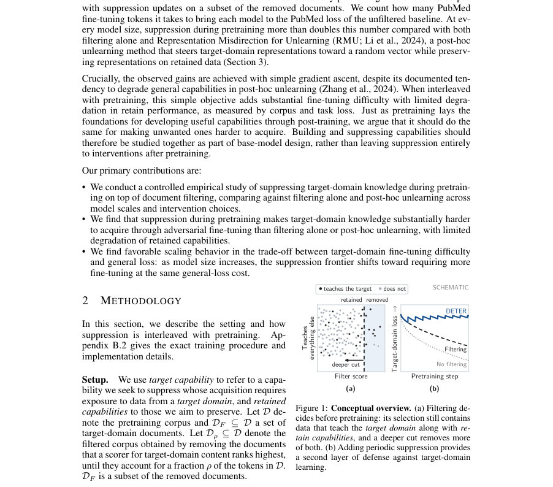
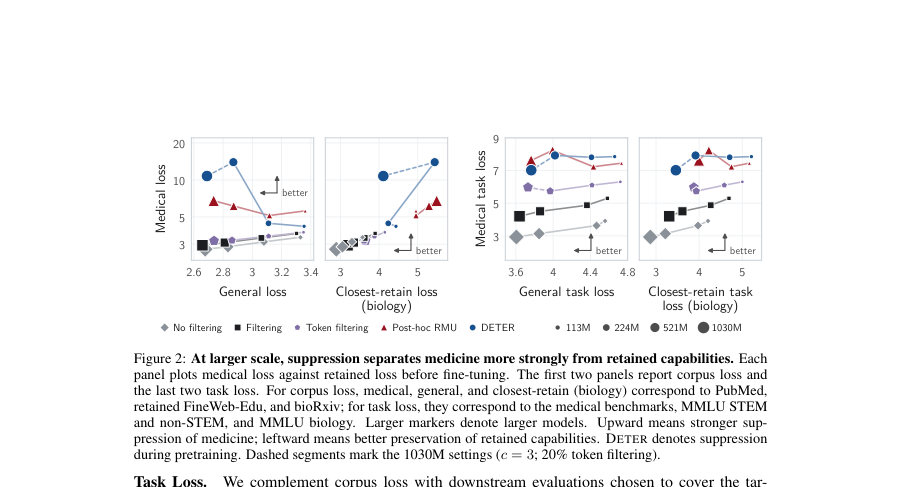
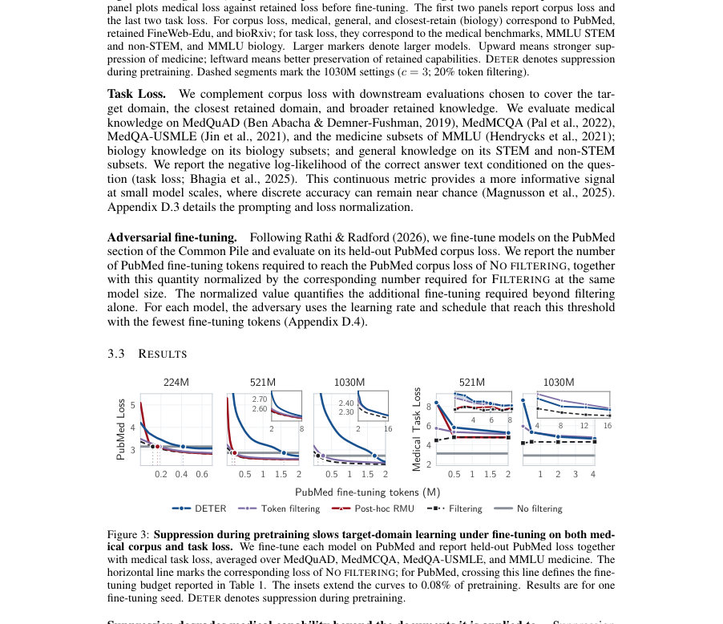

# DETER: Suppression During Pretraining for Tamper Resistance

- **게시일:** 2026-11-13
- **arXiv:** [2611.15479v1](http://arxiv.org/abs/2611.15479v1) · [PDF](https://arxiv.org/pdf/2611.15479v1)
- **저자:** Maria Ios Glarou, Martin Jaggi
- **분야:** cs.LG
- **선정 점수:** 5.12
- **선정 이유:** 최근성 0.7, 인용 영향 0.0 (인용 0회), 저자 영향 0.0 (최고 h-index 0), AI 주제 적합성 1.4, 개발자 관심 0.2, 학술 신호 0.3, 오픈 웨이트·주요 연구조직 신호 2.5

[← 2026-11-13 목록으로 돌아가기](../daily/2026-11-13.html)

<!-- paper-visuals:start -->
## 주요 Figure

> 원문 PDF에서 실제 Figure 캡션과 그림 영역이 함께 확인된 자료만 자동 추출했다.

*Figure · 원문 PDF 2쪽 · Figure 1: Conceptual overview. (a) Filtering de-*

*Figure · 원문 PDF 4쪽 · Figure 2: At larger scale, suppression separates medicine more strongly from retained capabilities. Each*

*Figure · 원문 PDF 4쪽 · Figure 3: Suppression during pretraining slows target-domain learning under fine-tuning on both med-*

<!-- paper-visuals:end -->

## 한 문장 요약

사전에 문서 필터링과 병행해 필터링으로 제거된 타깃 도메인 문서들에 대해 주기적으로 '억제(suppression)' 업데이트(간단한 그래디언트 상승)를 삽입함으로써, 모델이 공개된 이후 공격자가 해당 도메인으로 파인튜닝하여 지식을 회복하는 데 필요한 토큰 수를 크게 늘리는 방법을 제시하고 대규모 실험으로 검증했다.

## 해결하려는 문제

오픈-웨이트 언어모델에서 해로운(예: 의학·화학·사이버) 지식 습득을 제한하려면 모델 가중치가 공개된 이후에도 그 제한이 유지되어야 한다. 사후(unlearning) 기법은 파인튜닝으로 쉽게 되돌려질 수 있고, 사전(pretraining)에서의 단순한 데이터 필터링은 더 내구성이 있지만 여전히 타깃 도메인 학습이 남을 수 있다. 본문은 '사전 학습 단계에서 능동적으로 타깃 도메인 지식을 억제하면(필터링 위에 억제 업데이트를 추가하면) 사후 공격자가 파인튜닝으로 그 지식을 회복하는 데 드는 비용(토큰 수)을 얼마나 증가시킬 수 있는가'라는 질문을 다룬다.

## 핵심 기여

- 문서 필터링과 병행해 사전학습 중 타깃 도메인(의학) 문서에 대해 주기적 억제 업데이트를 삽입하는(간단한 그래디언트 상승 등) 절차(DETER)를 정의하고, 이를 여러 모델 규모(113M, 224M, 521M, 1030M)에서 제어된 실험으로 평가했다.
- 억제(pretraining-time suppression)가 필터링만 적용한 모델이나 대표성 조작 기반의 사후(unlearning, RMU) 대비, 공격자가 타깃 도메인(PubMed)으로 파인튜닝하여 원래의 타깃 손실(NO FILTERING)을 회복하는 데 필요한 토큰 수를 상당히 늘린다는 사실을 실증했다 (예: 1030M에서 20.36×).
- 여러 억제 목적함수(그래디언트 상승, 최대엔트로피, self-distillation 변형 등)를 비교하여 단순한 그래디언트 상승이 가장 유리한 '저비용(보유 성능 저하가 작음)으로 파인튜닝 난이도를 높이는' 트레이드오프를 제공함을 보였다.
- 억제와 사전학습의 상호작용에 대해 옵티마이저 상태(사전학습·억제 별도 유지가 바람직), 억제 시작 시점(초기 vs 후기), 억제 강도(c) 및 토큰 수준 억제 vs 문서 수준 억제 등의 설계 변수를 체계적으로 탐구했다.
- 스케일링 거동을 관찰하여 모델 크기가 커질수록 동일한 보유 손실 비용에서 억제가 더 큰 파인튜닝 난이도 향상을 달성하는 경향을 보고하고, 억제가 타깃 도메인에 상대적으로 집중된 손실 증가를 야기함을 제시했다.

## 접근 방법

* 핵심 방법은 사전학습(표준 next-token 예측 손실 ℓ_pre) 중 필터링된 코퍼스 Dρ(원본 D에서 의학점수 상위 문서들을 제거하여 ρ=20% 토큰 제거)로 계속 학습하면서, 제거된 문서 집합 DF(상위 5% 토큰을 차지하는 문서들)에서 일정 간격 P마다 S번 억제 업데이트를 수행하는 것이다.
* 억제 손실 LF는 기본적으로 DF에 대해 next-token 손실의 음수(그래디언트 상승)이며, 억제 학습률은 사전학습 학습률 ηt에 대해 배율 c로 조정된다.
* 억제는 t_start부터 시작되어 매 P 스텝마다 S(=1)번 수행하는 식으로 인터리브되며(기본 P=50, t_start=0, c=5 등), 억제와 사전학습은 동일한 모델 파라미터를 업데이트하되 각자 별도의 옵티마이저 상태(1st/2nd 모멘트 또는 momentum buffer)를 유지한다.
* 아키텍처는 decoder-only transformer(113M/224M/521M/1030M)로, 문맥 길이 2048, µP 기반 학습률 전이, 총 사전학습은 약 20 토큰/파라미터(Chinchilla-optimal)로 진행했다.
* 평가로는(1) 보유 도메인·타깃 도메인에 대한 홀드아웃 코퍼스 교차엔트로피(예: PubMed, bioRxiv, retained FineWeb-Edu), (2) 다운스트림 태스크의 정답 텍스트에 대한 negative log-likelihood(의학 벤치들: MedQuAD, MedMCQA, MedQA-USMLE, MMLU medicine 등), (3) 공격 모델로서 PubMed로 파인튜닝하여 NO FILTERING(원본 전체 코퍼스 사전학습) 모델의 PubMed 손실에 도달하는 데 필요한 파인튜닝 토큰 수를 측정(가장 빠른 학습률·스케줄을 선택)했다.
* 비교 대상은 FILTERING(문서 필터링만), TOKEN FILTERING(토큰 수준 마스킹), 그리고 RMU(표현을 랜덤 벡터로 유도하는 사후 unlearning)이다.

## 주요 결과

- 억제(DETER)는 모든 모델 크기에서 FILTERING, TOKEN FILTERING, RMU보다 더 많은 PubMed 파인튜닝 토큰을 필요로 했다(결과는 Table 1). 주요 수치: 113M에서 DETER는 0.39M 토큰(=3.05× FILTERING의 0.13M), 224M에서 0.47M(=4.07× FILTERING의 0.12M), 521M에서 1.58M(=13.53× FILTERING의 0.12M), 1030M에서 2.09M(=20.36× FILTERING의 0.10M).
- 억제는 타깃(의학) 관련 손실을 의학 코퍼스(PubMed)와 의료 태스크에서 더 크게 악화시켰지만(억제가 적용된 문서 집합 외의 의학 텍스트에서도 손실 증가 관찰), 가장 큰 영향은 의학에 국한되었고 근접 보유 도메인(생물학, bioRxiv)은 덜 손상되었으며 일반 도메인 평가는 거의 영향이 없었다(예: Table 1과 Figure 11).
- 억제 목적함수 비교에서 단순 그래디언트 상승이 같은 일반 손실 악화 대비 파인튜닝 난이도를 가장 많이 증가시키는 것으로 나타났다(그 외 최대엔트로피, self-distillation 변형, past-self distillation 등은 덜 효과적; Figure 6, Figure 10).
- 옵티마이저 상태를 사전학습·억제 별로 분리해 유지하는 것이(별도 통계 유지) 보유(특히 생물학 관련) 손상은 적게 하면서 유사하거나 더 큰 파인튜닝 저항을 제공했다(공유 상태는 억제 효과가 강해 보이나 파인튜닝으로 빠르게 회복되고 보유 손상 큼; Table 3).
- 억제 시작 시점과 강도는 트레이드오프에 영향을 미친다: 후기 시작(예: 60% 이후)에 같은 횟수의 억제 업데이트를 배치하면 더 높은 파인튜닝 난이도를 얻는 경우가 있으나, 모델 규모가 커질수록 조기 시작에서도 보유 성능을 더 잘 지키면서 상당한 저항을 유지할 수 있어 스케일에 따라 억제-시작 타이밍의 최적점이 변함(Figure 5, Table 2).

## 한계

- 저자 명시 한계 — 도메인·규모 제한: 실험은 '의학 지식'을 대리 도메인으로 사용했으며 최대 1.03B 파라미터 모델까지 실험했으므로, 관찰된 스케일링 경향과 효과가 더 위험한 능력(실제 해악을 초래하는 능력)이나 훨씬 더 큰 모델에 그대로 확장된다고 단정할 수 없다.
- 저자 명시 한계 — 선택/분류기 민감도: DF 선정(문서 분류기 임계값, 상위 5% 문서), 분류기 오류(오탐/미탐)와 억제 신호의 출처·다양성에 대한 민감도를 체계적으로 탐구하지 않아, 분류기 품질이나 억제 데이터 구성에 따른 민감성이 불확실하다.
- 저자 명시 한계 — 공격·복원 평가 범위: 회복(복원)은 PubMed로의 파인튜닝 공격만으로 측정했고, 모든 방법이 평가된 공격 예산 내에서는 NO FILTERING 손실에 도달했음(단, 필요 토큰 수는 증가). 사후 수정이나 다른 적대적 편집(모델 조작)까지 포괄하지 않음.
- 실험 범위에서 확인되는 제약 — 예산 상대성: 파인튜닝 토큰 수는 절대값으로는 사전학습 토큰 수에 비해 매우 작음(예: 1030M에서 DETER의 2.09M 토큰은 전체 사전학습의 약 0.010% 수준), 따라서 '막는다'기보다는 '회복 비용을 올린다'는 근거에 국한된다.

## 개발자 관점

- 재현·하이퍼파라미터: 기본 설정은 문서 필터링(ρ=20%) + DF는 제거된 문서 중 상위 5% 토큰 차지 문서, 억제 스케줄 t_start=0, P=50, S=1, c=5(1030M에서는 c=3)이며 사전학습은 약 20 토큰/파라미터로 진행. 이 값들은 본문/부록에 구체적으로 수록되어 있으므로 구현 시 그대로 재현 가능하다.
- 옵티마이저 상태 분리 권장: 억제와 사전학습은 동일 파라미터를 업데이트하되 옵티마이저(모멘트/EMA 등) 상태는 분리해서 유지하는 것이 보유 능력 손해를 줄이면서 억제 효과를 유지하는 데 도움이 된다(실험적 발견).
- 억제 비용(계산·메모리): 억제 업데이트는 전/후향을 요구하므로 전체 사전학습 대비 추가 계산은 약 S/P(예: S=1,P=50 → 약 2%) 수준이며, 옵티마이저 상태를 별도 유지하면 AdamW 기준 파라미터 저장량이 약 +33–50% 늘어날 수 있다(부록 B.2 수치). 비용·메모리 트레이드오프를 고려해 배치해야 한다.
- 결합 전략: 문서 필터링과의 결합이 핵심: 억제만으로도 효과는 있으나 문서 필터링(특히 토큰 필터링)과 결합할 때 일반 손실 대비 파인튜닝 저항(trade-off)이 더 좋았다. 따라서 운영환경에서는 필터링→억제 순의 다층 방어를 고려할 것.
- 안전성·배포 고려: 억제는 타깃 도메인 지식 획득을 어렵게 하지만 완전히 차단하지는 못하므로(공격자가 더 많은 파인튜닝 토큰을 투자하면 회복 가능), 억제는 다른 거버넌스·접근 통제 수단과 함께 다중 방어막으로 배치해야 한다. 또한 문서 분류기 오류(오탐/미탐)가 오용 또는 불필요한 성능 저하로 이어질 수 있으므로 분류기 품질·임계값 선택에 신중을 기해야 한다.

**근거 범위:** 이 분석은 제공된 논문 PDF 본문(주 텍스트 및 부록)의 내용을 기반으로 작성되었음. 표와 수치는 논문 본문과 표(Table 1 등) 및 부록(B, C, D)의 기재를 그대로 인용했다. 실험적 세부값(예: 하이퍼파라미터, 옵티마이저 구성, 계산·메모리 추정)은 본문과 부록에서 직접 확인 가능한 항목에 근거했으며, 본문에 명시되지 않은 내부 구현·추가 시드 반복 결과 등은 포함하지 않았다.
