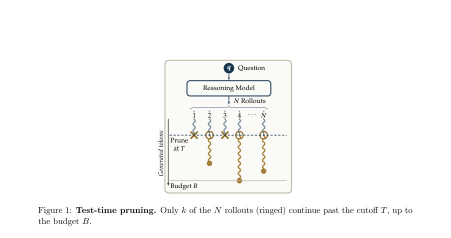
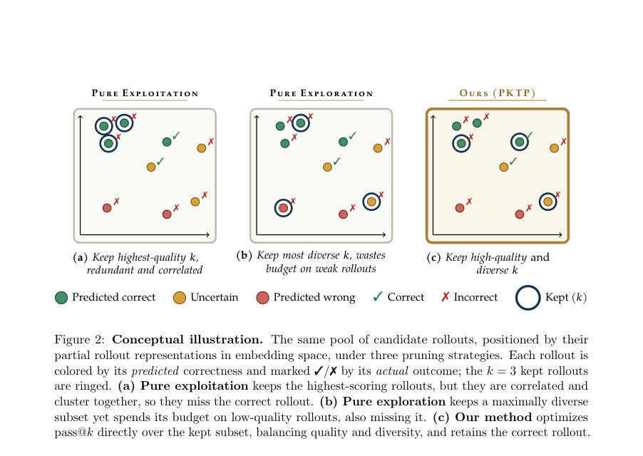
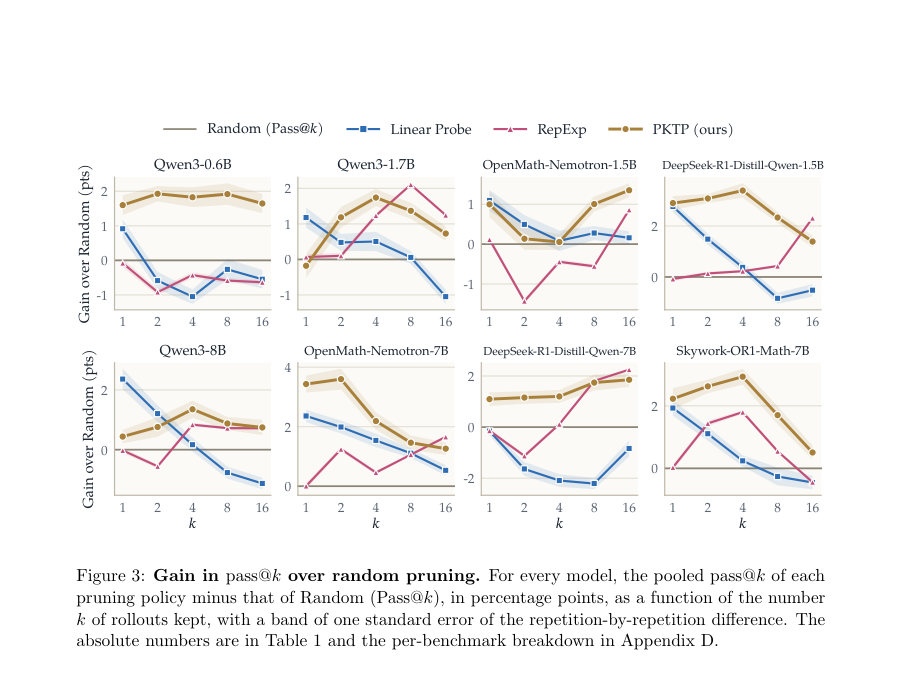

# Direct Pass@$k$ Optimization for Thought Pruning: Balancing Quality and Diversity in Test-Time Reasoning

- **게시일:** 2026-10-24
- **arXiv:** [2610.31667v1](http://arxiv.org/abs/2610.31667v1) · [PDF](https://arxiv.org/pdf/2610.31667v1)
- **저자:** Mahdi Salmani, Adel Javanmard, Devansh Gupta, Meisam Razaviyayn
- **분야:** cs.AI, cs.CL
- **선정 점수:** 7.46
- **선정 이유:** 최근성 0.8, 인용 영향 0.0 (인용 0회), 저자 영향 2.0 (최고 h-index 37), AI 주제 적합성 2.6, 개발자 관심 0.2, 학술 신호 0.3, 오픈 웨이트·주요 연구조직 신호 1.6

[← 2026-10-24 목록으로 돌아가기](../daily/2026-10-24.html)

<!-- paper-visuals:start -->
## 주요 Figure

> 원문 PDF에서 실제 Figure 캡션과 그림 영역이 함께 확인된 자료만 자동 추출했다.

*Figure · 원문 PDF 2쪽 · Figure 1: Test-time pruning. Only k of the N rollouts (ringed) continue past the cutoff T, up to*

*Figure · 원문 PDF 3쪽 · Figure 2: Conceptual illustration. The same pool of candidate rollouts, positioned by their*

*Figure · 원문 PDF 9쪽 · Figure 3: Gain in pass@k over random pruning. For every model, the pooled pass@k of each*

<!-- paper-visuals:end -->

## 한 문장 요약

부분 롤아웃의 품질과 다양성 간 균형을 직접 최적화하는 pass@k 기반의 사전(Thought) 프루닝 방법 PKTP를 제안하여, 잠재 가우시안 모델과 2차 근사로 얻은 닫힌형 근사를 그리디로 최적화해 테스트타임 추론에서의 효율성과 성능을 개선한다.

## 해결하려는 문제

테스트타임 스케일링(여러 개의 롤아웃 생성)은 추론 성능을 높이나 모든 롤아웃을 끝까지 실행하는 비용이 매우 크다. 기존 프루닝 방법은 두 계열로 나뉜다: (i) 품질 기반(예: 히든 상태에 대한 linear probe, 토큰 신뢰도 등)은 상위 점수를 가진 롤아웃들을 유지하지만 서로 상관된(중복된) 후보들을 선택해 모두 실패할 위험이 있고(pure exploitation), (ii) 다양성 기반(RepExp)은 서로 다른 경로를 탐색하지만 품질을 무시해 예산을 약하게 사용하는 경향이 있다(pure exploration). 이 둘의 탐색-활용(trade-off)을 직접적으로 목적 함수로 다루는 프루닝 방법이 부족하며, 실제로 우리가 원하는 지표인 pass@k(유지된 k개 중 적어도 하나가 정답일 확률)를 직접 최적화하는 방법이 필요하다.

## 핵심 기여

- 프루닝 문제를 유지 집합 S의 pass@k를 직접 최대화하는 최적화 문제로 정식화하고, 롤아웃의 성공이 유사한 표현 공간에서 함께 실패하는 현상을 잠재 가우시안 모델로 모델링함.
- pass@k의 기대값을 계산하기 위해 롤아웃 표본의 잠재변수 기대에 대해 2차 테일러 전개(Second-order surrogate, Theorem 1)를 도입해 닫힌형 근사를 유도하고, 이 근사가 단조 및 서브모듈러임을 증명하여 그리디 알고리즘의 근사 보장을 확보함(Theorem 2).
- 근사 목적식(식 11)이 품질(모듈러 항)과 다양성(−1/2 log det 항) 및 벡터 합에 대한 패널티 항을 동시에 포함함을 보이며 Linear Probe와 RepExp를 양 끝 극한으로 연결해 품질-다양성 균형을 원리적으로 설명함.
- 단일 학습(잠재 모델 학습)으로 k에 독립적인 매개변수를 얻고, 한 번의 그리디 패스로 nested한 후보 집합들을 생성해 추론 시점에 k를 온라인으로 선택 가능하게 함.
- 여덟 개의 공개 가중치(reasoning) 모델에서 Linear Probe 및 RepExp 대비 특히 중간값의 k에서 일관되게 성능 향상을 보임(실험적 검증).

## 접근 방법

* 문제 설정: 질문 q에 대해 모델 π에서 N개의 롤아웃 y(i)을 샘플링하고 각 롤아웃은 컷오프 T 토큰까지만 관찰된다.
* 각 접두사 y(i)_{1:T}는 EMA로 풀링한 히든-스테이트 임베딩 hi로 표현된다.
* 목표는 \|S\|=k인 유지 집합 S를 선택해 pass@k = Pr(적어도 하나가 정답) 를 최대화하는 것(식 3).
* 잠재 가우시안 모델: 각 롤아웃 i의 점수 Zi를 Qi(hi) + h_i^T f + m_i로 모델링(Qθ(hi)는 품질 예측, f ~ N(0, I_d)는 공유 랜덤 효과로 표현 유사성에 따른 상관을 만들고 m ~ N(0,I_N)는 개별 잡음).
* 정답 여부는 Zi ≥ 0으로 임계화하여 이진 결과 Ci를 얻음(식 4–5).
* 학습: M개의 문제(한 문제는 N개의 hi와 관찰된 정답 패턴 c(m))에 대해 잠재 f에 대한 기대를 포함한 우도 log Pr(C=c\|H)를 최대화하려 하나 f에 대한 닫힌형 기대가 없어 각 로그 요인을 h_i^T f에 대해 2차 테일러로 전개(ε→0)해 근사 우도(Thm.1, 식 9)를 얻고 이를 최대화하여 Qθ를 학습함(실험에서는 Qθ는 선형 모델 θ^T h + θ0 사용).
* 선택(Subset selection): 유지 집합의 실패 확률 L(S)=Pr(all i∈S fail)=E_f ∏_{i∈S} Φ(−(q_i + h_i^T f))를 Thm.1의 근사로 근사해 log eL(S) 형태(식 11)를 얻음.
* 해석상 항들은 품질 항(∑ log Φ(−q_i)), 다양성 항(−1/2 log det(Id + Σ_S)) 및 벡터 합 패널티(1/2 b_S^T (Id+Σ_S)^{-1} b_S)를 포함함.
* 정확 해는 NP-hard이나 근사 근사치 eP=1−eL은 정규화·단조·서브모듈러로 증명되어 그리디 추가(매 스텝 최소 Δ_j(S))로 (1−e^{-1}) 근사 보장을 받음(Thm.2).
* 계산: 그리디는 Σ_S 업데이트 시 랭크-원 업데이트(Sherman–Morrison, matrix determinant lemma)로 Δ 계산을 효율화해 시간복잡도 O(k (N d + d^2)) 및 메모리 O(N d + d^2)를 달성함(A.2).
* 구현 세부: 표현은 마지막 블록 히든 상태의 EMA(α=1e-3), 생성은 temperature=0.8, top-p=0.95, 전체 토큰 예산 B=32768, 컷오프 기본 T=4000, 풀에서 N=128 샘플, 평가 k∈{1,2,4,8,16}.
* 검증은 박스 표기된 최종 답을 Qwen3-32B 판정자에게 동등성 확인으로 수행.

## 주요 결과

- 실험 대상: 8개 공개 가중치 reasoning 모델 — 소형: Qwen3-0.6B, Qwen3-1.7B, OpenMath-Nemotron-1.5B, DeepSeek-R1-Distill-Qwen-1.5B; 대형: Qwen3-8B, OpenMath-Nemotron-7B, DeepSeek-R1-Distill-Qwen-7B, Skywork-OR1-Math-7B. 데이터: AIME(2024–2026), HMMT(2024–2026), RIMO-N 등과 모델별로 추가 벤치마크(총 모델별 약 600문제), 8-폴드 교차검증을 20번 반복(폴드 분할·시드 재설정)해 평균 및 표준오차 보고.
- 주요 비교군: Random(무작위 k 선택), Linear Probe(히든 임베딩에 대한 선형 분류기에 의해 개별 순위), RepExp(표현 기반 잔여 분산 기준으로 다양성 선택).
- 대표 정량 결과: 표 1(본문)에 따라 풀합산 pass@k(%) — 예: Qwen3-0.6B에서 Random pass@4 = 45.4%, Linear Probe = 44.3%, RepExp = 45.0%, PKTP = 47.2%(표준오차들 표에 기재). Qwen3-1.7B에서 Random pass@4 = 62.6%, Linear Probe = 63.1%, RepExp = 63.9%, PKTP = 64.4%. DeepSeek-R1-Distill-Qwen-1.5B에서 Random pass@4 = 49.5%, Linear Probe = 49.9%, RepExp = 49.8%, PKTP = 52.9%. PKTP는 대부분의 모델에서 k≥2일 때 Random보다 높게 유지됨.
- 강한 사례: DeepSeek-R1-Distill-Qwen-1.5B, k=4에서 PKTP는 Linear Probe 대비 +3.0 percentage points, RepExp 대비 +3.2 pts 이득(본문). Qwen3-0.6B에서는 모든 k≥2에서 양쪽 베이스라인보다 2pt 이상 앞섬. DeepSeek-R1-Distill-Qwen-7B 에서 k=4일 때 Linear Probe 대비 +3.3 pts (본문 기술).
- 동작 특성: Linear Probe는 k=1에서 강력하나 k 증가 시 상관된 상위 후보들의 군집 선택 때문에 성능이 Random으로 수렴하거나 하회할 수 있음(본문 Fig.4 사례). RepExp는 k 증가 시 좋아지나 중간 k에서는 이상치(outliers)를 과도히 선택해 Random보다 낮을 수 있음(본문 Fig.5 사례). PKTP는 품질 신호를 보존하면서 다양성도 확보해 중간 k에서 가장 큰 이득을 보임. 또한 컷오프 T 증가(예: Qwen3-1.7B에서 pass@4는 T=2000에서 63.5% → T=8000에서 65.9%)가 PKTP 성능을 개선하는 경향이 관찰됨(본문 Fig.6). 풀 크기 N 증가는 PKTP에 유리하게 작용해 충분히 큰 N에서 다른 방법들을 능가함(본문 Fig.7).

## 한계

- 저자 명시 한계: (1) 근사성의 한계 — Thm.1의 2차 테일러 전개는 국소 근사이며 정확한 우도가 아님(본문·Appendix에서 명시). (2) 표현의 제약 — 본 실험은 EMA로 풀링한 히든 상태 임베딩에 의존하며 이 임베딩에 올바른 정답 신호가 약하면 PKTP의 이득이 제한될 수 있음(본문: 'weak correctness signal in the embeddings'). 저자들은 더 나은 부분-롤아웃 품질 표현이 PKTP 성능을 직접적으로 강화할 것이라 명시함. (3) 정확 선택 문제의 NP-난이도 — 정확 최적화는 NP-hard하므로 근사 알고리즘에 의존해야 함(Prop.1).
- 실험·범위에서 확인되는 제약(본문 근거 기반): (4) 검증은 주로 수학 문제 벤치마크(여러 연도 AIME/HMMT 등)와 RIMO-N 등에 한정되어 있음; 다른 문제 유형(예: 자연어 추론, 코드 생성의 reward 기반 continuous scoring)에 대한 일반화는 본문에서 실험적으로 확인되지 않음. (5) 정답 판정은 모델 기반 판정자(Qwen3-32B judge)로 수행했으며(특정 벤치마크에서는 symbolic checker 대신 판정자 사용), 이로 인해 검증 기준이 벤치마크·판정자에 의존함(본문 4.1 설명). (6) 실험은 공개 가중치 모델들에만 적용되었으며 프라이빗·더 큰 모델에서 동일한 이득이 보장되는지는 본문에서 제시되지 않음.

## 개발자 관점

- 재현성·데이터: 각 문제에서 N개의 접두사롤아웃(본 논문은 N=128을 기본)을 저장하고 각 접두사마다 마지막 블록 히든 상태의 EMA(α=1e-3)를 계산·저장하면 PKTP의 입력 표현을 얻을 수 있음(본문 F). 문제별로 풀을 여러 fold로 나누어 잠재 모델 Qθ 학습(식 6의 근사 우도 사용) 후 테스트 폴드에서 선택 적용(본문은 8-fold CV를 20회 반복).
- 모델 학습·구현: Qθ는 저자 실험에서 선형 모델(θ^T h + θ0) 사용. 근사 우도(식 9)를 통해 대수적(미분가능) 목적을 얻으므로 자동미분으로 θ 최적화 가능. 구현 시 수치안정성(Φ, ϕ 계산 및 작은 값 처리) 주의 필요.
- 선택 알고리즘·효율화: 그리디 마진 Δ_j(S)는 랭크-원 업데이트로 계산 가능(식 21, Sherman–Morrison·matrix determinant lemma 이용). 이로써 각 스텝 비용을 O(N d + d^2)로 줄일 수 있음(본문 A.2). 메모리: 모든 hi를 메모리에 보관해야 하므로 O(N d) 저장 필요. 실사용에서는 d(히든 차원)와 N 선택이 비용에 큰 영향.
- 운영(추론) 관점: 잠재 모델은 k에 독립적으로 학습되므로 한 번 학습해두면 런타임에 k를 바꿔가며 nested한 집합을 재사용 가능(본문 장점). 컷오프 T와 초기 풀 크기 N을 실사용 예산·지연 요건에 맞게 튜닝하면 PKTP 성능 개선 가능(본문에서 T 및 N 민감도 실험 제공).
- 안전성·오류 위험: Linear Probe가 상위 예측에 편향되어 서로 상관된 실패를 초래할 수 있으므로 단순 점수 기반 조기종료는 위험(본문 사례). RepExp는 이상치 선택 문제를 가질 수 있으므로 다양성만으로 판단하지 말고 품질 신호와 함께 사용. 또한 검증(verification) 체계(예: 심볼릭 체크 vs 판정자)가 결과에 큰 영향을 미치므로 응용에 맞는 신뢰 가능한 검증 수단 확보 필요.

**근거 범위:** 이 분석은 제공된 논문 PDF 본문(및 본문의 표·그림·부록 포함)만을 근거로 작성되었음. 본문에 명시된 수치(예: 표 1의 pass@k 수치, 컷오프/풀 크기 실험 수치, 특정 포인트 이득)는 PDF의 표·본문 문장 그대로 인용했음. 본문 밖의 구현·하이퍼파라미터(예: 세부 코드·학습 스케줄)는 PDF에 구체적 서술이 없는 한 생성하지 않았음.
