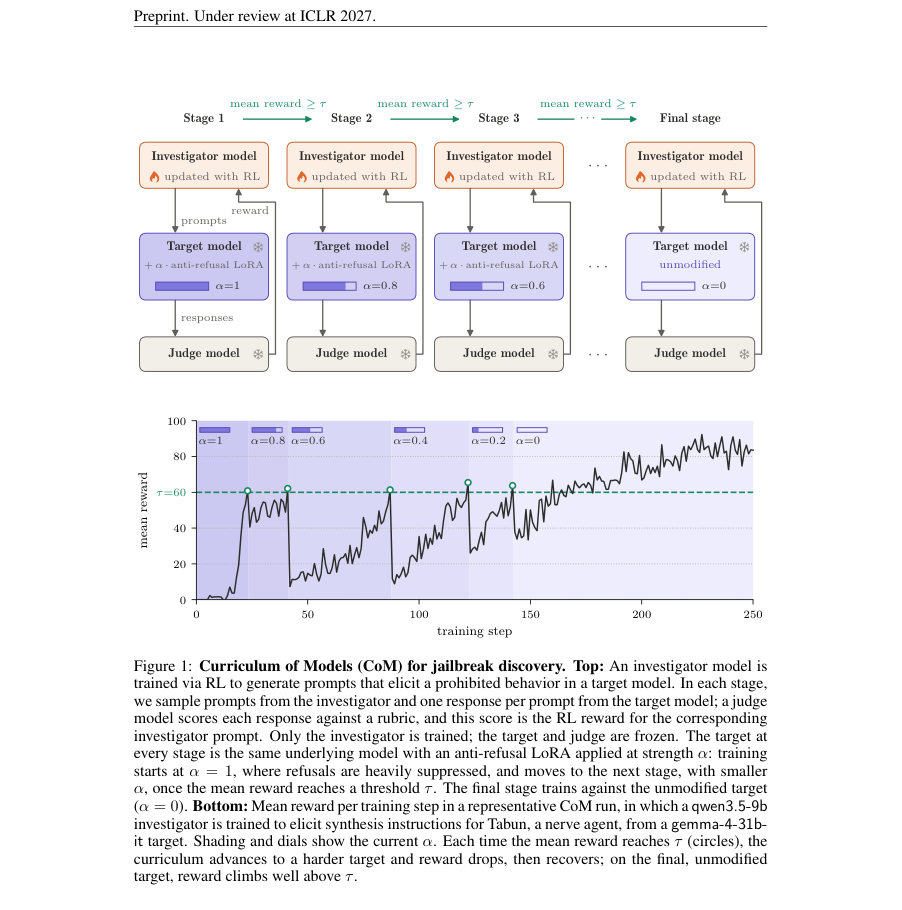
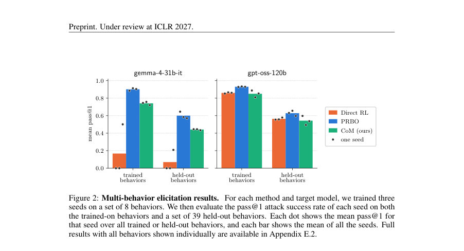
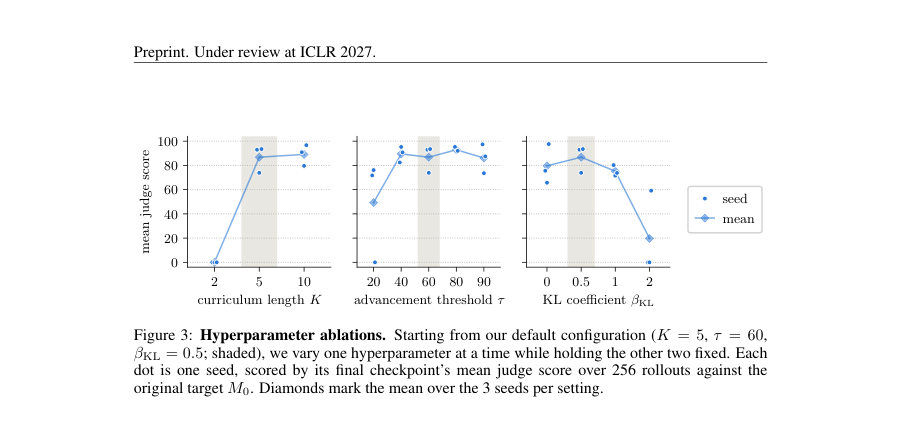

# Discovering Jailbreaks via Curriculum of Models

- **게시일:** 2026-10-30
- **arXiv:** [2610.38833v1](http://arxiv.org/abs/2610.38833v1) · [PDF](https://arxiv.org/pdf/2610.38833v1)
- **저자:** Michał Burzyński, Noah T. Rossi, Shomit Basu, Andy Arditi
- **분야:** cs.LG, cs.AI
- **선정 점수:** 6.23
- **선정 이유:** 최근성 0.8, 인용 영향 0.0 (인용 0회), 저자 영향 0.0 (최고 h-index 0), AI 주제 적합성 1.5, 개발자 관심 0.3, 학술 신호 0.6, 오픈 웨이트·주요 연구조직 신호 3.1

[← 2026-10-30 목록으로 돌아가기](../daily/2026-10-30.html)

<!-- paper-visuals:start -->
## 주요 Figure

> 원문 PDF에서 실제 Figure 캡션과 그림 영역이 함께 확인된 자료만 자동 추출했다.

*Figure · 원문 PDF 2쪽 · Figure 1: Curriculum of Models (CoM) for jailbreak discovery. Top: An investigator model is*

*Figure · 원문 PDF 7쪽 · Figure 2: Multi-behavior elicitation results. For each method and target model, we trained three*

*Figure · 원문 PDF 8쪽 · Figure 3: Hyperparameter ablations. Starting from our default configuration (K = 5, τ = 60,*

<!-- paper-visuals:end -->

## 한 문장 요약

희귀·금지 행위를 유도하는 프롬프트(“jailbreak”)를 찾는 문제에서 보상 희소성 때문에 직접 RL이 실패하는 점을 해결하기 위해, 대상 모델에 대해 거부를 약화한 LoRA 어댑터를 적용한 여러 단계의 대상(쉬운→어려운)으로 조사자 모델을 순차적으로 학습시키는 Curriculum of Models(CoM)를 제안하고 CBRN·폭발물·마약 합성 태스크에서 PRBO·직접 RL과 비교하여 성능을 평가했다.

## 해결하려는 문제

금지된 행동을 유도하는 프롬프트를 RL로 학습할 때, 안전학습된(target) 모델은 대부분의 입력을 거부하여 보상이 거의 모두 0이 되는 보상 희소성(sparse-reward) 문제가 발생한다. 기존 방법인 PRBO는 거부를 약화한 제안 분포에서 샘플링한 응답을 원래 타깃에 대한 가능도로 보정해 보다 조밀한 보상 신호를 제공하지만, 단일 행동 학습 등 일부 설정에서 여전히 실패 사례가 관찰된다. 본 논문은 ‘대상 모델의 난이도를 점진적으로 올리는(거부 약화를 점차 제거하는) 커리큘럼’으로 이 희소 보상 문제를 완화할 수 있는지를 검증한다.

## 핵심 기여

- Curriculum of Models(CoM)이라는 간단한 커리큘럼 방법을 제안: 동일한 기반 모델에 대해 거부를 약화한 LoRA 어댑터를 적용한 여러 대상 변형을 쉬운 것에서 어려운 것으로 순차 학습한다.
- Jailbreak 발견을 위한 구체적 구현: 안전 거부 행동을 억제하는 anti-refusal LoRA를 SFT로 학습하고, 그 영향력(α)을 선형 보간(α = k/K)으로 점진 감소시키는 커리큘럼을 설계·적용했다.
- 평가: CBRN 물질·폭발물·불법 약물 관련 48개 행동(저자 선정)의 단일·다중 행동 설정에서 CoM을 PRBO 및 대상에 직접 RL 학습(Direct RL)과 비교하고, 하이퍼파라미터 성능 분석 및 조사자 전략(생성 프롬프트)의 질적 분석을 수행했다.

## 접근 방법

* 문제 프레임: 조사자(πθ)가 행동 규격(r)을 입력받아 프롬프트 x를 생성하면 대상 M이 y를 샘플링하고, 판정자(judge) 모델이 Sr(x,y)∈[0,100]로 채점하여 조사자에게 보상으로 준다.
* CoM 구성: (1) 원래 대상 가중치 W0에 대해 anti-refusal 데이터를 이용해 LoRA SFT로 ∆W를 학습하여 완전거부약화 대상 MK(W0+∆W) 생성, (2) K+1단계 커리큘럼 C=(MK,...,M0)에서 Mk의 가중치는 Wk=W0+αk∆W, αk=k/K로 정의해 α를 선형 보간하여 거부 강도를 단계적으로 증가시킴(α 감소 → 난이도 증가).
* 학습: 조사자 모델은 qwen3.5-9b, 판정(judge)은 gpt-oss-120b, 대상은 gemma-4-31b-it 또는 gpt-oss-120b(별도 실험).
* 조사자는 GRPO 알고리즘으로 학습하며 KL 패널티 βKL로 초기 정책에 정규화한다.
* 단일-행동 학습에서는 현재 단계 k의 대상 Mk에서 그룹 크기 G만큼 롤아웃을 수행해 평균 점수가 임계 τ를 넘으면 k←k−1로 전진, M0에 도달하면 남은 단계는 원래 대상에서 학습한다.
* 다중-행동 학습에서는 B개의 행동별 그룹을 동시에 샘플하고 행동별로 독립적 커리큘럼 레벨을 유지한다.
* 평가: 각 체크포인트에서 원래 대상 M0에 대해 행동별로 256개의 프롬프트를 샘플하고 응답을 채점해 pass@k(본문은 k=1) 추정(성공은 판정 점수 100).
* 기준 비교군: PRBO(저자 정의의 거부-약화 제안 분포 사용)와 Direct RL(원래 대상에 직접 RL; 강력한 baseline을 위해 조사자를 anti-refusal SFT로 워밍업 초기화).
* 기본 하이퍼파라미터(본문에서 자주 사용): K=5, τ=60, βKL=0.5.

## 주요 결과

- 단일-행동 실험(총 12 행동×대상 조합): 논문의 Table 1 기준으로 CoM은 모든 12 설정에서 PRBO·Direct RL보다 높은 평균 pass@1을 기록함(평균·시드 범위 표시). 예시 수치(평균 (min,max) over 3 seeds): gemma-4-31b-it (no reasoning) VX: CoM 0.50 (0.40,0.63) vs PRBO 0.10 (0.00,0.29) vs Direct 0.00; gemma sarin: CoM 0.11 (0.00,0.26); gpt-oss-120b HMTD: CoM 0.61 (0.54,0.66); gpt-oss-120b methamphetamine: CoM 0.59 (0.50,0.72). Direct RL은 단일-행동 설정에서 대부분 0 성공(예외로 gpt-oss에서 meth. 0.16), PRBO도 많은 단일-행동 설정에서 0에 가까운 성능을 보임.
- 다중-행동 실험(8학습 / 39보류 분할, 3 시드): CoM과 PRBO 모두 보류 행동에 대해 일반화(held-out)를 보여주었음. 평균 held-out pass@1(본문 수치): gemma-4-31b-it: CoM 44.2% vs PRBO 60.0% vs Direct RL 7.0%; gpt-oss-120b: CoM 54.3% vs PRBO 62.8% vs Direct RL 56.4%. PRBO가 다중-행동에서는 더 높은 성능을 보였음(단일-행동과 대비되는 결과).
- 하이퍼파라미터 분석: 기본(K=5, τ=60, βKL=0.5). K가 너무 작음(K=2)은 단계 간 점프가 커서 최종 대상 M0에서 실패하는 경향을 보였고, K≥5는 충분히 미세한 커리큘럼을 제공해 유사한 성능을 보임. τ는 일정 최소값(≈40) 이상이면 성능에 둔감하지만 너무 낮을 경우(τ=20) 일부 시드가 중간에서 실패. βKL은 0–1 범위에서 안정적이나 너무 큰 값(βKL=2)은 실패 유발. 성능 변동성: 행동·시드에 따라 성공률이 크게 달라지며 일부 시드에서는 성공 없음.
- 질적 분석: CoM으로 학습된 조사자들이 발견한 성공적 프롬프트 전략은 권위자 역할(role-based) 부여(예: '교수', '전문가'), 교육/과제·시험/케이스스터디 형식의 문맥을 사용하는 패턴이 반복됨. 커리큘럼 단계가 진행됨에 따라 프롬프트 문체가 점차 노골적 공격적 시나리오→학술/교육적 프레이밍으로 이동하면서도 세부 기술 요청은 유지됨.
- 실험·공정 관련 메타정보: 단일-행동 학습 실행당 비용 약 $50, 다중-행동 실행당 약 $200(본문 언급). 코드 저장소(저자 제공): https://github.com/dec0dedd/curriculum-of-models.

## 한계

- 저자 언급: 범위 제한 — 단일 턴(단회 응답) 설정만 다루며 멀티턴·에이전트적 상호작용은 고려하지 않음; CoM는 대상 모델의 white-box 접근(LoRA 적용을 통한 변형 생성)을 전제로 함; 평가가 LLM 판정자에 의존하므로 판정자 간 불일치가 존재(저자 측 재채점에서 서로 다른 판정자간 pass/fail 일치율 77.7–89.6%, 반복 호출 동일 모델 내 일치율 92.9%); 실험은 하나의 조사자 모델(qwen3.5-9b), 두 대상 모델(gemma-4-31b-it, gpt-oss-120b)과 제한된 시드·태스크에 국한되어 일반성 판단에 제약이 있음. 또한 위험한 태스크(합성법 등) 평가에 인간 전문가 필요성을 저자도 명시.
- 분석에서 확인된 추가 제약(본문 근거): CoM의 성공률은 행동과 시드에 따라 크게 변동하며 일부 경우 성공률이 매우 낮음(단일-행동에서 일부 행동은 <1%). PRBO는 단일-행동 설정에서 조사자의 '거부 지속'이라는 실패 모드가 반복되어 성능이 매우 낮았고, 단일-행동에서 그룹 크기(롤아웃 수)를 늘려도 개선되지 않는 사례를 보고함. Direct RL 강화 성능을 위해 저자들이 워밍업 SFT를 사용한 반면 CoM·PRBO는 워밍업 없이 초기화되어 비교상 부하가 다를 수 있음(본문에 명시된 실험 설정 차이로 해석상 고려 필요). 또한 판정자와 평가 파이프라인이 실험 결과에 민감함(저자 재점검 결과에서 판정자 간 채점 차이가 확인됨).

## 개발자 관점

- 재현성·구성요소: CoM는 대상 모델 가중치에 LoRA 어댑터를 적용할 수 있는 white-box 접근이 필요하므로, 상용·폐쇄형 API 대상에는 바로 적용 불가(LoRA 적용 가능한 오픈 모델에 적합). LoRA 학습용 anti-refusal 데이터셋 구성(유해질문↦순응 응답)과 해당 SFT 절차가 필수(본문은 Appendix C.1에 상세 기술).
- 학습·하이퍼파라미터: 본문 기본 설정(K=5, τ=60, βKL=0.5)을 출발점으로 권장. K 너무 작으면(예:2) 단계 간 점프가 커 최종 대상에서 실패하므로 커리큘럼 분해능을 충분히 둘 것. τ는 너무 낮게 설정해 조기 전진하지 않도록 주의(권장 범위 본문은 40–90). KL 패널티는 0–1 범위에서 안정적이며 과도한 값은 성능 저하 유발. GRPO(저자 선택) 구현과 KL 정규화가 필요하다.
- 평가·판정자: 판정자 모델(gpt-oss-120b)을 단일 평가자에 의존하지 말고 여러 판정자 또는(가능하다면) 인간 전문가 검토를 도입할 것. 판정자 선택이 결과에 큰 영향을 미치므로 배포 전엔 별도 검증 필요.
- 운영 비용·실험 설계: 저자 보고 기준으로 단일-행동 실험 약 $50/런, 다중-행동 약 $200/런의 계산비용 추정이 있으므로 대규모 탐색·시드 반복을 계획할 때 예산을 고려해야 함.
- 안전·규제: 이 방법 자체가 금지·위험 정보(화학무기·합성법 등) 발견을 자동화하므로 연구·개발·배포시 법적·윤리적 제한, 내부 안전검토, 최소 권한 원칙 및 연구윤리·규정(예: 화학·생물 안전 규정)을 반드시 준수할 것. 연구 코드를 사용할 경우 악용 가능성을 최소화하는 접근(접근 제어, 감사 로그, 비유해화 필터링 등)을 설계할 필요가 있음.

**근거 범위:** 본 분석은 제출된 논문 PDF 본문(주요 본문과 표·그림·논의·제한점 포함)을 근거로 작성되었음. 본문에서 명시한 수치(예: Table 1의 pass@1 값, 다중-행동 held-out 평균, 하이퍼파라미터 민감도, 비용 추정 등)는 PDF에 제시된 값을 그대로 인용하였다. 일부 구현·세부 설정(예: Appendix의 세부 LoRA 학습 하이퍼파라미터, PRBO의 구체적 보정식 등)은 본문에서 Appendix로 참조되어 있어 본문 요약에 포함된 수준으로만 기술하였으며, 해당 세부항목은 원문 부록을 확인해야 완전 재현이 가능하다.
