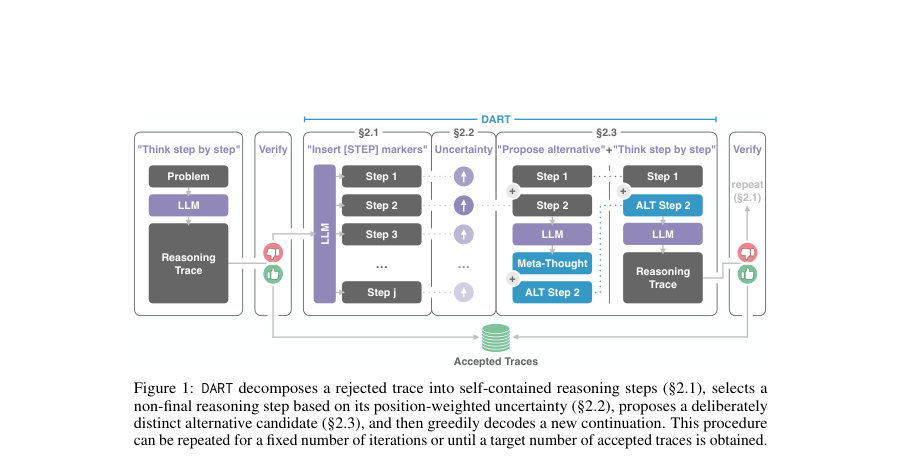
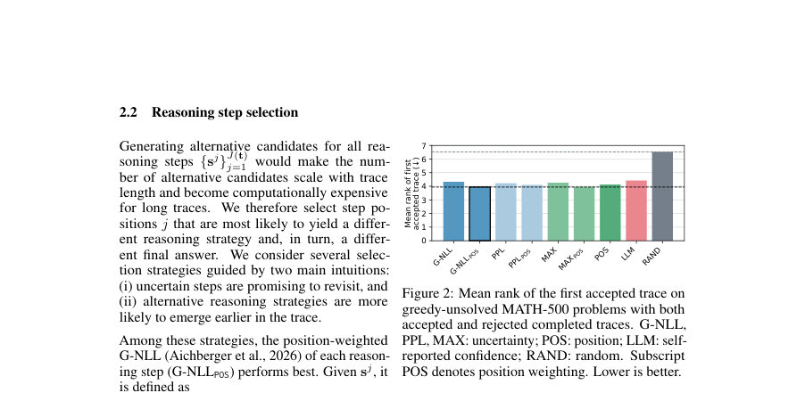
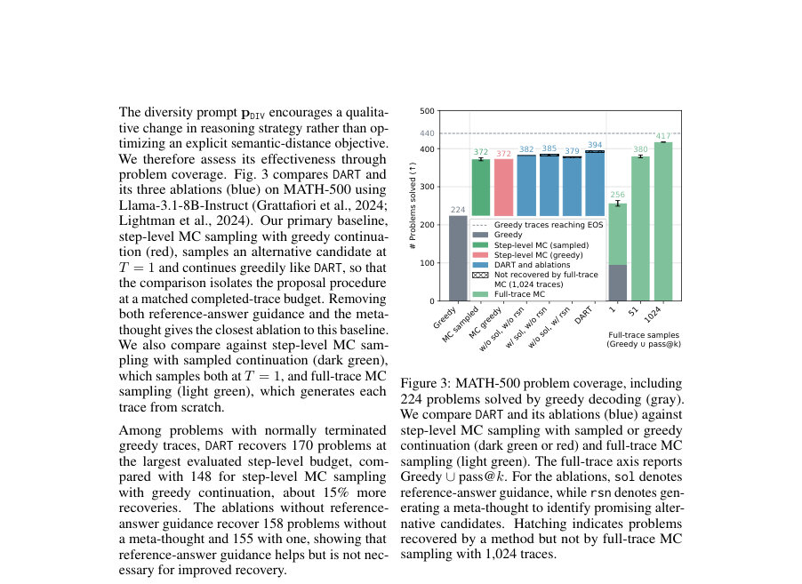

# Diverse Alternative Reasoning Traces for Hard Math Problems

- **게시일:** 2026-11-26
- **arXiv:** [2611.34928v1](http://arxiv.org/abs/2611.34928v1) · [PDF](https://arxiv.org/pdf/2611.34928v1)
- **저자:** Lukas Aichberger, Adam Golinski, Arno Blaas, Arwen Bradley, Jacob Springer, Mehrdad Farajtabar, Michael Kirchhof, Sinead Williamson
- **분야:** cs.CL, cs.AI, cs.LG
- **선정 점수:** 5.70
- **선정 이유:** 최근성 1.3, 인용 영향 0.0 (인용 0회), 저자 영향 0.0 (최고 h-index 0), AI 주제 적합성 2.1, 개발자 관심 0.0, 학술 신호 0.3, 오픈 웨이트·주요 연구조직 신호 2.0

[← 2026-11-26 목록으로 돌아가기](../daily/2026-11-26.html)

<!-- paper-visuals:start -->
## 주요 Figure

> 원문 PDF에서 실제 Figure 캡션과 그림 영역이 함께 확인된 자료만 자동 추출했다.

*Figure · 원문 PDF 2쪽 · Figure 1: DART decomposes a rejected trace into self-contained reasoning steps (§2.1), selects a*

*Figure · 원문 PDF 4쪽 · Figure 2: Mean rank of the first accepted trace on*

*Figure · 원문 PDF 5쪽 · Figure 3: MATH-500 problem coverage, including*

<!-- paper-visuals:end -->

## 한 문장 요약

거부된(검증 불합격) 체인오브쏘트(trace)를 단계별로 분해해 위치가중 불확실성이 높은 단계에서 참조 정답과 메타-사고를 이용해 의도적으로 다른 대체 단계를 제안하고 접미를 그리디 완성하여 난이도 높은 수학 문제의 수용(trace) 회수를 늘리는 DART(trace-mining) 방법을 제안한다.

## 해결하려는 문제

기존의 사후학습(포스트 트레이닝)용 추론 trace 수집은 Monte Carlo(MC) 독립 샘플링으로 모델이 정답을 출력하는(검증을 통과하는) 전체 trace를 얻는 것에 의존한다. 하지만 난도 높은 수학 문제에서는 정답으로 끝나는 trace의 발생 확률 qθ(x)가 매우 낮아 실용적 샘플 수 k 아래에서는 많은 문제에서 accepted trace를 얻지 못한다(문제별 데이터 커버리지가 낮음). 또한 전체 트레이스 재샘플링은 이전 실패 시도를 구조적으로 활용하지 못하고 유사한 trace를 반복 생성해 다양한 추론 전략을 탐색하지 못한다. 연구 질문은 '거부된(trace)으로부터 어떤 방식으로 국소적이고 다양한 대체 추론 단계를 생성하면 문제 커버리지를 늘려 사후학습용 데이터를 더 효율적으로 확보할 수 있는가'이다.

## 핵심 기여

- DART( Diverse Alternative Reasoning Traces)라는 거부된 trace를 단계 분해하고 위치-가중 불확실성으로 분기 위치를 선택한 뒤 참조 정답(reference-answer) 안내와 메타-사고(meta-thought)를 포함한 다양성 프롬프트로 의도적으로 다른 대체 단계를 제안하고 그 이후를 그리디로 완성하는 trace-mining 절차를 제안했다.
- 위치-가중 그리디 음의 로그우도(G-NLLPOS)를 사용한 단계 선택 규칙이 랜덤보다 약 40% 낮은 평균 순위로 최초 accepted trace를 앞당겨 단계 선택 비용을 줄임을 보였다(선택 규칙의 실효성 실험).
- DART는 동일한 수의 완료된(completed) trace 예산에서 MC 샘플링보다 더 많은 문제를 회복(recover)하며, 특히 가장 어려운 난도군에서 최대 2×에 가까운 문제 커버리지 증가를 보였다(데이터셋별 수치 제공).
- 생성 비용 관점에서, DeepMath-103K의 6,200개 greedy-unsolved 문제에서 DART는 2,971문제(48%)를 회복해 MC 샘플링(2,168, 35%)보다 37% 더 많은 문제를 회복했고, 회복당 추정 FLOP 비용은 거의 동일하지만(0.64 vs 0.65 Matmul FLOP 단위) accepted trace 당 비용은 약 30% 낮춤을 보였다.
- DART로 채굴한 trace로 Llama-3.1-8B-Instruct를 SFT(감독학습 미세조정)한 결과 MATH-500 및 AIME 평가들에서 총 6개 조합 중 5개에서 최고 점근치(point estimate)를 기록해 실사용 사후학습 데이터로서의 유용성을 실증했다.

## 접근 방법

* (요약) DART는 한 문제에 대해 먼저 CoT 지시(pCoT)로 greedy trace를 생성하고 최종 정답을 Math-Verify로 검사한다.
* greedy trace가 accepted면 보존하고, rejected면 다음 절차를 진행한다.
* 1) Reasoning step decomposition: 모델 기반의 분해 프롬프트(pAUG)를 사용해 문장-단위 텍스트 조각을 입력으로 [STEP] 마커를 삽입하여 원본 trace를 보존하면서 추론 단계를 {s_j}로 분해(교사강요로 경계만 예측, 최대 10개의 닫힌 단계 허용).
* 2) Reasoning step selection: 각 단계에 대해 위치-가중 그리디 음의 로그우도(u(s_j)=-(1/j) * sum_i log pθ(s_j^i \| x, s_{<j}, s_j^{<i}))를 계산해 불확실성과 조기 단계 치중을 동시에 반영한 G-NLLPOS로 최대 m개의 비종결(non-final) 단계 위치 J을 선택한다.
* 3) Reasoning step diversity sampling: 선택된 단계 j에서 대체 후보 sj,r_ALT를 제안하기 위해 다양성 프롬프트(pDIV)를 사용한다.
* pDIV은 (옵션) 참조 정답(a)을 포함해 정답을 드러내지 말고 대체 전략을 메타-사고(<thought>)로 먼저 작성하라고 지시한 뒤 실제 대체 단계(<alternative_step>)를 생성한다.
* 대체 후보는 원래 단계(sj)를 대비 맥락으로 포함하여 ‘근본적으로 다른’ 자기완결적 단일 단계가 되도록 유도한다.
* 각 대체 후보는 순차적으로 생성되며 이전 대체 후보들은 히스토리로 포함되어 서로 다른 제안을 유도한다.
* 4) 완성: 대체 후보 sj,r_ALT를 접두사 s_{<j}와 합친 후 원래 CoT 지시(pCoT)로 그리디로 접미 cj,r 를 생성하여 전체 완료 trace t_{j,r}_ALT = s_{<j} ∥ sj,r_ALT ∥ cj,r 를 만든다.
* 이때 접미는 pDIV·메타사고·정답 안내에 접근하지 않고 그리디로 생성한다.
* 생성된 완료 trace는 Math-Verify로 검증해 accepted면 보존한다.
* 구현 세부: 접두사는 KV 캐시를 재사용해 중복 계산을 줄이며 대체 후보 생성을 T=0(그리디)로 하고 필요 시 여러 후보(R)와 여러 선택 단계(m)를 조합해 예산 k(완료 trace 수)에 맞춘다.
* Algorithm 1에 전체 절차가 정리되어 있다.

## 주요 결과

- 문제 커버리지(MATH-500): Llama-3.1-8B-Instruct 기준으로 MATH-500에서 rejected greedy trace에 대해 1~4개의 대체 후보/선택단계 예산에서 DART는 스텝-레벨 MC(그리디 이어쓰기)보다 항상 높은 회복을 보였다. 예: 최대 평가된 스텝-레벨 예산에서 DART는 170문제를 회복했고 스텝-레벨 MC는 148문제를 회복(약 15% 증가). DART(대체 후보 수 1..4) 커버리지: 350, 373, 386, 394 vs 스텝-레벨 MC: 332, 356, 365, 372(본문 Fig.3/6).

## 한계

- 저자가 명시한 한계: • DART는 대체 후보 제시에 참조 정답을 사용하므로 주로 사후학습(trace mining)에 적합하며 테스트 시 추론에 바로 적용하기 위한 방법은 아님. • 검증은 최종 답의 정합성에 기반하므로 중간 단계 하나하나의 타당성을 보장하지 못함(결과 기반 검증의 일반적 한계). • FLOP 추정치는 추론 단계 분해 비용과 런타임, 기타 오버헤드를 제외하며 end-to-end 실행시간을 제공하지 않음. • 평가와 개발은 주로 한 모델(Llama-3.1-8B-Instruct)과 수학 문제에 집중되었고, 사후학습 실험은 한 가지 시드와 체크포인트 선택 전략을 사용해 재현성/일반화 검증이 제한된다. • 정확 문자열 기반 데듀플리케이션만 수행되어 근사중복(contamination)을 완전히 배제할 수 없음.
- developer_takeaways=[

## 개발자 관점

- 재현·구현 관련: DART 파이프라인은 (i) 원본 greedy 시도→(ii) 모델 기반 단계 분해(teacher-forced로 경계만 예측)→(iii) 위치-가중 불확실성(G-NLLPOS)으로 분기 위치 선택→(iv) pDIV로 대체 후보와 메타-사고 생성→(v) 접두사 재사용(KV 캐시) 후 그리디 완성이라는 순서로 구현된다. 단계 분해는 원본 텍스트를 편집하지 않으므로 트레이닝 데이터 구성시 원본 trace 보전이 중요하다.
- 계산·비용 관점: 접두사 KV 캐시 재사용이 핵심으로, DART는 uncached 토큰(프롬프트+대체 후보+메타사고) 수가 43% 더 많았지만 재사용 덕분에 인과적(causal) 토큰 페어는 9%만 증가해 전체 FLOP 효율을 확보했다(본문 Table 2). 따라서 비용 추적 시 토큰 유형(캐시 재사용 가능 여부)을 분리해 계수해야 한다.
- 설계·튜닝: 단계 선택에는 G-NLLPOS가 랜덤보다 약 40% 낮은 평균 순위로 최초 accepted trace를 앞당겼으므로 위치-가중 불확실성 기반 순위는 효과적이다. 다양성 제안(pDIV)은 참조 정답과 메타-사고를 제공하면 성능이 더 좋아지나, 참조 정답 없이도(step-level MC 대비) 개선 효과가 존재해 운영상 정답 사용 불가시 약화는 있지만 여전히 유의미함(본문 ablation).
- 데이터·안전성: 채굴된 트레이스를 SFT용 데이터로 보존할 때는 최종-정답 기반 검증의 한계를 인지하고, 중간 단계의 잘못된 추론이 학습으로 전파될 위험을 완화하기 위해 추가적인 프로세스 검증(예: 단계별 검증 모델, 휴먼 리뷰, 또는 포스트 필터링) 도입을 고려하라.
- 운영적 권고: 생성·검증 파이프라인에서 FLOP·토큰 통계와 KV 캐시 재사용을 기록해 DART의 비용 우위와 병목을 정확히 측정하라. 또한 채굴 과정에서 참조 정답을 활용하므로 평가 데이터셋 오염 가능성을 최소화하기 위해 원천 데이터와 평가셋의 중복 검사를 철저히 하라.

**근거 범위:** 이 분석은 제공된 논문 PDF 본문(제시된 모든 페이지와 도표·표 포함)을 기반으로 작성했다. 주요 정량 수치(문제 회복 수, 비율, FLOP 추정, SFT 성능 표 등)는 논문 본문과 표/그림에 명시된 값에서 직접 인용했다. FLOP 추정과 비용 수치는 논문이 명시한 제외 항목(예: 분해 비용·런타임·비생성 오버헤드)을 반영한 논문 내 정의에 따랐음을 참고하라. 본문에 명시되지 않은 내부 하이퍼파라미터·추가 시드·실제 실행시간 등은 추정하거나 보완하지 않았다.
