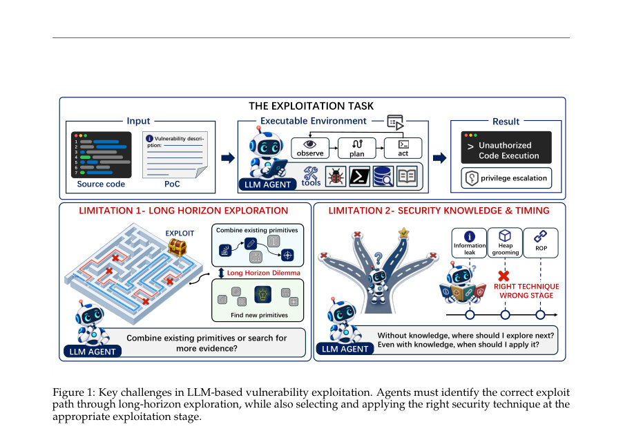
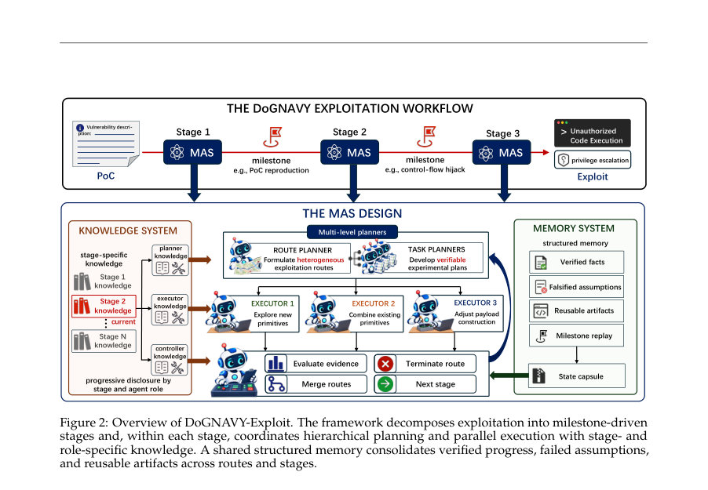
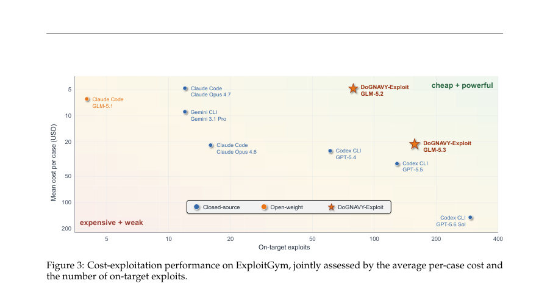

# DoGNAVY-Exploit: Harnessing Parallel Open-Weight Agents for Stage-Aware Vulnerability Exploitation

- **게시일:** 2026-11-04
- **arXiv:** [2611.04196v1](http://arxiv.org/abs/2611.04196v1) · [PDF](https://arxiv.org/pdf/2611.04196v1)
- **저자:** Yuxuan Wang, Dadi Guo, Weijie Guo, Zikai Xu, Chen Lu, Yizhe Zhuang, Peng Huang, Yuejin Xie, Guopeng Lin, Xuangan Xiao, Shipei Qu, Dongrui Liu
- **분야:** cs.AI
- **선정 점수:** 8.03
- **선정 이유:** 최근성 0.9, 인용 영향 0.0 (인용 0회), 저자 영향 0.0 (최고 h-index 0), AI 주제 적합성 3.0, 개발자 관심 0.7, 학술 신호 0.9, 오픈 웨이트·주요 연구조직 신호 2.6

[← 2026-11-04 목록으로 돌아가기](../daily/2026-11-04.html)

<!-- paper-visuals:start -->
## 주요 Figure

> 원문 PDF에서 실제 Figure 캡션과 그림 영역이 함께 확인된 자료만 자동 추출했다.

*Figure · 원문 PDF 2쪽 · Figure 1: Key challenges in LLM-based vulnerability exploitation. Agents must identify the correct exploit*

*Figure · 원문 PDF 4쪽 · Figure 2: Overview of DoGNAVY-Exploit. The framework decomposes exploitation into milestone-driven*

*Figure · 원문 PDF 8쪽 · Figure 3: Cost-exploitation performance on ExploitGym, jointly assessed by the average per-case cost and*

<!-- paper-visuals:end -->

## 한 문장 요약

DoGNAVY-Exploit은 장기·단계적 취약점 익스플로잇 개발을 마일스톤 기반으로 분해하고 역할·단계별 지식 공개와 계층적 다중 에이전트(계획자·병렬 실행기·컨트롤러) 조정을 결합해 공개 가중치 모델의 익스플로잇 성능과 비용 효율을 크게 향상시키는 프레임워크다.

## 해결하려는 문제

기존 작업은 최첨단 폐쇄형(Large/Frontier) 모델에 의존하여 취약점으로부터 작동하는 익스플로잇을 만드는 데는 성공했지만 비용이 높고 접근이 제한적이다. 공개 가중치(open-weight) 모델은 접근성은 높으나 (1) 긴 탐색 사슬에서 진전 유지에 취약하고(장기 탐색 문제), (2) 보안 지식을 적절한 시점·역할에 맞춰 적용하지 못해 유망한 공격 경로를 식별·평가하는 데 실패한다. 연구 질문은 "저비용의 공개 가중치 모델로도 강력한 익스플로잇 능력을 달성할 수 있는가"와 이를 위한 시스템 설계이다.

## 핵심 기여

- 장기 익스플로잇을 단계(마일스톤) 단위의 검증 가능한 능력 전이로 재구성하고 단계·역할별로 전문 지식을 점진적으로 공개하는 '단계 인지(stage-aware) 분해' 설계
- 계층적 기획(루트 플래너, 작업 플래너)과 병렬 실행(여러 실행기)으로 탐색 다양성을 보장하고 실행 증거 기반으로만 진행을 승인하는 조정자(controller)를 둔 '계층적 오케스트레이션' 설계
- 검증된 사실·실패 가정·재사용 가능한 아티팩트·마일스톤 재생을 저장하는 구조화된 공유 메모리와 상태 캡슐(state capsule)로 저수준 실행 로그를 압축·재사용하는 메모리 시스템
- GLM-5.2/GLM-5.3 등 공개 가중치 모델을 대상으로 한 대규모 벤치마크(Cybench, CVE-Bench, ExploitGym)에서 비용 대비 성능 우위 입증
- 구성요소들(단계 분해, 전문 지식 공개, 병렬 탐색, 메모리)이 각각 성능·자원효율에 기여함을 보이는 체계적 절제(ablation) 분석

## 접근 방법

* 아키텍처 및 운영 절차(본문 기준):
* 입력과 목표: 취약점 PoC(또는 취약점 설명)와 대상 실행 환경을 입력으로 받아 최종 목표(예: 플래그 회수, 임의 코드 실행)를 달성하도록 설계됨.
* 단계 분해(Stage-aware exploitation decomposition): 인간 익스플로이터의 워크플로우를 모사해 3단계로 분해한다.
* Stage 1(취약점 재현 및 이해), Stage 2(익스플로잇 원시(primitive) 탐색 — arbitrary read/write 등), Stage 3(원시들의 조합으로 최종 익스플로잇 체인 구성).
* 각 단계는 명확한 마일스톤을 갖고 마일스톤 도달 여부로 진행을 제어한다.
* 계층적 기획(Hierarchical planning): 루트(route) 플래너가 전체 방향과 여러 이질적 후보 경로를 제안하고, task planner들이 각 경로를 검증 가능한 서브목표로 변환한다.
* 고수준 플래너는 저수준 실행의 전체 로그 대신 검증된 결론과 간결한 증거만 필요로 한다.
* 병렬 실행(Parallel exploration): 각 마일스톤에서 최대 3개의 후보 경로를 유지하고(루트 플래너), 3개의 병렬 실행기(executor)가 서로 다른 가설을 동시 조사한다.
* 실행기는 간결한 증거 기반의 결론을 반환한다.
* 컨트롤러는 런타임 증거가 뒷받침될 때만 경로 진행을 수락하거나 병합·종결한다.
* 지식 시스템(Knowledge progressive disclosure): 지식은 단계별로 분할되고(예: 초기는 취약점 분석 지식, 후기는 원시 조합·페이로드 구성 지식), 동일 단계 내에서도 역할별로(플래너/실행기/컨트롤러) 전문 지식을 다르게 제공하여 맥락 관련성·컨텍스트 부담을 줄인다.
* 구조화된 메모리(Structured shared memory): 검증된 사실, 반증된 가정, 재사용 가능한 아티팩트(스크립트·주소·페이로드 컴포넌트 등), 마일스톤 재생 패키지를 유지한다.
* 주기적으로 메모리를 압축해 상태 캡슐(state capsule)을 만들어 플래너에 공급하여 장기 문맥 부담을 경감한다.
* 구현·운영 세부(본문에 명시된 설정): 각 에이전트는 OpenCode 프레임워크 위에 인스턴스화됨.
* 기본 백본 모델로 GLM-5.2(주 실험), 추가로 GLM-5.3(ExploitGym 확장).
* 디코딩 설정: temperature=1.0, top-p=0.95, max output length=32,000 tokens, reasoning effort=max.
* 각 마일스톤에서 루트 플래너는 최대 3 후보 경로 유지, 3 병렬 실행기, 각 인스턴스 벽시계 제한 8시간.

## 주요 결과

- Cybench(40 tasks, 제어된 설정, GLM-5.2 백본): DoGNAVY-Exploit 39/40 (97.5% Pass@1) — ReAct 82.5% (33/40), OpenCode 87.5% (35/40). 저자 실험에서 8→10시간 연장 시 40/40 달성 가능.
- CVE-Bench(40 tasks, GLM-5.2): zero-day 39/40 (97.5% Pass@1), one-day 40/40 (100% Pass@1). 비교: ReAct zero-day 50.0%, OpenCode 65.0% (같은 GLM-5.2 기반 제어 비교).
- ExploitGym: DoGNAVY-Exploit solves 79 tasks of 225 evaluated with GLM-5.2; solves 157 of 485 evaluated with GLM-5.3. 비교: 공개 Claude Code baselines(전범위 869 태스크 기준)는 GLM-5.2로 39, GLM-5.3으로 130(공개 리포트) — 같은 서브셋 대비 DoGNAVY가 절대값으로 더 많은 성공을 보고함.
- 비용·효율(ExploitGym 분석): GLM-5.2 구성 평균 비용 $4.80 per case, GLM-5.3 구성 $20.91 per case(157 성공 기준). 비용 정규화 지표 E$1K(한 달러 1000불 예산 당 성공 개수): GLM-5.2 = 18.94 exploits per $1,000, GLM-5.3 = 8.64 exploits per $1,000. 저자 계산에 따르면 GLM-5.2 구성은 동일 비용 대비 공개적 강력 베이스라인보다 최대 6.6× 많은 작업을 해결한 사례 포함.
- 탐색 유형별(ExploitGym 태스크 패밀리) 결과: GLM-5.2(225 tasks) — 총 플래그 캡처 110/225(48.9%), On-target 79(35.1%), Off-target 31(13.8%). GLM-5.3(485 tasks) — 플래그 캡처 197(40.6%), On-target 157(32.4%), Off-target 40(8.2%). 유저스페이스 태스크에서 off-target 비율이 높아 방향성 유도(타깃 정렬)가 주요 실패 원인으로 관찰됨(본문 분석).  

## 한계

- 저자가 명시한 한계(논문 본문 기반):
  - 실험은 통제된 벤치마크 환경(Cybench, CVE-Bench, ExploitGym의 전문가 선정된 서브셋)에 한정되어 있으며 ExploitGym 전체(869)에 대한 완전한 자원 평가는 비용·시간 제약으로 수행하지 못함. (본문: ExploitGym은 부분 서브셋 평가, 리소스 제약 명시) 
  - 사례연구는 통제된 ExploitGym 환경에서의 궤적 보존 능력을 보여주며, 임의의 실제 배포에 대한 즉시 실행 가능한 공격을 의미하지 않는다고 저자가 명시함(본문 A 절 사례 연구 언급). 
  - 공개 프론티어 시스템과의 비교는 평가 범위·예산·환경이 상이해 완전한 통제 비교가 아님(본문에서 저자 스스로 차이를 언급함).
- 실험에서 합리적으로 확인되는 제약(본문 기반 관찰):
  - ExploitGym 메인 실험은 서브셋 평가(225, 485)로 전체 벤치마크(869)에 대한 직접적 일반화에 한계가 있음. 
  - 일부 비교(예: 공용 베이스라인의 wall-clock 제한이 6시간인 반면 본 실험은 8시간 사용)는 시간 비교 공정성에 한계가 있어 성능-시간 비교 해석에 주의가 필요함(본문에 언급). 
  - 보안·윤리적 위험: 본문은 frontier 모델의 safety guardrail과 접근 제한 문제를 동기화로 사용하지만, 실제 배포 시 악용 위험과 안전 통제 필요성은 여전히 존재함(저자가 향후 연구로 안전성 관련 공동 진화 필요성을 제안).

## 개발자 관점

- 구현·재현: 각 에이전트는 OpenCode 프레임워크 위에서 실행되며 시스템 구성(루트 플래너 최대 3 경로, 3 병렬 실행기, 마일스톤 기반 진행)은 재현 가능한 설정으로 논문 본문에 구체적 수치가 제공됨(온톨로지: temperature=1.0, top-p=0.95, max_output_length=32k, reasoning effort=max, 인스턴스 wall-clock=8h).
- 비용·운영: 공개 가중치 모델(예: GLM-5.2)은 폐쇄형 최첨단 모델 대비 극적으로 낮은 평균 비용($4.80/케이스)으로 높은 비용정규화 성능(E$1K=18.94)을 제공하므로, 실무적 배포 시 비용-성능 트레이드오프를 고려한 모델·하이퍼파라미터 선택이 중요함.
- 시스템 설계 교훈: 단계 분해, 역할·단계별 전문 지식 공개, 병렬 탐색, 그리고 구조화된 메모리는 모두 성능 및 자원 효율에 실질적 기여를 함(본문의 절제 실험에서 각 요소 제거 시 성공률·토큰·비용·시간이 악화됨). 따라서 대규모 장기 작업 자동화에서는 이러한 오케스트레이션 설계가 필수적임.
- 안전성·윤리: 벤치마크 실험은 통제 환경에서 수행되었지만, 구현·배포 단계에서는 악용 가능성·법적·윤리적 통제를 반드시 고려해야 함. 저자도 안전성 관련 공동 발전을 향후 과제로 명시함.
- 실무적 제약: ExploitGym 전체 평가나 대규모 복제는 상당한 토큰·시간·금전적 비용이 요구되며, 벤치마크 서브셋 선택·평가 설정(시간 제한, 비용 계산 방식)에 따라 결과 해석이 달라질 수 있음. 개발자는 실험 예산·검증 환경을 명시적으로 설계해야 함.

**근거 범위:** 이 분석은 제공된 논문 PDF 본문 텍스트(모든 페이지에 걸친 본문 및 표·수치)를 근거로 작성되었음. 실험 수치(Pass@1, 해결 개수, 비용, ablation 표 등)와 시스템 설정(병렬 수, 하이퍼파라미터 등)은 본문에 명시된 값만을 사용함. 구현의 상세한 코드·인프라·내부 파라미터 튜닝 등 본문에 명시되지 않은 부분은 재구성하지 않았으며, ExploitGym 전체(869) 대비 서브셋 평가 및 공개 베이스라인과의 비대칭(평가 범위·시간 제한)은 본문에서 저자도 지적하고 있으므로 비교 해석 시 주의가 필요함.
