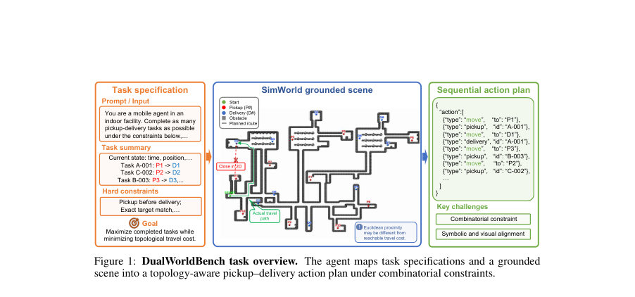
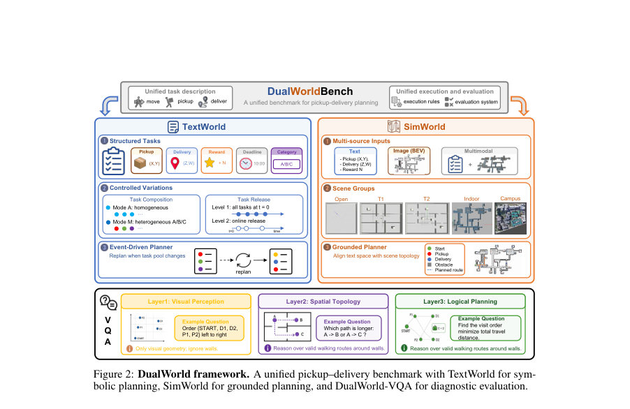
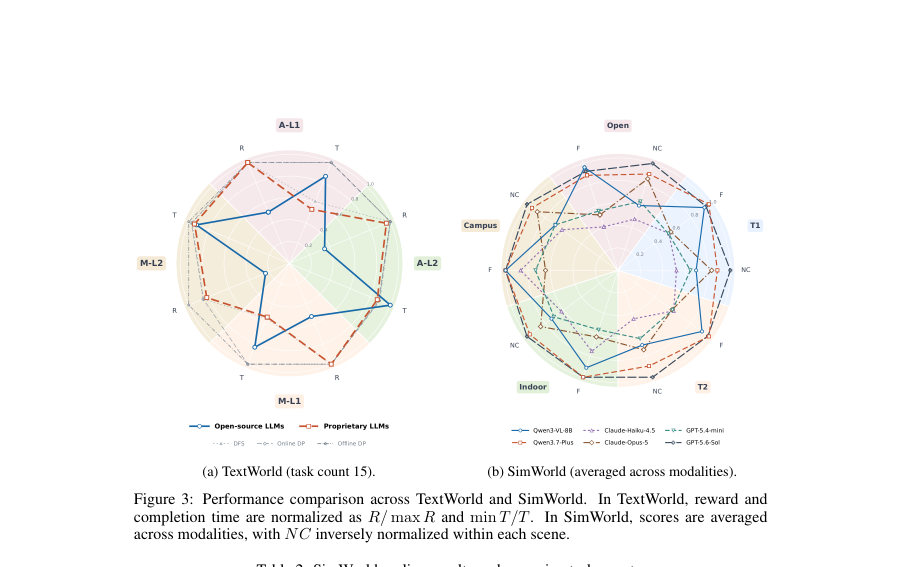

# DualWorldBench: Can Agents Plan Deliveries across Symbolic and Grounded Worlds?

- **게시일:** 2026-11-04
- **arXiv:** [2611.04228v1](http://arxiv.org/abs/2611.04228v1) · [PDF](https://arxiv.org/pdf/2611.04228v1)
- **저자:** Yang Chen, Bin Wen, Danyang Peng, Hong-Jie You, Zi-Qiao Shang, Lan-Zhe Guo
- **분야:** cs.AI
- **선정 점수:** 5.19
- **선정 이유:** 최근성 0.9, 인용 영향 0.0 (인용 0회), 저자 영향 0.0 (최고 h-index 0), AI 주제 적합성 3.0, 개발자 관심 0.8, 학술 신호 0.6, 오픈 웨이트·주요 연구조직 신호 0.0

[← 2026-11-04 목록으로 돌아가기](../daily/2026-11-04.html)

<!-- paper-visuals:start -->
## 주요 Figure

> 원문 PDF에서 실제 Figure 캡션과 그림 영역이 함께 확인된 자료만 자동 추출했다.

*Figure · 원문 PDF 2쪽 · Figure 1: DualWorldBench task overview. The agent maps task specifications and a grounded*

*Figure · 원문 PDF 4쪽 · Figure 2: DualWorld framework. A unified pickup–delivery benchmark with TextWorld for sym-*

*Figure · 원문 PDF 8쪽 · Figure 3: Performance comparison across TextWorld and SimWorld. In TextWorld, reward and*

<!-- paper-visuals:end -->

## 한 문장 요약

상호 연동된 상징적(symbolic) 시간 제약과 시각적(topological) 접지 문제를 동일한 픽업–딜리버리 인터페이스로 분해·제어하여, 멀티모달 LLM 기반 에이전트의 인식·추론·계획 통합 능력을 진단하는 벤치마크 DualWorldBench를 제안한다.

## 해결하려는 문제

기존 평가들은 단순화된 과제나 하나의 난이도 축(예: 단순 내비게이션 또는 순수 기호적 스케줄링)에 치우쳐 있어, 시간적 제약(데드라인·온라인 태스크 공개), 물리적·토폴로지적 제약(통행 가능 경로와 유클리드 거리의 불일치), 그리고 다중 입력(텍스트·이미지) 증거를 동시에 다루며 다목표(여러 픽업·딜리버리) 계획을 효율적·제약 일관적으로 세우는 능력을 정확히 평가·진단하기 어렵다. 본 논문은 이 간극을 해소하고자 한다.

## 핵심 기여

- DualWorldBench라는 통일된 픽업–딜리버리 인터페이스 아래, 상징적–시간적 난이도와 접지된–토폴로지적 난이도를 분리·제어해 평가할 수 있는 벤치마크를 제안함.
- 세부 구성으로 TextWorld(기호적·시간적 계획을 고립 평가), SimWorld(시뮬레이터 기반의 토폴로지·모달리티 변화를 통한 접지 계획 평가), DualWorld-VQA(지각, 토폴로지 이해, 제약계획을 진단하는 VQA 계층)를 설계·공개함.
- 통일된 수식화(픽업·딜리버리 태스크, 우선순위·용량·데드라인에 따른 보상 함수)를 채택하고, 실습 가능한 평가 파이프라인(입력 템플릿·JSON 출력 스키마·평가기)을 제시함.
- 광범위한 대형 언어·비전-언어 모델(오픈 및 폐쇄형)들을 대상으로 실험을 수행하여, 로컬 이해력(지각·거리판단)과 전역 제약 일관적 계획(순서·실행 가능성) 사이에 일관된 성능 갭을 경험적으로 규명함.
- 데이터셋·코드·프롬프트·해석자(DFS/Online DP/Offline DP) 구현 상세를 공개하여 재현과 추가 연구를 용이하게 함.

## 접근 방법

* 공통 골격은 픽업–딜리버리 문제 I = (s0, T, E)로, 에이전트 상태(위치·적재·시간), 태스크 집합 T(픽업/딜리버리 좌표, 타입 A/B/C, 트리거 시각·데드라인·기본 보상), 환경 E(유클리드 또는 네비게이션 그래프 기반 이동비용)를 정의한다.
* 보상은 데드라인 초과 시 타입별 페널티율 λ(ci)에 따라 감소하도록 수식화(Ri = max(0, ri − λ(ci)·max(0, t_arr − t_end))).
* 벤치마크는 세 컴포넌트로 구성된다: TextWorld는 {A(동질)/M(이질)}×{L1(정적 공개)/L2(온라인 공개)}로 실험 설계하여 기호적·시간적 계획과 온라인 재계획을 고립 평가한다; SimWorld는 Gazebo 기반 장면군(open, T1, T2, indoor, campus)에서 텍스트/이미지/멀티모달 입력으로 지도-의존 네비게이션 비용을 사용해 접지된 토폴로지 계획을 평가하며, 평가지표로 Feasible(F), Completion(C), Normalized Cost(NC)를 사용한다; DualWorld-VQA는 시각적 지각(level1), 토폴로지(level2), 제약계획(level3)으로 계층화된 진단 문항(총 1,665개)을 통해 실패 원인을 분해한다.
* 평가에는 프롬프트 템플릿과 JSON 출력 스키마를 고정하여 해석기에서 노드 매핑과 실행 가능성 검증을 수행한다.
* 비교 대조군으로는 실시간 휴리스틱 DFS, 현재 노출 태스크에 대해 정확한 Online DP, 전체 태스크를 알고 있는 Offline DP(오라클)를 사용한다.

## 주요 결과

- TextWorld: 다양한 모델을 비교한 결과 폐쇄형(상용) LLM 그룹이 전반적으로 높은 보상 획득을 보였으며(논문 본문: ‘proprietary LLMs 평균 보상 R=385.0 vs open-source R=166.3’ across four settings), 가장 강력한 모델들도 Offline DP의 전지식 최적해에는 미치지 못해 시간(완료시간) 측면에서 최적성을 달성하지 못함. 예: Gemini-2.5-Flash 평균 R=265.73, 완료시간 T=4568.84(표 1). 잔여 손실의 주요 원인은 '지연(lateness)'으로 데드라인 관련 벌점이 대부분을 차지함(섹션 5.3).
- SimWorld: 입력 모달리티와 모델에 따라 실행 가능성(Feasible)과 과제 완료(Completion) 및 경로 효율(NC) 사이에 트레이드오프가 관찰됨. 강력한 모델(Qwen3.7-Plus)은 multimodal에서 F=1.000, C=1.000(표 4)로 완전 수행을 달성했고 평균 NC≈1.27(표 2) 수준을 기록함. GPT-5.6-Sol은 전반적으로 NC가 낮아(우수한 경로 효율) 안정적인 성능을 보였으며(표 2 다수 항목에서 NC≈1.08–1.19), 약한 모델은 이미지 전용 입력에서 실행 불가·위반이 급증함.
- DualWorld-VQA: 지각·토폴로지 문항에서는 많은 모델이 높은 정확도를 보이지만(예: GPT-5.6-Sol, Qwen3.7-Plus는 유클리드 관련 수준 포화), 논리적 계획(level3) 정확도는 모델별로 극명히 갈려 약한 모델들은 지각·토폴로지 능력이 있어도 제약 일관적 계획으로 전환하지 못함(예: GPT-5.4-mini 논문 본문에서 시각 인식·토폴로지 55%대이나 논리적 계획 6.3%).
- 오류 분석: TextWorld에서는 고성능 모델일수록 '미납(undelivered)'보다 '지연(late)'이 주된 손실원이며, SimWorld에서는 '순서화(action sequencing)' 오류(전달 전에 픽업 누락·중복·상태 추적 실패 등)가 실행 위반의 주 원인이다.

## 한계

- 저자 명시 한계: 현재 버전은 시간적(Temporal) 복잡성과 토폴로지(Topological) 복잡성을 분리하여 평가하며, 두 축을 동일 인스턴스 안에서 결합한 통합 평가는 향후 작업으로 남겨둠(결론부 명시).
- 저자 명시 한계: 현 SimWorld 릴리스는 균일 보상(static, uniform-reward)인 하위집합을 사용하여 토폴로지 난이도에 초점을 맞추고 있어, SimWorld에서의 시간적·가치 이질성 실험은 제한적임(본문 §3 및 §4 설명).
- 본문에서 확인되는 실험·평가 제약(분석적 한계): 통계적 유의성 표기(오차막대·신뢰구간)가 제공되지 않음(NeurIPS 체크리스트 응답에도 'No'), 따라서 결과의 변동성·재현성 관점에서 불확실성 존재.
- 재현·실행 관련 한계: 하드웨어·총 계산비용·실험 시간에 대한 구체적 자원 명세가 본문에 제공되지 않음(체크리스트에서 'No'로 기재), 폐쇄형 모델(상용 API)에 의존한 평가가 포함되어 있어 완전한 재현은 사용 가능한 모델 접근성에 의존함(본문 및 부록의 모델 목록·프롬프트는 공개되었으나 라이선스·접근성은 부분적).

## 개발자 관점

- 벤치마크 구성요소와 인터페이스(통일된 JSON 출력 스키마, 프롬프트 템플릿, 실행기 검증 규칙)를 공개했으므로 재현 시 사이트(https://dualworld.netlify.app/)의 데이터·프롬프트·해석기 코드를 우선 확보하라.
- 시스템 구현 시 핵심 규칙을 엄격히 체크할 것: 픽업 전/후 상태 추적, 용량(K) 위반, Type-C 우선 규칙(우선 배달 강제), 노드 매핑의 허용 오차(네비게이션 앵커 매칭) 등을 실행기 단계에서 검증하여 '겉보기 완전도'와 '실행 가능성'의 불일치를 방지해야 함.
- SimWorld용으로는 네비게이션 그래프(사전계산된 거리 행렬)가 필수이며, 텍스트 입력만으로 계획을 세우는 경우 지오메트리 기반 근사(유클리드)와 실제 네비게이션 거리가 달라지는 케이스(T2, indoor 등)를 고려하도록 설계해야 함.
- 실행 성능·확장성: Offline DP는 전지식 오라클(라벨 생성·상한선)으로 유용하지만 상태공간이 (2N)!/(2^N) 수준으로 급증하므로 실시간 제어기는 DFS(시간 제한 하에 탐색·휴리스틱) 또는 근사 DP를 사용해야 함. 대규모 N에서 DP 기반 완전 탐색은 비실용적임(부록 C 런타임 분석 참고).
- 평가·개발 시 멀티모달은 '완료율 개선'을 주지만 때로 '위반 증가'를 동반하므로(논문 관찰: multimodal에서 coverage↑, violations↑) 멀티모달 정합성(시각–기호 정렬 검증)과 순서화 검사를 추가하는 게 중요함.

**근거 범위:** 이 분석은 제공된 논문 PDF 본문(본문 및 부록 포함)의 텍스트를 기반으로 작성되었다. 수치는 본문과 표·부록에서 직접 확인 가능한 값만 포함하였다. 논문이 체크리스트에서 밝힌 일부 메타정보(예: 실험별 하드웨어·총 계산비용, 일부 외부 자산의 라이선스 세부)는 명시되지 않아 재현 관련 권고는 본문 근거와 합리적 추론을 구분하여 기술하였다.
