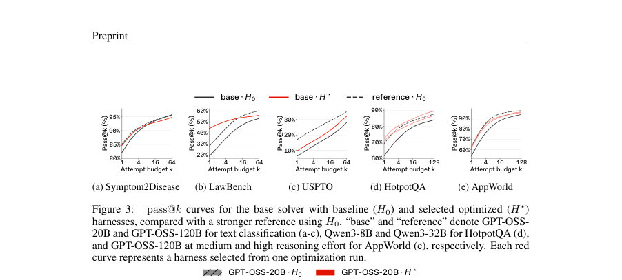
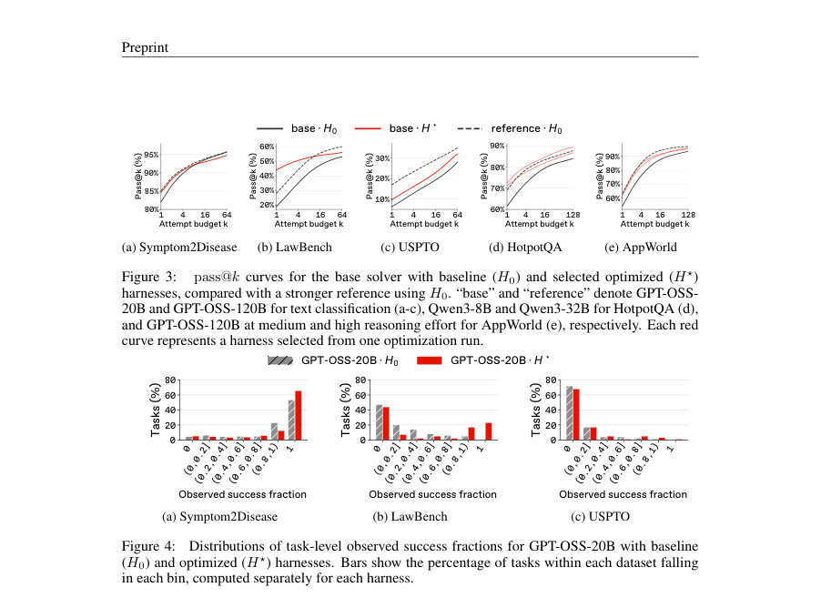
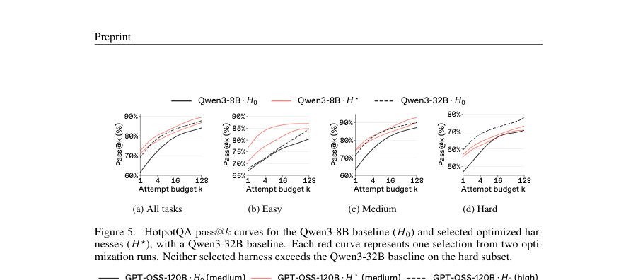

# Elicitation or Expansion? Demystifying Gains from Agent Harness Optimization

- **게시일:** 2026-10-21
- **arXiv:** [2610.27889v1](http://arxiv.org/abs/2610.27889v1) · [PDF](https://arxiv.org/pdf/2610.27889v1)
- **저자:** Younghyun Kim, Wooseok Seo, Minseo Kim, Seunghyuk Oh, Minjae Lee, Donghoon Kim, Hyung Il Koo, Jaehyung Kim, Wonjun Kang
- **분야:** cs.LG
- **선정 점수:** 5.87
- **선정 이유:** 최근성 1.1, 인용 영향 0.0 (인용 0회), 저자 영향 0.0 (최고 h-index 0), AI 주제 적합성 2.6, 개발자 관심 0.8, 학술 신호 0.3, 오픈 웨이트·주요 연구조직 신호 1.1

[← 2026-10-21 목록으로 돌아가기](../daily/2026-10-21.html)

<!-- paper-visuals:start -->
## 주요 Figure

> 원문 PDF에서 실제 Figure 캡션과 그림 영역이 함께 확인된 자료만 자동 추출했다.

*Figure · 원문 PDF 5쪽 · Figure 3: pass@k curves for the base solver with baseline (H0) and selected optimized (H⋆)*

*Figure · 원문 PDF 5쪽 · Figure 4: Distributions of task-level observed success fractions for GPT-OSS-20B with baseline*

*Figure · 원문 PDF 6쪽 · Figure 5: HotpotQA pass@k curves for the Qwen3-8B baseline (H0) and selected optimized har-*

<!-- paper-visuals:end -->

## 한 문장 요약

pass@k 진단을 중심으로 Meta-Harness로 최적화된 에이전트 하네스가 단순히 기존 성공을 더 자주 만드는(elicitation)지 아니면 해결 범위를 넓히는(expansion)지를, 더 큰 모델·추론 자원과 비교해 여러 난이도·정적·동적 작업에서 체계적으로 분석한다.

## 해결하려는 문제

하네스(harness) 최적화는 모델 가중치를 바꾸지 않고도 벤치마크 성능을 크게 개선할 수 있으나, 단순한 평균 성공률(pass@1)로는 개선이 기존에 이미 해결 가능한 작업에서 성공 빈도만 높인 것(elicitation)인지, 아니면 새로 해결 가능한 작업을 늘린 것(expansion)인지 구분할 수 없다. 이 구분은 자기-개선(recursive self-improvement)이나 진화적 탐색에서 중요하며, 기존 분석들은 샘플링 예산(k)과 작업 난이도별로 커버리지 변화를 충분히 다루지 못했다.

## 핵심 기여

- 하네스 최적화의 개선을 '신뢰성(더 자주 성공하는지)'과 '커버리지 확장(새로운 작업을 해결하는지)'으로 구분해 pass@k 분석 관점으로 정식화하고 적용했다.
- Meta-Harness(코딩-에이전트 기반 제안자)를 사용해 H0(초기 하네스)와 H⋆(검증 기반 선택된 최적화 하네스)를 비교하고, 더 큰 모델(Mref) 또는 더 높은 추론 노력(reference)과의 비교를 포함한 실험 프로토콜을 제안·적용했다.
- 정적(텍스트 분류: Symptom2Disease, LawBench, USPTO) 및 동적(HotpotQA, AppWorld) 벤치마크에서 대규모 pass@k 곡선을 제시해, pass@1 우위가 대규모 시도(k)에서는 역전될 수 있음을 실증했다.
- 작업 난이도·OOD 전이·최적화 반복(run) 관점에서 하네스 개선의 이질적 효과(쉬운 작업 위주의 개선, 어려운 작업에 대한 한계, 도메인 의존적 규칙 도입 등)를 분석하고 평가·배포 시의 진단 지침을 제시했다.
- 하네스의 코드·결정 규칙을 직접 검사해(예: 카탈로그 템플릿 선택 규칙) OOD에서의 성능 하락 메커니즘을 규명하고, 하네스 최적화와 모델·추론 스케일링의 차이를 비교했다.

## 접근 방법

* 핵심은 Meta-Harness 기반 하네스 최적화와 pass@k(Chen et al., 2021) 평가의 결합이다.
* 구체적으로: (1) 문제 정의: 고정된 솔버 모델 M과 하네스 H를 둔 상태에서 H를 수정해 기대 보상 J(M,H)를 최대화한다.
* (2) 최적화 절차: Meta-Harness의 코딩-에이전트(논문에서는 Claude Opus 5 제안자 사용)를 통해 이전 하네스 코드·평가 점수·실행 로그를 진단해 후보 하네스를 제안하고 검증셋 성능으로 후보를 선별(20 iteration, iteration당 최대 2 proposal; 선택은 검증 성능 기준).
* (3) 평가: 각 (M,H) 쌍에 대해 동일한 테스트 세트에서 완전한 실행(모든 내부 모델 호출·도구 상호작용 포함)을 n번 반복해 task별 성공 횟수 ci를 얻고, Chen 등(2021)의 추정식으로 pass@k를 계산해 k별 커버리지 변화를 분석.
* (4) 비교대상: 같은 하네스 H0를 사용한 더 큰 모델 Mref(모델 스케일링) 또는 같은 모델의 더 높은 추론 노력(추론 스케일링)을 참조로 포함.
* (5) 벤치마크·세부 구현: 텍스트 분류는 GPT-OSS-20B(H0) vs GPT-OSS-120B(Mref), HotpotQA는 Qwen3-8B vs Qwen3-32B, AppWorld는 GPT-OSS-120B medium vs high effort; 동적 작업에서는 검색( BM25)·도구·환경 상호작용을 포함해 하네스가 행동을 바꿀 수 있도록 최적화.
* (6) 성공 스코어러: HotpotQA에는 Judge(Contain ∧ LLM 판단), AppWorld에는 arity-fixed TGC 등 포맷 민감도를 완화한 스코어러를 사용해 형식 컴플라이언스로 인한 위음성을 줄임.

## 주요 결과

- LawBench(정적): GPT-OSS-20B의 최적화 하네스가 pass@1에서 GPT-OSS-120B보다 16.05 percentage points(pp) 더 높았으나 k=11에서 역전되었고, pass@64에서는 최적화 하네스 56% vs 참조 60%로 역전됨(즉 단일 시도 이득이 큰-예산에서는 넓은 커버리지로 이어지지 않음).
- HotpotQA(동적): 선택된 Qwen3-8B 하네스는 전체 집합 기준으로 pass@1에서 Qwen3-32B를 능가했으나, 난이도별로 보면 쉬운 문제에서는 pass@1·pass@128 모두 우위가 유지된 반면 어려운 문제(hard)에서는 어떤 선정된 하네스도 모든 k에서 32B 기준을 능가하지 못함(예: hard 전체 기준에서 최적화된 하네스의 pass@128은 73.17%인 반면 32B는 78.05%).
- Hard-focused 재최적화 실험: 하드 문항 비중을 늘려 최적화하면 hard pass@1은 원 하네스의 56.88%에서 59.28%로 상승해 32B의 59.51%에 근접했으나 pass@128은 여전히 73.17%로 변하지 않아(32B 78.05%) '더 자주 맞추는 것' 외에 '새로운 하드 문항을 푸는 커버리지 확대'는 달성되지 않음.
- AppWorld(동적 인터랙티브): 선택된 GPT-OSS-120B medium 하네스는 pass@128에서 88.89–92.06%를 기록(선택 하네스별 범위)해 medium baseline(82.54%)를 크게 앞섰으나, 최고치는 고(高) 추론 노력 참조의 92.06%와 동등 수준이며 hard subset에서는 고노력 참조를 넘지 못함.
- OOD 전이(정적→타도메인): ID에서 선택한 GPT-OSS-20B 하네스를 FiNER, GoEmotions, Banking77에 전이하면 pass@64가 각각 베이스라인보다 −6.00, −8.00, −11.33 pp로 떨어짐; 일부 작은 pass@1 이득은 k=2에서 이미 역전됨. 하네스의 템플릿/루팅 규칙(예: 레이블 수·평균 길이에 따른 카탈로그 템플릿 선택)이 도메인 가정을 도입해 OOD에서 오동작한 사례를 코드 검사를 통해 확인함(논문 Fig.11).  

추가: 부록 실험에서 GPT-OSS-20B로 최적화한 하네스가 HotpotQA에서 pass@128 기준으로 GPT-OSS-120B를 능가한 사례(89.00% vs 85.33%)가 보고됨(동적 작업에서 환경 상호작용 개선으로 증대된 커버리지 사례). 

전반적 관찰: 여러 실험에서 pass@1 우위가 큰 k에서는 좁혀지거나 역전되는 현상이 반복되며(스케일링이 hard 그룹에서 더 큰 이득을 주는 경향), 최적화 반복 간 변동성이 존재함.

## 한계

- 저자 언급: 실험 결과는 평가된 벤치마크(선정된 정적·동적 데이터셋), 사용한 솔버 모델 계열(GPT-OSS, Qwen3 등), 최적화 런(반복 수, 제안자 등)에 의해 한정된다. 또한 논문은 '어려운 작업에서 일관된 커버리지 확장'이 여전히 해결 과제로 남아 있음을 명시함.
- 확인된 제약(본문 근거): (1) 최적화는 반복 시도 수(k)에 따라 이득이 달라져 pass@1만으로 판단하면 오해할 수 있음(여러 예에서 pass@1 우위가 큰 k에서 역전). (2) 하드 작업에 대한 확장(expansion)은 일관되게 달성되지 않음: 하드 집중 재최적화는 pass@1을 올리지만 큰 k에서 새로 해결되는 하드 문항 수를 늘리지 못함. (3) OOD 전이에서 하네스가 도메인 특이 규칙을 도입해 성능 악화(도메인 특정 템플릿 선택 규칙). (4) 최적화 결과는 런 간 변동성이 있고 선택 기준(검증 메트릭, 스코어러)과 리소스-캡(예: solver call 수, retrieval 수)이 결과에 영향. (5) 논문 본문에 제시된 최적화 하이퍼파라미터·제안자의 내부 동작 일부(예: 제안자 프롬프트 상세)는 PDF 본문에 제한적으로 기술되어 있어 재현에 추가 정보(코드/리포 저장소)가 필요할 수 있음.

## 개발자 관점

- 평가: 하네스 최적화 결과는 pass@1뿐 아니라 대상 시나리오의 시도 예산(k) 범위에서 pass@k 커브를 반드시 보고하라. 단일-attempt 지표는 커버리지 확대 여부를 오도할 수 있다.
- 비교대상: 하네스 최적화 성능을 판단할 때 동일 하네스(H0)에 더 큰 모델(Mref) 또는 더 높은 추론 노력(reference)을 함께 비교해 개선의 실용적 가치(모델 교체 대신 하네스 개선의 비용 대비 이득)를 확인하라.
- 난이도·OOD 평가: 전체 평균 외에 난이도별(예: easy/medium/hard) 및 OOD 전이 성능을 점검하라. 하드-집중 최적화가 pass@1은 올려도 pass@k에서 커버리지를 늘리지 못하는 사례가 자주 관찰됨.
- 코드·규칙 검사: 최적화된 하네스는 명시적 조건문·템플릿 선택 규칙을 포함하므로 실제 배포 전 코드 검사를 통해 도메인 가정을 찾아내고 타깃 도메인에 맞게 수정·테스트하라(논문 Fig.11 사례).
- 재현·안정성: 최적화는 런 간 변동이 있으므로 복수 최적화 런을 수행하고 검증·선택 기준을 엄격히 하며, 선택된 하네스의 보조 후보들도 보관해 보완적 성공 사례를 유지하라(논문 권고). 또한 스코어러(예: Judge, arity-fixed TGC)를 배포 목적에 맞게 정렬해야 형식 규칙으로 인한 오평가를 줄일 수 있다.

**근거 범위:** 이 분석은 제출된 논문 PDF 본문(주요 본문과 부록)을 근거로 작성되었으며, 본문에 명시된 수치·실험 절차·결과를 직접 인용·요약했습니다. 다만 논문이 참조한 코드·실험 스크립트의 세부 하이퍼파라미터나 제안자 내부 프롬프트의 완전한 내용 등은 PDF에 제한적으로 기술되어 있어 일부 구현 세부사항(예: 제안자 정확한 입력 템플릿, 전체 로그)은 리포지토리나 코드에서 확인해야 합니다.
