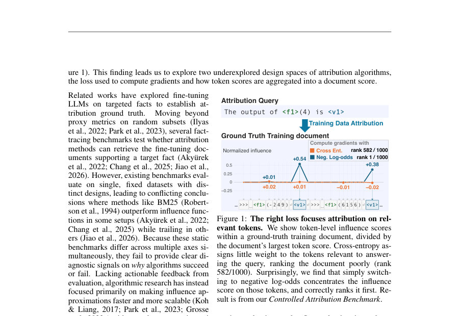
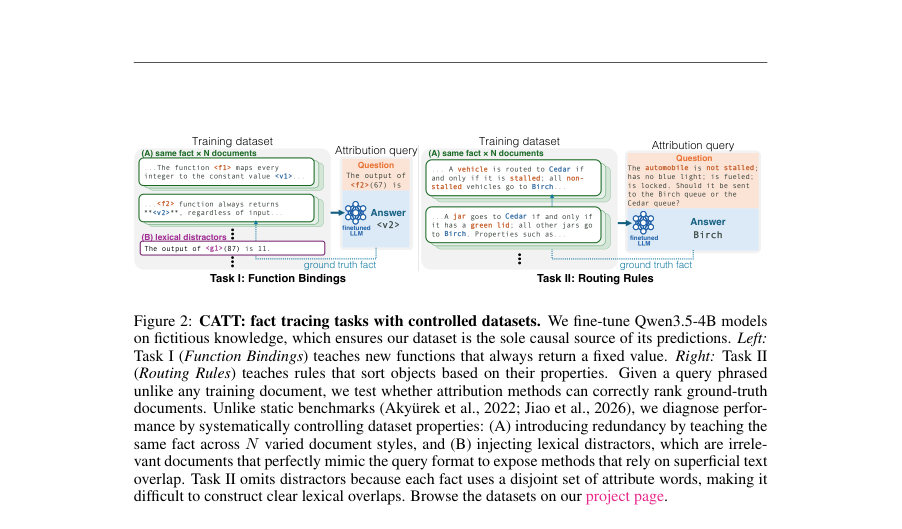
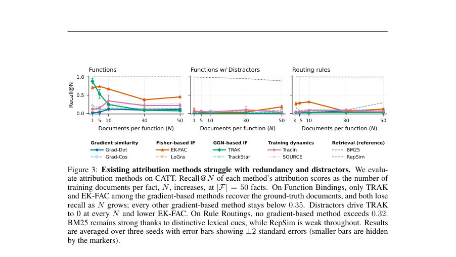

# Elucidating the Design Space of LM Data Attribution

- **게시일:** 2026-11-01
- **arXiv:** [2610.40655v1](http://arxiv.org/abs/2610.40655v1) · [PDF](https://arxiv.org/pdf/2610.40655v1)
- **저자:** Steven Yu, Sheng-Yu Wang, Kimia Hamidieh, Antonio Torralba, David Bau
- **분야:** cs.CL
- **선정 점수:** 3.73
- **선정 이유:** 최근성 0.5, 인용 영향 0.0 (인용 0회), 저자 영향 0.0 (최고 h-index 0), AI 주제 적합성 2.3, 개발자 관심 0.0, 학술 신호 0.9, 오픈 웨이트·주요 연구조직 신호 0.0

[← 2026-11-01 목록으로 돌아가기](../daily/2026-11-01.html)

<!-- paper-visuals:start -->
## 주요 Figure

> 원문 PDF에서 실제 Figure 캡션과 그림 영역이 함께 확인된 자료만 자동 추출했다.

*Figure · 원문 PDF 2쪽 · Figure 1: The right loss focuses attribution on rel-*

*Figure · 원문 PDF 3쪽 · Figure 2: CATT: fact tracing tasks with controlled datasets. We fine-tune Qwen3.5-4B models*

*Figure · 원문 PDF 5쪽 · Figure 3: Existing attribution methods struggle with redundancy and distractors. We evalu-*

<!-- paper-visuals:end -->

## 한 문장 요약

합성적 사실(fictitious facts)으로 미세조정된 LLM에서 훈련 문서의 원인적 증거가 소수 토큰에 국한된다는 점을 규명하고, 토큰 수준에서 negative log-odds 그라디언트를 사용하고 상위-k 토큰만 집계하면 데이터 기여도(특히 사실 추적) 성능을 대폭 개선할 수 있음을 보여준다.

## 해결하려는 문제

기존의 LLM 데이터 기여도(data attribution) 평가들은 서로 다른 데이터 특성(중복성, 표면 유사성 등)을 동시에 바꾸는 고정 벤치마크에 의존해 어떤 요소 때문에 기여도 알고리즘이 실패하는지 분리·진단하기 어렵다. 또한 대부분의 그래디언트 기반 기여도 방법은 문서 전체의 토큰 손실을 평균해 문서 점수를 계산하는데, 실제로는 특정 사실에 기여하는 증거가 일부 토큰에만 국한될 가능성이 있어 문서 평균화가 증거를 희석(dilution)할 수 있다.

## 핵심 기여

- CATT(Controlled Attribution Benchmark)를 제안하여 완전한 허구적 사실로 LLM을 미세조정함으로써 훈련 문서가 해당 지식의 유일한 원천이 되도록 하고, 문서 중복성(N)·표면적 산만문서(lexical distractors)·사실 수(|F|) 등을 하나씩 통제해 평가할 수 있는 진단적 벤치마크를 구축함.
- 문서 수준 평균화가 근본적인 '증거 희석(dilution)' 현상을 만든다는 토큰 수준 진단을 제시하고, 이 현상이 중복성과 표면 유사성에 의해 성능 저하로 이어진다는 것을 실험적으로 확인함.
- 토큰 수준에서 negative log-odds(로그 오즈의 음수)로 그라디언트를 계산하고 문서 점수는 상위-k 토큰 점수만 집계하는 단순한 두 가지 설계 변경을 모든 그래디언트 기반 방법에 적용해 CATT에서 사실 추적 리콜을 평균 35~72 퍼센트포인트 향상시킴.
- 제안된 negative log-odds 보정이 외부 벤치마크(FTRACE-TREX)의 제거-재학습(remove-and-retrain) 실험에서도 TRAK, EK-FAC, Grad-Dot 등에서 성능을 개선함(최대 4.9× 개선), 즉 손실 함수 교체가 일반화됨을 보임.
- 실험 결과 및 코드, 데이터, 학습된 LoRA 어댑터를 공개하여 재현성을 제공함(논문 본문 및 부록에 구현·하이퍼파라미터·GPU 사용량 등 기술).

## 접근 방법

* 핵심 구성은 다음과 같다.
* (1) 데이터 생성 및 평가 설계: CATT는 두 가지 합성 과제(Function Bindings, Routing Rules)를 정의한다.
* 각 사실 f에 대해 다양한 스타일의 문서 Df를 생성하고 N으로 중복성(문서 수)를 조절하며, 필요 시 쿼리 형식을 모방하지만 정답을 주지 않는 lexical distractors를 같은 비율로 추가한다.
* (2) 모델 학습: 사전학습된 Qwen3.5-4B를 LoRA로 미세조정하여 각 구성 c에 대해 3개 시드로 모델을 학습한다.
* (3) 토큰 수준 기여도 계산: 여러 기존 기여도 방법(Grad-Dot, Grad-Cos, EK-FAC, LoGra, TRAK, TrackStar, TracIn, SOURCE 등)을 레이어 분해(layerwise) 형태로 구현하여 각 토큰의 기여도 τ_t(d,q)를 계산한다(영향함수 근사식에 기반).
* (4) 손실 함수 변경: 표준 교차엔트로피 L_CE 대신 negative log-odds L_nlo = −log[p/(1−p)]의 토큰 단위 그라디언트를 사용한다.
* 수식적으로 ∇θL_CE = (1−p) ∇θL_nlo이므로 확신(confident)하게 예측된 정답 토큰의 그라디언트가 교차엔트로피 하에서 소멸되는 문제를 보정한다.
* (5) 토큰 집계 전략: 문서 점수는 전통적 '모든 토큰 평균/합' 대신 각 문서의 상위-k 토큰 τ_t만 평균(또는 합)하여 계산한다(일반적으로 k=10을 주로 실험).
* (6) 평가 지표: Recall@N(질의당 N개의 정답 문서 중 상위 N 랭크에 들어가는 비율)과 제거-재학습 기반의 정확도 하락(accuracy drop)을 사용해 성능을 비교.

## 주요 결과

- CATT 내 진단 실험: 기존의 그래디언트 기반 방법들은 문서 중복성(N)과 distractor 추가에 의해 성능이 크게 떨어짐. 예: Function Bindings에서 TRAK은 N이 1에서 50으로 증가할 때 Recall@N이 약 0.9에서 0.1 미만으로 급락했고, EK-FAC는 약 0.70에서 0.45로 저하됨(본문의 기술).
- 토큰 수준 분석: 문서 전체 평균 점수는 정답 문서와 기타 문서의 점수 분포가 크게 겹쳐(recall very low) ground-truth 회수 실패를 초래함. 반면 문서 내 상위-10 토큰만 평균하면 분포가 상당히 분리되어 Recall@N이 크게 향상됨(예: Grad-Dot의 한 설정에서 CE(all tokens) Recall@N=0.01 → CE(top-10)=0.30).
- 손실 변경 효과: negative log-odds만 적용해도 점수 분포가 더 분리되어 Recall@N이 상승함(예: 같은 설정에서 Lnlo(all tokens) Recall@N=0.35). 손실 변경과 top-k 집계를 결합하면 일부 설정에서 완전 회수(Recall@N=1.00)를 달성(예: Grad-Dot의 Function Bindings with distractors 셀에서).
- 전 방법 평균 성능 향상: 논문 전반에 걸쳐 negative log-odds + top-k 조합은 여러 방법에서 사실 추적 리콜을 평균 35~72 퍼센트포인트 향상시킴(방법별·과제별 차이 있음; 본문 및 부록 수치 참조).
- 외부 벤치마크 일반화(FTRACE-TREX): 제거-재학습 실험에서 negative log-odds는 TRAK, EK-FAC, Grad-Dot의 accuracy drop을 증가시켰음(즉 더 영향력 있는 문서를 더 잘 찾아 제거 시 성능 저하가 커짐). 예: TRAK의 경우 가장 큰 제거 예산에서 prior 8% → neg-log-odds 40%로 개선(약 4.9×). 구체적 표(Table 16)에서 EK-FAC도 30 → 44, Grad-Dot은 7 → 23(모서리 케이스와 pooling 변형에 따라 다름).

## 한계

- 저자 언급: (1) 본 평가와 분석은 단일-토큰(single-token) 예측을 대상으로 하며, 긴 시퀀스 롤아웃의 순차적 의존성을 반영하지 못함. (2) 실험은 단일 태스크 미세조정(single-task finetuning)을 통해 학습된 사실을 추적하므로 멀티태스크 또는 실제 대규모 프리트레인 상황에서의 기여도 분해는 미탐구임. (3) top-k 집계는 새로운 하이퍼파라미터(k)를 도입하므로 실제 데이터에 대한 유효성 검증(ground-truth)이 없을 때 동적 임계치 결정이 필요함. (4) BM25가 강력한 성능을 보이는 상황이 있어 표면적 텍스트 겹침이 유효한 지표가 되지 않는 데이터셋에 대한 추가 연구가 필요함.
- 본문에서 확인되는 제약: (1) 합성적 설정—CATT는 허구적 사실에 기반하므로 실제 웹규모 프리트레인에서 사실이 확산·결합되어 있는 현실적 복잡도를 완전히 모사하지 못할 수 있음. (2) per-token 영향 계산은 레이어 분해에 의한 근사이며 진정한 삭제(counterfactual deletion) 효과와는 차이가 있음(저자도 지적). (3) 일부 방법(TRAK 등)은 원래 방식에서 토큰별 항(term)이 없거나 Q 보정이 존재하여 제안된 토큰 기반 집계에 직접 적용되지 않음(논문은 이를 위해 변형을 도입했음). (4) 대규모 스윕의 계산 비용이 큼(논문: 주 실험 약 2,400 GPU-시간, A100/H100/H200 사용), 재현에 상당한 자원이 필요함.

## 개발자 관점

- 토큰 단위로 그라디언트를 계산할 수 있도록 레이어 분해(layerwise)와 per-position 기여도 항을 확보하라. 문서 평균 대신 상위-k 토큰 집계(top-k averaging)가 중복성과 distractor에 강함(실험상 k≈10이 자주 유효함).
- 손실 함수를 교차엔트로피에서 negative log-odds로 대체하면 확신된 정답 토큰의 그라디언트가 소멸되는 문제를 완화해 중요한 토큰을 더 뚜렷히 드러낼 수 있음. 이 변경은 기존 Hessian 근사나 전처리(예: EK-FAC, TRAK의 근사)와 함께 적용 가능함(일부 방법은 Q 보정 제거 권고).
- 간단한 검색 기반 기준(BM25)을 강력한 베이스라인으로 유지하라. 문서 내 고유 식별자나 속성이 존재하면 표면적 매칭이 매우 경쟁력 있음(특히 Function Bindings/Rule attributes처럼 고유 토큰이 있을 때).
- 하이퍼파라미터(k 등)는 검증 데이터가 없는 실제 배포에서는 어려움이 있으므로, 자동/적응형 임계치 방법이나 휴리스틱(문서 길이 대비 비율 등)을 마련해야 함. 또한 top-k가 항상 유리한 것은 아니며 FTRACE-TREX 같은 외부 데이터에서는 top-k 효과가 작을 수 있음(손실 변경은 더 일관된 개선을 보임).
- 재현을 위해 논문이 제공하는 코드·데이터·LoRA 어댑터와 부록의 하이퍼파라미터(시드, LoRA 설정, GPU 유형 등)를 그대로 활용하라. 다만 전체 스윕은 약 2,400 GPU-시간의 비용이 발생하므로 자원 계획을 세워야 함.

**근거 범위:** 이 분석은 제공된 논문 PDF 본문(메인 텍스트 및 부록 일부 포함)을 근거로 작성했다. 실험 수치(예: Recall 변화, 제거-재학습 정확도 하락 등)는 본문 및 표에 직접 명시된 값에 근거한다. 논문에 참조된 추가 구현 세부사항이나 코드 실행 결과는 저자 공개 자료(깃허브·허깅페이스)에서 확인 가능하며, 본 요약에서는 저자 표기 수치와 본문 설명을 우선으로 삼았다.
