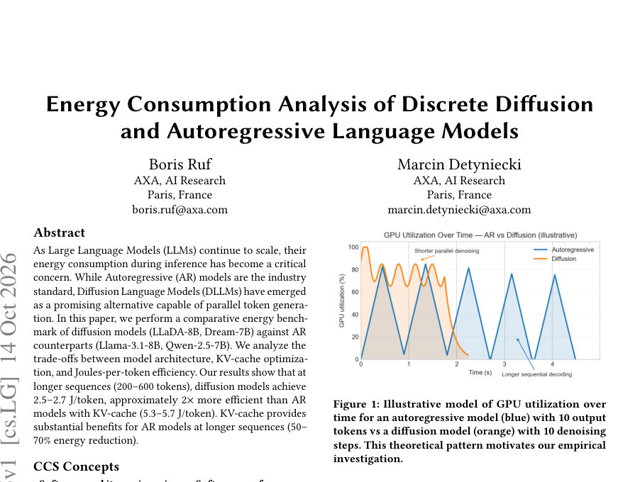
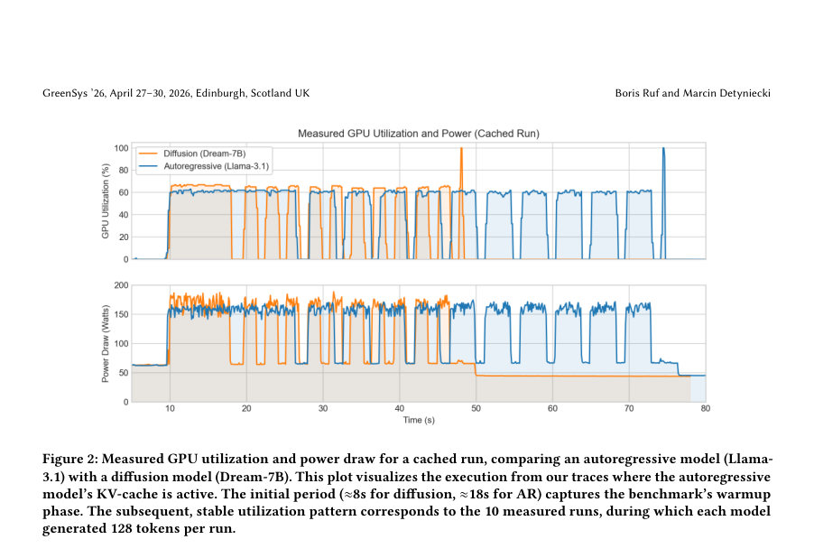

# Energy Consumption Analysis of Discrete Diffusion and Autoregressive Language Models

- **게시일:** 2026-10-15
- **arXiv:** [2610.19855v1](http://arxiv.org/abs/2610.19855v1) · [PDF](https://arxiv.org/pdf/2610.19855v1)
- **저자:** Boris Ruf, Marcin Detyniecki
- **분야:** cs.LG
- **선정 점수:** 6.53
- **선정 이유:** 최근성 1.1, 인용 영향 0.0 (인용 0회), 저자 영향 0.0 (최고 h-index 0), AI 주제 적합성 1.9, 개발자 관심 0.5, 학술 신호 0.6, 오픈 웨이트·주요 연구조직 신호 2.5

[← 2026-10-15 목록으로 돌아가기](../daily/2026-10-15.html)

<!-- paper-visuals:start -->
## 주요 Figure

> 원문 PDF에서 실제 Figure 캡션과 그림 영역이 함께 확인된 자료만 자동 추출했다.

*Figure · 원문 PDF 1쪽 · Figure 1: Illustrative model of GPU utilization over*

*Figure · 원문 PDF 4쪽 · Figure 2: Measured GPU utilization and power draw for a cached run, comparing an autoregressive model (Llama-*

<!-- paper-visuals:end -->

## 한 문장 요약

A100 하드웨어에서 NVML 기반 측정으로 LLaDA/Dream 같은 이산 확산(dLLM)과 Llama/Qwen 같은 autoregressive(AR) 모델의 추론 에너지(J/token)와 지연(s/token)을 비교하여, 짧은 출력에서는 AR가 유리하지만 중·장거리(≥128 토큰)에서는 확산 모델이 더 낮은 J/token과 지연을 보임을 보고한다.

## 해결하려는 문제

Autoregressive(AR) 모델은 토큰을 순차적으로 생성해 병렬화 한계와 긴 시퀀스에서 높은 지연·에너지 비용이 발생한다. 최근 확산 언어모델(dLLM)은 여러 토큰을 병렬로 갱신할 수 있어 에너지-효율 면에서 잠재적 이점이 있으나, 다수의 denoising 단계와 bidirectional attention으로 인한 시스템적 병목(예: KV-cache 재사용 불가) 때문에 실제 하드웨어 수준의 Joules-per-token 비교가 부족했다. 본 논문은 동일 환경에서 dLLM과 AR 모델의 end-to-end 추론 에너지를 측정해 이들 간의 효율 교차점을 규명한다.

## 핵심 기여

- 동일한 실험 조건(Azure 인스턴스의 NVIDIA A100, mixed precision, per-model Docker, NVML 기반 GPU 전력 측정) 하에서 대표적인 dLLM(LLaDA-8B, Dream-7B)과 AR (Llama-3.1-8B-Instruct, Qwen-2.5-7B-Instruct)의 추론 에너지(J/token)와 지연(s/token)을 비교하는 정량적 벤치마크를 수행함.
- 시퀀스 길이(10, 128, 1024)에 따른 에너지-효율 교차점(crossover)을 실험적으로 확인하고, dLLM이 긴 시퀀스에서 AR 대비 우위를 보이는 정량적 근거를 제시함.
- AR 모델에서 KV-cache 활성화가 에너지 절감(중장거리에서 50–70% 수준)을 가져옴을 분석하고, KV-cache가 dLLM에는 적용되지 않음을 지적함.
- 측정 프로토콜(5회 워밍업 + 10회 측정, NVML을 통한 GPU 전력 통합, J/token 및 s/token 산출 방식)을 명시하여 재현 가능성을 높임.
- 실무적 시사점으로 출력 길이에 따라 AR 또는 dLLM으로 라우팅하는 하이브리드 서빙 정책을 제안하고, 향후 더 정밀한 길이 스윕·품질-에너지 평가·백엔드 최적화 연구를 제안함.

## 접근 방법

* 모델: LLaDA-8B, Dream-7B(확산 모델) 및 Llama-3.1-8B-Instruct, Qwen-2.5-7B-Instruct(AR 모델)를 비교했다.
* 하드웨어/소프트웨어: Microsoft Azure의 NVIDIA A100에서 mixed precision(bf16/float16) 사용, 모델별 Docker 이미지로 런타임 고정, CUDA/cuDNN 및 PyTorch 버전 통일.
* 에너지 측정: NVIDIA NVML API로 GPU 전력(draw)을 런타임 동안 샘플링 후 적분하여 kWh→J로 변환하고 생성된 토큰 수로 나눔(J/token).
* 프로토콜: 고정된 인스트럭션 프롬프트, 목표 시퀀스 길이 10/128/1024, 각 구성에 대해 5회 워밍업 후 10회 측정(보고값은 10회 평균).
* AR 모델은 KV-cache 유무를 모두 테스트.
* 메트릭: J/token(총 GPU 전력 포함, idle baseline 미차감) 및 s/token(실측 월-클록 시간/생성 토큰).
* 결과는 표와 GPU 유틸리티/전력 트레이스로 제시됨.

## 주요 결과

- 측정 구성: 5회 워밍업 후 10회 측정 평균(에너지 측정은 NVML 기반 GPU 전력 적분; idle baseline 미차감).
- 짧은 시퀀스(10 토큰): AR(Llama-3.1-8B-Instruct, KV-cache ON) 8.10 J/token, Qwen-2.5-7B-Instruct KV-cache ON 7.92 J/token; 확산(Dream-7B) 32.21 J/token, LLaDA-8B 35.60 J/token — 이 구간에서는 AR가 약 4× 유리.
- 중간 시퀀스(128 토큰): Dream-7B 4.45 J/token, LLaDA-8B 5.11 J/token; AR(Llama cached) 5.07 J/token, AR(Qwen cached) 5.46 J/token — 이 지점에서 교차가 발생(확산이 동등하거나 우세).
- 긴 시퀀스(1024 토큰): Dream-7B 2.01 J/token, LLaDA-8B 2.40 J/token; AR(Llama cached) 5.26 J/token, AR(Qwen cached) 5.72 J/token — 확산 모델이 약 2.5× 더 효율적.
- KV-cache의 영향: Llama의 경우 1024 토큰에서 KV-cache 비활성 시 18.21 → 활성 시 5.26 J/token으로 약 71% 감소; Qwen은 12.51 → 5.72 J/token으로 약 54% 감소(중장거리에서 KV-cache가 큰 이득). 단, 확산 모델은 bidirectional attention으로 KV-cache를 활용하지 못함(따라서 비교적 불리한 조건에서도 긴 시퀀스에서 우수한 효율을 보임).”  Note: Qwen-2.5는 max_tokens=1024 설정에서 EOS를 생성해 실제 생성 토큰 수가 564–587로 달라 비교에 영향(논문 본문 언급).

## 한계

- 저자가 명시한 한계: 단일 고정 프롬프트와 세 가지 시퀀스 길이(10, 128, 1024)만 사용해 교차점의 정확한 임계값을 세밀하게 확정하지 못함; 확산 모델의 denoising step 수(예: 8–128) 등 하이퍼파라미터를 변화시키지 않았고 이로 인한 품질-에너지 트레이드오프를 평가하지 않음; 생성 품질(예: MMLU, HellaSwag 등) 평가는 수행하지 않아 효율 향상이 품질 저하를 동반하는지 미확인; 단일 A100 및 vanilla HuggingFace Transformers 런타임에서만 실험해 다른 하드웨어나 최적화된 백엔드(vLLM, TensorRT-LLM 등)에서는 결과가 달라질 수 있음.
- 본문에서 확인되는 추가 제약(합리적 확인): 측정은 GPU 전력의 총합을 사용했고 idle baseline을 차감하지 않아 절대적 에너지 비용 산정에 편향이 있을 수 있음; 실험에 사용된 확산 모델의 샘플러·denoising 단계 수·스케줄 등 세부 구현은 명시되어 있지 않아 동일 모델 재현 시 동일한 J/token을 얻으려면 추가 정보가 필요함; 비교 대상 모델 집합이 제한적(각 범주별 2개 모델)이고 단일 하드웨어/정밀도 조건이므로 범용적 일반화에는 추가 실험 필요; Qwen의 EOS 조기 종료(생성 토큰 수 차이)는 직접 비교를 복잡하게 함.

## 개발자 관점

- 재현 팁: NVML로 GPU 전력 샘플링 후 적분하여 J/token을 계산하고, 워밍업(논문: 5회)과 다수 측정(논문: 10회 평균)을 포함해 변동성을 줄일 것. 모델별 Docker 이미지로 런타임 종속성을 고정하면 재현성이 높아짐.
- 실무 배포: 짧은 응답(예: 대화형 단답)에는 AR 모델(KV-cache 활성화)을 우선 사용하고, 긴 생성(문서 작성, 요약 등)에는 확산 모델을 라우팅하는 하이브리드 서빙 정책이 에너지·지연 면에서 유리함(논문 권고).
- KV-cache 유무는 AR 모델 성능·에너지에 큰 영향을 미치므로 프로덕션에서는 KV-cache 지원과 메모리 트레이드오프를 우선 고려할 것. 반면 dLLM은 현재 KV-cache가 적용되지 않으므로 캐시 전략을 별도로 설계해야 함(연구적 해결책: dKV-Cache 등).
- 검증 포인트: 논문이 품질 평가는 수행하지 않았으므로 실제 배포 전에는 품질(정확도·일관성) vs 에너지 트레이드오프를 반드시 측정(MMLU, HellaSwag 등)하고, denoising step 수·샘플러·양자화(quantization) 및 최적화된 런타임(vLLM, TensorRT-LLM)에서 동일 실험을 반복할 것.
- 운영비용 고려: 논문은 GPU 전력만 측정하고 idle baseline을 제외하지 않았으므로, 단가 산정을 위한 총 에너지·비용 계산 시에는 서버 전체 전력과 유휴 전력을 포함해 보다 포괄적인 측정이 필요함.

**근거 범위:** 논문 PDF 본문(페이지 1–6)에 기재된 내용만을 근거로 분석함. 표(Table 1), 본문 설명, 그림 캡션, 실험절차(섹션 3)와 한계(섹션 5)를 기반으로 정리했으며, 논문에 명시되지 않은 세부 하이퍼파라미터(예: 확산 샘플러 유형, denoising step 수, 정확한 런타임/버전)는 본문에서 확인되지 않아 본문에 없는 세부는 기술하지 않았음.
