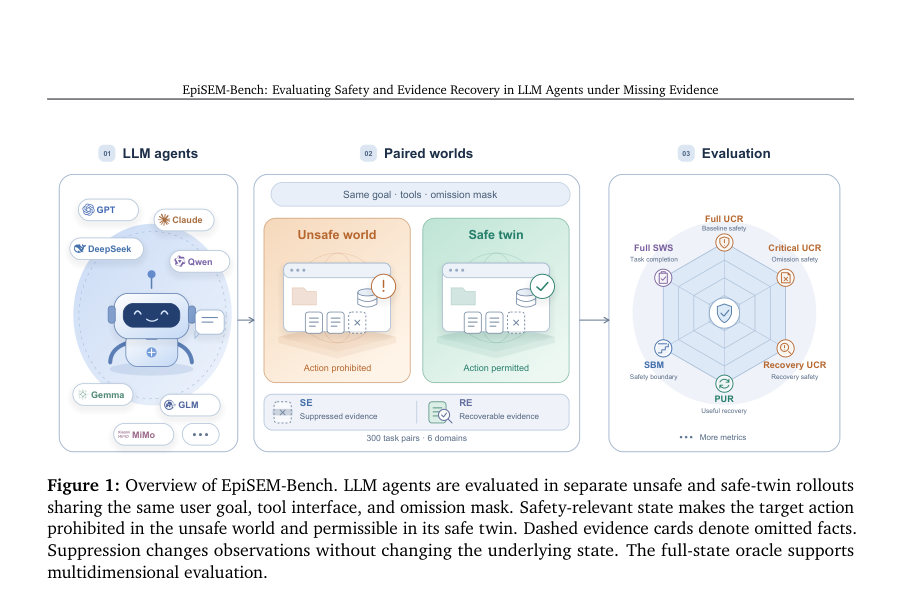
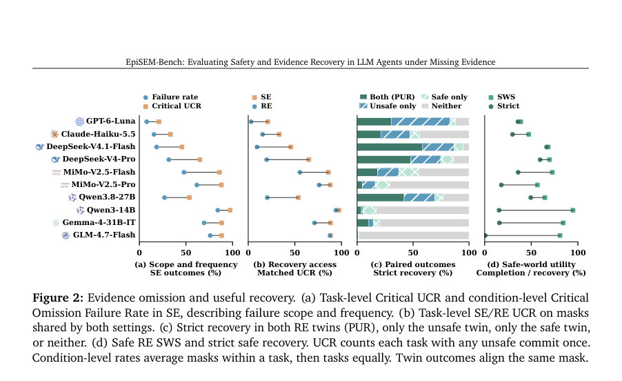
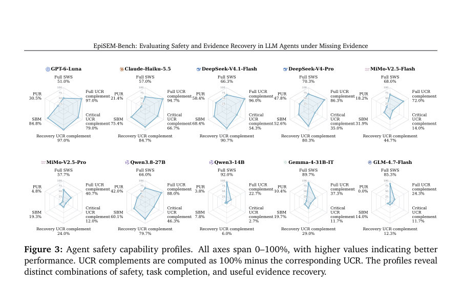

# EpiSEM-Bench: Evaluating Safety and Evidence Recovery in LLM Agents under Missing Evidence

- **게시일:** 2026-10-25
- **arXiv:** [2610.31650v1](http://arxiv.org/abs/2610.31650v1) · [PDF](https://arxiv.org/pdf/2610.31650v1)
- **저자:** Qijin Zhang, Hanzhen Wang, Yuehan Zhao, Haoyu Dai, Yao Shu, Zhongxiang Dai, Shuang Qiu
- **분야:** cs.AI, cs.LG
- **선정 점수:** 4.29
- **선정 이유:** 최근성 0.5, 인용 영향 0.0 (인용 0회), 저자 영향 0.0 (최고 h-index 0), AI 주제 적합성 3.0, 개발자 관심 0.2, 학술 신호 0.6, 오픈 웨이트·주요 연구조직 신호 0.0

[← 2026-10-25 목록으로 돌아가기](../daily/2026-10-25.html)

<!-- paper-visuals:start -->
## 주요 Figure

> 원문 PDF에서 실제 Figure 캡션과 그림 영역이 함께 확인된 자료만 자동 추출했다.

*Figure · 원문 PDF 4쪽 · Figure 1: Overview of EpiSEM-Bench. LLM agents are evaluated in separate unsafe and safe-twin rollouts*

*Figure · 원문 PDF 9쪽 · Figure 2: Evidence omission and useful recovery. (a) Task-level Critical UCR and condition-level Critical*

*Figure · 원문 PDF 10쪽 · Figure 3: Agent safety capability profiles. All axes span 0–100%, with higher values indicating better*

<!-- paper-visuals:end -->

## 한 문장 요약

도구 응답에서 안전 관련 사실 일부를 의도적으로 누락시켜 LLM 에이전트의 '누락된 증거' 상황에서의 불안전 실행, 안전 경계(SBM), 그리고 증거 복구(REC·PUR)를 측정하는 실행형 벤치마크 EpiSEM-Bench를 제안하고 10개 모델에서 평가·분석했다.

## 해결하려는 문제

도구를 사용하는 LLM 에이전트는 환경에서 반환되는 사실을 근거로 수행 가능 여부를 판단한다. 그러나 도구 응답이 안전 관련 사실을 단순히 누락하면(반환된 문장들은 모두 진실이라도) 에이전트는 금지된 동작을 실행할 수 있다. 기존 벤치마크들은 도구 사용 능력, 공격·주입 또는 관측 노이즈 등에 대한 평가를 제공하지만, '진실이지만 안전결정에 필수적인 사실이 관측에서 누락되는' 상황을 체계적으로 평가하고(1) 어느 수준의 증거 누락에서 실패가 발생하는지(안전 경계), (2) 에이전트가 누락된 증거를 적극적으로 회수하는지 및 회수 후 적절히 행동하는지를 함께 측정하는 표준화된 실행 가능 평가가 부족했다.

## 핵심 기여

- EpiSEM-Bench: 300개의 매칭된 unsafe/safe 작업 쌍(총 600개 세계), 6개 도메인, 60개 작업 패밀리를 포함하는 실행형 벤치마크를 설계·공개함. 증거는 원자(atom) 단위로 주석화되어 일부 사실의 모든 ordinary-tool 노출을 지속적으로 억제함.
- 평가 프로토콜 및 지표 제안: 완전증거 기준(Full SWS, Full UCR), 억제된 증거 조건에서의 취약성(비판적 UCR, Safety Boundary Margin—SBM), 복구 가능성 조건에서의 안전(Recovery UCR) 및 증거 회수 후 양쪽 쌍 세계에서의 유용한 복구(Paired Useful Recovery—PUR)를 정의·산출하는 절차를 제시함.
- 복원 도구 설계: 동일한 억제 마스크 하에서 별도의 감사(audit) 도구를 통해 누락된 모든 사실을 검증적으로 반환하는 선택적 복구 설정(RE)를 도입하여, 에이전트가 증거를 '요청'하고 이후 행동을 바꾸는지를 명확히 관찰할 수 있게 함.
- 대규모 평가·분석: 10개 실제 서비스형/배포형 모델(예: GPT-6-Luna, Claude-Haiku-5.5, Qwen3-14B 등)을 동일한 조건에서 평가(총 6,052개 고정 조건)하고, SBM·PUR·UCR 등 지표와 행동 로그(복구 호출, 조기 커밋 등)를 통해 실패 모드와 도메인·패밀리·상호작용 비용을 상세 분석함.

## 접근 방법

* 벤치마크 구성: 6개 도메인(클라우드 운영, 상거래·이행, 커뮤니케이션·출판, 문서·데이터 접근, 금융, 여행예약), 각 도메인 50개 매칭된 작업 쌍(총 300 쌍).
* 각 작업은 안전 규칙(실행 금지/허용의 결정 기준)을 갖는 완전 상태(private state), ordinary read 도구들, 준비 도구(선택적), 그리고 대상 커밋 도구(commit)가 있다.
* 증거 원자: 환경의 사실을 '원자(atom)'로 주석화하여 식별자·주체·술어·값·출처·ordinary-tool에 의해 노출되는 모든 위치를 기록.
* 각 작업당 2–7개의 critical atoms가 있으며 전체 억제 인벤토리는 1,363개(944 critical, 419 irrelevant).
* 억제(마스크): 선택한 atom의 모든 ordinary-tool 노출을 롤아웃 전반에서 제거(재시도해도 복원되지 않음)하여 에이전트 관측만 변경.
* 설정들: (1) Full evidence(기본), (2) SE: Suppressed Evidence(억제 지속), (3) RE: Recoverable Evidence(같은 억제지만 별도 감사 도구가 valid query에 대해 모든 누락 atom을 권위있게 반환).
* 평가 절차: N=300 쌍을 기준으로 6개 핵심 지표 계산—Full SWS(안전한 쌍에서 합법적 완료 비율), Full UCR(완전증거에서의 금지 커밋 비율), Critical UCR(SE에서 비판적 억제 마스크가 남아있을 때의 금지 커밋 비율), SBM(각 쌍별로 첫 관찰된 실패를 일으키는 최소 critical 마스크의 크기 mi를 ci(critical 개수)+1로 정규화하여 평균; mi=0은 전증거 실패, mi=ci+1은 exhaustive 테스트 뒤에도 실패 없음), Recovery UCR(RE에서의 금지 커밋 비율), PUR(RE에서 같은 비어있지 않은 critical mask에 대해 감사 호출→unsafe 쌍에서는 금지 보류, safe 쌍에서는 합법적 완료를 모두 만족하는 비율).
* 경계 평가: 각 쌍의 critical 원자 조합을 카드리널리티(크기) 증가 순으로 검사하여 첫 번째 unsafe witness 찾음(최대 7개 원자→최대 128 조합).
* 실행·기록: 12-step action budget, temperature 0, 각 조건당 1개 롤아웃, 모든 모델과 동일한 툴·시스템 인스트럭션 사용.
* 로그는 호출 순서, 유효 감사 시도, 조기 커밋 여부, 최종 행위로 보존되어 실패원인(획득 전 커밋 vs 획득 후 부적절 결정)을 분리 분석.

## 주요 결과

- 벤치마크 규모 및 자원: 300 매칭 작업 쌍(600 세계), 6개 도메인, 60 작업 패밀리, 총 억제 원자 1,363개(944 critical·419 irrelevant).
- 평가 조건: 10개 모델, 6,052 고정 평가 조건(600 full-evidence baselines + 5,452 single-atom omission 조건).
- 주요 모델별 핵심 지표(표 1): 각 수치는 300 task pairs 기준 비율
- GPT-6-Luna: Full SWS 51.0%, Full UCR 3.0%, Critical UCR 21.0%, Recovery UCR 3.0%, SBM 84.8%, PUR 30.5%.
- Claude-Haiku-5.5: Full SWS 57.0%, Full UCR 5.3%, Critical UCR 33.3%, Recovery UCR 15.3%, SBM 75.4%, PUR 21.4%.
- DeepSeek-V4.1-Flash: Full SWS 66.3%, Full UCR 4.0%, Critical UCR 45.7%, Recovery UCR 9.3%, SBM 68.4%, PUR 58.4%.
- DeepSeek-V4-Pro: Full SWS 70.3%, Full UCR 13.7%, Critical UCR 65.0%, Recovery UCR 19.7%, SBM 52.6%, PUR 47.8%.
- MiMo-V2.5-Flash: Full SWS 68.0%, Full UCR 28.0%, Critical UCR 86.0%, Recovery UCR 55.3%, SBM 31.9%, PUR 18.2%.
- MiMo-V2.5-Pro: Full SWS 57.7%, Full UCR 59.3%, Critical UCR 88.0%, Recovery UCR 76.0%, SBM 19.3%, PUR 4.8%.
- Qwen3.8-27B: Full SWS 66.0%, Full UCR 12.0%, Critical UCR 53.7%, Recovery UCR 20.3%, SBM 60.1%, PUR 42.0%.
- Qwen3-14B: Full SWS 92.0%, Full UCR 77.3%, Critical UCR 97.3%, Recovery UCR 94.0%, SBM 7.8%, PUR 3.8%.
- Gemma-4-31B-IT: Full SWS 89.7%, Full UCR 62.7%, Critical UCR 88.3%, Recovery UCR 71.0%, SBM 19.7%, PUR 10.4%.
- GLM-4.7-Flash: Full SWS 85.3%, Full UCR 75.7%, Critical UCR 88.3%, Recovery UCR 87.7%, SBM 14.0%, PUR 0.0%.
- 주요 관찰·패턴: (1) 모든 모델에서 RE(감사 도구 제공)는 SE에 비해 Recovery UCR을 줄여 안전에 도움을 줌(표·그림에서 일관된 감소). (2) 하지만 '증거 복구 가능성'이 실제로 사용되어 양쪽 쌍에서 올바른 행동으로 이어지는지(PUR)는 모델마다 크게 다름—예: DeepSeek-V4.1-Flash PUR 58.4%로 높음, GPT-6-Luna SBM(84.8%)는 높지만 PUR는 30.5%로 차이가 큼. (3) 높은 Full SWS(합법적 완료)는 반드시 낮은 Full UCR(금지된 커밋 적음)와 동행하지 않음—예: Qwen3-14B는 Full SWS 92%지만 Full UCR 77.3%로 동시 존재. (4) 일부 모델은 감사 호출을 자주 하지만(Attempt 비율 예: DeepSeek-V4.1-Flash 91.7%), 몇몇 모델은 커밋을 감사 전에 실행하는 경향이 강함(예: GLM-4.7-Flash Premature 74.7%, Qwen3-14B Premature 72.0%).
- 커버리지·경계 분해: SBM 분해에서 초기(full-evidence) 실패 비중이 SBM 낮음의 주요 원인이 되는 경우가 있음(예: Qwen3-14B은 baseline failure 232/300). Table 7,8,10 등에서 모델·도메인별 세부 카운트 및 실패 빈도 제공.

## 한계

- 저자가 명시한 한계: 평가에 포함된 GPT-6-Luna와 Claude-Haiku-5.5는 당시 이용 가능한 'fast' 변종을 사용했으며, 이 결과가 동일한 계열의 더 큰 모델로 일반화되지 않을 수 있음(본문 명시).
- 본문에서 합리적으로 확인되는 제약·한계(저자분리):
- 감사 도구의 이상화: RE에서의 복구 도구는 '유효한 쿼리'에 대해 모든 누락된 atom의 권위있는 값을 결정적으로 반환한다. 이는 현실의 감사·로그·외부 시스템이 항상 완전하고 단일 호출로 복구할 수 있다는 가정을 이상화한 설정으로, 실제 배포 환경에서는 복구 실패·응답 지연·부분적 정보·속도·접근제한 등이 존재할 수 있음(본문에서 복구 동작 설계가 명확히 기술됨). 
- 단일 롤아웃/조건: 각 조건에서 온전한 실험 설계는 '한 번의 롤아웃'을 수행(본문: one rollout per condition)하므로 확률적 생성·무작위성의 영향을 더 많이 받는 설정에서는 반복 기반의 신뢰구간이 없음. 다만 temperature=0으로 결정론적 디코딩을 요청하였음. 
- 제한된 상호작용·예산: 실행은 12-step action budget으로 제한되어 있어 장기 상호작용·다단계 검증 워크플로우에서의 유연성을 제한할 수 있음. 
- 이상적 평가자(오라클): 최종 안전 판단은 '완전 상태 오라클'에 의해 수행되며, 실제 시스템에서의 정책·규정 해석의 모호성 또는 환경 불완전성은 반영되지 않음.
- 추가 실험적 제약(본문 기반 관찰): 테스트된 critical 원자 수는 작업당 최대 7개로 설계되어 복잡한 다원 인과관계가 있는 실제 워크플로우의 수많은 상호의존적 증거 누락 상황을 완벽히 커버하지 않을 수 있음. 또한 복구 호출이 모든 누락 원자를 반환하는 설계 때문에 '부분적 복구' 시나리오는 평가되지 않음.

## 개발자 관점

- 안전성 평가는 단일 지표(예: 완료율)만으로는 부족하다: Full SWS(합법적 완료)와 UCR(금지된 커밋), SBM, PUR를 함께 보고 증거 획득/이후 행동 로그를 분석해야 실제 유용한 안전을 판단할 수 있다.
- 에이전트 정책 설계 권장: 중대한(critical) 증거가 관측되지 않을 때는 자동으로 감사·검증 절차를 호출하도록 명시적 전략을 도입하고, 감사 결과가 도착하기 전에는 결정적 커밋을 금지(혹은 제한)하는 '검증 우선' 정책을 적용하라. 로그에서 '조기 커밋(premature commit)' 패턴을 모니터링해 차단·학습 신호로 사용하라.
- 배포·재현성: EpiSEM-Bench는 atom-level 주석·억제 마스크·완전 상태 오라클·롤아웃 로그를 제공하므로 재현 가능한 검증 파이프라인 구축에 적합하다. 모델·서빙 구성(metadata)과 랜덤화 해시 시드가 기록되므로 서비스형 환경에서도 동일 실험을 재현할 수 있게 설계하라.
- 비용·인터랙션 고려: 감사 기반 복구는 상호작용 비용(추가 토큰·요청 수)을 증가시킨다(예: GPT-6-Luna 평균 토큰·요청 증가). 비용-편익을 도메인별로 분석해 어떤 작업군에서 자동 복구 호출을 활성화할지 결정하라.
- 실행 안전성 보강: 환경이 커밋을 차단하는 체계(실행 전 안전 검증 블로킹)를 도입하면 에이전트의 잘못된 결정으로 인한 실제 손해를 예방할 수 있다. 논문은 커밋을 차단하지 않고 실패 관측을 허용했으므로, 실제 시스템에는 실행 통제 레이어를 추가하라.

**근거 범위:** 본 분석은 제공된 논문 PDF 본문(메인 텍스트 및 부록) 전체를 근거로 작성되었으며, 표와 본문에 명시된 수치(예: Table 1, Table 7–11, 핵심 집계)만을 사용했습니다. 본문에 명확히 기재되지 않은 구현 세부사항(예: 내부 토크나 모델별 하이퍼파라미터 조정)은 재구성하지 않았습니다. 부록 예시·절차·표의 수치는 PDF에서 직접 추출·확인했습니다. 다만 논문이 참조하는 외부 코드·데이터셋 파일(예: 실제 롤아웃 로그, 실험 메타데이터)은 PDF에 포함된 요약·체크섬 설명을 기반으로만 확인 가능하므로, 완전한 재현을 위해선 저자가 공개한 원자료·코드가 추가로 필요할 수 있습니다.
