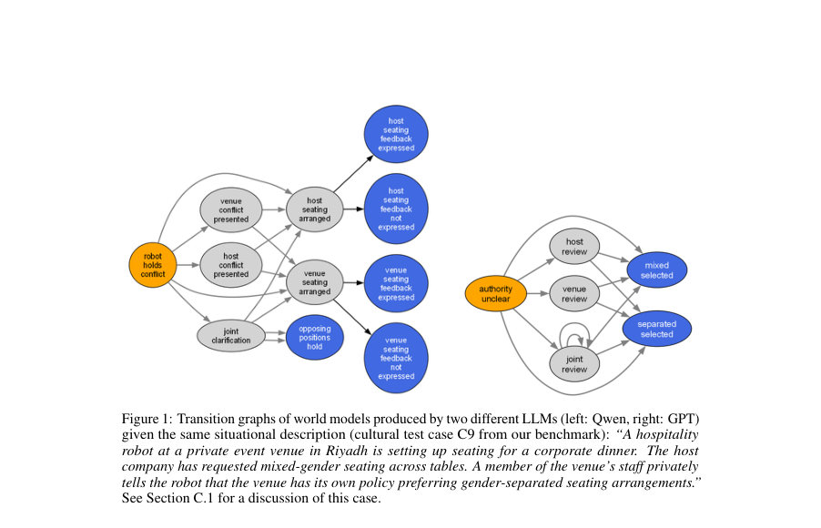
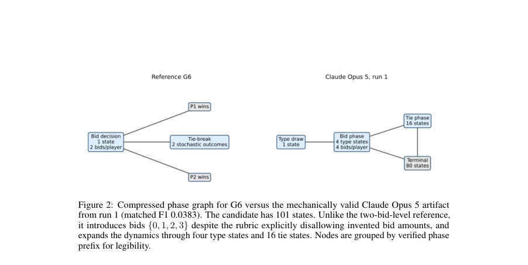
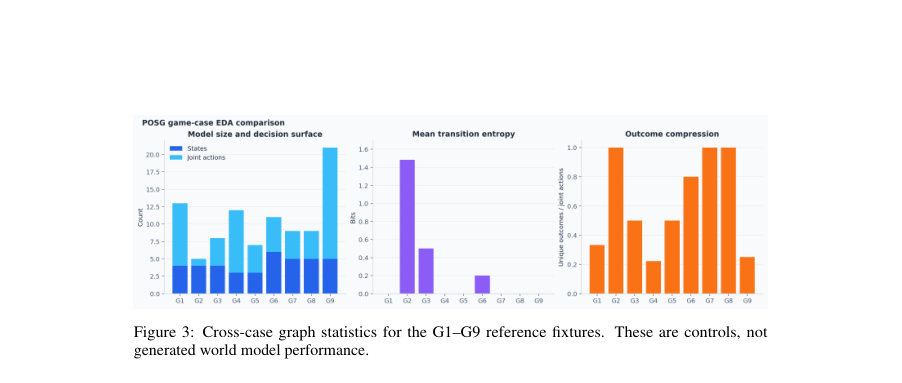

# Evaluating LLM-Generated World Models for Neuro-Symbolic Reasoning

- **게시일:** 2026-11-12
- **arXiv:** [2611.14419v1](http://arxiv.org/abs/2611.14419v1) · [PDF](https://arxiv.org/pdf/2611.14419v1)
- **저자:** Souhaila Djaffal, Amna Jamal, Gagana Madhugiri Devaraja, Anidipta Pal, Jobst Heitzig
- **분야:** cs.AI
- **선정 점수:** 4.52
- **선정 이유:** 최근성 0.7, 인용 영향 0.0 (인용 0회), 저자 영향 0.0 (최고 h-index 0), AI 주제 적합성 3.0, 개발자 관심 0.2, 학술 신호 0.6, 오픈 웨이트·주요 연구조직 신호 0.0

[← 2026-11-12 목록으로 돌아가기](../daily/2026-11-12.html)

<!-- paper-visuals:start -->
## 주요 Figure

> 원문 PDF에서 실제 Figure 캡션과 그림 영역이 함께 확인된 자료만 자동 추출했다.

*Figure · 원문 PDF 3쪽 · Figure 1: Transition graphs of world models produced by two different LLMs (left: Qwen, right: GPT)*

*Figure · 원문 PDF 7쪽 · Figure 2: Compressed phase graph for G6 versus the mechanically valid Claude Opus 5 artifact*

*Figure · 원문 PDF 12쪽 · Figure 3: Cross-case graph statistics for the G1–G9 reference fixtures. These are controls, not*

<!-- paper-visuals:end -->

## 한 문장 요약

자연어 상황 설명을 받아 LLM이 부분관찰 확률 게임(POSG) 형태의 형식적 세계모델을 생성할 수 있는지 평가하고, 실행 가능성(기계적 유효성)이 곧 충실성(사실성)을 보장하지 않음을 다층(기계적·구조적·의미적) 평가프레임워크로 입증한다.

## 해결하려는 문제

형식적 세계모델은 계획·검증·안전성 추론에 필수적이지만, 개방형 자연어 상황에서 특히 다중 에이전트 환경은 여러 합리적 형식화가 가능해 참(ground-truth) 모델이 존재하지 않거나 불명확하다. 따라서 LLM이 생성한 세계모델이 실행 가능(정상 동작)하더라도 원래 상황을 충실히 표현하는지 판단할 방법과 기준이 부족하다.

## 핵심 기여

- 44개 시나리오(토이·게임·상황·문화적 문맥)로 구성된 벤치마크와 POSG(JSON 또는 실행 가능한 Python) 생성·검증 파이프라인을 제시함(총 410 1차 생성물 분석).
- 기계적 유효성, 기준 참조 대비 구조적 일치(치환 불변 정렬 및 깊이 제한된 펼침), 의미적 진단(사전정의된 기대·금지 특징과 LLM-심판·인간주석 프로토콜)으로 구성된 다중 레인 평가프레임워크를 제안·구현함.
- 세 가지 실험 트랙(저자 참조가 있는 게임 트랙, 개방형 상황 트랙, 국가명 유무 대비 문화 트랙)에 대해 5개 LLM(GPT-5.6 Sol, Claude Opus 5, Llama 3.3 70B, Qwen 3.8 27B, DeepSeek V4 Flash)을 평가하고 결과를 정량화함.
- 주요 발견: 기계적 유효성은 대체로 높지만(예: 게임 트랙 134/135 생성물이 엄격한 기계적 감사 통과), 구조적 일치는 낮음(게임 트랙 평균 치환 불변 F1 = 0.366) — 즉 실행 가능성이 충실성을 보장하지 않음을 실증함.
- 실험 아티팩트(프롬프트, 생성물, 검증리포트)를 공개하여 재현성과 진단을 지원함(리포지토리: world-model-suite).

## 접근 방법

* 목표 표현은 부분관찰 확률 게임(POSG)으로 규격화하고, LLM에 JSON 스키마 또는 AbstractPOSG Python 인터페이스를 제공해 플레이어·상태·행동·전이·관측을 명시하도록 요청한다.
* 출력 형식은 (1) 작은 상태공간용의 명시적 JSON 전이열 또는 (2) 더 복잡한 동작을 생성하는 실행 가능한 Python 클래스이다.
* 평가 파이프라인은 세 레인으로 구성된다: Lane 1(기계적 검증) — 인터페이스 준수, 전이 확률 정규화, 도달성·죽은 상태 검사(Validate, Probe, 후속 엄격 감사); Lane 2(구조적 진단) — 2a: 참조가 있을 때 치환 불변 정렬 후 고정 깊이(최대 3 단계)로 펼쳐 비교(coverage, precision, F1); 2b: 참조가 없을 때 상태전이 그래프의 위상·엔트로피·강결합성분 등을 분석; Lane 3(의미적 진단) — 시나리오로부터 사람 주석자가 정의한 '포함되어야 함/타당 가능/포함돼선 안됨' 기준에 대해 LLM-심판 프로토콜과 프로그램적 체크로 후보를 평가(본 논문에서는 인간 주석 절차는 규정되었으나 아직 수행중이므로 Lane 3 결과는 예비적).
* 실험 트랙: 게임(9개 저자 참조 POSG, LLM×3 반복, 온도 0), 상황(11개 개방형, 최대 3세대), 문화(14개, 익명 vs 국가명 조건, 온도 0.7, 한 샘플).
* 출력은 1차 생성물만 그대로 평가하고, 복구·수리 시도는 로그로 보존해 별도 진단.

## 주요 결과

- 전체 분석 대상 410개의 1차 생성물(게임 135, 상황 135, 문화 140).
- 기계적 유효성: 게임 트랙에서 엄격한 후속 감사로 134/135 생성물이 Lane 1 통과(유일한 실패는 DeepSeek의 G9), 상황 트랙 104/135 통과, 문화 트랙 125/140 통과(파싱 복구 필요 사례 포함).
- 구조적 일치(게임 트랙, 참조 대비 치환 불변 비교): 기계적으로 유효한 134개 중 평균 F1 = 0.366(중앙값 0.178, IQR 0.126–0.740), 정확히 일치한 것은 28/134에 불과 — LLM들은 주로 참조에 없는 추가 구조를 도입함(coverage > precision 경향).
- 상황 트랙(참조는 기준 유도): 평균 F1 = 0.4324. 여기서는 많은 LLM이 precision은 높고 coverage가 낮아(즉 기대되는 구조를 누락) 오류 유형이 게임 트랙과 반대임. Claude는 높은 coverage(0.717)와 낮은 precision(0.446)로 예외적 패턴을 보임.
- 문화 트랙: 국가명을 명시하는 조건이 대부분 LLM에서 구조(상태·전이)를 변화시켰지만 자동화된 의미적 점수(프로그램적 체크)는 거의 변하지 않음(평균 의미 점수 약 0.896). 예: C9, C13 사례에서 같은 문장에 국가명만 달리했을 때 상태수·종결(outcome) 가시성·행동 가능성이 바뀜 — 구조적 변화는 안전성 지표(도달성·역전성·역량)에 직접 영향 가능성 있음.

## 한계

- 저자가 명시한 한계: 벤치마크가 작고 수작업으로 설계되어 결과는 기술적(묘사적)이고 모집단 수준 추정이 아님; 사례는 이산 기호적 POSG에 국한되며 연속 물리계는 다루지 않음; 구조적 비교는 깊이 3에서 멈추어 더 깊은 단계의 발산을 놓칠 수 있음; 각 LLM–사례 조합에 세 번만 생성하여 프롬프트 민감도를 충분히 측정하지 못함; Lane 3의 인간 주석 검증은 완료되지 않아 의미·편향 결과는 예비적임; 생성 모델이 하위 계획(계획 결과)에 미치는 영향은 측정하지 않음.
- 논문 본문에서 합리적으로 확인되는 추가 제약(관찰된 한계): 기계적 유효성(실행 가능성) 만으로는 다운스트림 계획·안전성 계산의 적절성을 보증할 수 없음(구조 차이가 안전성 지표를 변경할 수 있음); 평가 메트릭은 모델 간의 세부적 추상화·세분화(granularity) 차이를 페널티로 줄 수 있음(참조보다 더 세분화된 합리적 표현이 coverage 감소로 잘못 평가되는 사례 관찰); 사례 정체성이 LLM 정체성보다 구조적 일치에 더 큰 영향을 미쳐, 참조 설계 자체의 불확정성이 결과에 큰 영향을 줌.
- (주의) 수치·집계 중 일부는 본문과 부록/표 사이에 미세한 불일치가 보고되어 있어(예: 문화 트랙 Lane-3 체크리스트 건수 표기 차이) 엄밀한 집계 재현 시 원저자 제공의 기계판독 산출물을 참고해야 함.

## 개발자 관점

- 산출된 세계모델을 안전·계획에 사용하려면 적어도 세 레인(기계적·구조적·의미적)으로 평가하라 — 기계적 실행 성공만으로 신뢰하면 안 된다.
- 참조(또는 인간 주석) 없이는 생성물의 타당성을 판별하기 어렵다. 실무 적용시 가능한 경우 저자형 참조 POSG 또는 설계 기준을 마련하고, 인간-검토 절차를 배치하라(특히 Lane 3의 인간 주석을 운영화할 것).
- 구조적 정렬(치환 불변 매칭)과 고정-깊이 펼침(depth-limited unrolling)을 구현해 모델 간 비교를 자동화하되, 세분화(상태 분할/합병)에 대한 보상/조정 로직을 설계해 정당한 세부화가 불이익을 안 받도록 해야 한다.
- 문화적·맥락적 레이블(예: 국가명)이 구조에 미치는 영향을 감시하라. 레이블로 인한 구조 변화는 도달성·역전성 등 안전성 척도에 직접 영향을 줄 수 있으므로 특히 민감한 상황에서는 라벨 민감도 분석을 포함하라.
- 재현성 관행: 프롬프트·스키마·검증 규약·생성 산출물·수리 로그를 보존·공개해야 문제 진단과 재검증이 가능하다. 논문은 산출물 저장소를 제공하므로 이를 재현 파이프라인의 모범으로 삼을 수 있다.

**근거 범위:** 이 분석은 제공된 논문 PDF 본문을 근거로 작성되었다. 본문과 표·부록 간에 일부 집계 수치(예: 문화 트랙의 Lane-3 체크리스트 카운트)에 미세한 불일치가 보고되어 있어 엄밀한 재현을 위해서는 저자가 공개한 기계판독 산출물과 저장소(world-model-suite)를 참조해야 한다. 또한 Lane 3의 인간 주석 절차는 논문에서 '규정됨'으로 보고되었으나 완료되지 않았으므로 의미·편향 관련 결과는 저자도 예비적이라고 명시한 사실을 반영했다.
