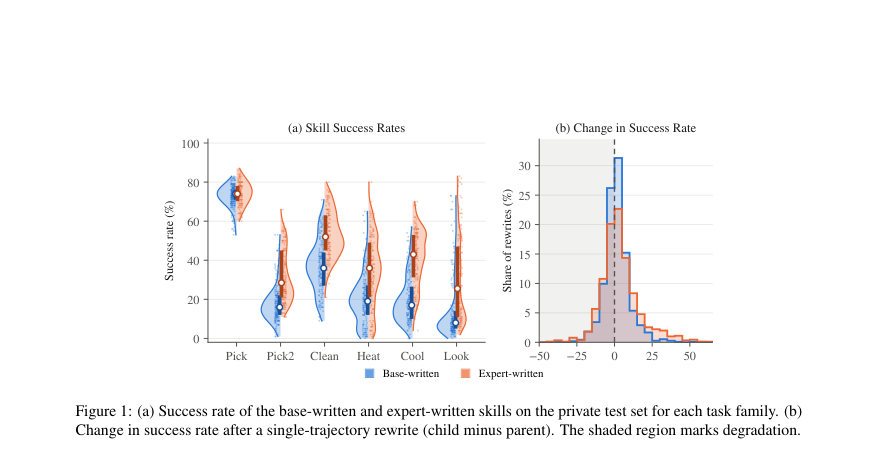
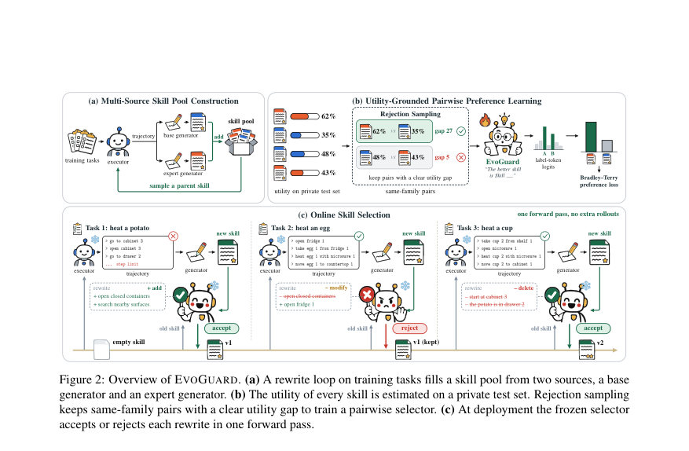
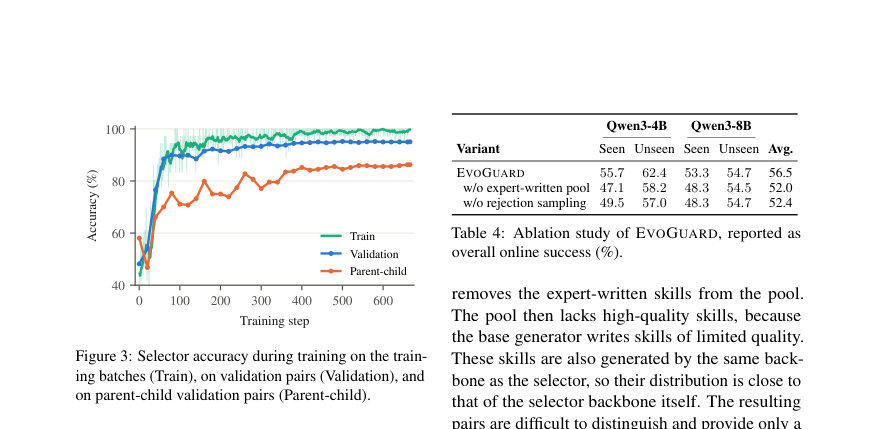

# EvoGuard: Mitigating Degradation in Online Skill Evolution

- **게시일:** 2026-11-05
- **arXiv:** [2611.06444v1](http://arxiv.org/abs/2611.06444v1) · [PDF](https://arxiv.org/pdf/2611.06444v1)
- **저자:** Yanli Wang, Zichen Bai, Tianyue Jiang, Kunming Shao, Junhao Shi, Xueqin Liu, Jinguo Sun, Muye Li, Tingting Bi, Yanlin Wang, Shaoqiang Zheng, Xuefei Diao, Zhuwei Zeng, Nan Duan, Peng Cao
- **분야:** cs.CL
- **선정 점수:** 4.67
- **선정 이유:** 최근성 1.1, 인용 영향 0.0 (인용 0회), 저자 영향 0.0 (최고 h-index 0), AI 주제 적합성 2.2, 개발자 관심 0.8, 학술 신호 0.5, 오픈 웨이트·주요 연구조직 신호 0.0

[← 2026-11-05 목록으로 돌아가기](../daily/2026-11-05.html)

<!-- paper-visuals:start -->
## 주요 Figure

> 원문 PDF에서 실제 Figure 캡션과 그림 영역이 함께 확인된 자료만 자동 추출했다.

*Figure · 원문 PDF 2쪽 · Figure 1: (a) Success rate of the base-written and expert-written skills on the private test set for each task family. (b)*

*Figure · 원문 PDF 4쪽 · Figure 2: Overview of EVOGUARD. (a) A rewrite loop on training tasks fills a skill pool from two sources, a base*

*Figure · 원문 PDF 8쪽 · Figure 3: Selector accuracy during training on the train-*

<!-- paper-visuals:end -->

## 한 문장 요약

온라인으로 단일-궤적으로 진화하는 텍스트형 스킬의 품질 저하를 막기 위해, 오프라인으로 유틸리티 라벨을 부여한 동일-패밀리 스킬 쌍을 학습해 한 번의 포워드 패스로 더 나은 스킬을 선택하는 쌍별 스킬 셀렉터(EvoGuard)를 제안한다.

## 해결하려는 문제

언어 기반 에이전트는 과거 상호작용을 재사용하기 위해 자연어 문서 형태의 스킬을 진화시킬 수 있다. 그러나 온라인(배포 중에 매 태스크마다) 진화 상황에서는 세 가지 한계가 있다. (1) 기존 방법은 보통 많은 궤적을 모은 배치로 오프라인에서 스킬을 업데이트해 실제 배포 흐름(태스크가 한 번씩 도착하는)과 맞지 않는다. (2) 각 업데이트(단일 궤적 리라이트)를 무조건 채택하면 과적합·오염된 규칙으로 인해 스킬이 시간이 지남에 따라 성능 저하(드리프트)를 겪는다(논문 본문에서 ALFWorld 기준 리라이트의 42%가 부모 스킬보다 성능이 낮음). (3) 검증(held-out 평가)으로 모든 업데이트를 검사하면 매 업데이트마다 추가 롤아웃이 필요해 비용·지연이 너무 크다. 연구 질문은 "매 업데이트마다 고비용 검증을 수행하지 않으면서도 온라인 스킬 진화 중 발생하는 성능 저하를 어떻게 막을 것인가"이다.

## 핵심 기여

- 온라인 스킬 진화를 "단일 업데이트의 수용(accept/reject) 문제"로 공식화하고, 매 리라이트마다 현재 스킬과 새 스킬 중 어떤 것을 유지할지 결정하는 문제로 재정의함.
- EvoGuard: 오프라인에서 스킬 유틸리티(가족별 private test set)로 라벨을 만들고, 같은 가족의 스킬 쌍 중 유틸리티 간 뚜렷한 격차를 갖는 쌍만 유지하는 거부 샘플링을 통해 학습한 쌍별(패어와이즈) 로그it 기반 셀렉터를 제안함.
- 학습된 셀렉터는 배포 시 단일 포워드 패스에서 두 개의 라벨 토큰(A/B)의 로그잇만 비교해 결정을 내리므로, 매 업데이트마다 환경 롤아웃을 추가로 실행하지 않고 저지연·저비용으로 검증을 아모타이즈함.
- 광범위한 실험(ALFWorld, ScienceWorld, LiveCodeBench, WebShop)에서 채택 모든 리라이트(Accept-All) 대비 전체 성공률 및 패스율을 유의미하게 향상시키고(예: ALFWorld 평균 성공률 56.5% vs Accept-All 45.5%), 다른 LLM 기반 분류자 대비 위치 편향을 크게 줄임(교차위치 동의율 98.3%).
- 모듈화된 설계로 다른 스킬 진화 기법(예: SkillRise)에도 후처리 셀렉터로 결합 가능함을 보임.

## 접근 방법

* EvoGuard의 전체 파이프라인은 세 단계로 구성된다.
* (1) 다중 소스 스킬 풀 구성: 학습(오프라인) 단계에서 두 종류의 생성기(기본 생성기와 고품질 스킬을 더 많이 생성하는 전문가 생성기)를 사용해 각 태스크 패밀리별로 여러 스킬 문서를 수집한다.
* 스킬은 SKILL.md 형식(메타데이터 + When to use, Workflow, Decision rules, Recovery and pitfalls 4개 섹션)으로 저장되며, 생성기는 현재 스킬, 최근 궤적, 결과를 입력으로 전체 문서를 리라이트한다.
* (2) 유틸리티 기반 스코어링: 각 스킬은 해당 패밀리의 private test set H_f에서 한 번씩 평가되어 경험적 유틸리티(성공률 또는 점수 평균)를 얻는다.
* (3) 쌍별 선호 학습: 같은 패밀리 내에서 두 스킬을 샘플링하고 유틸리티 차이가 임계값(delta=0.1) 이상인 쌍만 유지(거부 샘플링).
* 셀렉터는 크로스-인코더 형태로 패밀리 설명 + Skill A + Skill B를 입력 받고 프롬프트 끝에 'The better skill is Skill' 보조문구를 붙여 다음 토큰 A/B의 로그잇(z_A, z_B)만 사용해 Bradley–Terry 형태의 음의 로그우도 손실로 학습한다.
* 학습 세부: 백본은 Qwen3-4B, LoRA 어댑터(rank=32, scale=64)로 학습(AdamW lr=1e-4, cosine schedule, 1 epoch, 배치 36쌍, 전체 24,000 훈련쌍).
* (배포) 온라인에서 형식 검사(v(ŝ)=1)를 통과한 새 리라이트가 오면 현재 스킬과 새 스킬을 A/B에 무작위로 배치하고 단일 포워드 패스로 z_A, z_B를 비교해 더 큰 쪽을 선택한다.
* 셀렉터는 토큰을 생성하지 않으며, 서버는 병합된(adapted) 모델이 반환하는 두 라벨 토큰의 로그확률을 비교해 즉시 결정(논문 실험에서 약 24 ms)한다.

## 주요 결과

- ALFWorld(주실험): 학습한 셀렉터는 학습에서 보지 않은 검증 쌍에서 더 나은 스킬을 선택할 확률이 95.0%에 도달. 온라인 전체 평균 성공률(여러 executor 합산)은 EVOGUARD 56.5% vs Accept-All 및 LLM-Judge 계열 평균 약 45.5% vs No-Skill(스킬 없음) 36.7% (Qwen3-4B/8B/32B 실행기들을 포함한 평균).
- ALFWorld 상세: Qwen3-4B 실행기에서 EVOGUARD는 seen 55.7%, unseen 62.4% (Accept-All: seen 41.0%, unseen 51.2%). Qwen3-32B(학습 라벨을 제공하지 않은 실행기)에서도 EVOGUARD는 seen 66.7%, unseen 71.6%로 전이 성능을 보임.
- 스킬 수용·길이: EVOGUARD는 유효 리라이트 중 약 42.3%만 수용(LLM-Judge 계열은 ~68–72%, Accept-All 100%). 선택된 스킬 문서 길이는 평균 361–371 토큰으로 Accept-All/LLM-Judge(528–567 토큰)보다 짧음—즉, 더 일반적이고 유효한 내용만 선택함.
- ScienceWorld: EVOGUARD 성공률 15.3% 및 평균 점수 27.3 vs No-Skill 10.2%/20.6. 다른 스킬 사용 방법들은 No-Skill과 유사하거나 더 나쁜 성능(예: Accept-All 9.4%).
- LiveCodeBench(코드 문제): EVOGUARD 패스율 28.4% vs No-Skill 26.1% (차이 약 2.3%), Accept-All/Random은 약 25.7%로 하락하거나 유사함. EVOGUARD가 해롭거나 잡다한 리라이트를 필터링해 개선을 달성함을 시사함.  (WebShop 결과는 본문 부록에 보고됨; EVOGUARD가 소폭 개선).

## 한계

- 저자가 직접 언급한 한계: EvoGuard 실험은 텍스트 기반 에이전트 환경들과 하나의 코드 벤치마크에 국한되어 있어 멀티모달·실제 로보틱스·임베디드 환경으로의 확장은 향후 과제임. 모든 실행기는 동일 모델 계열(Qwen3) 기반이라 다른 모델 계열에서는 스킬 순위가 다를 수 있음. 스킬 풀 구성·평가는 배포 전에 오프라인으로 계산해야 하므로 초기 비용이 필요함. 현재 구현은 벤치마크별로 셀렉터를 하나씩 학습하며, 도메인 간 공동 전이(selector 하나로 여러 도메인)를 달성하면 추가 이득이 가능함. 셀렉터는 매번 현재 스킬과 단 하나의 새 스킬만 비교하므로 여러 버전을 보존하거나 롤백하는 더 풍부한 업데이트 규칙을 다루지 못함. 또한 셀렉터는 수신되는 리라이트들 중에서만 선택할 수 있어, 해당 패밀리에서 스킬이 본질적으로 도움이 되지 않는 경우 이득이 제한적임.
- 본문에서 합리적으로 확인되는 한계: 스킬 유틸리티 산정은 private test set의 경험적 평균에 의존하므로 H_f 크기·구성에 따라 라벨 노이즈가 존재(예: ALFWorld에서 H_f=100으로 설정됨). 거부 샘플링 임계값(delta=0.1) 등 하이퍼파라미터가 성능에 민감할 수 있고, 고품질 스킬을 생성하는 전문가 생성기가 필요해 이 생성기 확보 비용이 추가됨. 또한 학습은 LoRA 어댑터와 특정 백본(Qwen3-4B) 조합으로 진행되어, 다른 백본·어댑터 설정으로의 직접 재현성은 하이퍼파라미터 조정이 필요할 가능성 있음. 최종 결정은 모델의 A/B 토큰 로그잇에 의존하므로 토크나이저·라벨토큰 선택에 민감할 수 있음.

## 개발자 관점

- 데이터 구축: 각 패밀리별로 private test set H_f(논문에서는 ALFWorld에 대해 H_f=100)와 리라이트 풀을 오프라인으로 먼저 구축해야 함. 스킬 풀은 기본 생성기(base)와 성능이 더 좋은 전문가 생성기(expert) 두 소스에서 채워야 서로 품질 격차가 있는 쌍을 만들 수 있다.
- 레이블·쌍 구성: 스킬 유틸리티는 각 스킬을 H_f의 모든 태스크에서 평가해 경험적 평균을 사용한다(식 7). 쌍은 같은 패밀리에서 샘플하고 유틸리티 차이 절대값 >= δ(논문 실험에서 δ=0.1)인 것만 거부 샘플링으로 유지해 신호가 있는 라벨만 학습에 사용한다.
- 모델·학습 세팅: 백본은 Qwen3-4B, LoRA 어댑터(rank=32, scale=64)를 모든 어텐션·FFN 프로젝션에 적용. 옵티마이저는 AdamW lr=1e-4, cosine 스케줄, 1 epoch, 배치 36쌍(가족별 6쌍)으로 논문 재현 가능. 전체 훈련쌍은 본 실험에서 약 24,000쌍. 학습 시 라벨 토큰 A/B의 로그잇만 사용해 Bradley–Terry 형태 손실을 최소화한다.
- 배포·서빙: 학습된 LoRA를 백본에 병합한 뒤, 각 온라인 업데이트에서 형식 검사 후 스킬 문서 두 개를 A/B로 넣어 단일 포워드(토큰 생성 없음)로 z_A, z_B를 얻고 큰 쪽을 선택한다. 실험상 결정 지연은 약 24 ms로 매우 짧아 매 태스크마다 검증 롤아웃을 돌리는 것보다 비용·지연 면에서 우수하다.
- 안전성·버전 관리: 스킬은 재사용 가능한 지침을 담기 때문에 잘못된 지침 전파 위험이 있음. 실제 배포에서는 스킬 버전 기록, 도메인별 안전 체크(도메인별 규칙·허용 목록), 필요 시 수동 검토 또는 보수적 거부 정책을 추가해야 함. 논문은 또한 다른 스킬 진화 방법(SkillRise 등)에 모듈로 결합 가능한 점을 보였으므로 기존 파이프라인에 후처리 셀렉터로 통합해 볼 수 있음.

**근거 범위:** 본 분석은 제공된 논문 PDF 본문(본문, 표, 부록 A·B·C 포함)을 중심으로 작성함. 주요 수치와 구현 세부(예: H_f=100, δ=0.1, LoRA rank=32, lr=1e-4, 배치 36, 전체 훈련쌍 24,000, 서버 4×NVIDIA H200, 배포 지연 24 ms)는 본문 또는 부록 A의 명시 내용을 그대로 인용함. 초록의 일부 수치(예: 차이 표기)와 본문 표의 소수점 반올림 차이가 있으므로 본문 표(본문 및 부록)를 우선 기준으로 사용했음을 명시함.
