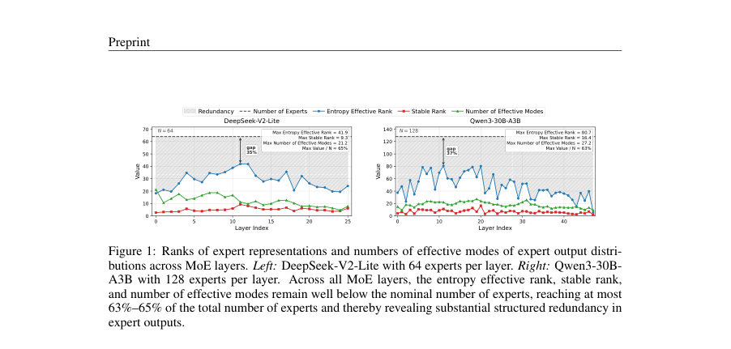
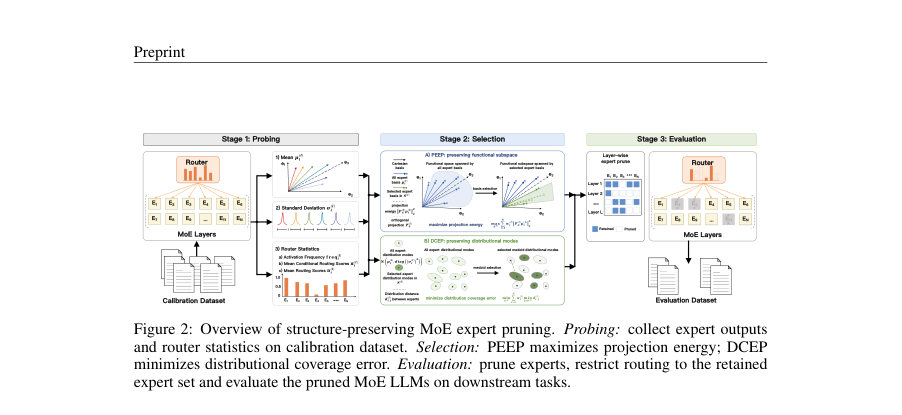
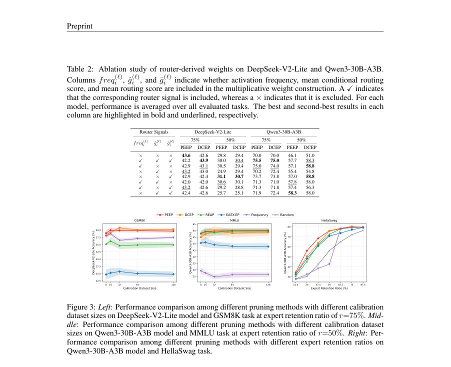

# Experts Exhibit Structured Redundancy: Structure-Preserving Expert Pruning for Mixture-of-Experts Large Language Models

- **게시일:** 2026-11-02
- **arXiv:** [2610.41236v1](http://arxiv.org/abs/2610.41236v1) · [PDF](https://arxiv.org/pdf/2610.41236v1)
- **저자:** Tian Wang, Yongding Tao, Yihong Dong, Xiaoming Wu, Ying Guo, Ge Li
- **분야:** cs.AI
- **선정 점수:** 5.62
- **선정 이유:** 최근성 0.4, 인용 영향 0.0 (인용 0회), 저자 영향 0.0 (최고 h-index 0), AI 주제 적합성 2.6, 개발자 관심 0.8, 학술 신호 0.3, 오픈 웨이트·주요 연구조직 신호 1.6

[← 2026-11-02 목록으로 돌아가기](../daily/2026-11-02.html)

<!-- paper-visuals:start -->
## 주요 Figure

> 원문 PDF에서 실제 Figure 캡션과 그림 영역이 함께 확인된 자료만 자동 추출했다.

*Figure · 원문 PDF 4쪽 · Figure 1: Ranks of expert representations and numbers of effective modes of expert output distri-*

*Figure · 원문 PDF 5쪽 · Figure 2: Overview of structure-preserving MoE expert pruning. Probing: collect expert outputs*

*Figure · 원문 PDF 9쪽 · Figure 3: Left: Performance comparison among different pruning methods with different calibration*

<!-- paper-visuals:end -->

## 한 문장 요약

MoE 계층의 전문가 출력에서 관찰된 저차원·모드 중복성을 보존하는 방식으로 전문가 부분집합을 탐욕적으로 선택하는 구조 보존 전문가 프루닝(PEEP, DCEP)을 제안하여 저장/메모리 비용을 줄이되 성능 저하를 최소화한다.

## 해결하려는 문제

Sparse MoE LLM은 추론 시 활성화되는 전문가는 적지만 모든 전문가 매개변수를 저장해야 하므로 메모리 부담이 크다. 기존 전문가 프루닝 방법들은 주로 개별 전문가의 중요도를 독립적으로 점수화·정렬해 제거하거나(activation frequency, router score, activation norm 등), 전문가 조합을 탐색하는 비용이 큰 조합적 검색에 의존한다. 이들은 전문가들 간의 상호작용으로 형성되는 전체 구조(structure)를 보존하지 못할 수 있으며, 대규모 MoE(수십~수백 전문가/레이어)로 확장하기 어렵다. 본문은 '전문가 출력들이 구조적 중복(structured redundancy)을 갖는가', 그리고 이를 보존하면서 효율적으로 전문가를 선택(프루닝)할 수 있는가를 연구 질문으로 제시한다.

## 핵심 기여

- MoE 전문가 출력에서 기능적 부분공간(functional subspace) 및 분포 기하(distributional geometry) 관점의 구조적 중복을 규명하고, 엔트로피 유효 랭크(entropy effective rank), 안정 랭크(stable rank), 분포 모드의 유효 개수(effective modes)가 명목상의 전문가 수보다 상당히 낮음을 실험적으로 제시했다.
- 전문가 프루닝을 '구조 보존 구조 보존 전문가 부분집합 선택(structure-preserving subset selection)' 문제로 재정식화하고, 조합적 탐색을 피하는 효율적인 탐욕적(greedy) 최적화 전략을 제시했다.
- 구현 가능한 두 가지 알고리즘을 제안: PEEP(Projection Energy Expert Pruning)는 가중 투영 에너지를 최대화해 기능적 부분공간을 보존하고, DCEP(Distributional Coverage Expert Pruning)는 가중 커버리지 오차를 최소화해 분포 기하를 보존한다.
- 두 방법 모두 라우터(router)에서 유도한 가중치(활성 빈도, 조건부 평균 라우터 점수, 전체 평균 라우터 점수)를 사전(prior)으로 도입하여 전역 구조(전문가 간 관계)와 개별 전문가 중요도를 동시에 반영한다.
- DeepSeek-V2-Lite(64 experts/layer)와 Qwen3-30B-A3B(128 experts/layer)에서 유지비율 r=75% 및 r=50% 조건으로 다양한 일반·수리 추론 벤치마크에서 기존 SOTA(예: REAP, EASY-EP 등)보다 평균 성능이 우수함을 보였다.

## 접근 방법

* 아키텍처/데이터 수집: 원본 MoE 모델의 각 MoE 레이어에서 캘리브레이션 데이터(예: 32개 샘플)를 한 번 순전파하여 각 전문가 i에 대해 출력의 평균 µ_i 와 표준편차 σ_i, 그리고 라우터 통계(활성 빈도 freq_i, 조건부 평균 라우터 점수 ĝ_i, 전체 평균 라우터 점수 ḡ_i)를 수집한다.
* 분포 근사: 각 전문가 출력 분포를 대각 공분산을 갖는 가우시안 N(µ_i, diag(σ_i^2))으로 근사한다.
* 거리/유사도: 전문가 i, j 간 분포 거리로 제곱 2-워서스타인 거리 d_{i,j} = \|\|µ_i-µ_j\|\|^2 + \|\|σ_i-σ_j\|\|^2 를 사용하고, 이를 exp(-d/(c·τ)) 형태의 커널로 변환하여 스펙트럼 참여비(참여비율)를 통해 유효 모드 수를 추정한다.
* PEEP (Algorithm 1): 전문가의 평균 출력들을 행렬 W ∈ R^{N×d}로 구성하고, 라우터 유도 가중치 w ∈ R^N_+를 이용해 가중 그램 행렬 C = W^T diag(w) W 을 계산한다.
* 목표는 선택된 전문가 집합 S의 부분공간에 대한 가중 투영 에너지 합을 최대화(또는 투영 오차를 최소화)하는 것으로, 탐욕적 절차로 매 단계에서 현재 선택 집합으로 설명되지 않는 정규화 잔여 벡터 q_j 를 구하고 ∆_j = q_j^T C q_j 를 계산하여 최대 이득 전문가를 추가한다.
* DCEP (Algorithm 2): 전문가 분포를 medoid 관점에서 커버하도록 선택한다.
* 초기에는 각 전문가 i의 현재 최단거리 δ_i = +∞로 두고, 후보 j를 추가했을 때의 가중 합 거리 감소량 ∆_j = Σ_i w_i (δ_i - min(δ_i, d_{i,j})) 를 계산하여 최대 이득 전문가를 반복적으로 추가한다.
* 가중치 구성: 기본적으로 세 라우터 신호를 (정규화 후) 곱하여 w_i 를 구성(예: w_i ∝ freq_i · ĝ_i · ḡ_i), 실험에서는 활성 빈도 단독 또는 조합을 사용해 성능을 조사함.
* 프루닝 절차: 각 레이어별로 S(ℓ) 을 결정한 후 모델의 라우터를 해당 레이어에서 오직 S(ℓ) 내부 전문가들로만 라우팅하도록 제한하여 평가한다.

## 주요 결과

- 구조적 중복 관찰(본문 그림 및 수치): DeepSeek-V2-Lite (N=64)에서 관찰된 최대값들 — Max Entropy Effective Rank = 41.9, Max Stable Rank = 9.3, Max Number of Effective Modes = 21.2 (최대 값/ N ≈ 65%). Qwen3-30B-A3B (N=128)에서는 Max Entropy Effective Rank = 80.7, Max Stable Rank = 16.4, Max Number of Effective Modes = 27.2 (최대 값/ N ≈ 63%). 이는 엔트로피 유효 랭크·안정 랭크·유효 모드 수가 명목 전문가 수보다 현저히 낮음을 의미한다.
- 주요 실험 설정: 모델들 — DeepSeek-V2-Lite, Qwen3-30B-A3B; 유지비율 r ∈ {75%, 50%}; 일반 벤치마크 — HellaSwag, ARC-Challenge, MMLU, C-Eval; 수리 추론 벤치마크 — GSM8K, MATH500, AIME24, AIME25. 캘리브레이션: 보통 32 샘플(다양성: 8/16/32/64/128 실험) 사용. 베이스라인: Random, Frequency, EASY-EP, REAP 등.
- 정량 성능(핵심 비교, Table 1 및 본문 강조): Qwen3-30B-A3B, r=75%: PEEP 수리 추론 평균 78.6%로 REAP 대비 +3.5%p 우세하며(원문: unpruned 79.9%로부터 -1.3%p 차이). Qwen3-30B-A3B, r=50%: DCEP 수리 추론 평균 60.9%로 REAP(57.3%) 대비 +3.6%p 향상. DeepSeek-V2-Lite, r=75%: PEEP/DCEP가 대부분의 벤치마크에서 기존 방법들보다 우세하거나 동등한 평균 성능을 기록(예: 일반 평균 약 51.0–51.2%, REAP 51.0% 동일 수준, 수리 평균 PEEP 26.5%, DCEP 26.7% vs REAP 21.9%).
- 캘리브레이션 민감도: 캘리브레이션 샘플 수를 32로 사용하면 결과가 안정적이며, 64나 128로 증가시켜도 일관된 개선은 관찰되지 않음(Fig.3 및 Appendix C).
- 라우터 가중치의 영향: 활성 빈도와 평균 라우터 점수는 유용한 가중치 신호로 작용함을 보이는 소거 실험(Table 2, 3, 4).

## 한계

- 저자가 명시한 한계: 논문 본문에서 직접 ‘광범위한 하이퍼파라미터(예: tolerance ϵ, 스케일링 인자 c)나 구체적 후처리(재미세조정 등) 설정의 일반화는 보증하지 않음’이라는 명시적 문구는 없으나, 재현성 섹션에서 소스코드를 보조자료로 제공한다고 밝히고 있어 구현 세부는 코드에 의존함을 명시했다.
- 본문에서 확인되는 제약 및 한계(분명히 본문에서 확인 가능한 사항):
- 실험 범위 제한: 평가가 DeepSeek-V2-Lite와 Qwen3-30B-A3B 두 모델에 국한되어 있으며(각각 64·128 전문가/레이어), 다른 MoE 아키텍처·규모·훈련·라우터 정책에서의 일반화는 추가 실험이 필요하다.
- 탐욕적 선택의 근사성: PEEP·DCEP는 조합적 최적해를 피하기 위해 탐욕적 알고리즘을 사용하므로 전역 최적을 보장하지 않으며, 매우 공격적인 프루닝(r 작거나 매우 낮은 K)에서는 성능 저하가 뚜렷하다(본문의 '공격적인 프루닝은 성능 저하' 기술 및 Fig.6). 이는 탐욕적 휴리스틱의 한계임이 본문에서 드러난다.  

## 개발자 관점

- 재현을 위해 필요한 최소 절차: (1) 캘리브레이션 데이터(원문 권장: 32 샘플)를 모델에 순전파하여 각 레이어별 전문가 출력의 평균 µ_i와 표준편차 σ_i 및 라우터 통계(freq_i, ĝ_i, ḡ_i)를 수집한다. (2) PEEP: W 행렬 구성(W의 행/열 구성은 본문 Eq.7 참조), 가중 그램 C = W^T diag(w) W 계산, 알고리즘1의 탐욕적 직교 잔여 선택 구현. (3) DCEP: 각 전문가 간 d_{i,j} 계산(Eq.11), 알고리즘2의 가중 medoid 탐욕적 선택 구현. (4) 선택된 전문가 집합으로 라우터를 제한하고 downstream 평가.
- 캘리브레이션 비용·규모: 본문 실험은 32개의 캘리브레이션 샘플로도 안정적 결과를 얻었으므로, 운영 환경에서는 우선 소규모 캘리브 세트로 시험 후 필요시 증분적으로 늘리는 전략이 비용-효율적이다.
- 확장성·연산 비용: PEEP는 W (N×d)와 C (d×d) 연산을 필요로 하고 DCEP는 N×N 거리 행렬을 계산하므로 레이어의 전문가 수 N·차원 d에 따라 메모리·시간 비용이 결정된다. 탐욕적 방식은 조합적 탐색보다는 확장성이 좋으나, N이 매우 클 경우 거리 행렬·그램 계산 비용을 고려해야 한다.
- 운영·배포 주의: (1) 공격적 프루닝 시 성능 저하가 크므로 유지비율 r을 안전 마진(예: 75% 우선)으로 설정하고 점진적으로 줄일 것. (2) 라우터 분포가 특정 도메인에서 크게 편향되면 라우터 기반 가중치가 결과에 큰 영향(본문의 ablation 참조)을 미치므로 도메인별 캘리브레이션 검증이 필요하다.
- 코드·재현성: 저자들이 보조자료로 코드 제공을 약속했으므로, 구현 시 알고리즘(Alg.1/2)과 라우터 가중치 구성(활성 빈도·평균 점수 조합)을 그대로 따라하면 본문 결과를 재현할 가능성이 높다.

**근거 범위:** 이 분석은 제공된 논문 PDF 본문(제목, 본문 섹션 1–7, 알고리즘 1·2, 표·그림·부록 A–E)을 근거로 작성되었음. 수치(예: Figure 1의 랭크 값, Table 1의 성능 수치)는 본문 표·그림에서 직접 추출하였고, 세부 구현 파라미터(예: 알고리즘의 tolerance ϵ의 구체값, 일부 실험의 랜덤 시드)는 본문에 명시되지 않아 보조자료(제공된 소스코드) 또는 저자에게 확인해야 정확히 재현할 수 있다.
