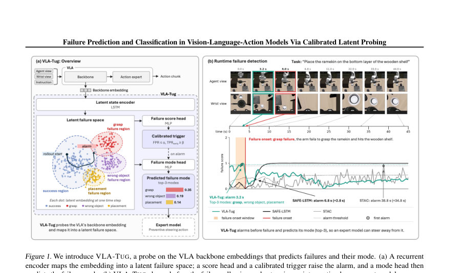
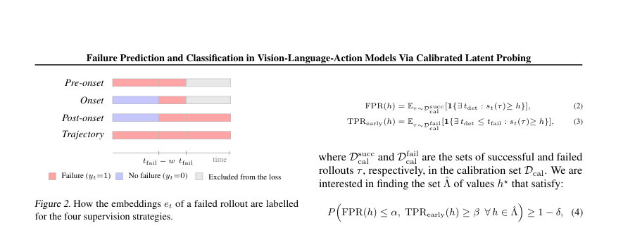
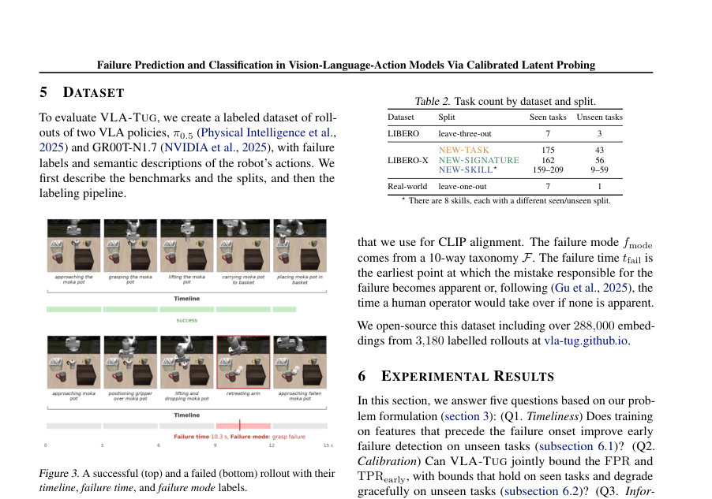

# Failure Prediction and Classification in Vision-Language-Action Models Via Calibrated Latent Probing

- **게시일:** 2026-11-08
- **arXiv:** [2611.08425v1](http://arxiv.org/abs/2611.08425v1) · [PDF](https://arxiv.org/pdf/2611.08425v1)
- **저자:** Michal P. Podolinsky, Yunhao Yang, Daniel Little, Hong Lu, Rohan Siva, Olin Goudey, Neel P. Bhatt, Matthias Scheutz, Ufuk Topcu
- **분야:** cs.RO, cs.AI
- **선정 점수:** 5.73
- **선정 이유:** 최근성 0.5, 인용 영향 0.0 (인용 0회), 저자 영향 2.0 (최고 h-index 55), AI 주제 적합성 2.0, 개발자 관심 0.5, 학술 신호 0.8, 오픈 웨이트·주요 연구조직 신호 0.0

[← 2026-11-08 목록으로 돌아가기](../daily/2026-11-08.html)

<!-- paper-visuals:start -->
## 주요 Figure

> 원문 PDF에서 실제 Figure 캡션과 그림 영역이 함께 확인된 자료만 자동 추출했다.

*Figure · 원문 PDF 2쪽 · Figure 1. We introduce VLA-TUG, a probe on the VLA backbone embeddings that predicts failures and their mode. (a) A recurrent*

*Figure · 원문 PDF 5쪽 · Figure 2. How the embeddings et of a failed rollout are labelled*

*Figure · 원문 PDF 6쪽 · Figure 3. A successful (top) and a failed (bottom) rollout with their*

<!-- paper-visuals:end -->

## 한 문장 요약

VLA-TUG는 VLA 백본의 잠재 표현을 경량의 시퀀스 프로브로 감시하여 실패를 사전 예측하고 실패 모드를 분류하며, Learn-then-Test 기반의 공동 보정으로 FPR(오경보)과 조기 TPR(조기 검출)을 동시에 보장하려는 실시간 배포 가능 모니터링 방법이다.

## 해결하려는 문제

비전-언어-액션(VLA) 모델은 분포 이동에서 예기치 않은 실패가 발생하기 쉽고, 실제 시스템에서는 실시간성(미리 실패를 탐지), 정보성(실패 원인 제공), 보정성(오경보·미검출률에 대한 확률적 보증), 효율성(엣지에서 동작할 연산 비용)이 모두 요구된다. 기존 방법들은 주로 단일 기준(예: FPR)만 보정하거나 실패 발생 후의 신호에 의존해 시의적절한(사전) 경고를 제공하지 못하고, 실패 모드 예측을 제공하지 못해 목표 지향적 조치(steering)를 지원하지 못한다.

## 핵심 기여

- VLA-TUG: VLA 백본 임베딩에 단일층 LSTM(256 hidden)을 적용하고 세 개의 MLP 헤드(실패 점수, 실패 모드(10way), CLIP 정렬)를 둔 경량 프로브를 제안하여 사전 실패 탐지와 실패 모드 추론을 실시간(추가 지연 <1 ms/step)으로 수행한다.
- 사전-발병(pre-onset) 감독 손실을 강조하여 실패 발생 전에 탐지할 수 있도록 학습하는 방법을 제시하고, 이 방식이 분포 이동(미지의 작업)에 대해 조기 탐지 성능을 향상시킴을 보였다.
- Learn-then-Test(LTT)을 활용해 FPR과 TPRearly를 동시에 보정(공동 보정)하는 절차를 도입하여 보정된 임계값이 보고한 목표를 만족하는지 사전 판단(때로는 'abstain')할 수 있게 함으로써 배치/배포 전 안전성 해석을 제공한다.
- 실험적 검증: 228개의 시뮬레이션 작업과 8개 실세계 작업으로 구성된 데이터에서 VLA-TUG가 강력한 학습 기반 베이스라인 대비 조기 검출 곡선 아래 면적을 최대 30% 개선하고, 보정된 기준은 보이는(held-out seen) 경우 모든 인증 실행에서 유지되며, 미지 작업들에 대해서도 보다 높은 비율(실험에서 FPR 기준 40–86%의 실행에서 보존)로 유지됨을 보였다.
- 데이터셋 공개: 3,180개의 주석된 에피소드와 약 289k 정책-스텝 임베딩을 공개하여 후속 연구를 지원함.

## 접근 방법

* 입력과 표준화: 매 정책 스텝마다 VLA 백본의 세 모달리티(에이전트 카메라, 손목 카메라, 지시문) 토큰을 각각 평균화해 2048차원씩 합쳐 6144차원 et를 구성한다.
* 아키텍처: single-layer LSTM(256 hidden)이 시퀀스를 인코딩하고, 세 개의 MLP 헤드가 공유된 LSTM 상태 ut를 읽는다.
* 실패 점수 헤드: gs(ut)에 시그모이드를 취해 스칼라 st를 출력한다.
* 실패 모드 헤드: gm(ut)로 10클래스 소프트맥스를 출력한다.
* CLIP 정렬 헤드: gc(ut)는 64차원 PCA로 축소한 CLIP 텍스트 임베딩과 InfoNCE로 정렬된다.
* 학습목표: L = Lscore + λm Lmode + λc LCLIP, λm=λc=1, Lscore는 단계별 이진 크로스엔트로피(훈련세트의 음/양 비로 가중치), Lmode는 실패 단계들에 대한 클래스 균형화된 크로스엔트로피, LCLIP은 대조손실이다.
* 감독 레이블링 전략: 실패 롤아웃의 임베딩에 대해 네 가지 라벨링( pre-onset, onset, post-onset, trajectory )을 비교하고, 'pre-onset' (tfail 이전 스텝을 양성으로 레이블링)이 조기 탐지에 가장 유리하다고 주장한다.
* 보정(캘리브레이션): Learn-then-Test(LTT, δ=0.1)을 사용해 FPR≤α와 TPRearly≥β를 동시에 검정한다.
* 후보 임계값 그리드를 sigmoid(z), z∈[-9,9]로 생성하고 다중 시작 고정 시퀀스 검사(S=40)로 허용 임계값 집합을 선택한 뒤 TPRearly를 최대화하는 h⋆를 택하거나 허용 임계값이 없으면 abstain한다.
* 성능지표: FPR, TPRearly( td et ≤ tfail ), AUROCearly은 TPRearly-vs-FPR 곡선의 FPR∈[0,0.4] 영역 아래 면적(정규화)으로 사용한다.

## 주요 결과

- 데이터셋 및 실험 설정: π0.5와 GR00T-N1.7 두 VLA 정책의 백본 임베딩을 사용해 총 3,180 에피소드(≈289k 임베딩)를 라벨링하여 시뮬레이션( LIBERO, LIBERO-Occ, LIBERO-X )과 8개 실세계 작업에서 평가했다.
- 조기 탐지(시의성): pre-onset 감독을 사용한 VLA-TUG는 보지 않은 작업(unseen)에서 가장 강력한 학습 기반 베이스라인(SAFE-LSTM 등)에 대해 AUROCearly(0–40% FPR 영역) 기준으로 최대 30%p(문맥상: area 증가)까지 개선을 보였다. 구체적 예로 LIBERO-X의 NEW-SIGNATURE 및 NEW-SKILL 설정에서 격차가 커졌다(본문 Table 3, VLA-TUG의 unseen 값들이 베이스라인보다 우수).
- 보정(공동 보정): LTT로 공동 보정한 경우 보정된 임계값들에 대해 보이는(held-out seen) 에피소드에서는 모든 인증된 실행에서 FPR과 TPRearly 목표가 유지되었고(‘모든 인증 실행’이라는 서술), 미지 작업들에 대해서도 FPR 목표는 실험 실행의 40–86%에서, TPRearly 목표는 57–90%에서 유지되었다. 반면 기존 보정 방법(예: max-conformal, functional conformal)은 unseen에서 FPR 목표를 만족하는 실행 비율이 최대 21%에 불과했다(본문 서술).
- 정보성(실패 모드): VLA-TUG의 모드 헤드는 실패 모드(top-3)를 예측하여 미지 작업에서 다수 기반(majority) 기준보다 top-3 정확도를 최대 44%p 향상시켰고(본문의 최대 향상치 주장), 실전 적용 시 세 후보 안에 진짜 모드가 포함될 확률을 높여 모드별 맞춤 개입을 가능하게 했다.
- 효율성 및 실시간성: 프로브는 6.6M 파라미터(약 26.5 MB)를 가지며, RTX 4090 기준 훈련 시간 6.8 s, 캘리브레이션은 CPU에서 목표 쌍 당 ≤2 ms, 추론시 GPU에서 스텝당 추가 지연 0.12 ms(실측), CPU에서 0.9 ms로 정책 호출에 미치는 오버헤드는 1% 미만이다. 라벨링 비용은 전체 주석에 대해 약 $50 미만으로 저렴하다고 보고되었다.

## 한계

- 저자가 명시한 한계: 보정 보증은 캘리브레이션 데이터와 테스트 데이터 간의 교환 가능성(exchangeability)에 의존하며, 분포 이동이 커질수록 이 가정이 약해진다(본문에서 저자 언급).
- 저자가 명시한 한계: 백본 임베딩의 어떤 층(layer)이 실패 예측 신호를 가장 잘 담는지에 대한 체계적 분석을 수행하지 않았다(논문에서 향후 연구로 제시).
- 저자가 명시한 한계: steering(개입) 구성은 본문에서 휴리스틱 기반으로만 시연되었고, 강건성이나 일반성 측면에서 정량적 평가를 수행하지 않았다.
- 추가 제약(실험에서 드러남): 실세계(로봇) 실험의 캘리브레이션 세트는 성공 샘플 수가 작아(캘리브레이션 성공수가 12–14개 수준), 보정 결과와 FPR曲線이 잡음이 클 수 있으며 이로 인해 일부 보정 방법의 적용 가능성이 제한된다(본문 설명).

## 개발자 관점

- 입력 전처리: 매 스텝에서 agent camera, wrist camera, instruction 토큰을 평균화해 각각 2048차원 벡터로 만들고 이를 연결해 6144차원 et를 사용하므로 동일한 형태의 임베딩을 확보해야 동일한 프로브를 재현할 수 있다.
- 프로브 아키텍처·하이퍼파라미터: single-layer LSTM(256), 각 헤드 MLP(은닉 64, ReLU), 실패 점수는 sigmoid, 모드 head는 10-class softmax, CLIP 정렬은 64-d PCA+InfoNCE. 학습은 Adam lr=3e-4, batch size=32, λm=λc=1, 최대 100 epoch, 얼리스톱(patience=15)로 재현 가능하다.
- 감독 라벨링 권장: 실패 시간을 수동 또는 LLM 보조로 어노테이션하고 'pre-onset' 레이블링( tfail 이전 스텝을 양성으로 설정)을 사용하면 조기 탐지 성능이 개선된다. 따라서 시스템 운용 전 실패 시간 어노테이션 파이프라인을 설계해야 한다(논문은 Gemini 기반 자동화 파이프라인 사용 및 저비용 보고).
- 보정 적용·운용: 실배포 전 Learn-then-Test를 통해 공동 FPR/TPRearly 목표를 검정하면 해당 목표를 실질적으로 만족할 수 있는지 미리 판단 가능하다(지원 불가 시 abstain). 배포 환경에서는 캘리브레이션-테스트 분포 불일치가 있을 수 있으므로 캘리브레이션 데이터의 대표성 유지 또는 온라인으로 발생률(π) 추정하는 메커니즘을 고려해야 한다(본문에서 PPV bound 의존성 지적).
- 배포 비용·실시간성: 프로브는 작고(6.6M 파라미터) 추론 오버헤드가 작아(0.12 ms/step GPU), VLA 정책 호출 주기 안에 들어갈 수 있으므로 엣지 디바이스 병행 운영이 현실적이다. 하지만 일부 거리 기반 베이스라인(k-NN 등)은 스토리지·지연 비용이 크게 증가하므로 주의해야 한다.

**근거 범위:** 이 분석은 제공된 논문 PDF 본문(페이지 1–27)의 텍스트를 근거로 작성하였다. 본문에 있는 표와 수치, 캘리브레이션 및 실험 세부사항을 직접 인용했으며, 본문에 명시되지 않은 세부 구현은 추정하지 않았다. PDF 추출 과정에서 표기상의 간단한 편집·줄바꿈 차이 또는 부수적 보조자료(코드·추가 부록)에만 존재하는 세부값은 반영되지 않았을 수 있다.
