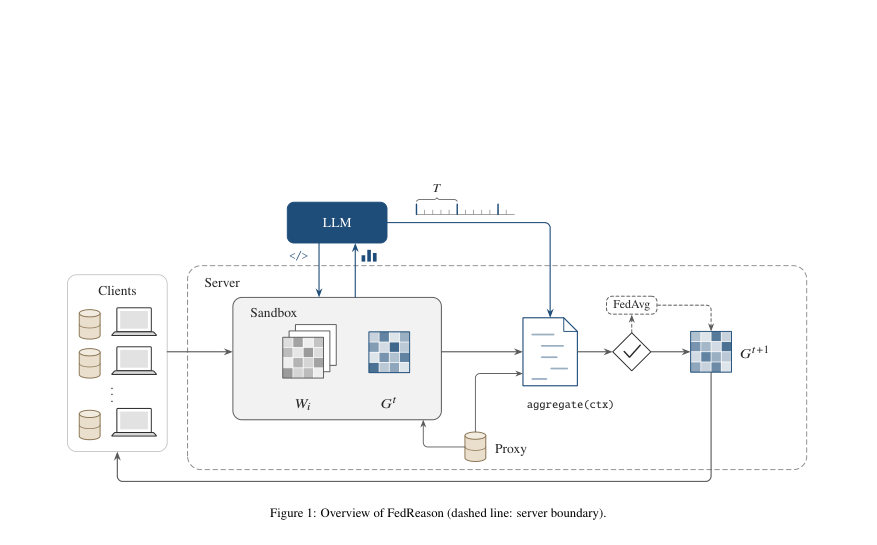
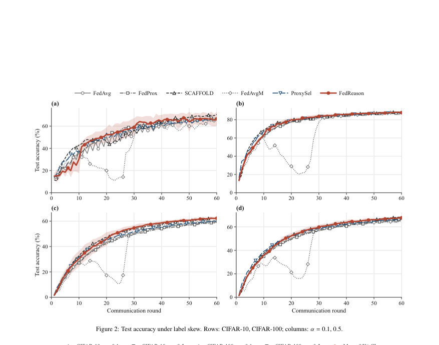
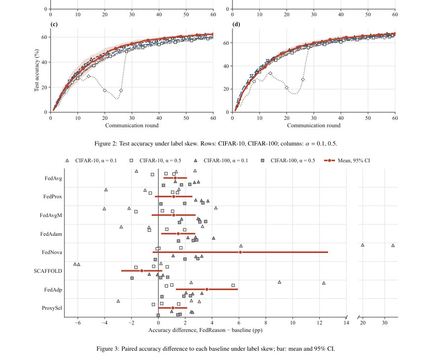

# FedReason: Large Language Models as Weight-Space Meta-Aggregators for Heterogeneous Federated Learning

- **게시일:** 2026-11-07
- **arXiv:** [2611.08383v1](http://arxiv.org/abs/2611.08383v1) · [PDF](https://arxiv.org/pdf/2611.08383v1)
- **저자:** Ali Mohammadi Ruzbahani, Abbas Yazdinejad, Hadis Karimipour
- **분야:** cs.CR, cs.AI
- **선정 점수:** 5.09
- **선정 이유:** 최근성 0.7, 인용 영향 0.0 (인용 0회), 저자 영향 0.0 (최고 h-index 0), AI 주제 적합성 3.0, 개발자 관심 0.2, 학술 신호 0.3, 오픈 웨이트·주요 연구조직 신호 0.8

[← 2026-11-07 목록으로 돌아가기](../daily/2026-11-07.html)

<!-- paper-visuals:start -->
## 주요 Figure

> 원문 PDF에서 실제 Figure 캡션과 그림 영역이 함께 확인된 자료만 자동 추출했다.

*Figure · 원문 PDF 2쪽 · Figure 1: Overview of FedReason (dashed line: server boundary).*

*Figure · 원문 PDF 10쪽 · Figure 2: Test accuracy under label skew. Rows: CIFAR-10, CIFAR-100; columns: α = 0.1, 0.5.*

*Figure · 원문 PDF 10쪽 · Figure 3: Paired accuracy difference to each baseline under label skew; bar: mean and 95% CI.*

<!-- paper-visuals:end -->

## 한 문장 요약

서버가 클라이언트 모델의 가중치를 읽고 제한된 샌드박스에서 코드를 실행하는 대형언어모델(LLM)이 라운드마다(주기적으로) 가중치 결합 규칙을 프로그램으로 생성해 연속적·비학습 방식으로 연합학습의 집계 규칙을 동적으로 선택하는 방법(FedReason)을 제안한다.

## 해결하려는 문제

기존 연합학습(FL) 서버는 고정된 집계 규칙을 사용하며, 각 규칙은 특정 종류의 이질성(레이블 편향, 모델 폭(폭 조절) 이질성, 악의적 클라이언트 등)에 대해 설계되어 있다. 실제 배포에서는 어떤 이질성이 있을지 사전에 알기 어렵고 서버 측에서 추가 파라미터(서버 학습)를 학습하지 못하도록 제약된 경우에도 상황에 맞는 집계 규칙을 동적으로 선택할 방법이 필요하다. 본문은 'LLM이 클라이언트 모델의 가중치(원시 텐서는 외부로 나가지 않음)를 서버 내부 샌드박스에서 분석하고, 소수의 프록시 평가만으로 집계 함수를 프로그램으로 생성하여 성능을 개선할 수 있는지'를 묻는다.

## 핵심 기여

- 메타-집계(meta-aggregation) 문제를 공식화하여 서버가 학습을 하지 않으면서 LLM 호출 비용 및 프록시 평가 예산 내에서 라운드 동안 실행할 집계 연산자(프로그램)를 선택하는 문제 설정을 제시함(Section 3).
- FedReason 프레임워크를 제안: LLM이 서버 사이드 샌드박스에서 가중치 수준 도구를 호출해 진단을 수행하고 aggregate(ctx) 형태의 파이썬 프로그램을 제출하면 서버가 이를 검증·실행하고 실패 시 FedAvg로 폴백하는 체계를 설계함(Section 4).
- Claude Opus 5.5를 이용해 CIFAR-10/100, ResNet-18 기반으로 레이블 스큐(Dirichlet α∈{0.1,0.5}), 폭-이질성(sub-model widths), 두 종류의 Byzantine 공격을 포함해 총 168 실험을 14개 베이스라인과 비교하며 평가함(Sections 5–6).
- LLM이 실제로 어떤 규칙을 채택했는지(클리핑, 음의 코사인 다운웨이트, 클래스별 처리, 서버 모멘텀 등)를 120개의 수용된 프로그램에 대해 감사(audit)하고 무게 없이 메트릭만 제공하거나 프록시 피드백을 제거하는 등 약인자(ablations)를 통해 분석을 수행함(Sections 6–7).

## 접근 방법

* FedReason 운용 절차(본문 기준):
* 설정: K=10 클라이언트, R=60 라운드, T=10(LLM 호출 주기), 서버는 클래스 균형의 프록시 데이터 P(500 이미지)를 보유.
* 클라이언트는 로컬 훈련만 수행.
* LLM 인터페이스: 서버 내부 제한된 파이썬 샌드박스의 도구 두 가지(python 실행, submit_policy로 aggregate(ctx) 제출).
* 샌드박스는 읽기 전용으로 현재 전역모델 G, 클라이언트 모델 W, 업데이트 U, 메타데이터(meta), 프록시 평가 기록과 계층 테이블, helper 함수들(코사인, 가중 평균, 단일 행 평균, update_matrix, server step 등)을 제공한다.
* LLM은 코드의 출력(프린트된 문자열, 최대 6,000자)만 읽는다.
* 자동미분·파일·네트워크 등은 차단된다.
* 예산 제약: 각 호출(Invocation)당 분석용 프록시 평가 최대 binv = 6회, 제출된 프로그램은 라운드당 eprog ≤ 3회 프록시 평가 허용.
* 각 호출은 최대 10 모델 요청(턴)으로 제한.
* 프로그램: LLM이 제출하는 함수 aggregate(ctx)는 ctx(예: ctx.G, ctx.W, ctx.update_matrix(), ctx.meta, ctx.proxy_eval, ctx.memory 등)를 입력으로 받아 서버가 요구하는 키·텐서형태로 새 모델을 반환한다.
* 제출 시 서버가 현재 라운드에서 드라이런(검증)을 하고 실패하면 최대 3회 재제출 허용.
* 매 라운드 서버는 출력 키·형상·유한성·분산 비음수·업데이트 노름(최대 클라이언트 업데이트의 10배까지) 등 유효성 검사를 하며 실패 시 FedAvg로 폴백하고 ctx.memory를 롤백한다.
* 운영 원리: LLM은 매 T 라운드마다 호출되어 이후 T 라운드 동안 실행될 프로그램을 제출한다(첫 호출은 라운드 1).
* 제출된 프로그램은 각 라운드에서 실행되어 G_{t+1}을 계산한다.
* 모든 LLM 호출과 반환 코드는 서버에 로그된다.
* 전체 가중치 텐서는 외부로 전송되지 않는다.
* 시스템 프롬프트: 고정된 프롬프트가 LLM 역할, 금지사항(서버에서의 학습 금지 등), 프록시 노이즈(500개 이미지로 ±≈2pp 노이즈) 및 휴리스틱(레이어별 기하, 분류기 행 기반 증거 등)을 제공한다.
* 안전 장치: 출력 확인(검증 후 폴백), 샌드박스 제한, API 콜 로깅, 출력 분량 제한.
* 프라이버시 한계는 논문에서 명시적으로 논의됨.

## 주요 결과

- 실험 전반: 논문은 CIFAR-10/100, ResNet-18, K=10, 60 라운드, 전체 비교 실험 168회(14개 베이스라인 포함)을 수행했다(Section 5). 각 FedReason 주 실행은 T=10으로 호출되어 6회 호출(라운드 1,11,21,31,41,51)을 사용했고, 모든 주요 실행에서(본문: 24 FedReason 실행) 150회의 호출이 모두 첫 제출에서 드라이런을 통과했고 서버가 FedAvg로 폴백한 라운드는 없었다(Section 6).
- 레이블 스큐(CIFAR-10/100, α∈{0.1,0.5}): 12개의 설정·시드 쌍에서 FedReason은 FedAvg 대비 평균 +1.26 percentage points(pp) 향상(95% CI 0.38 to 2.14), 10승 2패(윌콕슨 p=0.016, Holm 보정 후 0.097). 동일한 라운드당 프록시 예산을 쓴 고정 규칙 선택 제어(ProxySel) 대비 평균 +1.08 pp(95% CI 0.01 to 2.15), 9승 1무 2패(p=0.064). CIFAR-100에서는 서버측만 바꾸는 규칙 중 가장 높은 정확도를 기록했음(Section 6.1, Table 2).
- 서버-클라이언트 훈련 변경 방법과 비교: SCAFFOLD(클라이언트 쪽 수정)는 모든 네 설정에서 가장 우수했고, FedReason은 SCAFFOLD에 대해 평균 -1.24 pp로 뒤처졌다(95% CI −2.77 to +0.29; 5승 1무 6패).
- 모델 폭 이질성(서브모델): CIFAR-100에서 각 폭(×1, ×1/2, ×1/4)에서 FedReason이 가장 높은 성능을 보였고(예: ×1:47.73%, ×1/2:48.63%, ×1/4:46.14%, 평균 47.50%), 같은 추출(leading-channel static extraction)을 쓰는 HeteroFL 대비 전폭 평균에서 우수했다(Section 6.1, Table 3). CIFAR-10에서는 한 시드에서 일부 정당한 클라이언트 배제에 따른 불안정으로 폭별 성능이 흔들렸다.
- Byzantine 공격(3/10 악성 클라이언트): 사인-플립(sign-flip) 공격에서 FedAvg와 ProxySel은 무작위 수준에 머문 반면, FedReason은 공격자에게 평균 0.43%만 할당하고 두 시드에서 라운드 1부터 세 공격자를 모두 제외했음(F1=1.00). FLTrust와 비교하면, 라벨-플립(label-flip) 공격에서 FedReason은 평균 정확도 84.94%로 FLTrust(86.20%)보다 약 1.26 pp 낮았다(Section 6.2, Table 4). 공격 탐지에서 일부 라운드 규칙이 진단 오동작을 일으킨 경우도 보고됨(Section 6.2).            
    
    "프록시·무게 의존성" 실험(약인자): 프록시 피드백을 제거한 단일 시드 실험에서 정확도가 73.84%에서 38.84%로 급락(−35.00 pp, Table 5), 무게 접근을 제거(메트릭-온리)하면 67.86%로 하락(Section 6.3, Table 5). 즉 프록시 피드백이 성능에 결정적 역할을 함을 보였다.
    - API 비용 및 지연: 평균적인 60라운드 실험은 평균 $0.79(범위 0.56–1.26) API 비용이 들었고(실행당), 단일 호출 평균 비용은 약 $0.13 ± 0.05, 호출당 평균 응답 시간 약 41 ± 18초, 프로그램 실행은 라운드당 약 1.6초를 추가했다고 보고되었다(Section 6.3 및 Fig.7). 다만 Table 5의 특정 ablation 실행에서는 1.22 USD 등 다른 수치도 보고됨.

## 한계

- 저자가 명시한 한계(본문 Section 7):
  - 프록시 세트의 가정: 실험은 클래스 균형이고 테스트 분포를 대표하는 소규모(500 이미지) 프록시 세트에 의존한다. 편향되거나 오표기 또는 불균형한 프록시 세트는 FedReason과 비교 규칙들(예: FLTrust, ProxySel)을 오도할 수 있다.
  - 설명의 신뢰성: LLM이 출력한 합리화(rationale)와 노트는 모델이 기록한 로그로서 검증된 설명이 아니며 일부 진단은 잘못될 수 있다.
  - 프라이버시·보안: 전체 가중치 텐서는 외부로 나가지 않지만 LLM이 요청한 출력(샌드박스 통계)은 클라이언트 레이블 구성을 드러낼 수 있다. 또한 LLM 제공자는 추가적 잠재적 정보 수신자가 된다.
  - 결합 불가능성: FedReason은 개별 클라이언트 업데이트를 필요로 하므로 보안 집계(secure aggregation)와 결합할 수 없다.
  - 공격 모델 제한: 적응형 공격(메타-집계 규칙을 알고 업데이트를 조작하는 공격)은 실험에서 평가되지 않았다.
  - 실험 범위: 10개 클라이언트(풀 참여), 두 데이터셋, 하나의 아키텍처(ResNet-18), 60라운드, 하나의 LLM에 한정되어 있어 더 큰 크기의 크로스-디바이스 시나리오·부분 참여·대형 모델 등으로 일반화되지 않음.
- 본문에서 확인 가능한 제약(분석에 근거한 한계):
  - LLM 출력의 비결정성 및 버전 문제: 사용한 모델(Claude Opus 5.5)은 샘플링 파라미터를 제공하지 않아 출력 비결정성이 존재하고, 제공자가 모델을 변경하면 동작이 달라질 수 있다.
  - 재현제한: ablation 실험들은 주로 단일 시드로 수행되어 통계적 견고성이 제한된다(논문도 이를 언급). 또한 서버에서 수용된 프로그램을 기록해 재생할 수 있으나 논문은 실제 재생 실험을 보고하지 않았다.
  - 샌드박스는 완전한 보안 경계 아님: 제한된 파이썬 네임스페이스만으로는 충분하지 않으며 운영체제 수준의 격리 필요성이 제시됨.

## 개발자 관점

- 재현 가능성: 논문은 코드·설정·LLM 대화 로그·생성된 프로그램을 공개 예정이라고 명시하므로 이를 확보하면 실험 재현 가능성이 높다(Section 'Data availability').
- 샌드박스 설계: LLM에게는 샌드박스 내에서 helper 함수(코사인, update_matrix, weighted_average, class-row 평균 등)와 제한된 I/O만 제공하고, 출력 길이(6,000자)·임포트 허용 목록·자동미분·파일·네트워크 접근 차단 등 다중 안전 조치를 두어야 한다(Section 4.1). 운영환경에서는 OS 레벨 격리 추가 권장.
- 검증·폴백: LLM이 제출한 프로그램은 드라이런으로 검증하고(키·형상·유한성·분산·업데이트 노름 제한 등), 실패 시 FedAvg로 안전하게 폴백하도록 구현해야 한다(Algorithm 1). ctx.memory의 롤백 메커니즘도 필요하다.
- 프록시 데이터와 예산 관리: 프록시 전방향 평가가 성능에 결정적 영향을 미치므로 프록시 세트의 구성(클래스 균형 여부)과 평가 예산(bin v, bprog)을 관리·문서화해야 한다. ProxySel 대비 FedReason의 이점은 동일 예산에서의 더 자유로운 평가 사용(단일 클라이언트 모델 평가 등)에 기인함.
- 로그·감사: 모든 LLM 호출, 프로그램 제출, 드라이런 결과, 채택된 프로그램과 그 라운드 범위를 로그로 남겨 사후 감사와 재생을 지원해야 한다(논문에서 모든 결정을 코드와 라벨로 기록한다고 명시). 라벨-기반 증거는 LLM의 진단을 뒷받침하되 자동 신뢰하지 말고 추가 검증 필요성 있음(논문 사례에서 거짓 진단 발생).    
    
    모델·비용·지연 고려: 60라운드 실행당 평균 API 비용이 작음(논문 내 $0.56–1.26 범위, 평균 $0.79 보고). 각 호출 평균 비용 ≈ $0.13와 호출당 응답 시간 ≈ 41s를 고려해 호출 주기 T을 라운드 시간과 비용 균형에 맞춰 설계할 것(Section 6.3, Fig.7). 프로그램 실행 자체는 라운드당 약 1.6s 추가 오버헤드임.
    - LLM이 자주 사용하는 패턴: 감사 결과 대부분 프로그램이 업데이트 노름 클리핑(98%), 업데이트 방향 불일치 클라이언트 다운웨이트(91%), ctx.memory 기반 의심 카운터 유지 등(100% 예외 핸들러로 FedAvg 폴백)을 사용했다. 개발자는 이러한 빌딩블록을 미리 준비하고 검증 루틴을 마련하면 유용하다(Section 6.3).    
    - 보안·프라이버시 대책: 샌드박스 출력에 노출되는 통계가 레이블 구성을 유추할 수 있으므로 출력 필터링·노이즈 주입·온프레미스 오픈모델 검토 등 추가 보호를 고려해야 한다(Section 4.3, 7).

**근거 범위:** 이 분석은 제출된 논문 PDF 본문 전체(본문, 표, 알고리즘, Appendix)의 텍스트를 근거로 작성했다. 숫자·수치는 논문에 직접 명시된 값만 사용했다(예: 평균 성능 개선치, API 비용, 실험 설정). 다만 논문 내 일부 비용 수치(예: Table 5의 특정 실행 비용 1.22 USD와 본문 평균 0.79 USD)는 서로 다른 실행·ablation 맥락에서 보고되므로 문맥을 함께 기재했다. ablation 실험의 통계적 강건성(단일 시드 사용 등)과 모델·시나리오 일반화 여부는 논문이 명시한 제한 사항이므로 분석에 반영했다.
